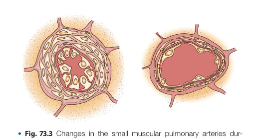
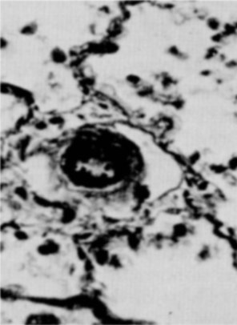
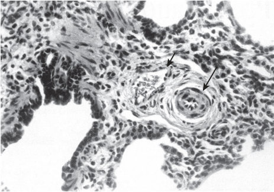
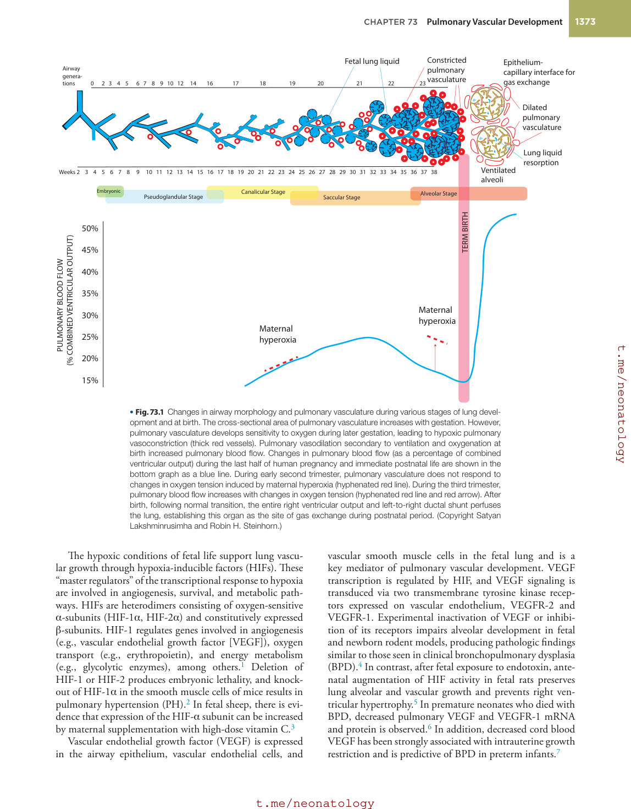
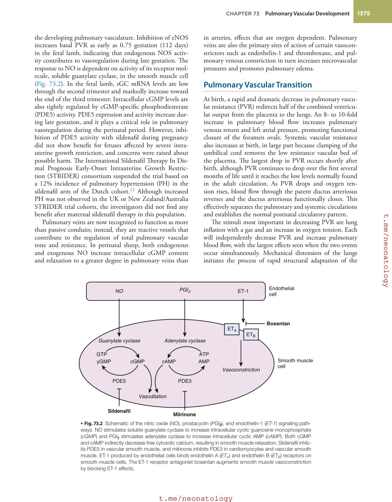
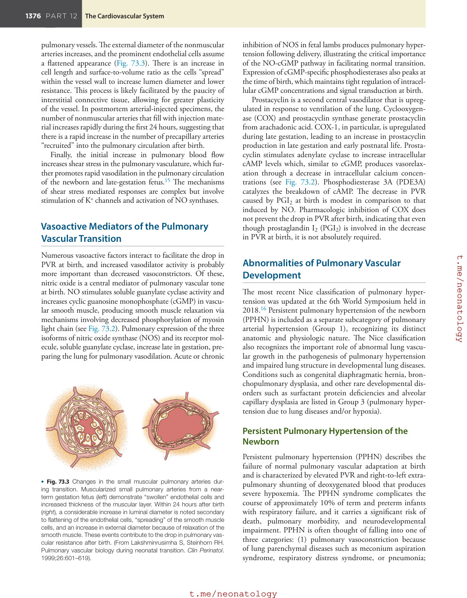
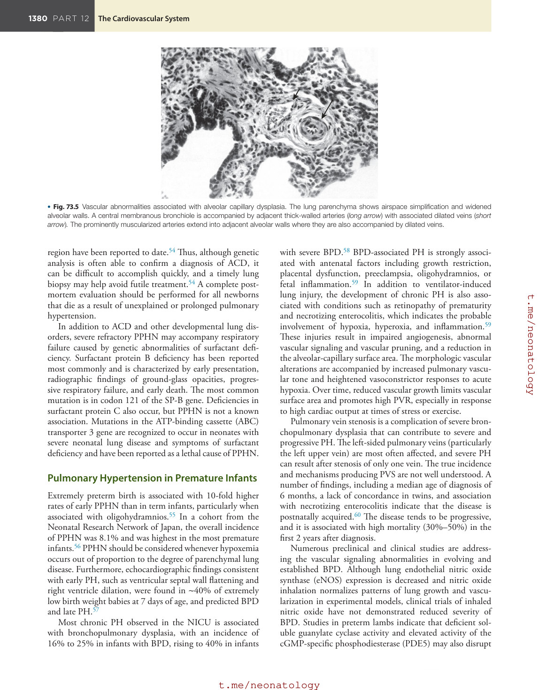
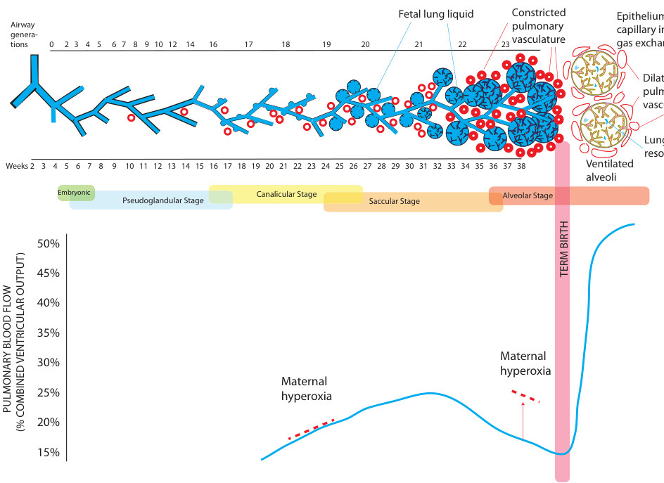
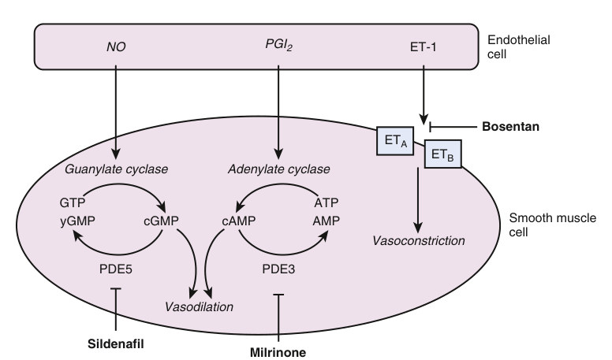

# 73. Pulmonary Vascular Development
> [Source credits](../../SOURCE_CREDITS.md).

## Study pillars

### Vascular growth

Vasculogenesis. Vasculogenesis forms vessels de novo from progenitors; angiogenesis extends existing vessels.

PDF p. 1372

### Fetal resistance

Placental gas exchange permits high pulmonary resistance and low lung flow. High fetal resistance directs blood through fetal channels while the placenta provides oxygenation.

PDF p. 1374

### Transition

A particularly large fall in pulmonary vascular resistance. Inflation and oxygenation independently lower resistance, with the greatest effects together; lung flow and pulmonary venous return increase.

PDF p. 1375

### Nitric oxide signaling

Cyclic GMP. Nitric oxide activates soluble guanylate cyclase, increasing cGMP and promoting relaxation.

PDF p. 1376

### Coupled development

Vascular and alveolar development are closely coupled. The chapter describes coordinated vascular and airway growth and experimental impairment of alveolarization after VEGF inhibition.

PDF p. 1373

## Full source extraction

# 73. Pulmonary Vascular Development
> Source attribution: [Source credits](../../SOURCE_CREDITS.md).

## PDF page 1372 | printed page 1372

73 Pulmonary Vascular Development

### ROBIN H. STEINHORN

Survival of the newborn is dependent upon rapid adaptation of the fetal cardiopulmonary system to the demands of extrauterine life. Normal development of pulmonary vascular structure and function through prenatal and early postnatal life prepares the lung to perform its basic physiologic function of gas exchange across a thin blood-gas interface. As postnatal development continues, normal lung function and growth depends on sustained low pulmonary vascular resistance (PVR). Abnormalities of vascular development can result in persistent pulmonary hypertension of the newborn (PPHN), a life-threatening syndrome characterized by hypoxemia associated with sustained elevation of PVR and extrapulmonary right-to-left shunting across persistent fetal channels.

### Fetal Pulmonary Vascular Development

### Structural Development

Pulmonary vascular development begins during the embryonic phase of lung development and is highly coordinated with airway growth (Fig. 73.1). Endodermal lung buds arise from the ventral aspect of the foregut by the fifth week of gestation. The pulmonary trunk, derived from the truncus arteriosus, divides into the aorta and pulmonary trunks by 8 weeks of gestation by growth of the spiral aortopulmonary septum. The pulmonary trunk connects to the pulmonary arch arteries, which are derived from the sixth branchial arch arteries. The mesenchyme surrounding the lung bud then develops into the vascular network. In the human lung, the pre-acinar vascular branching pattern is present by the 20th week of fetal life. The intra-acinar arteries form later in fetal life and after birth during the alveolar phase of lung development. Development of the pulmonary veins parallels that of the arteries, but they arise separately from the loose mesenchyme of the lung septa and subsequently connect to the left atrium.

Angiogenesis and vasculogenesis are the two primary morphogenetic processes that form the pulmonary vasculature. Vasculogenesis is the de novo organization of

1372

blood vessels produced by the migration and differentiation of endothelial progenitor cells or angioblasts. These cells migrate, adhere, and form vascular tubes that become arteries, veins, or lymphatics depending on the local growth factors within the mesenchyme. Endothelial precursor cells, after differentiation into the endothelium, contribute either to the expression of smooth muscle phenotype in the surrounding mesenchyme or they recruit existing smooth muscle cells to the forming vessel. Angiogenesis refers to the budding, sprouting, and branching of existing vessels to form new ones. Vasculogenesis and angiogenesis are not necessarily sequential processes and both may occur early in lung development, perhaps giving rise to heterogeneous cell populations in the vasculature. In addition, a process of vascular fusion has been described that connects the angiogenic and vasculogenic vessels to allow for expansion of the vascular network.

Fetal lung septation and alveolarization begin at around 32 to 36 weeks’ gestation in the human fetus and continue well into postnatal life. During this process, vascular growth and branching are tightly coupled with the growth and branching of the airway epithelium. The number of small pulmonary arteries increases, both in absolute terms and per unit volume of the lung. For example, in fetal lambs, lung weight increases by fourfold during the last trimester, whereas the number of small blood vessels in the lungs increases 40-fold. This dramatic increase in surface area of small blood vessels prepares the lungs to accept the 10-fold increase in blood per unit of lung that occurs at birth. During the final stages of vascular development, the pulmonary capillaries surround the thinning alveolar walls, providing the increased alveolar and capillary surface areas necessary to support gas exchange at birth. Lung blood vessels actively promote alveolar growth during development and contribute to the maintenance of alveolar structures throughout postnatal life, and disrupted development of one system will have important consequences on the development of the other. Antenatal or postnatal events that affect the developmental program of the fetal or newborn lung may contribute to defective pulmonary vascular development.

## PDF page 1373 | printed page 1373

Airway generations 0 2 3 4 5 6 7 8 9 10 12 14 16 17 18 19 20

Weeks 2 3 4 5 6 7 8 9 10 11 12 13 14 15 16 17 18 19 20 21 22 23 24 25 26 27 28 29 30 31 32 33 34 35 36 37 38

Canalicular Stage Saccular Stage Pseudoglandular Stage Embryonic

50%

(% COMBINED VENTRICULAR OUTPUT)

45%

PULMONARY BLOOD FLOW

40%

35%

30%

Maternal hyperoxia

25%

20%

15%

• Fig. 73.1 Changes in airway morphology and pulmonary vasculature during various stages of lung development and at birth. The cross-sectional area of pulmonary vasculature increases with gestation. However, pulmonary vasculature develops sensitivity to oxygen during later gestation, leading to hypoxic pulmonary vasoconstriction (thick red vessels). Pulmonary vasodilation secondary to ventilation and oxygenation at birth increased pulmonary blood flow. Changes in pulmonary blood flow (as a percentage of combined ventricular output) during the last half of human pregnancy and immediate postnatal life are shown in the bottom graph as a blue line. During early second trimester, pulmonary vasculature does not respond to changes in oxygen tension induced by maternal hyperoxia (hyphenated red line). During the third trimester, pulmonary blood flow increases with changes in oxygen tension (hyphenated red line and red arrow). After birth, following normal transition, the entire right ventricular output and left-to-right ductal shunt perfuses the lung, establishing this organ as the site of gas exchange during postnatal period. (Copyright Satyan Lakshminrusimha and Robin H. Steinhorn.)

The hypoxic conditions of fetal life support lung vascular growth through hypoxia-inducible factors (HIFs). These “master regulators” of the transcriptional response to hypoxia are involved in angiogenesis, survival, and metabolic pathways. HIFs are heterodimers consisting of oxygen-sensitive α-subunits (HIF-1α, HIF-2α) and constitutively expressed β-subunits. HIF-1 regulates genes involved in angiogenesis (e.g., vascular endothelial growth factor [VEGF]), oxygen transport (e.g., erythropoietin), and energy metabolism (e.g., glycolytic enzymes), among others.1 Deletion of HIF-1 or HIF-2 produces embryonic lethality, and knockout of HIF-1α in the smooth muscle cells of mice results in pulmonary hypertension (PH).2 In fetal sheep, there is evidence that expression of the HIF-α subunit can be increased by maternal supplementation with high-dose vitamin C.3

Vascular endothelial growth factor (VEGF) is expressed in the airway epithelium, vascular endothelial cells, and

Constricted pulmonary vasculature

Fetal lung liquid

Epitheliumcapillary interface for gas exchange

21 22 23

Dilated pulmonary vasculature

Lung liquid resorption

Ventilated alveoli

Alveolar Stage

TERM BIRTH

Maternal hyperoxia

vascular smooth muscle cells in the fetal lung and is a key mediator of pulmonary vascular development. VEGF transcription is regulated by HIF, and VEGF signaling is transduced via two transmembrane tyrosine kinase receptors expressed on vascular endothelium, VEGFR-2 and VEGFR-1. Experimental inactivation of VEGF or inhibition of its receptors impairs alveolar development in fetal and newborn rodent models, producing pathologic findings similar to those seen in clinical bronchopulmonary dysplasia (BPD).4 In contrast, after fetal exposure to endotoxin, antenatal augmentation of HIF activity in fetal rats preserves lung alveolar and vascular growth and prevents right ventricular hypertrophy.5 In premature neonates who died with BPD, decreased pulmonary VEGF and VEGFR-1 mRNA and protein is observed.6 In addition, decreased cord blood VEGF has been strongly associated with intrauterine growth restriction and is predictive of BPD in preterm infants.7

## PDF page 1374

VEGF-induced lung angiogenesis is in part mediated by nitric oxide (NO). Nitric oxide is best known for its role as a pulmonary vasodilator, but it also plays a key role in lung vascular growth during fetal and neonatal life. Lung endothelial NOS (eNOS) mRNA and protein are present in early fetal life in rats and sheep and increase with advancing gestation. The expression and activity of eNOS are regulated by hemodynamic forces, hormonal stimuli (e.g., estradiol), paracrine factors (including VEGF), substrate and cofactor availability, oxygen tension, and other factors. The lungs of late fetal and neonatal eNOS-deficient mice have striking abnormalities of vascularization and are more susceptible to failed vascular growth following exposure to mild hypoxia.8 Inhibition of VEGF receptors decreases lung eNOS protein expression and NO production, and lung vascular growth is restored by treatment with inhaled NO, although other evidence suggests that VEGF also affects vascular development through mechanisms independent of eNOS.

Numerous other transcription factors important to lung vascular development have been identified. For example, the Forkhead Box (Fox) family of transcription factors regulates expression of genes involved in cellular proliferation and differentiation. Newborn mice with low Foxf1 levels die with defects in lung vascularization and alveolarization, and FOXf1 haploinsufficiency is found in 40% of infants with alveolar capillary dysplasia, a lethal disorder of lung vascular development.9

### Mediators of Fetal Pulmonary Vascular Tone

During fetal life, pulmonary hypertension is physiologic and a necessity to maintain gas exchange via placental support. In the fetal lamb, pulmonary arterial blood has a PO2 of approximately 18 mm Hg and oxygen saturation of 50%. High pulmonary vascular resistance (PVR) permits only ∼16% of the combined ventricular output to be directed to the pulmonary vascular bed, whereas most of the fetal right ventricular output bypasses the lung via the foramen ovale and the ductus arteriosus and is directed to the descending aorta. The blood is then oxygenated in the placenta and returns to the body through the umbilical vein, with a PO2 of ∼32 to 35 mm Hg in lambs.

Multiple mechanisms maintain high PVR and low pulmonary blood flow in the fetus, including low oxygen tension, low basal production of vasodilators such as prostacyclin (PgI2) and NO, and increased production of vasoconstrictors. The fetal pulmonary circulation also exhibits a marked “myogenic response” as gestation progresses, meaning that the vasculature responds to vasodilatory stimuli with active vasoconstriction.

The low oxygen environment of the fetus plays a key role in maintaining high PVR. Maternal hyperoxygenation has no effect on human fetal pulmonary blood flow before 26 weeks’ gestation but produces significant increases between 31 and 36 weeks of gestation, suggesting the capacity of the pulmonary circulation to sense and respond to changes in oxygen tension is developmentally regulated. Extremely

preterm infants born before 26 weeks’ gestation also have much higher risk for pulmonary hypertension than those born at term gestation (2% vs. 0.2%). Because oxygen regulates activity of enzymes such as nitric oxide synthase and prostacyclin, the low oxygen environment of the fetus may maintain low production of these vasoactive mediators.

Pulmonary artery endothelial cells produce multiple vasoactive mediators that maintain the normal patterns of fetal pulmonary circulation. Proposed fetal pulmonary vasoconstrictors include endothelin-1 (ET-1) and lipid mediators such as thromboxane and leukotrienes C4 and D4, and platelet–activating factor, but none have been shown to play a central regulatory role. ET-1 is produced by vascular endothelium and acts on the ET-A receptors in the smooth muscle cell to induce vasoconstriction by increasing ionic calcium concentrations. A second endothelial receptor, ET-B, on the endothelial cell stimulates NO release and vasodilation. PreproET-1 mRNA (the precursor to ET-1) has been identified in fetal rat lung early in gestation, and high circulating ET-1 levels are present in umbilical cord blood. Although capable of both vasodilator and constrictor responses, ET-1 appears to primarily act as a pulmonary vasoconstrictor in the fetal pulmonary circulation.

Endogenous serotonin (5-HT) production also appears to contribute to the high PVR of the fetus. In fetal lambs, infusions of serotonin increase PVR, and infusions of ketanserin, a 5-HT 2A receptor antagonist, decrease fetal PVR.10 Conversely, brief infusions of selective serotonin reuptake inhibitors (SSRI), such as sertraline and fluoxetine, produce potent and sustained elevations of PVR. These findings suggest that 5-HT causes pulmonary vasoconstriction and contributes to maintenance of high PVR in the normal fetus through stimulation of 5-HT 2A receptors and Rho kinase activation. These findings have clinical implications for SSRI treatment for maternal depression.

Vascular smooth muscle contraction is regulated by intracellular Ca2+ levels; as they rise, myosin light-chain kinase (MLCK) is activated, which causes vascular smooth muscle contraction. RhoA/Rho kinase (ROCK) is a downstream signal transduction pathway that promotes vasoconstriction through inactivation of myosin light chain phosphatase, thus increasing calcium sensitivity of the smooth muscle cell and promoting the “myogenic response.” Hypoxia, antenatal ductal constriction, and endothelin have been shown to activate RhoA, which increases Ca2+ sensitivity of the contractile myofilaments in the vascular smooth muscle. In turn, Rho kinase activity maintains high PVR in the fetal lung, and its inhibition dilates the perinatal circulation by a mechanism independent of NO.11

As gestation progresses, NO and cyclic guanosine monophosphate (cGMP) become central to the emergence of pulmonary vascular reactivity, and prostaglandins appear to play a less important role than NO in regulating fetal and transitional pulmonary vascular tone. Chronic inhibition of VEGF receptors down-regulates eNOS and induces pulmonary hypertension in the late gestation fetus,12 indicating the importance of both in the development and function of

## PDF page 1375 | printed page 1375

the developing pulmonary vasculature. Inhibition of eNOS increases basal PVR as early as 0.75 gestation (112 days) in the fetal lamb, indicating that endogenous NOS activity contributes to vasoregulation during late gestation. The response to NO is dependent on activity of its receptor molecule, soluble guanylate cyclase, in the smooth muscle cell (Fig. 73.2). In the fetal lamb, sGC mRNA levels are low through the second trimester and markedly increase toward the end of the third trimester. Intracellular cGMP levels are also tightly regulated by cGMP-specific phosphodiesterase (PDE5) activity. PDE5 expression and activity increase during late gestation, and it plays a critical role in pulmonary vasoregulation during the perinatal period. However, inhibition of PDE5 activity with sildenafil during pregnancy did not show benefit for fetuses affected by severe intrauterine growth restriction, and concerns were raised about possible harm. The International Sildenafil Therapy In Dismal Prognosis Early-Onset Intrauterine Growth Restriction (STRIDER) consortium suspended the trial based on a 12% incidence of pulmonary hypertension (PH) in the sildenafil arm of the Dutch cohort.13 Although increased PH was not observed in the UK or New Zealand/Australia STRIDER trial cohorts, the investigators did not find any benefit after maternal sildenafil therapy in this population.

Pulmonary veins are now recognized to function as more than passive conduits; instead, they are reactive vessels that contribute to the regulation of total pulmonary vascular tone and resistance. In perinatal sheep, both endogenous and exogenous NO increase intracellular cGMP content and relaxation to a greater degree in pulmonary veins than

NO PGI2

Adenylate cyclase Guanylate cyclase

cAMP cGMP yGMP GTP ATP

AMP

PDE5 PDE3

Vasodilation

Sildenafil Milrinone

• Fig. 73.2 Schematic of the nitric oxide (NO), prostacyclin (PGI2), and endothelin-1 (ET-1) signaling pathways. NO stimulates soluble guanylate cyclase to increase intracellular cyclic guanosine monophosphate (cGMP) and PGI2 stimulates adenylate cyclase to increase intracellular cyclic AMP (cAMP). Both cGMP and cAMP indirectly decrease free cytosolic calcium, resulting in smooth muscle relaxation. Sildenafil inhibits PDE5 in vascular smooth muscle, and milrinone inhibits PDE3 in cardiomyocytes and vascular smooth muscle. ET-1 produced by endothelial cells binds endothelin A (ETA) and endothelin B (ETB) receptors on smooth muscle cells. The ET-1 receptor antagonist bosentan augments smooth muscle vasoconstriction by blocking ET-1 effects.

in arteries, effects that are oxygen dependent. Pulmonary veins are also the primary sites of action of certain vasoconstrictors such as endothelin-1 and thromboxane, and pulmonary venous constriction in turn increases microvascular pressures and promotes pulmonary edema.

### Pulmonary Vascular Transition

At birth, a rapid and dramatic decrease in pulmonary vascular resistance (PVR) redirects half of the combined ventricular output from the placenta to the lungs. An 8- to 10-fold increase in pulmonary blood flow increases pulmonary venous return and left atrial pressure, promoting functional closure of the foramen ovale. Systemic vascular resistance also increases at birth, in large part because clamping of the umbilical cord removes the low resistance vascular bed of the placenta. The largest drop in PVR occurs shortly after birth, although PVR continues to drop over the first several months of life until it reaches the low levels normally found in the adult circulation. As PVR drops and oxygen tension rises, blood flow through the patent ductus arteriosus reverses and the ductus arteriosus functionally closes. This effectively separates the pulmonary and systemic circulations and establishes the normal postnatal circulatory pattern.

The stimuli most important in decreasing PVR are lung inflation with a gas and an increase in oxygen tension. Each will independently decrease PVR and increase pulmonary blood flow, with the largest effects seen when the two events occur simultaneously. Mechanical distension of the lungs initiates the process of rapid structural adaptation of the

Endothelial cell

ET-1

Bosentan

ETA ETB

Smooth muscle cell

Vasoconstriction

## PDF page 1376

pulmonary vessels. The external diameter of the nonmuscular arteries increases, and the prominent endothelial cells assume a flattened appearance (Fig. 73.3). There is an increase in cell length and surface-to-volume ratio as the cells “spread” within the vessel wall to increase lumen diameter and lower resistance. This process is likely facilitated by the paucity of interstitial connective tissue, allowing for greater plasticity of the vessel. In postmortem arterial-injected specimens, the number of nonmuscular arteries that fill with injection material increases rapidly during the first 24 hours, suggesting that there is a rapid increase in the number of precapillary arteries “recruited” into the pulmonary circulation after birth.

Finally, the initial increase in pulmonary blood flow increases shear stress in the pulmonary vasculature, which further promotes rapid vasodilation in the pulmonary circulation of the newborn and late-gestation fetus.15 The mechanisms of shear stress mediated responses are complex but involve stimulation of K+ channels and activation of NO synthases.

### Vasoactive Mediators of the Pulmonary Vascular Transition

Numerous vasoactive factors interact to facilitate the drop in PVR at birth, and increased vasodilator activity is probably more important than decreased vasoconstrictors. Of these, nitric oxide is a central mediator of pulmonary vascular tone at birth. NO stimulates soluble guanylate cyclase activity and increases cyclic guanosine monophosphate (cGMP) in vascular smooth muscle, producing smooth muscle relaxation via mechanisms involving decreased phosphorylation of myosin light chain (see Fig. 73.2). Pulmonary expression of the three isoforms of nitric oxide synthase (NOS) and its receptor molecule, soluble guanylate cyclase, increase late in gestation, preparing the lung for pulmonary vasodilation. Acute or chronic

• Fig. 73.3 Changes in the small muscular pulmonary arteries during transition. Muscularized small pulmonary arteries from a nearterm gestation fetus (left) demonstrate “swollen” endothelial cells and increased thickness of the muscular layer. Within 24 hours after birth (right), a considerable increase in luminal diameter is noted secondary to flattening of the endothelial cells, “spreading” of the smooth muscle cells, and an increase in external diameter because of relaxation of the smooth muscle. These events contribute to the drop in pulmonary vascular resistance after birth. (From Lakshminrusimha S, Steinhorn RH. Pulmonary vascular biology during neonatal transition. Clin Perinatol. 1999;26:601–619).

inhibition of NOS in fetal lambs produces pulmonary hypertension following delivery, illustrating the critical importance of the NO-cGMP pathway in facilitating normal transition. Expression of cGMP-specific phosphodiesterases also peaks at the time of birth, which maintains tight regulation of intracellular cGMP concentrations and signal transduction at birth.

Prostacyclin is a second central vasodilator that is upregulated in response to ventilation of the lung. Cyclooxygenase (COX) and prostacyclin synthase generate prostacyclin from arachadonic acid. COX-1, in particular, is upregulated during late gestation, leading to an increase in prostacyclin production in late gestation and early postnatal life. Prostacyclin stimulates adenylate cyclase to increase intracellular cAMP levels which, similar to cGMP, produces vasorelaxation through a decrease in intracellular calcium concentrations (see Fig. 73.2). Phosphodiesterase 3A (PDE3A) catalyzes the breakdown of cAMP. The decrease in PVR caused by PGI2 at birth is modest in comparison to that induced by NO. Pharmacologic inhibition of COX does not prevent the drop in PVR after birth, indicating that even though prostaglandin I2 (PGI2) is involved in the decrease in PVR at birth, it is not absolutely required.

### Abnormalities of Pulmonary Vascular Development

The most recent Nice classification of pulmonary hypertension was updated at the 6th World Symposium held in 2018.16 Persistent pulmonary hypertension of the newborn (PPHN) is included as a separate subcategory of pulmonary arterial hypertension (Group 1), recognizing its distinct anatomic and physiologic nature. The Nice classification also recognizes the important role of abnormal lung vascular growth in the pathogenesis of pulmonary hypertension and impaired lung structure in developmental lung diseases. Conditions such as congenital diaphragmatic hernia, bronchopulmonary dysplasia, and other rare developmental disorders such as surfactant protein deficiencies and alveolar capillary dysplasia are listed in Group 3 (pulmonary hypertension due to lung diseases and/or hypoxia).

### Persistent Pulmonary Hypertension of the Newborn

Persistent pulmonary hypertension (PPHN) describes the failure of normal pulmonary vascular adaptation at birth and is characterized by elevated PVR and right-to-left extrapulmonary shunting of deoxygenated blood that produces severe hypoxemia. The PPHN syndrome complicates the course of approximately 10% of term and preterm infants with respiratory failure, and it carries a significant risk of death, pulmonary morbidity, and neurodevelopmental impairment. PPHN is often thought of falling into one of three categories: (1) pulmonary vasoconstriction because of lung parenchymal diseases such as meconium aspiration syndrome, respiratory distress syndrome, or pneumonia;

• Fig. 73.3 Changes in the small muscular pulmonary arteries during transition. Muscularized small pulmonary arteries from a nearterm gestation fetus (left) demonstrate “swollen” endothelial cells and increased thickness of the muscular layer. Within 24 hours after birth (right), a considerable increase in luminal diameter is noted secondary to flattening of the endothelial cells, “spreading” of the smooth muscle cells, and an increase in external diameter because of relaxation of the smooth muscle. These events contribute to the drop in pulmonary vascular resistance after birth. (From Lakshminrusimha S, Steinhorn RH. Pulmonary vascular biology during neonatal transition. Clin Perinatol. 1999;26:601–619).

## PDF page 1377 | printed page 1377

(2) normal parenchyma and remodeled pulmonary vasculature, also referred to as idiopathic PPHN; or (3) hypoplastic vasculature as seen in congenital diaphragmatic hernia. Although idiopathic pulmonary hypertension is responsible for only 10% to 20% of all infants with PPHN, severe cases of PPHN associated with parenchymal disease are almost always complicated by a significant degree of vascular remodeling.

Significant pulmonary vascular remodeling occurs antenatally in infants presenting with early, severe PPHN, characterized by vessel wall thickening and smooth muscle hyperplasia. An important feature includes extension of the smooth muscle to the level of the intra-acinar arteries (Fig. 73.4), which does not normally occur until much later in postnatal development. Because it is difficult to gain sufficient mechanistic insights in the clinical setting, animal models have provided many of the insights into the antenatal and postnatal vascular abnormalities associated with PPHN.

Potential causes of antenatal remodeling of the pulmonary vasculature include environmental exposures or genetic risk factors. Maternal use of salicylates was one of the earliest triggers identified for PPHN, likely because of their blockade of prostaglandins, which are mediators of ductal patency and pulmonary vascular reactivity. Although early reports suggested a strong association between clinically significant PPHN and the maternal use of nonsteroidal anti-inflammatory drugs (NSAIDs; aspirin, ibuprofen, naproxen), a large multicenter epidemiologic study found no significant association between PPHN risk and maternal use of nonaspirin NSAIDs or ibuprofen use during third trimester.17

Alveolar wall Alveolar duct

Respiratory bronchiole Terminal bronchiole

Arteries

Intra-acinar Pre-acinar

Normals

Term fetus 3 days 9 days

1 day

### PPHN

1 day 3 days 3 days 3 days 6 days • Fig. 73.4 Vascular maldevelopment is a hallmark of persistent pulmonary hypertension of the newborn (PPHN). The pulmonary vessels show thickened walls with smooth muscle hyperplasia. Further, the smooth muscle extends to the level of the intra-acinar arteries, which does not normally occur until much later in the postnatal period. (From Murphy JD, Rabinovitch M, Goldstein JD, Reid LM. The structural basis of persistent pulmonary hypertension of the newborn infant. J Pediatr. 1981;98[6]:962–967).

Conflicting evidence exists whether maternal selective serotonin reuptake inhibitor (SSRI) use during pregnancy increases the risk of PPHN. Exposure of pregnant rats to fluoxetine produces pulmonary hypertension, hypoxia, and increased mortality in the pups.18 In human epidemiology studies, the use of SSRIs during the last half of pregnancy was associated with an increase in the incidence of PPHN, although some reports indicate the risk is modest when controlling for maternal depression.19,20 The mechanism by which SSRIs induce PPHN remains poorly understood, although animal data indicate that SSRIs induce concentration-dependent constriction of the ductus arteriosus.21 These findings are in agreement with data from a large Swedish registry, which suggested that SSRI-exposed infants are more likely to have idiopathic PPHN without lung disease.22 The severity of PPHN has not been well characterized, and at least one report found that neonatal mortality rates were not higher in SSRI-exposed versus nonexposed neonates with PPHN (3.4% vs. 8.3%, P = NS).22 A large meta-analysis of 11 studies and 156,978 pregnancies found that exposure to SSRIs was associated with a twofold increase for PPHN; sertraline had the lowest probability risk of all the antidepressants studied.23 Based on the lack of well-controlled studies, the FDA continues to recommend that health care professionals treat depression during pregnancy as clinically appropriate, weighing the potential risk of PPHN against the risks associated with lack of treatment of depression during pregnancy.

Unlike pulmonary hypertension in children or adults, PPHN is rarely familial and relatively few genetic risk factors have been identified. Genotype analysis of 88 neonates with documented PPHN found no differences in candidate genes associated with adult pulmonary hypertension,

Unmatched source image; PDF page 1377. Consult the original caption.

## PDF page 1378

including BMPR2 and nitric oxide synthase.24 The same study found PPHN was significantly associated with genetic variants for corticotropin releasing hormone receptor-1 (CRHR1) and CRH-binding protein and with increased levels of 17-hydroxyprogesterone. These data are supported by animal data indicating that antenatal and postnatal steroids reduce oxidant stress and normalize nitric oxide synthase and phosphodiesterase function in experimental PPHN.25,26 Endothelial cells generate NO from the precursor L-arginine, an amino acid supplied by the urea cycle. In term neonates with respiratory failure and PPHN, polymorphisms have been identified in six urea cycle enzyme genes, including carbamoyl-phosphate synthetase-1; additional clinical studies suggest these findings may be associated with low plasma citrulline and arginine concentrations.27 More recently, variants in the T-box transcription factor 4 gene (TBX4) have been reported in infants with prolonged pulmonary hypertension.28 Although the contribution of these novel variants to PPHN is not well understood, whole genome sequencing should be considered in infants with atypical or prolonged PPHN.

Children with Down syndrome (trisomy 21) commonly develop pulmonary hypertension in association with structural heart defects, and also have a 10- to 100-fold increased incidence of PPHN in the absence of cardiac disease.29 For instance, in a Dutch cohort with excellent early ascertainment of Down syndrome, PPHN was documented in 5.2% of the infants.30 Infants with Down syndrome are similarly overrepresented in the extracorporeal membrane oxygenation (ECMO) registry maintained by the Extracorporeal Life Support Organization, and their survival to discharge is significantly decreased compared to the general population. Recent evidence suggests that Down syndrome infants have left ventricular diastolic impairment, which is independently associated with measures of PH in the first week of life.31

Delivery by elective cesarean section delays the decrease in pulmonary arterial pressure and increases the risk of PPHN,32 and delivery before 39 weeks’ gestation likely amplifies this effect. When compared to matched controls, infants with PPHN are more likely to have been delivered by cesarean section. Maternal diabetes, asthma, Black or Asian race, and high body mass index are also important risk factors.33,34 The effect of early versus delayed cord clamping on the pulmonary vascular transition is not well understood. In preterm lambs, delayed cord clamping for 3 to 4 minutes until after ventilation is established improves cardiovascular function by increasing pulmonary venous return and left ventricular filling before cessation of umbilical venous return.35 Moreover, delayed cord clamping in lambs with congenital diaphragmatic hernia improved cardiopulmonary hemodynamics and enhanced the postnatal decrease in PVR.36

PPHN complicates the course of 25% of infants with perinatal asphyxia. Fetal hypoxemia, ischemia, acidosis, meconium aspiration, and ventricular dysfunction delay the fall in PVR and increase the risk for PPHN. Acute asphyxia

is associated with reversible pulmonary vasoconstriction, but chronic in utero asphyxia also induces pulmonary vascular remodeling.37 The adoption of therapeutic hypothermia for moderate or severe hypoxic ischemic encephalopathy (HIE) raised concerns about its capacity to induce or aggravate PPHN in asphyxiated infants. Deep hypothermia (temperature decreased to 32°C) increased mean pulmonary arterial pressure by 30% in neonatal lambs, and increased rates of PPHN and ECMO in human infants.38 However, the effect of moderate therapeutic hypothermia (33.5°C) on PVR appears to be more modest. Analyses of randomized trials found that moderate therapeutic hypothermia does not significantly increase the incidence of PPHN, although the presence of PPHN increases mortality for infants with HIE.39

Disruptions in the production or function of vasoactive mediators in the perinatal period will also lead to pulmonary vasoconstriction and/or remodeling. Data from animal models and human infants indicate that disruptions of the NO-cGMP, prostacyclin-cAMP, and endothelin signaling pathways are among those that play an important role in the vascular dysfunction associated with PPHN. The NOcGMP pathway has been a topic of particularly intense investigation over the last two decades, in part because of the ability to deliver inhaled nitric oxide (iNO) gas as a therapeutic agent. Decreased expression and activity of eNOS have been documented in animal models of PPHN, and decreased eNOS expression has been found in umbilical venous endothelial cell cultures from human infants with meconium staining who develop PPHN.40 Furthermore, PPHN is associated with “uncoupling” of the eNOS enzyme, which reduces synthesis of nitric oxide and promotes production of reactive oxygen species, such as superoxide. Downstream vascular abnormalities include reduced levels of the critical second messenger, cGMP. For instance, in vascular smooth muscle from lambs with experimental PPHN, reduced cGMP concentrations are generated in response to NO, in part because of reduced activity of soluble guanylate cyclase and increased activity of cGMPspecific phosphodiesterase (PDE5). PDE5 activity is also elevated in fetal lambs with chronic intrauterine PH, and striking increases in PDE5 activity emerge in response to mechanical ventilation and oxygen therapy, further driving down cGMP levels.41

Less is known about the role of abnormal prostacyclincAMP signaling in PPHN. Some data suggest that abnormal prostacyclin synthesis and downstream adenylate cyclase signaling occurs, analogous to the changes reported for NO-cGMP signaling. In addition, elevated production of the vasoconstrictor arachadonic acid metabolite, thromboxane, plays a role in pulmonary hypertension produced by chronic hypoxia.

Circulating levels of the potent vasoconstrictor endothelin (ET-1) are elevated in lambs and newborn infants with PPHN, and there is evidence that the balance of ET receptors is shifted to the vasoconstrictor (ET-A) pathways. In addition to stimulation of ET-A receptors, endothelin may

## PDF page 1379 | printed page 1379

affect vascular tone by increasing production of reactive oxygen species such as superoxide and hydrogen peroxide, which also act as vasoconstrictors. Elevated endothelin levels also correlated with worse outcomes and higher severity of pulmonary hypertension in infants with congenital diaphragmatic hernia.42

Oxidant stress plays an important role in the pathogenesis of PPHN both antenatally and following birth. An increase in reactive oxygen species such as superoxide and hydrogen peroxide in the smooth muscle and adventitia of pulmonary arteries has been demonstrated in neonatal animal models of pulmonary hypertension.43,44 Oxidant stress can be because of immature or dysfunctional antioxidant defense mechanisms (e.g., superoxide dismutase, catalase), increased activity of prooxidant enzymes such as nicotinamide adenine dinucleotide phosphate (NADPH) oxidase, and/or use of high concentrations of inspired oxygen. The resulting reactive oxygen species can cause pulmonary vasoconstriction and trigger vascular remodeling as seen in PPHN.45,46 Reactive oxygen species generated in response to hyperoxia can decrease eNOS expression and activity, decrease activity of soluble guanylate cyclase, and increase PDE5 activity, resulting in decreased cGMP levels.

### Congenital Diaphragmatic Hernia

Congenital diaphragmatic hernia (CDH) represents ∼8% of all major congenital anomalies and affects approximately 1 in 2500 to 3000 pregnancies when including patients identified by prenatal diagnosis. CDH includes abnormal diaphragm development, herniation of abdominal viscera into the chest, and a variable degree of lung hypoplasia. Herniation occurs most often in the posterolateral segments of the diaphragm, and 80% of the defects occur on the left side. CDH is associated with particularly severe pulmonary hypertension and has become the most common indication for extracorporeal membrane oxygenation (ECMO) in neonates.

Severe CDH develops early in the course of lung development. An arrest in the normal pattern of airway branching occurs in both lungs, resulting in reduced lung volume and impaired alveolarization. A similar developmental arrest occurs in pulmonary arterial branching, resulting in reduced cross-sectional area of the pulmonary vascular bed, thickened media and adventitia of small arterioles, and abnormal medial muscular hypertrophy extending distally to the level of the acinar arterioles. Although in utero lung compression by herniated viscera has been implicated as the primary mechanism responsible for producing the lung abnormalities of CDH, some evidence suggests that decreased pulmonary blood flow alone is sufficient to cause lung hypoplasia.47 After birth, PVR often remains at suprasystemic levels, causing extra-pulmonary right-to-left shunting across the foramen ovale and ductus arteriosus and profound hypoxemia. High PVR in the newborn with CDH is related to multiple factors, including the small cross-sectional area of pulmonary arteries, structural vascular remodeling,

vasoconstriction with altered reactivity, and LV dysfunction causing pulmonary venous hypertension. The mediators of altered pulmonary vascular reactivity in CDH are not well understood, although substantial evidence points to disruptions in NO-cGMP and endothelin signaling.42 Chronic pulmonary hypertension is commonly seen in infants with severe disease and is associated with persistently high endothelin levels.42

Abnormalities of cardiac development and function are now recognized as key components of the pathophysiology of CDH. The left ventricle, left atrium, and intraventricular septum are hypoplastic in infants that die of CDH relative to age-matched controls,48 perhaps because of low fetal and postnatal pulmonary blood flow as well as compression by the hypertensive right ventricle. Left ventricular hypoplasia and dysfunction increase left atrial and pulmonary venous pressures, and the resulting pulmonary venous hypertension will diminish the clinical response to inhaled NO during the first few days of life. Some infants may have exceptionally severe left ventricular dysfunction that leads to dependence on the right ventricle for systemic perfusion; this subset may benefit from clinical strategies that maintain patency of the ductus arteriosus and/or use agents such as milrinone to target LV dysfunction.49

### Alveolar Capillary Dysplasia

Alveolar capillary dysplasia (ACD, with or without misalignment of the pulmonary veins) is a rare form of interstitial lung disease that presents as severe PH and hypoxemia early in life. The etiology of ACD is believed to be caused by a genetic defect or early antenatal insult that prevents normal development of the pulmonary capillary bed. Findings include remodeling of the pulmonary arterioles, simplification of the alveolar architecture, and development of congested “misaligned pulmonary veins” residing in the same adventitial sheath (Fig. 73.5). These so-called veins are now recognized to be bronchopulmonary anastomoses that link the systemic and pulmonary circulations and bypass the alveolar capillary bed.50 ACD is generally a fatal disease, even with extracorporeal support, although there are limited case reports of long-term survival, mostly after lung transplantation.51 More than 50% of infants present with other anomalies, most commonly affecting the genitourinary, cardiovascular, and gastrointestinal systems. Although ACD classically presents in the neonatal period, late presentation at several months of life has been reported. Approximately 10% of reported ACD cases have a familial association, and in 40% or more of infants with ACD, mutations or deletions in the transcription factor forkhead box F1 gene (FOXF1) deletions upstream to FOXF1 are identified.52,53 Murine models of FOXF1 deficiency have similar defects in lung vascularization and alveolarization, further demonstrating the importance of the FoxF1 protein in embryonic development of the pulmonary vasculature. More than 70 FOXF1 variants and 60 copy number variant (CNV) deletions involving the gene and/or its upstream regulatory

## PDF page 1380

• Fig. 73.5 Vascular abnormalities associated with alveolar capillary dysplasia. The lung parenchyma shows airspace simplification and widened alveolar walls. A central membranous bronchiole is accompanied by adjacent thick-walled arteries (long arrow) with associated dilated veins (short arrow). The prominently muscularized arteries extend into adjacent alveolar walls where they are also accompanied by dilated veins.

region have been reported to date.54 Thus, although genetic analysis is often able to confirm a diagnosis of ACD, it can be difficult to accomplish quickly, and a timely lung biopsy may help avoid futile treatment.54 A complete postmortem evaluation should be performed for all newborns that die as a result of unexplained or prolonged pulmonary hypertension.

In addition to ACD and other developmental lung disorders, severe refractory PPHN may accompany respiratory failure caused by genetic abnormalities of surfactant deficiency. Surfactant protein B deficiency has been reported most commonly and is characterized by early presentation, radiographic findings of ground-glass opacities, progressive respiratory failure, and early death. The most common mutation is in codon 121 of the SP-B gene. Deficiencies in surfactant protein C also occur, but PPHN is not a known association. Mutations in the ATP-binding cassette (ABC) transporter 3 gene are recognized to occur in neonates with severe neonatal lung disease and symptoms of surfactant deficiency and have been reported as a lethal cause of PPHN.

### Pulmonary Hypertension in Premature Infants

Extremely preterm birth is associated with 10-fold higher rates of early PPHN than in term infants, particularly when associated with oligohydramnios.55 In a cohort from the Neonatal Research Network of Japan, the overall incidence of PPHN was 8.1% and was highest in the most premature infants.56 PPHN should be considered whenever hypoxemia occurs out of proportion to the degree of parenchymal lung disease. Furthermore, echocardiographic findings consistent with early PH, such as ventricular septal wall flattening and right ventricle dilation, were found in ∼40% of extremely low birth weight babies at 7 days of age, and predicted BPD and late PH.57

Most chronic PH observed in the NICU is associated with bronchopulmonary dysplasia, with an incidence of 16% to 25% in infants with BPD, rising to 40% in infants

with severe BPD.58 BPD-associated PH is strongly associated with antenatal factors including growth restriction, placental dysfunction, preeclampsia, oligohydramnios, or fetal inflammation.59 In addition to ventilator-induced lung injury, the development of chronic PH is also associated with conditions such as retinopathy of prematurity and necrotizing enterocolitis, which indicates the probable involvement of hypoxia, hyperoxia, and inflammation.59 These injuries result in impaired angiogenesis, abnormal vascular signaling and vascular pruning, and a reduction in the alveolar-capillary surface area. The morphologic vascular alterations are accompanied by increased pulmonary vascular tone and heightened vasoconstrictor responses to acute hypoxia. Over time, reduced vascular growth limits vascular surface area and promotes high PVR, especially in response to high cardiac output at times of stress or exercise.

Pulmonary vein stenosis is a complication of severe bronchopulmonary dysplasia that can contribute to severe and progressive PH. The left-sided pulmonary veins (particularly the left upper vein) are most often affected, and severe PH can result after stenosis of only one vein. The true incidence and mechanisms producing PVS are not well understood. A number of findings, including a median age of diagnosis of 6 months, a lack of concordance in twins, and association with necrotizing enterocolitis indicate that the disease is postnatally acquired.60 The disease tends to be progressive, and it is associated with high mortality (30%–50%) in the first 2 years after diagnosis.

Numerous preclinical and clinical studies are addressing the vascular signaling abnormalities in evolving and established BPD. Although lung endothelial nitric oxide synthase (eNOS) expression is decreased and nitric oxide inhalation normalizes patterns of lung growth and vascularization in experimental models, clinical trials of inhaled nitric oxide have not demonstrated reduced severity of BPD. Studies in preterm lambs indicate that deficient soluble guanylate cyclase activity and elevated activity of the cGMP-specific phosphodiesterase (PDE5) may also disrupt

• Fig. 73.5 Vascular abnormalities associated with alveolar capillary dysplasia. The lung parenchyma shows airspace simplification and widened alveolar walls. A central membranous bronchiole is accompanied by adjacent thick-walled arteries (long arrow) with associated dilated veins (short arrow). The prominently muscularized arteries extend into adjacent alveolar walls where they are also accompanied by dilated veins.

## PDF page 1381 | printed page 1381

cGMP signaling, leading to new studies testing the safety and efficacy of sildenafil in prevention of BPD and chronic PH.61

### Clinical Therapy of Pulmonary Hypertension of the Newborn

PPHN presents in term or preterm infants with respiratory distress, labile oxygenation, differential saturation (higher SpO2 in the right upper extremity compared to a lower extremity), or profound hypoxemia despite oxygen and mechanical ventilation. Echocardiography is mandatory to establish an accurate diagnosis of PPHN, identify extra pulmonary shunting, and rule out congenital heart disease. Findings that confirm PPHN include bidirectional or predominantly right-toleft shunting across the foramen ovale or ductus arteriosus, although other signs such as flattening or left deviation of the intraventricular velocity, tricuspid regurgitant velocity, and increased right ventricular dilation also suggest the diagnosis. Echocardiography also determines whether left ventricular dysfunction is present, which could trigger pulmonary venous hypertension that would only be aggravated by a pulmonary vasodilator. Although levels of brain natriuretic peptide increase in the face of elevated right ventricular pressure, this biomarker does not have sufficient sensitivity and specificity to detect or monitor the severity of PPHN.

### General Care

The American Heart Association and American Thoracic Society have published guidelines for management of pediatric pulmonary hypertension, including PPHN (Box 73.1).62 General management principles include maintenance of normal temperature (except for those undergoing therapeutic hypothermia), electrolytes (particularly calcium), glucose, and intravascular volume. Systemic blood pressure should be maintained at normal levels for age with volume and cardiotonic therapy, with the primary goal to optimize left and right ventricular function and enhance systemic O2 transport. Increasing blood pressure to supraphysiologic levels for the sole purpose of driving a left-to-right shunt across the PDA may transiently improve oxygenation but should be done with extreme caution and combined with therapy to simultaneously reduce PVR. Maintaining normal left ventricular function is an important element of care, and agents such as dopamine may increase systemic resistance, compromise LV performance, and inadvertently worsen pulmonary hemodynamic stability.63 An “inodilator” such as milrinone may improve left ventricular function and reduce pulmonary venous hypertension, both of which may improve pulmonary blood flow and oxygenation in infants with refractory PPHN.

Alveolar hypoxia and hypoxemia should be avoided, because they are pulmonary vasoconstrictors and contribute to the pathophysiology of PPHN. Oxygen is a mainstay of PPHN therapy to maintain oxygen delivery to the brain and

• BOX 73.1 AHA/ATS Management Guidelines for

### PPHN

1. Inhaled nitric oxide (iNO) is indicated to reduce the need

for extracorporeal membrane oxygenation (ECMO) support in term and near-term infants with persistent PH of the newborn (PPHN) or hypoxemic respiratory failure who have an oxygenation index that exceeds 25 (Class I; Level of Evidence A). 2. Lung recruitment strategies can improve the efficacy of iNO

therapy and should be performed in patients with PPHN associated with parenchymal lung disease (Class I, Level of Evidence B). 3. ECMO support is indicated for term and near-term

neonates with severe PH or hypoxemia that is refractory to iNO and optimization of respiratory and cardiac function (Class I; Level of Evidence A). 4. Evaluation for disorders of lung development such as

alveolar capillary dysplasia (ACD) and genetic surfactant protein diseases is reasonable for infants with severe PPHN who fail to improve after vasodilator, lung recruitment, or ECMO therapy (Class IIa; Level of Evidence B). 5. Sildenafil is a reasonable adjunctive therapy for infants

with PPHN who are refractory to iNO, especially with an oxygenation index that exceeds 25 (Class IIa; Level of Evidence B). 6. Inhaled prostacyclin (PGI2) analogues may be considered as

adjunctive therapy for infants with PPHN who are refractory to iNO and have an oxygenation index that exceeds 25 (Class IIb; Level of Evidence B). 7. Intravenous milrinone is reasonable in infants with PPHN

and signs of left ventricular (LV) dysfunction (Class IIb; Level of Evidence B). 8. iNO can be beneficial for preterm infants with severe

hypoxemia that is due primarily to PPHN physiology rather than parenchymal lung disease, particularly if associated with prolonged rupture of membranes and oligohydramnios (Class IIa, Level of Evidence B).

AHA, American Heart Association; ATS, American Thoracic Society; CDH, congenital diaphragmatic hernia; PAH, pulmonary arterial hypertension; PH, pulmonary hypertension; PPHN, persistent pulmonary hypertension of the newborn. From Abman SH, Hansmann G, Archer SL, et al. Pediatric pulmonary hypertension: guidelines from the American Heart Association and American Thoracic Society. Circulation. 2015;132(21):2037–2099. Reprinted with permission. ©2015 American Heart Association, Inc.

other tissues and for its pulmonary vasodilator properties. High oxygen concentrations, frequently up to 100% oxygen, are commonly used to reverse hypoxemia and pulmonary vasoconstriction in infants with PPHN. However, hyperoxia may also exaggerate oxidative stress, increase pulmonary vascular contractility, and impair the pulmonary dilator response to nitric oxide. In normal lambs and lambs with PPHN, the vasodilatory effects of supplemental oxygen reach a plateau at about 60% oxygen or a PaO2 of ∼60 mm Hg.64 The shortterm pulmonary vascular benefits of hyperoxia should carefully be weighed against the risks of increased pulmonary vascular contractility or diminished vasodilator responses, as well as potential systemic risks. In patients undergoing therapeutic hypothermia, the oxygen dissociation curve is shifted to the left, which may influence PaO2 levels at lower

## PDF page 1382

saturation levels. Factoring in this left shift when monitoring pulse oximetry and correcting blood gases to patient’s actual body temperature helps promote adequate oxygen delivery.

Lung recruitment should be optimized to 9 to 10 ribs expansion. High-frequency ventilation and/or surfactant should be considered in infants with severe parenchymal lung disease from surfactant deficiency because of lack of production (e.g., respiratory distress syndrome) or inactivation (e.g., meconium aspiration syndrome or pneumonia). Surfactant improves oxygenation, reduces air leak, and reduces need for ECMO in infants with meconium aspiration, sepsis, and other parenchymal lung disease.65 However, surfactant administration is ineffective and risks lung overdistension or acute airway obstruction in infants with idiopathic pulmonary hypertension without parenchymal lung disease. Several clinical studies indicate that surfactant does not benefit infants with CDH.66

Elegant physiologic studies in calves and lambs show that acidosis is a pulmonary vasoconstrictor, particularly when combined with hypoxia.67 During clinical care, pH should be maintained greater than 7.3. However, alkalosis induced by hyperventilation or infusion of sodium bicarbonate should be avoided. Alkalosis was frequently used before the approval of inhaled nitric oxide because of transient improvements in PaO2. However, prolonged alkalosis does not improve survival, and it may worsen pulmonary vascular tone, reactivity, and permeability edema, as well as cause cerebral vasoconstriction, reduced cerebral blood flow, and worse neurodevelopmental outcomes.

Infants who fail to exhibit sustained improvement in oxygenation with good hemodynamic function should receive evaluation for treatment with extracorporeal membrane oxygenation (ECMO) in a center that is equipped with appropriate equipment and personnel. The oxygenation index (OI; calculated as [mean airway pressure × FiO2 × 100]/PaO2) is a useful gauge for the severity of disease, with OI >40 often used as an indication for referral to an ECMO center. Although ECMO is the only therapy that has been proven to reduce mortality for PPHN, it is also costly, labor intensive, and associated with potential adverse effects, such as intracranial hemorrhage and ligation of the right common carotid artery. Even with inhaled nitric oxide and ECMO, mortality for PPHN was found to be 7.6% in a large California cohort of term and late-preterm infants.68

### Pulmonary Vasodilator Therapy

Pulmonary vasodilator therapies have been developed based on abnormalities in the endogenous signaling pathways (see Fig. 73.2). Inhaled nitric oxide (iNO) is the only selective pulmonary vasodilator therapy approved by the FDA for PPHN. iNO acutely improves oxygenation and decreases the need for ECMO support in newborns with PPHN and an oxygenation index of greater than 25. However, iNO has not reduced mortality or length of hospitalization in any clinical trial. Doses greater than 20 ppm provide no benefit and increase the risk of methemoglobinemia and

other complications. The optimal window for introduction of therapy with iNO remains under investigation. The use of iNO for milder or earlier respiratory failure (oxygenation index of 15–25) does not appear to improve outcomes, including prevention of death, need for ECMO, chronic lung disease, or long-term neurodevelopmental impairment. On the other hand, at least one study suggests that delaying iNO initiation until respiratory failure is advanced (oxygenation index of >40) may increase the length of time on oxygen.69 Similar to term infants, preterm infants with acute, early PPHN, particularly after prolonged rupture of membranes or oligohydramnios, will show marked improvement in oxygenation after treatment with iNO.70

Once oxygenation improves, iNO can usually be weaned and discontinued within 5 days. Infants who remain hypoxemic with evidence of PPHN beyond that time are more likely to have an underlying cause of dysregulated pulmonary vascular tone, such as developmental lung abnormalities like alveolar capillary dysplasia, pulmonary vein stenosis, severe pulmonary hypoplasia, or progressive lung injury. When iNO is stopped abruptly, “rebound” PH sometimes develops, even if no improvement in oxygenation was observed at the onset of therapy. This interesting phenomenon can be life threatening and raises questions about whether vascular cells respond to NO by upregulating vasoconstrictor pathways. However, from a practical standpoint, the clinical problem can be overcome by weaning iNO to 1 ppm before discontinuation.

Up to 40% of infants will not respond or sustain a response to iNO. PDE5 activity is elevated in PPHN, leading to interest in a role for PDE5 inhibitors as primary or adjunctive therapeutic agents. Pilot studies of enteral or intravenous sildenafil administered alone or in addition to iNO suggested dramatic improvement in oxygenation and survival. Systemic hypotension was the most commonly reported adverse effect, which generally occurred after rapid initiation of an intravenous loading dose. A recent multicenter trial that incorporated a standardized iNO weaning protocol did not find any benefit from intravenous sildenafil on treatment failure or time on iNO.71 Successful long-term use of enteral sildenafil has been reported in infants with chronic pulmonary hypertension associated with congenital diaphragmatic hernia and BPD, although no randomized trials are available to confirm its safety and efficacy. Additional trials are underway to examine the effect of sildenafil on prevention of BPD and BPD-associated PH.61 Little information is available for other PDE5 inhibitors (e.g., tadalafil) for PPHN.

### Prostanoids

Intravenous prostacyclin (PGI2) is commonly used for pulmonary hypertension in children and adults but is rarely considered in neonates because of concerns about systemic hypotension and/or ventilation-perfusion mismatch in infants with parenchymal lung disease. Aerosolized PGI2 is commonly used in adults with pulmonary hypertension. In

## PDF page 1383 | printed page 1383

case series of infants poorly responsive to iNO, inhaled PGI2 produced transient pulmonary vasodilation and enhanced oxygenation. However, the alkaline solution needed to maintain drug stability could irritate the airway, and delivery of precise doses can be difficult because of loss of medication into the nebulization circuit. New, more stable preparations have emerged that are specifically designed for intermittent nebulization, such as iloprost or treprostinil. Treprostinil has been successfully used in infants with chronic PH because of CDH and BPD, and it is a drug that can be administered systemically, including by the subcutaneous route. A clinical trial studying the efficacy of treprostinil for PPHN has completed enrollment (NCT02261883).

### Milrinone

cAMP concentrations are regulated in part by cAMP-hydrolyzing phosphodiesterases such as PDE3. PDE3A expression and activity increases after birth and in response to iNO, which could counter the normal vasodilatory response to iNO therapy. In animal studies, the PDE3 inhibitor milrinone decreases PVR, acts additively with iNO, and prevents rebound PH. Clinical reports indicate that milrinone may enhance pulmonary vasodilation of infants with PPHN refractory to iNO. As an “inodilator,” milrinone also reduces left ventricular dysfunction and pulmonary venous hypertension. Milrinone may be especially useful in reversing left ventricular diastolic dysfunction in congenital diaphragmatic hernia; the benefit of milrinone for CDH is currently under evaluation in a randomized clinical trial (NCT02951130).

### Endothelin Receptor Antagonists

Plasma endothelin-1 (ET-1) levels are increased in infants with PPHN and severe CDH and appear to correlate with the severity of illness. Bosentan, a nonspecific ET-1 receptor blocker, is established treatment for PH in adults and is approved by the FDA for children over 3 years of age. Endothelin blockade enhances pulmonary vasodilation in experimental PPHN, and one single-center trial found that bosentan improved oxygenation in an iNO-naïve population of PPHN infants. In contrast, the FUTURE-4 multicenter trial found that bosentan as adjunctive therapy for iNO did not improve PPHN outcomes, time on iNO, or time to extubation, possibly in part due to inconsistent intestinal absorption.72 There is little information on the efficacy of bosentan for chronic PH associated with BPD and CDH.

Key Points

• Normal lung vascular development is supported by a

hypoxic intrauterine environment, which promotes expression of hypoxia inducible factor (HIF) and vascular endothelial growth factor (VEGF). • Maternal factors such as diabetes, high body mass index,

smoking, use of selective serotonin reuptake inhibitors or nonsteroidal anti-inflammatory drugs, and cesarean

### Outcome and Follow-Up

Before the introduction of ECMO in the late 1980s, the mortality rate for severe hypoxemic respiratory failure was nearly 40%, and the prevalence of major neurologic disability in survivors was estimated at 25% to 60%. ECMO produced remarkable reductions in the mortality rate of PPHN, and after introduction of iNO, mortality rates have been approximately 7% to 9%. Post-discharge medical problems for the first year of life include a greater than 25% incidence of reactive airways disease, and a 15% to 20% incidence of significant feeding difficulty and/or poor weight gain (<5th percentile for age). The need for supplemental oxygen decreases substantially by 2 years of age, although the incidence of reactive airways disease and rehospitalization remains high through school age. Information on adult pulmonary outcomes remains sparse. However, several studies indicate that preterm infants with or without BPD have evidence of subclinical pulmonary vascular disease and right heart dysfunction that persists into adolescence and young adulthood.73

Approximately 25% of survivors of PPHN will display significant neurodevelopmental impairment when tested at 12 to 24 months of age. Neurodevelopmental disability rates are similar in infants with moderate versus severe disease, and no therapy, including iNO, has been shown to improve developmental outcomes. A trend toward higher motor impairment was observed after iNO versus placebo in clinical trials. In the early iNO trial reported by Konduri et al. the decrease in the Bayley PDI was statistically significant.74 The reasons for these findings remain unknown, but it is possible that confounding factors such as antenatal injury and/or commonly used therapies such as hyperventilation, hyperoxia, or drugs such as pancuronium play a significant role in adverse outcomes. Serial screening for late sensorineural hearing loss is mandatory, because its prevalence is 6% to 10%, and it will continue to emerge through school age. Comprehensive follow-up of a large PPHN cohort through school age found a 9% incidence of severe intellectual disability (FSIQ <70), and a 7% incidence of moderate intellectual disability (IQ of 70–84).75 Neuroimaging is recommended before discharge for all children with moderate to severe PPHN (OI >25), even when ECMO or therapeutic hypothermia is not required. Comprehensive screening is recommended for all PPHN survivors before they enter school to determine if any subtle deficits may predispose them to learning disabilities.

section increase the risk of persistent pulmonary hypertension of the newborn (PPHN); postnatal factors include perinatal asphyxia, hyperoxia, hypoxia, infection, and lung inflammation. • Medical management of PPHN requires lung recruit-

ment, optimization of right and left ventricular function, and maintenance of PaO2 between 60 and 80.

## PDF page 1384

### • Inhaled nitric oxide at 20 ppm improves oxygenation and

reduces the need for extracorporeal membrane oxygenation (ECMO) support in term and near-term infants with PPHN.

### • Therapies directed at downstream cyclic guanosine

monophosphate signaling, prostanoid signaling, and endothelin signaling remain investigational.

### References

1. Semenza GL. Oxygen sensing, hypoxia-inducible factors, and

disease pathophysiology. Annu Rev Pathol. 2014;9:47–71. https:// doi.org/10.1146/annurev-pathol-012513-104720. 2. Kim YM, Barnes EA, Alvira CM, et al. Hypoxia-inducible factor-

1alpha in pulmonary artery smooth muscle cells lowers vascular tone by decreasing myosin light chain phosphorylation. Circ Res. 2013;112(9):1230–1233. https://doi.org/10.1161/CIRCRE- SAHA.112.300646. 3. McGillick EV, Orgeig S, Allison BJ, et al. Molecular regulation of

lung maturation in near-term fetal sheep by maternal daily vitamin C treatment in late gestation. Pediatr Res. 2022;91(4):828– 838. https://doi.org/10.1038/s41390-021-01489-4. 4. Gerber HP, Hillan KJ, Ryan AM, et al. VEGF is required

for growth and survival in neonatal mice. Development. 1999;126(6):1149–1159. 5. Hirsch K, Taglauer E, Seedorf G, et al. Perinatal hypoxia-

inducible factor stabilization preserves lung alveolar and vascular growth in experimental bronchopulmonary dysplasia. Am J Respir Crit Care Med. 2020;202(8):1146–1158. https://doi. org/10.1164/rccm.202003-0601OC. 6. Bhatt AJ, Pryhuber GS, Huyck H, et al. Disrupted pulmonary

vasculature and decreased vascular endothelial growth factor, Flt-1, and TIE-2 in human infants dying with bronchopulmonary dysplasia. Am J Respir Crit Care Med. 2001;164(10 Pt 1):1971–1980. 7. Mestan KK, Gotteiner N, Porta N, et al. Cord blood biomarkers of

placental maternal vascular underperfusion predict bronchopulmonary dysplasia-associated pulmonary hypertension. J Pediatr. 2017;185:33–41. https://doi.org/10.1016/j.jpeds.2017.01.015. 8. Balasubramaniam V, Tang JR, Maxey A, et al. Mild hypoxia impairs

alveolarization in the endothelial nitric oxide synthase-deficient mouse. Am J Physiol Lung Cell Mol Physiol. 2003;284(6):L964– L971. https://doi.org/10.1152/ajplung.00421.2002. 9. Bishop NB, Stankiewicz P, Steinhorn RH. Alveolar capillary dys-

plasia. Am J Respir Crit Care Med. 2011;184(2):172–179. https:// doi.org/10.1164/rccm.201010-1697CI. 10. Delaney C, Gien J, Grover TR, et al. Pulmonary vascular

effects of serotonin and selective serotonin reuptake inhibitors in the late-gestation ovine fetus. Am J Physiol Lung Cell Mol Physiol. 2011;301(6):L937–L944. https://doi.org/10.1152/ ajplung.00198.2011. 11. Alvira CM, Sukovich DJ, Lyu SC, Cornfield DN. Rho kinase

modulates postnatal adaptation of the pulmonary circulation through separate effects on pulmonary artery endothelial and smooth muscle cells. Am J Physiol Lung Cell Mol Physiol. 2010;299(6):L872–L878. 12. Grover TR, Parker TA, Zenge JP, et al. Intrauterine hyperten-

sion decreases lung VEGF expression and VEGF inhibition causes pulmonary hypertension in the ovine fetus. Am J Physiol Lung Cell Mol Physiol. 2003;284(3):L508–L517. https://doi. org/10.1152/ajplung.00135.2002.

### • ECMO support is indicated for term and near-term

neonates with severe pulmonary hypertension and/or hypoxemia that is refractory to inhaled nitric oxide and optimization of respiratory and cardiac function.

### • Infants that survive moderate to severe PPHN are at

high risk for neurodevelopmental impairment and should receive neuroimaging and neurodevelopmental follow-up.

13. Pels A, Onland W, Berger RMF, et al. Neonatal pulmonary

hypertension after severe early-onset fetal growth restriction: post hoc reflections on the Dutch STRIDER study. Eur J Pediatr. 2022;181(4):1709–1718. https://doi.org/10.1007/s00431-021- 04355-x. 14. Tiktinsky MH, Morin III FC. Increasing oxygen tension dilates

fetal pulmonary circulation via endothelium-derived relaxing factor. Am J Physiol Heart Circ Physiol. 1993;265:H376–H380. 15. Abman SH, Accurso FJ. Acute effects of partial compression of

ductus arteriosus on fetal pulmonary circulation. Am J Physiol Heart Circ Physiol. 1989;26:H626–H634. 16. Rosenzweig EB, Abman SH, Adatia I, et al. Paediatric pulmo-

nary arterial hypertension: updates on definition, classification, diagnostics and management. Eur Respir J. 2019;53(1):1801916. https://doi.org/10.1183/13993003.01916-2018. 17. Van Marter LJ, Hernandez-Diaz S, Werler MM, et al. Non-

steroidal antiinflammatory drugs in late pregnancy and persistent pulmonary hypertension of the newborn. Pediatrics. 2013;131(1):79–87. https://doi.org/10.1542/peds.2012-0496. 18. Fornaro E, Li D, Pan J, Belik J. Prenatal exposure to fluoxetine

induces fetal pulmonary hypertension in the rat. Am J Respir Crit Care Med. 2007;176(10):1035–1040. https://doi.org/10.1164/ rccm.200701-163OC. 19. Chambers CD, Hernandez-Diaz S, Van Marter LJ, et al. Selective

serotonin-reuptake inhibitors and risk of persistent pulmonary hypertension of the newborn. N Engl J Med. 2006;354(6):579– 587. doi:354/6/579 [pii] 10.1056/NEJMoa052744 [doi]. 20. Kieler H, Artama M, Engeland A, et al. Selective serotonin

reuptake inhibitors during pregnancy and risk of persistent pulmonary hypertension in the newborn: population based cohort study from the five Nordic countries. BMJ. 2012;344:d8012. 21. Hooper CW, Delaney C, Streeter T, et al. Selective serotonin

reuptake inhibitor exposure constricts the mouse ductus arteriosus in utero. Am J Physiol Heart Circ Physiol. 2016;311(3):H572– H581. https://doi.org/10.1152/ajpheart.00822.2015. 22. Norby U, Forsberg L, Wide K, et al. Neonatal morbidity after

maternal use of antidepressant drugs during pregnancy. Pediatrics. 2016;138(5):e20160181. https://doi.org/10.1542/peds.2016-0181. 23. Masarwa R, Bar-Oz B, Gorelik E, et al. Prenatal exposure to selec-

tive serotonin reuptake inhibitors and serotonin norepinephrine reuptake inhibitors and risk for persistent pulmonary hypertension of the newborn: a systematic review, meta-analysis, and network meta-analysis. Am J Obstet Gynecol. 2019;220(1):57.e1–57. e13. https://doi.org/10.1016/j.ajog.2018.08.030. 24. Byers HM, Dagle JM, Klein JM, et al. Variations in CRHR1 are

associated with persistent pulmonary hypertension of the newborn. Pediatr Res. 2012;71(2):162–167. https://doi.org/10.1038/ pr.2011.24. 25. Chandrasekar I, Eis A, Konduri GG. Betamethasone attenuates

oxidant stress in endothelial cells from fetal lambs with persistent pulmonary hypertension. Pediatr Res. 2008;63(1):67–72. https:// doi.org/10.1203/PDR.0b013e31815b43ee.

## PDF page 1385 | printed page 1385

26. Perez M, Lakshminrusimha S, Wedgwood S, et al. Hydrocor-

tisone normalizes oxygenation and CGMP regulation in lambs with persistent pulmonary hypertension of the newborn. Am J Physiol Lung Cell Mol Physiol. 2012;302(6):L595–L603. https:// doi.org/10.1152/ajplung.00145.2011. 27. Kaluarachchi DC, Smith CJ, Klein JM, et al. Polymorphisms in

urea cycle enzyme genes are associated with persistent pulmonary hypertension of the newborn. Pediatr Res. 2018;83(1-1):142– 147. https://doi.org/10.1038/pr.2017.143. 28. Galambos C, Mullen MP, Shieh JT, et al. Phenotype characterisation

of TBX4 mutation and deletion carriers with neonatal and paediatric pulmonary hypertension. Eur Respir J. 2019;54(2):1801965. https://doi.org/10.1183/13993003.01965-2018. 29. Bush DS, Ivy DD. Pulmonary hypertension in the population

with Down syndrome. Cardiol Ther. 2022;11(1):33–47. https:// doi.org/10.1007/s40119-021-00251-5. 30. Weijerman ME, van Furth AM, van der Mooren MD, et al.

Prevalence of congenital heart defects and persistent pulmonary hypertension of the neonate with Down syndrome. Eur J Pediatr. 2010;169(10):1195–1199. https://doi.org/10.1007/s00431- 010-1200-0. 31. Smith A, Bussmann N, Breatnach C, et al. Relationship between

postnatal pulmonary arterial pressure and altered diastolic function in neonates with Down syndrome. J Pediatr. 2022;245:172–178. e5. https://doi.org/10.1016/j.jpeds.2022.02.014. 32. Makihara K, Hata T, Hata K, Kitao M. Echocardiographic assess-

ment of systolic time intervals in vaginal and cesarean delivered neonates. Am J Perinatol. 1993;10(1):53–57. https://doi.org/10. 1055/s-2007-994702. 33. Hernandez-Diaz S, Van Marter LJ, Werler MM, et al. Risk fac-

tors for persistent pulmonary hypertension of the newborn. Pediatrics. 2007;120(2):e272–e282. https://doi.org/10.1542/ peds.2006-3037. 34. Wilson KL, Zelig CM, Harvey JP, et al. Persistent pulmonary

hypertension of the newborn is associated with mode of delivery and not with maternal use of selective serotonin reuptake inhibitors. Am J Perinatol. 2011;28(1):19–24. https://doi.org/10.105 5/s-0030-1262507. 35. Bhatt S, Alison BJ, Wallace EM, et al. Delaying cord clamping

until ventilation onset improves cardiovascular function at birth in preterm lambs. J Physiol. 2013;591(Pt 8):2113–2126. https:// doi.org/10.1113/jphysiol.2012.250084. 36. Kashyap AJ, Hodges RJ, Thio M, et al. Physiologically based

cord clamping improves cardiopulmonary haemodynamics in lambs with a diaphragmatic hernia. Arch Dis Child Fetal Neonatal Ed. 2020;105(1):18–25. https://doi.org/10.1136/archdischild-2019-316906. 37. Murphy JD, Vawter GF, Reid LM. Pulmonary vascular disease in

fatal meconium aspiration. J Pediatr. 1984;104(5):758–762. 38. Shankaran S, Laptook AR, Pappas A, et al. Effect of depth and

duration of cooling on deaths in the NICU among neonates with hypoxic ischemic encephalopathy: a randomized clinical trial. JAMA. 2014;312(24):2629–2639. https://doi.org/10.1001/ JAMA.2014.16058. 39. Lakshminrusimha S, Shankaran S, Laptook A, et al. Pulmonary

hypertension associated with hypoxic-ischemic encephalopathyantecedent characteristics and comorbidities. J Pediatr. 2018; 196:45–51.e3. https://doi.org/10.1016/j.jpeds.2017.12.055. 40. Esterlita M, Villanueva T, Zaher FM, et al. Decreased gene expres-

sion of endothelial nitric oxide synthase in newborns with persistent pulmonary hypertension. Pediatri Res. 1998;44(3):338–343.

41. Farrow KN, Lakshminrusimha S, Czech L, et al. Superoxide

dismutase and inhaled nitric oxide normalize phosphodiesterase 5 expression and activity in neonatal lambs with persistent pulmonary hypertension. Am J Physiol Lung Cell Mol Physiol. 2010;299(1):L109–L116. https://doi.org/10.1152/ ajplung.00309.2009. 42. Keller RL, Tacy TA, Hendricks-Munoz K, et al. Congenital dia-

phragmatic hernia: endothelin-1, pulmonary hypertension, and disease severity. Am J Respir Crit Care Med. 2010;182(4):555– 561. https://doi.org/10.1164/rccm.200907-1126OC. 43. Brennan LA, Steinhorn RH, Wedgwood S, et al. Increased super-

oxide generation Is associated with pulmonary hypertension in fetal lambs. A role for NADPH oxidase. Circ Res. 2003;92:683–691. 44. Fike CD, Slaughter JC, Kaplowitz MR, et al. Reactive oxygen spe-

cies from NADPH oxidase contribute to altered pulmonary vascular responses in piglets with chronic hypoxia-induced pulmonary hypertension. Am J Physiol Lung Cell Mol Physiol. 2008;295(5):L881– L888. https://doi.org/10.1152/ajplung.00047.2008. 45. Brennan LA, Steinhorn RH, Wedgwood S, et al. Increased super-

oxide generation is associated with pulmonary hypertension in fetal lambs: a role for NADPH oxidase. Circ Res. 2003;92(6):683– 691. https://doi.org/10.1161/01.RES.0000063424.28903.BB. 46. Konduri GG, Bakhutashvili I, Eis A, Pritchard Jr K. Oxidant

stress from uncoupled nitric oxide synthase impairs vasodilation in fetal lambs with persistent pulmonary hypertension. Am J Physiol Heart Circ Physiol. 2007;292(4):H1812–H1820. 47. Tajchman UW, Tuder RM, Horan M, et al. Persistent eNOS in

lung hypoplasia caused by left pulmonary artery ligation in the ovine fetus. Am J Physiol. 1997;272(5 Pt 1):L969–L978. 48. Siebert JR, Haas JE, Beckwith JB. Left ventricular hypoplasia

in congenital diaphragmatic hernia. J Pediatr Surg. 1984;19(5): 567–571. 49. Kumar VHS, Dadiz R, Koumoundouros J, et al. Response to

pulmonary vasodilators in infants with congenital diaphragmatic hernia. Pediatr Surg Int. 2018;34(7):735–742. https://doi. org/10.1007/s00383-018-4286-5. 50. Galambos C, Sims-Lucas S, Ali N, et al. Intrapulmonary vascular

shunt pathways in alveolar capillary dysplasia with misalignment of pulmonary veins. Thorax. 2015;70(1):84–85. https://doi. org/10.1136/thoraxjnl-2014-205851. 51. Towe CT, White FV, Grady RM, et al. Infants with atypical pre-

sentations of alveolar capillary dysplasia with misalignment of the pulmonary veins who underwent bilateral lung transplantation. J Pediatr. 2018;194:158–164.e1. https://doi.org/10.1016/j. jpeds.2017.10.026. 52. Stankiewicz P, Sen P, Bhatt SS, et al. Genomic and genic deletions

of the FOX gene cluster on 16q24.1 and inactivating mutations of FOXF1 cause alveolar capillary dysplasia and other malformations. Am J Hum Genet. 2009;84(6):780–791. https://doi.org/10.1016/j. ajhg.2009.05.005. 53. Jourdan-Voyen L, Touraine R, Masutti JP, et al. Phenotypic and

genetic spectrum of alveolar capillary dysplasia: a retrospective cohort study. Arch Dis Child Fetal Neonatal Ed. 2020;105(4):387– 392. https://doi.org/10.1136/archdischild-2019-317121. 54. Bush A, Gilbert C, Gregory J, et al. Interstitial lung disease

in infancy. Early Hum Dev. 2020;150:105186. https://doi. org/10.1016/j.earlhumdev.2020.105186. 55. Krishnan U, Feinstein JA, Adatia I, et al. Evaluation and man-

agement of pulmonary hypertension in children with bronchopulmonary dysplasia. J Pediatr. 2017;188:24–34.e1. https://doi. org/10.1016/j.jpeds.2017.05.029.

## PDF page 1386

56. Lakshminrusimha S, Kinsella JP, Krishnan US, et al. Just say

no to iNO in preterms—really? J Pediatr. 2020;218:243–252. https://doi.org/10.1016/j.jpeds.2019.10.063. 57. Mourani PM, Sontag MK, Younoszai A, et al. Early pulmonary

vascular disease in preterm infants at risk for bronchopulmonary dysplasia. Am J Respir Crit Care Med. 2015;191(1):87–95. https://doi.org/10.1164/rccm.201409-1594OC. 58. Mourani PM, Abman SH. Pulmonary hypertension and vas-

cular abnormalities in bronchopulmonary dysplasia. Clin Perinatol. 2015;42(4):839–855. https://doi.org/10.1016/j. clp.2015.08.010. 59. Arjaans S, Zwart EAH, Ploegstra MJ, et al. Identification of

gaps in the current knowledge on pulmonary hypertension in extremely preterm infants: a systematic review and meta-analysis. Paediatr Perinat Epidemiol. 2018;32(3):258–267. https://doi. org/10.1111/ppe.12444. 60. Mahgoub L, Kaddoura T, Kameny AR, et al. Pulmonary vein ste-

nosis of ex-premature infants with pulmonary hypertension and bronchopulmonary dysplasia, epidemiology, and survival from a multicenter cohort. Pediatr Pulmonol. 2017;52(8):1063–1070. https://doi.org/10.1002/ppul.23679. 61. Jackson W, Gonzalez D, Smith PB, et al. Safety of sildenafil in

extremely premature infants: a phase I trial. J Perinatol. 2022;42 (1):31–36. https://doi.org/10.1038/s41372-021-01261-w. 62. Abman SH, Hansmann G, Archer SL, et al. Pediatric pulmonary

hypertension: guidelines from the American Heart Association and American Thoracic Society. Circulation. 2015;132(21):2037– 2099. https://doi.org/10.1161/cir.0000000000000329. 63. McNamara PJ, Giesinger RE, Lakshminrusimha S. Dopamine

and neonatal pulmonary hypertension-pressing need for a better pressor? J Pediatr. 2022;246:242–250. https://doi.org/10.1016/j. jpeds.2022.03.022. 64. Lakshminrusimha S, Swartz DD, Gugino SF, et al. Oxygen con-

centration and pulmonary hemodynamics in newborn lambs with pulmonary hypertension. Pediatr Res. 2009;66(5):539–544. https://doi.org/10.1203/PDR.0b013e3181bab0c7. 65. Lotze A, Mitchell BR, Bulas DI, et al. Multicenter study of sur-

factant (beractant) use in the treatment of term infants with severe respiratory failure. Survanta in Term Infants Study Group. J Pediatr. 1998;132:40–47. 66. Van Meurs K. Is surfactant therapy beneficial in the treatment of

the term newborn infant with congenital diaphragmatic hernia?

J Pediatr. 2004;145(3):312–316. https://doi.org/10.1016/j. jpeds.2004.04.056. 67. Rudolph AM, Yuan S. Response of the pulmonary vasculature

to hypoxia and H+ ion concentration changes. J Clin Invest. 1966;45(3):399–411. https://doi.org/10.1172/JCI105355. 68. Steurer MA, Jelliffe-Pawlowski LL, Baer RJ, et al. Persistent

pulmonary hypertension of the newborn in late preterm and term infants in California. Pediatrics. 2017;139(1):e20161165. https://doi.org/10.1542/peds.2016-1165. 69. Gonzalez A, Fabres J, D’Apremont I, et al. Randomized con-

trolled trial of early compared with delayed use of inhaled nitric oxide in newborns with a moderate respiratory failure and pulmonary hypertension. J Perinatol. 2010;30(6):420–424. https:// doi.org/10.1038/jp.2009.171. 70. Kinsella JP, Steinhorn RH, Krishnan US, et al. Recommendations

for the use of inhaled nitric oxide therapy in premature newborns with severe pulmonary hypertension. J Pediatr. 2016;170:312– 314. https://doi.org/10.1016/j.jpeds.2015.11.050. 71. Pierce CM, Zhang MH, Jonsson B, et al. Efficacy and safety

of IV sildenafil in the treatment of newborn infants with, or at risk of, persistent pulmonary hypertension of the newborn (PPHN): a multicenter, randomized, placebo-controlled trial. J Pediatr. 2021;237:154–161.e3. https://doi.org/10.1016/j. jpeds.2021.05.051. 72. Steinhorn RH, Fineman J, Kusic-Pajic A, et al. FUTURE-4

study investigators. Bosentan as adjunctive therapy for persistent pulmonary hypertension of the newborn: results of the randomized multicenter placebo-controlled exploratory trial. J Pediatr. 2016;177:90–96.e3. https://doi.org/10.1016/j.jpeds. 2016.06.078. 73. Abman SH. Pulmonary hypertension: the hidden danger for

newborns. Neonatology. 2021;118(2):211–217. https://doi. org/10.1159/000516107. 74. Konduri GG, Vohr B, Robertson C, et al. Early inhaled nitric

oxide therapy for term and near-term newborn infants with hypoxic respiratory failure: neurodevelopmental follow-up. J Pediatr. 2007;150(3):235–240.240.e1. 75. Rosenberg AA, Lee NR, Vaver KN, et al. School-age outcomes

of newborns treated for persistent pulmonary hypertension. J Perinatol. 2010;30(2):127–134. https://doi.org/10.1038/ jp.2009.139.

<!-- SOURCE_LAYOUT_VIEWS -->

## Original layout views and recovered diagrams

Automatic extraction can flatten tables and superscripts. Check the original layout for numeric data, footnotes and image credits. [Source review notes](../../SOURCE_REVIEW_NOTES.md).

### Original source page 1373

### Original source page 1375

### Original source page 1376

### Original source page 1380

• Fig. 73.1 Changes in airway morphology and pulmonary vasculature during various stages of lung development and at birth. The cross-sectional area of pulmonary vasculature increases with gestation. However, pulmonary vasculature develops sensitivity to oxygen during later gestation, leading to hypoxic pulmonary vasoconstriction (thick red vessels). Pulmonary vasodilation secondary to ventilation and oxygenation at birth increased pulmonary blood flow. Changes in pulmonary blood flow (as a percentage of combined ventricular output) during the last half of human pregnancy and immediate postnatal life are shown in the bottom graph as a blue line. During early second trimester, pulmonary vasculature does not respond to changes in oxygen tension induced by maternal hyperoxia (hyphenated red line). During the third trimester, pulmonary blood flow increases with changes in oxygen tension (hyphenated red line and red arrow). After birth, following normal transition, the entire right ventricular output and left-to-right ductal shunt perfuses the lung, establishing this organ as the site of gas exchange during postnatal period. (Copyright Satyan Lakshminrusimha and Robin H. Steinhorn.)

PDF p. 1373

• Fig. 73.2 Schematic of the nitric oxide (NO), prostacyclin (PGI2), and endothelin-1 (ET-1) signaling pathways. NO stimulates soluble guanylate cyclase to increase intracellular cyclic guanosine monophosphate (cGMP) and PGI2 stimulates adenylate cyclase to increase intracellular cyclic AMP (cAMP). Both cGMP and cAMP indirectly decrease free cytosolic calcium, resulting in smooth muscle relaxation. Sildenafil inhibits PDE5 in vascular smooth muscle, and milrinone inhibits PDE3 in cardiomyocytes and vascular smooth muscle. ET-1 produced by endothelial cells binds endothelin A (ETA) and endothelin B (ETB) receptors on smooth muscle cells. The ET-1 receptor antagonist bosentan augments smooth muscle vasoconstriction by blocking ET-1 effects.

PDF p. 1375
