# 74. Prenatal Diagnosis of Congenital Heart Disease
> [Source credits](../../SOURCE_CREDITS.md).

## Study pillars

### Systematic examination

Systematic segmental assessment including outflow tracts, arches and venous return. A fetal echocardiogram evaluates anatomy, connections, outflow tracts, arches and functional flow using two-dimensional and Doppler imaging.

PDF p. 1389

### Referral limitations

Many affected babies do not belong to these traditional high-risk groups. The chapter estimates that only a minority of affected babies would be identified by restricting echocardiography to traditional high-risk groups.

PDF p. 1389

### Small lesions

Small defects and minor valve abnormalities cannot be reliably excluded. Small structures are less readily assessed; small VSDs, partial anomalous pulmonary venous return and minor valve abnormalities may not be excluded.

PDF p. 1396

### Delivery planning

Coordinate level of care, cardiology access, transport and likely intervention. Disease-specific findings permit risk-stratified delivery planning to prevent hemodynamic compromise.

PDF p. 1396

### Counseling

Reassess understanding and provide repeated empathetic counseling. Counseling includes findings, limitations, prognosis, management options and support, with understanding reassessed and sessions repeated as needed.

PDF p. 1396

## Full source extraction

# 74. Prenatal Diagnosis of Congenital Heart Disease
> Source attribution: [Source credits](../../SOURCE_CREDITS.md).

## PDF page 1387 | printed page 1387

74 Prenatal Diagnosis of Congenital Heart Disease

### JAMES STRAINIC

### Introduction

Congenital heart disease (CHD) affects six to eight per 1000 live births.1,2 However, only 20% of babies with CHD would be identified if the examination of the fetal heart were confined to traditional high-risk groups, such as increased nuchal translucency, family history of CHD, and teratogen exposure.1 Fetal echocardiography and cardiology allow for the diagnosis and management of CHD in the prenatal period, offering such clear benefits as preparation and education of the parents and appropriate planning by the medical team, including modifying the delivery plan, if necessary. In addition, early diagnosis of certain lesions offers the potential for fetal cardiac intervention with the possibility of altering the known natural history. The goals and objectives of this chapter are to: • Describe the historical perspective of fetal echocardiogra-

phy and fetal cardiology. • Discuss: • Fetal circulation and the effects of parturition on

postnatal circulation • Indications for fetal echocardiogram • Assessment of fetal cardiovascular performance • Impact of prenatal diagnosis on outcome • Diagnosis and therapy of fetal arrhythmias • Limitations of fetal echocardiograms • Fetal cardiac interventions • Novel approaches to prenatal diagnosis and interven-

tions of CHD The current American Society of Echocardiography guideline suggests that the optimal timing for performance of a comprehensive transabdominal fetal echocardiogram is between 18 and 22 weeks’ gestation.3 Repeat fetal echocardiograms are suggested for those fetuses identified with diseases that can be progressive, fetuses with a suboptimal scan, or any patient with fetal arrhythmia. The interpreting physician must have the skill to apply all modalities of echocardiography, including two-dimensional, M-mode, pulsed-wave, continuous-wave, and Doppler color flow mapping to recognizing and evaluating both the normal

and abnormal fetal anatomy and physiology throughout the stages of human heart development. The fetal cardiologist must be able to diagnose the full spectrum of simple and complex congenital and acquired heart disease and be familiar with its manifestations and natural history throughout gestation. This includes knowledge of the principles of biologic ultrasound instrumentation, understanding of maternal-fetal physiology, familiarity with the latest developments in obstetric diagnostics, and knowledge of the growing field of invasive fetal intervention. There should also be a thorough understanding of fetal arrhythmias. In addition, fetal cardiologists must be able to work with their colleagues across disciplines (e.g., neonatology, cardiothoracic surgery, interventional cardiology, electrophysiology) to make appropriate plans for immediate postnatal management and be able to counsel families on expected short- and long-term outcomes for a wide range of diagnoses.

### Historical Perspective

The first real-time cardiac heart images and quantitative data were published by the Lange, Sahn, and Reed group in Tucson, Arizona, in 1980.3a,3b Lindsey Allan published echocardiogram/anatomical correlates in the same year, describing systematically real-time normal and abnormal ultrasonic anatomy of the fetal heart, laying the foundation for the field of fetal echocardiography. Using ultrasonic equipment available at the time, real-time cross-sectional study and diagnosis of fetal cardiac anomalies in utero in the second trimester was possible.

Improvements in diagnostic capabilities over the past 45 years have had tremendous impact on fetal cardiac diagnosis. The use of direct Doppler interrogation of fetal intracardiac flow was first demonstrated in 1985. Use of Doppler color flow mapping in the assessment of fetal cardiac malformations and particularly in a screening situation was begun shortly after. The use of color Doppler has become indispensable in the diagnosis of more complicated cardiac malformations. By the late 1990s, the

1387

## PDF page 1388

diagnostic accuracy of the nature of complex cardiac malformations in utero was as high as 95%.1,4–6

### Overview of Fetal Circulation and Cardiac Adaptation at Birth

One must not assume that the fully developed fetal heart is analogous to the infant or child heart. This section discusses the difference between the fetal myocardium and the postnatal myocardium and unique fetal blood flow through natural occurring shunts, blood flow to the placenta, and pulmonary blood flow.

The fetal myocardium has significant differences from the pediatric and adult myocardium. It is composed of a greater proportion of noncontractile elements (60% vs. 30%), and can only hypertrophy. In addition, the removal of calcium from troponin C is slower in the fetus, resulting in slower muscle relaxation. The right ventricle handles more volume, its radius is greater, the radius-to-wall thickness is greater, and it hypertrophies in order to maintain appropriate wall tension. As a result, the wall thickness of the right ventricle is approximately equal to that of the left in fetal life.

These differences result in increased stiffness and impaired relaxation of the fetal heart as demonstrated in the Doppler pattern across the atrioventricular (AV) valves. In the fetus, passive ventricular filling is impaired, and active atrial filling is responsible for emptying the atria. As a result, the right ventricle is more sensitive to changes in preload and shows signs of dysfunction before the left ventricle. Increased preload as seen in anemia, viral illness, and significant arteriovenous malformations (AVMs) results in fetal hydrops. There is a gradual change from the “fetal heart” to an “adult heart” that progresses throughout the neonatal period to adulthood. These changes can be easily demonstrated by echocardiography.

The fetus has a unique physiology consisting of various shunts to promote oxygenated blood to the brain and deoxygenated blood to the placenta. The foramen ovale is designed to allow higher oxygenated blood from the placental veins preferentially to the left atrium. The increased oxygenated blood from the placenta travels through the umbilical vein to the ductus venosus. The blood then travels to the inferior vena cava (IVC) and is directed across the foramen ovale by the Eustachian valve. Lower oxygenated blood flow from the fetal brain is preferentially directed from the superior vena cava to the right ventricle and eventually across the ductus arteriosus to the placenta. The ductus arteriosus is responsible for carrying most of the cardiac output from the “pulmonary circulation” to the descending aorta and the placenta. The flow pattern is typically a predominant systolic peak with continuous lowvelocity diastolic flow. Continuous diastolic flow toward the descending aorta is a result of low-resistance placental circulation. Elevated diastolic flow in the ductus arteriosus is a sign of ductal constriction or lower body AVMs. The

aortic isthmus has a distinctive waveform in the fetus. The aortic isthmus is located between the left subclavian artery and the insertion of the ductus arteriosus. It is unique in that it straddles two different output systems (the systemic output of the left ventricle and the pulmonic output of the right ventricle that is directed toward the placenta). Flow is normally toward the placenta in both systole and diastole at the level of the aortic isthmus. Decreased flow in the aortic isthmus from inappropriate shunting can result in isthmus hypoplasia and eventually coarctation of the aorta. Left ventricular outflow tract obstruction or significant left ventricular dysfunction results in reversal of flow toward the head in systole. Reversal of flow may also be seen in decreased upper body vascular resistance (AVMs or stressed fetus).

The circulation to the fetal lungs is uniquely different from the blood flow in the adult. The size and number of pulmonary arteries and veins increase as gestation advances. From 20 to 30 weeks’ gestation, blood flow to the lung increases from 15% to 25% of the combined cardiac output (CCO), accompanied by a significant decrease in weightindexed pulmonary vascular resistance (PVR). In the animal lab, increasing oxygen tension from 24 to 46 mm Hg increases pulmonary blood flow by 10-fold in term lambs.7 This suggests that a substantial portion of the high PVR in the mature fetus is maintained by vasoconstriction in an oxygen tension–sensitive manner. Increased oxygen tension in lesions such as transposition of the great arteries (TGA) may explain development of foramen ovale restriction or closure in the neonatal period. Increased pulmonary blood flow results in increased venous return to the left atrium, resulting in increased left atrial pressure and potential restriction at the foramen ovale.

There is a transition between fetal life and infancy during the first few hours in which the PVR decreases, resulting in increased pulmonary blood flow. It results from various birth-related events that occur concurrently and sequentially, including ventilation, oxygenation, increasing shear stress of blood flow, and changes in the activities of a number of vasoactive agents and their signaling pathways, such as endothelium-derived nitric oxide (EDNO), prostacyclin (PGI2), endothelin-1 (ET-1), and plateletactivating factor (PAF).8–11 However, in certain cases, the maturation of the pulmonary vascular bed is delayed, which results in persistent pulmonary hypertension of the newborn (PPHN). Understanding the transition period between fetal circulation and infant circulation is critically important in certain CHDs, especially ductal dependent lesions.

A major difference in the fetal circulation compared with the postnatal circulation is the inclusion of the placental circulation. Typically, the placenta is a low-resistance circuit. The umbilical arterial flow is in part dependent on the placental resistance. The placenta has the lowest vascular resistance of any structure in the fetal circulation and therefore is the major contributor to umbilical arterial flow. The two vessels that arise from the iliac artery and travel to the placenta carry a large amount of blood. The pulsatility

## PDF page 1389 | printed page 1389

is low and progressively decreases during pregnancy. Reversal of diastolic flow indicates flow toward other vascular regions in the fetus where resistance is low, such as an AVM or severe elevation in placental resistance. The ductus venosus connects the umbilical vein with the IVC as it enters the right atrium. Flow is generally phasic in the IVC toward the heart. Phasic periods with absent forward flow or reversal of flow are markers of impaired relaxation of the right ventricle or right atrium secondary to decreased compliance. This can be the result of a cardiomyopathy, ductal restriction, and/or severe volume overload.

### Indications for Fetal Echocardiogram

Indications for a fetal echocardiogram fall within three categories, which are listed in Table 74.1 with examples from each category.1,3–6 Only 20% of all babies with CHD would be identified if the examination of the heart by fetal echocardiogram were confined to traditional high-risk groups, including increased nuchal translucency, family history of CHD, and teratogen exposure. Current guidelines recommend that a fetal echocardiogram should be performed for indications that carry a relative risk of 3% or greater, with it being reasonable to consider this additional testing in indications with risk levels of ≥2% to 3%.2 A recent study demonstrated that, as expected, the highest diagnostic yield is in fetal echocardiograms performed for suspected fetal heart disease (41%), with suspected or confirmed genetic disorder (15%) and twins or multiples (11%) being the next highest yield referral indications.12

### Performance of a Fetal Echocardiogram

Each fetal echocardiogram must be individualized, depending on the nature of the suspected cardiac lesion, as well as the status of the mother and fetus. At a minimum, it must include a thorough two-dimensional imaging, color Doppler, and spectral Doppler examination of the four-chamber view, both arterial outflow tracts, three vessels and trachea

TABLE

Indications for a Fetal Echocardiogram

74.1

Fetal Maternal

• Extracardiac anomalies • Omphalocele • Duodenal atresia • Spina bifida • Vertebral anomalies • Limb anomalies • Arrhythmia • Hydrops • Abnormal obstetrical ultrasound

• CHD • Teratogen exposure • Lithium • Anti-seizure medications • Cocaine • Metabolic disorder • Diabetes • Phenylketonuria

screen • Increased nuchal translucency

CHD, Congenital heart disease.

view, and an assessment of pulmonary venous return (Figs. 74.1 to 74.8). There is broad variation in anatomy in the spectrum of CHD, including situs inversus, ventricular inversion, TGA, heterotaxy syndromes, and a host of other complex configurations of the heart. Therefore the examiner should confirm anatomical relationships and functional flow characteristics through a systematic analysis of the following areas: • Ventricular morphology • Cardiac axis and situs • Venous-atrial, AV, and ventriculoarterial connections of

the heart • Interventricular septum, atrial septum, atrial chamber

size, and foramen ovale • AV and semilunar valves • Size and relationships of the left and right ventricular

outflow tracts • Ductal and aortic arches • Pericardial effusions

The best approach to performing a fetal echocardiogram is to follow a segmental approach. The first step is to determine the fetal position in space and establish a right-left and cranial-caudal axis. The next step is to determine the fetal abdominal situs. This can be performed in the crosssectional view of the abdomen. Next, using morphologic markers and a segmental approach, determine the following: • Atrial morphology • Ventricular morphology and looping • Great artery looping • Venous connections • AV connections • Ventriculoarterial connections • Cardiac rhythm (Figs. 74.9 and 74.10)

### Fetal Pathology

Fetal heart pathology can be broken up into three broad categories: structural anomalies, functional anomalies, and rhythm disorders. Diagnosis of functional and structural

Genetic

• History of familial CHD • Mendelian syndromes that include

CHD • Noonan • Tuberous sclerosis • DiGeorge syndrome • Chromosomal syndromes associated

with CHD • Trisomy 21 • Trisomy 13 • Trisomy 18 • Turner syndrome

## PDF page 1390

• Fig. 74.1 Four-chamber view of the fetal heart at the level of the tricuspid and mitral valve. The arrow points to the fetal spine, which is the posterior aspect of the fetus. LA, Left atrium; LV, left ventricle; RA, right atrium; RV, right ventricle.

• Fig. 74.2 The parasternal long axis of the heart can be obtained by slight rotation of the probe between a transverse and longitudinal plane. Ao, Aorta; LA, left atrium; LV, left ventricle; RV, right ventricle.

anomalies of the fetus can provide guidance for post-delivery management.

Fetal rhythm disorders can be diagnosed on fetal echocardiogram and treated prenatally in most circumstances. In addition, fetal echocardiogram provides information regarding the cardiac functional state in fetal-specific disease states, including twin-twin transfusion syndrome (TTTS).

Most congenital heart defects can be diagnosed prenatally. Detailed discussion regarding specific structural cardiac anomalies is provided in subsequent chapters; however, there are specific findings on fetal echocardiogram that are useful in guiding management at the time of delivery and in the immediate postnatal period. The need for urgent postnatal procedures in cases of hypoplastic left heart syndrome (HLHS) and TGA and the need for prostaglandin E (PGE) can be predicted based on fetal echocardiogram findings.

Prostaglandin-dependent CHD lesions can be divided into two categories: those with too little pulmonary blood

• Fig. 74.3 A parasternal short-axis view of the fetal heart at the level of the mitral valve. LV, left ventricle; RV, right ventricle.

• Fig. 74.4 A parasternal short-axis view of the fetal heart at the base of the heart. DA, Ductus arteriosus; PA, pulmonary artery; RV, right ventricle.

flow and those with too little systemic blood flow. In its most extreme form, tetralogy of Fallot can be ductal dependent when the pulmonary stenosis is severe. There are markers on fetal echocardiograms that can help predict whether a fetus with tetralogy of Fallot will require PGE or an intervention in the neonatal period. Morphologic markers including the pulmonary valve (PV) annulus size, the PV to aortic valve ratio, and the main pulmonary artery to PV ratio have been shown to predict both ductal dependence and need for neonatal procedures.13 Functional variables including PV peak velocity and reversal of blood flow in the ductus arteriosus also predict the need for PGE and early intervention.13 Reversed flow in the ductus arteriosus and reverse orientation of the ductus arteriosus have been shown to be excellent predictors for the need for PGE in the postnatal period in any CHD with right-sided outflow obstruction.14

TGA results in systemic venous return with relatively low oxygen content directed to the ascending aorta. This results in central nervous system and cardiac hypoxia. Atrial level mixing in this lesion is required to provide adequate

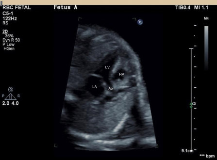

• Fig. 74.2 The parasternal long axis of the heart can be obtained by slight rotation of the probe between a transverse and longitudinal plane. Ao, Aorta; LA, left atrium; LV, left ventricle; RV, right ventricle.

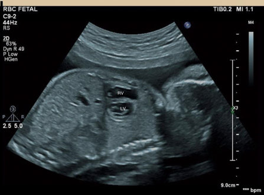

• Fig. 74.3 A parasternal short-axis view of the fetal heart at the level of the mitral valve. LV, left ventricle; RV, right ventricle.

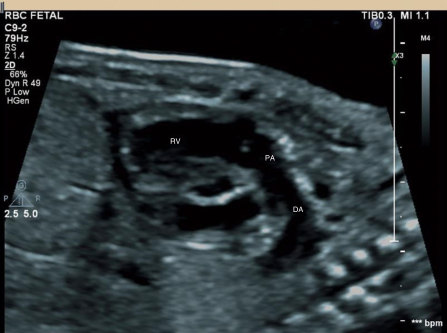

• Fig. 74.4 A parasternal short-axis view of the fetal heart at the base of the heart. DA, Ductus arteriosus; PA, pulmonary artery; RV, right ventricle.

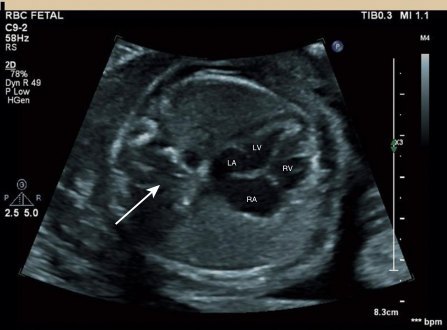

• Fig. 74.1 Four-chamber view of the fetal heart at the level of the tricuspid and mitral valve. The arrow points to the fetal spine, which is the posterior aspect of the fetus. LA, Left atrium; LV, left ventricle; RA, right atrium; RV, right ventricle.

## PDF page 1391 | printed page 1391

• Fig. 74.5 The bicaval view, or “cava-cava” view, showing the superior and inferior vena cava entering the right atrium.

RV

MPA

* **

• Fig. 74.6 The ductal arch view. MPA, Main pulmonary artery; RV, right ventricle; *, ductus arteriosus; **, aortic arch.

oxygen to the brain and myocardium, as well as to sustain cardiac output. In fetal life, the size of the foramen ovale versus the septal length, a hypermobile primum atrial septum, and reversal of flow in the ductus arteriosus have been shown to be predictive of the need for urgent postnatal balloon atrial septostomy to ensure adequate atrial level communication.15,16

HLHS with an intact or highly restrictive atrial septum has a mortality as high as 80%.17,18 Urgent decompression of the left atrium after birth can improve survival. Fetal assessment of the pulmonary venous inflow and the vasoreactivity of the pulmonary vascular bed have been shown to be helpful in predicting the need for postnatal intervention. A normal pulmonary vein spectral Doppler typically shows a predominant antegrade wave form in systole and early diastole with flow reversal in late diastole. A flow reversal ratio of less than 5 (forward/reverse velocity-time integral [VTI] <5) is highly predictive of the need for emergent intervention

• Fig. 74.7 The aortic arch view.

• Fig. 74.8 The three-vessel view. Ao, Aorta; PA, pulmonary artery; SVC, superior vena cava.

in the immediate postnatal period.19 Responsiveness of the fetal pulmonary vasculature to maternal hyperoxygenation (exposure of the mother to 60% inspired oxygen for 10 minutes) can also help identify fetuses that will require urgent postnatal intervention. Failure to augment pulmonary arterial blood flow in response to oxygen predicts the need for emergent decompression of the left atrium20 and may also help identify candidates for fetal intervention with fetal atrial septoplasty and stent placement.

Fetal heart failure is associated with placental edema and resultant hypoxia. The response of the mature heart to hypoxia is to increase the heart rate, but the fetus decreases its heart rate in response to hypoxia.7 This results in hydrops fetalis. The differential diagnosis of the underlying cause of hydrops is broad (Table 74.2). Chemoreceptors in the fetal aorta respond to an aortic partial pressure of oxygen (PO2) below 18 to 19 mm Hg, inducing bradycardia. The fetal cardiac output is maintained by redistributing blood flow. Blood flow to the myocardium, adrenal glands, and brain is increased (sampling of the middle cerebral artery [MCA] may show increased diastolic velocities, the so-called brainsparing effect), and the flow to the renal system, skin, muscle, bones, and gastrointestinal system is decreased.7

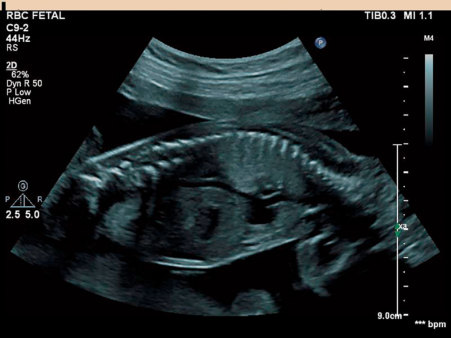

• Fig. 74.5 The bicaval view, or “cava-cava” view, showing the superior and inferior vena cava entering the right atrium.

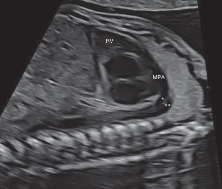

• Fig. 74.6 The ductal arch view. MPA, Main pulmonary artery; RV, right ventricle; *, ductus arteriosus; **, aortic arch.

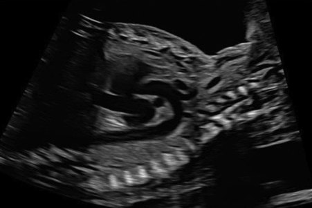

• Fig. 74.7 The aortic arch view.

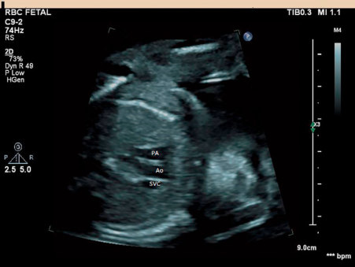

• Fig. 74.8 The three-vessel view. Ao, Aorta; PA, pulmonary artery; SVC, superior vena cava.

## PDF page 1392

V V

A A

• Fig. 74.9 M-mode fetal scan through the atrial and ventricular walls, demonstrating normal atrial to ventricular intervals. The atrial wall motion (A) is in a one-to-one relationship with the ventricular wall motion (V).

MV

Ao

• Fig. 74.10 Color M-mode fetal scan through the atrium and ventricle demonstrating that mitral valve inflow (MV) and aortic outflow (Ao) are in a one-to-one relationship. Notice there are approximately 2.5 heartbeats per second, resulting in a heart rate of 150 beats per minute.

One of the major causes of placental edema is increased right heart preload. This can be seen in any condition that volume loads the right ventricle, including large AV malformations, sacrococcygeal teratomas, and TTTS.7 There is a resultant increase in the combined cardiac output (CCO). The CCO increase reflects the amount of preload increase. Most infants do well without evidence of hydrops until the CCO reaches 700 to 800 mL/kg/min.7

A special situation of increased preload occurs in TTTS. The donor twin often exhibits volume depletion and nephrosclerosis. This results in elevated ET-1 and angiotensin II. Doppler of the umbilical artery shows decreased diastolic flow and increased resistance. The increased resistance rarely results in ventricular dysfunction; however, postnatal studies have shown abnormalities in vascular compliance and increased pulse wave velocities in the donor twin.7 Donor hormones from the response to hypovolemia are transferred across the placenta to the recipient twin. The recipient is thus exposed to increased volume and vasoconstrictors. Angiotensin II is a potent stimulant for hypertrophy. Thus the recipient twin often presents with

V V V V

A A A A

Differential Diagnosis of Causes of

TABLE

74.2

Hydrops Fetalis

• Immune/blood disorders • Rh incompatibility leading to anemia • Infection • Viral hepatitis leading to decreased protein

production • Viral infection leading to anemia (parvovirus) • Hemoglobinopathy (e.g., Bart) • Cardiac • Congenital heart disease with severe tricuspid

regurgitation (i.e., Ebstein anomaly) • Arrhythmia • Myocardial dysfunction • Twin-twin transfusion syndrome • Arteriovenous malformation • Congenital malformations and chromosomal

disorders • Congenital diaphragmatic hernia • Cystic hygroma

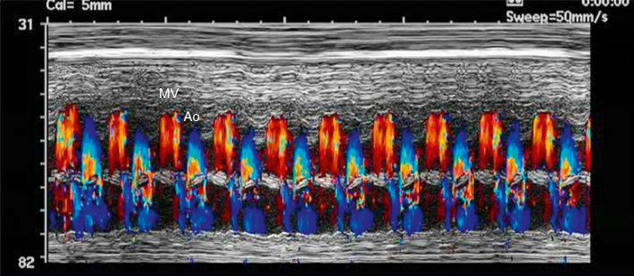

• Fig. 74.10 Color M-mode fetal scan through the atrium and ventricle demonstrating that mitral valve inflow (MV) and aortic outflow (Ao) are in a one-to-one relationship. Notice there are approximately 2.5 heartbeats per second, resulting in a heart rate of 150 beats per minute.

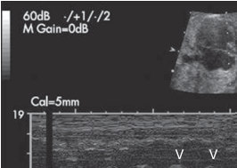

• Fig. 74.9 M-mode fetal scan through the atrial and ventricular walls, demonstrating normal atrial to ventricular intervals. The atrial wall motion (A) is in a one-to-one relationship with the ventricular wall motion (V).

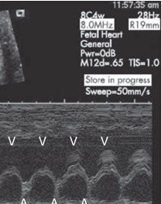

Unmatched source image; PDF page 1392. Consult the original caption.

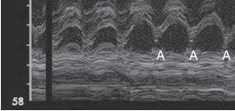

• Fig. 74.9 M-mode fetal scan through the atrial and ventricular walls, demonstrating normal atrial to ventricular intervals. The atrial wall motion (A) is in a one-to-one relationship with the ventricular wall motion (V).

## PDF page 1393 | printed page 1393

TABLE

Cardiovascular Profile Score

74.3

Category 2 Points 1 Point

Hydrops None Ascites or pericardial or pleural

effusion

Cardiothoracic area ratio >0.2 and <0.35 0.35–0.5

Cardiac function Normal MV and TV filling, LV

Holosystolic TR, LV or RV

or RV shortening fraction >0.28

shortening fraction <0.28

Arterial umbilical Doppler Normal Absent end diastolic flow

Venous Doppler Normal Ductus venosus atrial flow

reversal

The cardiovascular profile score can be used for surveillance of congestive heart failure and aid in predicting outcomes in the fetus at risk for heart failure. dP/dt, Rate of rise of left ventricular pressure; LV, left ventricle; MR, mitral regurgitation; MV, mitral valve; RV, right ventricle; TR, tricuspid regurgitation; TV, tricuspid valve. Adapted from Wieczorek A, Hernandez-Robles J, Ewing L, et al. Prediction of outcome of fetal congenital heart disease using a cardiovascular profile score. Ultrasound Obstet Gynecol. 2008;31:284–288.

cardiomyopathy—dilated, hypertrophic, or a combination of the two. Many fetuses demonstrate marked ventricular hypertrophy, which may result in right ventricular outflow tract obstruction, pulmonary stenosis, and tricuspid valve regurgitation.7

Studies have shown that fetal echocardiographic prognostic indicators can predict hydrops fetalis outcomes. These include cardiac function, cardiac size, the systemic venous Doppler profile of the ductus venosus or umbilical vein, the presence of AV valve regurgitation, and the presence of pericardial effusions, pleural effusions, ascites, or skin edema.21 These indicators can be compiled to obtain a cardiovascular profile score (Table 74.3).21 Treatment should be directed toward underlying pathology, including resolving abnormal peripheral impedance and treating high output failure, myocardial dysfunction, arrhythmia, anemia, or twin-twin transfusion syndrome.21

Doppler assessments of extracardiac structures can also provide information regarding fetal well-being and are thus included as part of a standard fetal echocardiogram. Assessment of the MCA helps assess effects of pathophysiologic states on the cerebrovascular flow.22 Normally, resistance in the MCA is relatively high and diastolic velocity is low. In high-output disease states such as anemia, the peak velocity of the MCA is frequently elevated.22 In states of low cardiac output, the cerebral vascular resistance decreases in response to stress, resulting in increased diastolic velocity so as to preserve adequate blood supply to the brain, the so-called brain-sparing effect.23

Fetal rhythm abnormalities occur in up to 2% of all pregnancies and can be broken down into three categories: ectopic beats, tachycardias, and bradycardias.24 Accurate diagnosis of rhythm disturbances presents a unique challenge given the lack of access to conventional electrocardiograms (ECGs). The diagnosis of fetal rhythm disturbances relies primarily on ultrasound techniques, including

0 Points

Skin edema

<0.2 or >0.5

Holosystolic MR or TR dP/dt

<400, monophasic diastolic filling

Reversed end diastolic flow

Umbilical vein pulsations

M-mode imaging, spectral Doppler, and tissue Doppler.24–26 A more sophisticated modality to investigate fetal arrhythmia is magnetocardiography, which uses a magnetic field of the fetal heart to generate waveforms that are similar to an ECG. However, it requires magnetically shielded rooms and specialized equipment that are not universally available.24

Premature atrial beats are common (present in 1%–3% of pregnancies) and are generally well tolerated unless a sustained tachycardia develops. The risk of fetal tachycardia when premature atrial contractions have been seen is approximately 0.5% to 1%, although couplets and blocked atrial bigeminy may increase this risk. Medical treatment is not recommended for either isolated premature atrial contractions or blocked atrial bigeminy; however, interval auscultation of the fetal heart rate weekly by the obstetrician is recommended for frequent premature atrial or ventricular contractions until resolution of the arrhythmia is documented.2

Fetal tachycardia is generally defined as fetal heart rates greater than 180 bpm. The majority of fetal tachycardias are supraventricular in origin, and ventricular tachycardias are very rare. Management of fetal supraventricular tachycardia is targeted to those at risk for heart failure. Intermittent tachycardia is generally well tolerated by the fetus, with the risk for hydrops increasing proportionally with increased time spent in the abnormal rhythm. Therapy is generally felt to be indicated for sustained tachycardias—those that occur most of the time or greater than 50% of the time while monitored. Most of these tachyarrhythmias can be treated through maternal administration of antiarrhythmic medications with transplacental delivery to the fetus.24 However, the influence of certain medications, such as amiodarone, on the developing fetus and fetal myocardium must be taken into account. Ventricular tachycardia is very rare in the fetus. It may be associated with myocardial disease or observed in the presence of cardiac tumors. Rarely,

## PDF page 1394

incessant ventricular tachycardia warrants maternal antiarrhythmic medication.2,24 Fig. 74.11 outlines a decision tree for maternal-fetal pairs presenting with fetal tachycardia.

Fetal bradycardia is defined as a fetal heart rate less than 110 beats per minute.2,24 The most common cause of bradycardia in the fetus is sinus bradycardia, which often occurs due to compression during ultrasound examinations. Fetal AV block can present with varying degrees of bradycardia depending on whether it is first, second, or third

Tachycardia HR > 180 bpm

Refer to Fetal Heart Program for consultation

### A V

Long VA − consider second line medication as listed below

Atrial flutter 250-500 bpm Short VA

No hydrops Consider delivery if GA > 36 wk

Hydrops present

- Admit to hospital - Prior to therapy, obtain maternal ECG & echocardiogram (a repeat ECG may be needed with change in treatment) - Fetal arrhythmia team consult - Electrolytes (including Mg and Ca2+)

Digoxin PO Load: total load 0.5-1.5 mg divided over 3 doses Maint: 0.25-0.5 mg bid/tid

After 48 hours Tachycardia

Normal sinus rhythm

Amiodarone

- Load: 1800 mg/d divided q8-12h for 48 hours - Maint. 200-600 mg daily

Drug levels (digoxin) monthly - Target level 0.8-2 ng/mL

After 48 hours, if SVT persists, consider adding/moving to second agent

or

Flecainide 100-300 mg/d divided q8-12h PO ± Digoxin

Fetal echo every 1-4 weeks

or

Sotalol 160-480 mg/d divided q8-12h PO ± Digoxin

Weekly maternal ECG, drug levels & biweekly fetal echocardiogram

Normal sinus rhythm

- Check electrolytes (K, Mg, Ca2+)

### • Fig. 74.11 Decision tree for maternal-fetal pairs presenting with fetal tachycardia. A, Atrial; ECG, elec-

trocardiogram; GA, gestational age; HR, heart rate; IV, intravenously; OB, obstetrician; PO, per os; SVT, supraventricular tachycardia; V, ventral; VA, ventricular arrhythmia; VT, ventricular tachycardia.

degree (complete) AV block. Fetal AV block is associated with maternal Sjögren antibodies (SSA/SSB) and complex structural heart disease.2,24 Rarely, it is an isolated phenomenon. In the setting of immune-mediated heart block, fluorinated glucocorticoids and intravenous immunoglobulin have been used in therapy. Studies have supported the use of hydroxychloroquine in known SSA/SSB-positive mothers to prevent the development of heart block.27 In the era of postnatal cardiac intensive care with early pacemaker

*The majority of intermittent tachycardia (less than 50% of time) remain intermittent during fetal life with no signs of cardiac compromise. These fetuses may not need treatment; however, close follow-up is necessary in the event that tachycardia becomes sustained or the fetus exhibits signs of compromise. Repeat heart tones at OB office in 3-5 days. Repeat fetal echocardiogram in a week. An exception to this is VT with rates >200 bpm, for which treatment is reasonable due to the risk of rapid progression to hydrops.

### V A

- Admit to hospital - Prior to therapy, obtain maternal ECG & echocardiogram (a repeat ECG may be needed with change in treatment) - Fetal Arrhythmia Team consult - Electrolytes (including Mg and Ca2+)

Magnesium Sulfate: Load: 2-6 g IV over 20 min followed by 1-2 g/h Treatment for >48 h is not recommended but redosing may be considered if VT recurs

Consider sotalol as first line therapy. Procainamide is contraindicated.

Lidocaine: Load: 1-1.5 mg/kg IV followed by infusion of 1-4 mg/min

Mexiletine: 600-900 mg/day divided every 8 h PO

Propranolol: 60-320 mg/d divided every 6 h PO

- If LQTS can be excluded, sotalol, amiodarone, and flecainide may result in successful termination of VT - Accelerated ventricular rhythms are slightly faster than the sinus rate, and are a more benign form of VT (no treatment)

## PDF page 1395 | printed page 1395

therapy, mortality for congenital AV block has decreased from 45% in the 1990s to less than 15% in the early 2000s and most recently as low as 2% to 3% in the absence of risk factors (described as an escape rate ≤ 50 bpm, gestation at diagnosis <20 weeks, fetal hydrops, and impaired left ventricular function).24,28 Rarely, bradycardia may be a sign of long QT syndrome, and an ECG on the mother and family members is recommended. Fig. 74.12 outlines a decision tree for maternal-fetal pairs presenting with fetal bradycardia.

Bradycardia HR < 100 bpm

Refer to Fetal Heart Program for consultation

Non-sustained Sustained

Sinus bradycardia

PACs

Observation

- Rule out fetal distress - Test for SSA/SSB antibodies - Family history for channelopathies - Rule out secondary causes (maternal hypothyroid, medication or CNS malformation)

SSA/SSB antibody*

In 1 week, repeat Doppler auscultation to evaluate for tachy/ bradycardia by obstetrician

Steroids - Dexamethasone 4-8 mg/d

IVIG

Steroid + IVIG

β agonist for heart rate < 55 bpm e.g., Terbutaline

### • Fig. 74.12 Decision tree for maternal-fetal pairs presenting with fetal bradycardia. AV, Atrioventricular;

AVC, atrioventricular canal; ccTGA, congenitally corrected transposition of the great arteries; CHB, complete heart block; CNS, central nervous system; DORV, double outlet right ventricle; ECG, electrocardiogram; HR, heart rate; IVIG, intravenous immunoglobulin; LQTS, long QT syndrome; NKX 2.5, cardiac homeobox gene; PACs, premature atrial contractions; SSA/SSB, Sjögren antibodies.

### Parental Counseling After Fetal Diagnosis of Congenital Heart Disease

Effective counseling after the prenatal diagnosis of CHD can be summarized by four aims: (1) to provide an accurate diagnosis of the malformation, (2) to provide an honest prognosis, (3) to review various treatment and management strategies, and (4) to support the family and help them reach a decision that is best for them.29 Despite the benefits of accurate prenatal diagnosis of CHD, receiving a

AV block

Abnormal AV node (ccTGA, heterotaxy, AVC, DORV)

Channelopathy** (NKX 2.5, LQTS)

Observation Maternal electrolyte abnormalities Mg and Ca should be avoided, as well as drugs and anesthetic agents that lengthen the QT interval

Observation weekly

β agonist for heart rate < 55 bpm e.g., Terbutaline

*A trial of dexamethasone for immune mediated second-degree AV block or first-degree AV block if there are additional cardiac findings of inflammation (echogenicity, effusion, etc.) may be considered to prevent progression to CHB, although its usefulness is not well established.

In mothers of high risk pregnancies (prior pregnancy resulting in cardiac manifestations of neonatal lupus), consider starting daily hydroxychloroquine at 10 weeks of gestation.

**For suspected channelopathy and fetal bradycardia, recommend maternal and paternal ECG to investigate for inheritable prolong QT.

## PDF page 1396

prenatal diagnosis can be a traumatic experience for parents. Posttraumatic stress, depression, and anxiety are common in mothers after prenatal diagnosis of CHD. Psychological distress may persist for months after birth. There is a need for research to determine the most effective techniques for counseling and family support, as well as investigating potential modifiable variables of maternal stress that may alter the impact.30

Prenatal diagnosis does allow for sustained education and guidance between diagnosis and delivery. Little research has been done on the most effective methods for prenatal counseling and family support. Some important elements to address during prenatal counseling would include findings and limitations, results given in close proximity to the time of testing (preferably the same day), natural history in utero, prognosis for the remainder of the pregnancy and beyond as able, possible associations with genetic anomalies, alleviating parental guilt, and a potential range of management options.2 The practitioner must utilize good communication skills and empathy. The level of parental understanding must be assessed continuously during counseling with the knowledge that understanding may be limited by grief, and multiple counseling sessions may be required.2

### Impact of Prenatal Diagnosis

The goal of early detection of a pathologic state is to alter long-term outcome in a favorable way. Early studies of the impact of fetal diagnosis on postnatal outcome were not satisfying. However, subsequent publications suggest an improvement in postnatal mortality and morbidity. One study looking at the impact of prenatal diagnosis in hypoplastic left heart syndrome (HLHS) showed that preoperative status and first-stage mortality were affected by prenatal diagnosis, with a total survival of 75% in those who elected to undergo surgery. All of the patients who were diagnosed prenatally survived, whereas only 65% of the patients who were diagnosed postnatally survived. In addition, patients diagnosed prenatally had a lower incidence of preoperative acidosis, tricuspid regurgitation, and ventricular dysfunction, and they were also less likely to need preoperative inotropic medications or bicarbonate. Preoperative risk factors that correlated with early mortality included postnatal diagnosis, more severe acidosis, need for bicarbonate or inotropes, and ventricular dysfunction.31 Another study on prenatal diagnosis of CHD evaluated the neurologic outcomes in fetuses with HLHS. Although the overall mortality did not differ in the prenatal versus postnatal groups, prenatal diagnosis was associated with fewer adverse neurologic events when compared with those with postnatal diagnosis.32 Similarly, diagnosis, metabolic acidosis level, preoperative mortality, length of stay, and postoperative mortality were all significantly better in patients with a prenatal diagnosis of TGA compared with the group diagnosed postnatally.33

However, although these data are encouraging, further studies are needed to evaluate the CHD outcomes in the

setting of prenatal diagnosis. Certain populations continue to have poor outcomes despite prenatal diagnosis, including those with HLHS with intact or restrictive atrial septum, right atrial and left atrial isomerisms (heterotaxy), and pulmonary atresia with intact septum with right-ventricular–dependent coronary circulation. Further studies into markers of outcome in these patients and improved survival may depend on fetal intervention.34–36

Specific findings on fetal echocardiogram allow for comprehensive delivery planning to prevent hemodynamic compromise in high-risk CHD. Disease-specific delivery room recommendations are currently well accepted in clinical practice.2,37,38 Level-of-care recommendations should include follow-up, possible need for transport to a tertiary care center, likelihood of neonatal intervention (catheterbased or surgical), or, in rare cases, the need for emergent intervention in the delivery. Table 74.4 summarizes riskstratified level-of-care assignment and coordinating action plans based on reported algorithms.

### Limitations of Fetal Echocardiograms

Advances in ultrasound technology have greatly improved the sensitivity of fetal echocardiograms over the past 20 to 25 years, and it is currently expected that fetal echocardiograms can diagnose even complex CHD in specific detail. However, despite the advances in technology over time, data indicate that only 48% to 60% of congenital heart defects are detected prenatally.39 Detection rates are poorest in rural communities.40 In addition, recent research has demonstrated significantly discrepant prenatal detection rates—specifically, TGA and HLHS—with lower socioeconomic quartile, Hispanic ethnicity, and public insurance, in addition to rural residence, being associated with lower and later prenatal detection rates.41 This suggests that better access to care, screening mechanisms, and indications for fetal echocardiogram are needed, particularly in underserved communities.

It is important to recognize the limitations of fetal echocardiography both in diagnosing certain types of CHD and in detecting associated lesions. A recent study reviewing fetal echocardiograms from 2008 to 2017 demonstrated a diagnostic discrepancy rate as high as 13.5% in fetuses with major CHD, mostly minor and moderate in severity, indicating that we can still do better at elucidating the finer details of anatomy and physiology when CHD is present.42 Ultrasound and fetal echocardiography are intrinsically more sensitive for some types of CHD than others. Even in the most optimal of situations, fetal echocardiography is less sensitive to detect abnormalities of smaller structures. Thus diagnoses such as partial anomalous pulmonary venous return (PAPVR), small ventricular septal defects, and minor valve abnormalities, including bicuspid aortic valve, cannot be ruled out on fetal echocardiograms. The rates of prenatal detection for specific types of CHD lesions offer some insight into which defects are more likely to be identified on obstetric ultrasound and subsequently on fetal

## PDF page 1397 | printed page 1397

TABLE

### Risk-Stratified Level-of-Care Assignment and Coordinating Action Plans

73.4

Level-of-Care Code Level of Care Action

0 No identified cardiac

Delivery per obstetrician at patient’s preferred

anomaly or resolution of cardiac anomaly

hospital Standard newborn care per neonatal team

0P CHD in which only

Arrange for family support/palliative care

palliative care is planned

services Delivery per obstetrician at patient’s preferred

hospital Cardiology consult for supportive care and

confirmation of diagnosis are available

1 Cardiac anomaly that

Delivery per obstetrician at patient’s preferred

is not expected to cause hemodynamic instability in the neonatal period

hospital Standard newborn care per neonatal team Cardiology evaluation prior to hospital discharge

or as an outpatient within 1–2 weeks if the patient is delivering at an outside hospital

2 Cardiovascular

Neonatology management in delivery room Nonemergent cardiology consultation For fetal echocardiogram findings of an

anomaly or disease expected to not cause hemodynamic instability at birth

unclear etiology, as long as the baby’s clinical presentation allows, recommend a cardiology evaluation in conjunction with the neonatology team to confirm fetal findings prior to ultimate disposition (CTICU or NICU)

3 Cardiovascular anomaly

Neonatology management in delivery room May allow for maternal-infant bonding time Transfer to NICU for transitional care and line

of moderate severity (including ductal dependent lesions) where hemodynamic instability is possible but not anticipated

placement Transfer to the CTICU/NICU for further

evaluation and management Urgent cardiology consultation within 1 hour of

delivery

4 Cardiovascular anomaly

Cardiology and neonatology notification of labor Neonatology and cardiology to co-manage

with high likelihood of hemodynamic instability

delivery Disposition of the patient will be determined by

clinical presentation. Emergent transfer to the operating room or

cardiac catheter lab may be necessary (see details medical record note). Lines may need to be placed in NICU, CTICU,

catheter lab, or operating room pending disposition decision. Final disposition to CTICU vs. NICU is based on

established center guidelines.

CHD, Congenital heart disease; CTICU, cardiothoracic intensive care unit; HLHS, hypoplastic left heart syndrome; LV, left ventricular; LVOT, left ventricular outflow tract; NICU, neonatal intensive care unit; RV, right ventricular; RVOT, right ventricular outflow tract; SVT, supraventricular tachycardia.

echocardiogram (Table 74.5).43 In addition, fetal echocardiogram is limited by the necessary presence of fetal circulation, making it impossible to rule out atrial septal defects or patent ductus arteriosus prenatally. Also, although certain findings can raise concern for coarctation of the aorta,

Examples

• Normal fetal

echocardiogram • Premature atrial

contractions that resolve

• CHD with severe/fatal

chromosome anomaly or multisystem involvement

• Muscular ventricular septal

defect • Atrial septal defect • Isolated ventricular septal

defect

• Balanced atrioventricular

canal • Tetralogy of Fallot (pink) • Benign/controlled

arrhythmia (nonsustained SVT without hydrops) • LV/RV size discrepancy

without concern for coarctation • CDH without significant

cardiac pathology

• HLHS with no risk factors • Single ventricle with critical

RVOT or LVOT obstruction • Coarctation of the aorta • Tetralogy of Fallot with

moderate to severe obstruction • Sustained tachyarrhythmia

• Transposition of great

arteries • Tetralogy of Fallot with

absent pulmonary valve • HLHS with suspected atrial

septal restriction • CHD with ventricular

dysfunction • Complete heart block • Hydropic fetus with cardiac

anomaly

including small isthmus diameter, great vessel discrepancy (smaller aorta than main pulmonary artery), abnormal aortic arch flow, left superior vena cava, and ventricular disproportion (smaller left ventricle than right ventricle), this diagnosis cannot be ruled out prenatally.44

## PDF page 1398

Percent of Prenatal Diagnoses by Specific

TABLE

74.5

CHD Type

Percent of Prenatal Diagnoses

CHD Type

Single ventricle (all) 85%

Hypoplastic left heart syndrome 83%

Complex single ventricle 87%

Dextro-TGA (all) 54%

Dextro-TGA with intact

47%

ventricular septum

Dextro-TGA with ventricular

64%

septal defect

Tetralogy of Fallot 75%

Isolated arch anomaly 58%

Arch anomaly with additional

75%

anomaly

Total anomalous pulmonary

2%

venous return

Pulmonary valve stenosis 44%

Double outlet right ventricle 97%

Double outlet right ventricle with

83%

malposed great vessels

Balanced atrioventricular canal 79%

Interrupted aortic arch 61%

CHD, Congenital heart disease; TGA, transposition of the great arteries.

### Fetal Therapies

The first attempt at performing a fetal cardiac intervention was in 1987, when attempts were made to pace the fetal heart to prevent progression of hydrops fetalis. The first attempt at fetal aortic valve intervention was made more than 30 years ago by attempting to dilate the aortic valve in a fetus with severe aortic stenosis. This attempt was successful, and the infant eventually underwent a biventricular repair.17,18,36,45–47 Currently, there is a growing body of evidence in support of fetal cardiac intervention. Several techniques have been attempted for fetal balloon interventions. Ideally, fetal cardiac interventional procedures are performed percutaneously to limit maternal risks. The least invasive technique involves maternal sedation with percutaneous access to the fetus. More invasive methods, which increase maternal risk, have the benefit of better fetal position.17,18,36,45–47 The goal after fetal intervention is to allow the fetus to spend as much time in utero as possible to promote remodeling and allow the fetal lung to complete maturity. The underlying hypothesis in support of many fetal interventions is that the left ventricle undergoes severe myocardial injury or fibroblast damage, compromising the pressure-generating capability of the ventricle

prenatally.17,18,36,45–47 If the underlying cause of the injury, such as is the case in severe aortic stenosis, can be resolved, the left ventricle has the potential to remodel, allowing for improvement in contractile function and, it is hoped, a biventricular repair.

As in all procedures, appropriate selection of patients is of utmost importance. The goal is to offer the appropriate procedure to the right patient. Criteria for selection for fetal aortic valve balloon dilation currently include a large left ventricle with persistent patency of the aortic valve, a normal-appearing mitral valve, reversed flow in the aortic arch, and a left-to-right shunt at the atrial level.17,18,36,45–47

The most promising group for fetal intervention may be patients with HLHS with intact or restrictive atrial septum. Postnatal mortality is extremely high in this group of patients, with reported rates of 48% to 80%. Intact atrial septum can be found in up to 6% of patients with HLHS, with the majority of their mortality reported during the first few weeks of life. This suggests that mortality risk may be associated with intrapulmonary arterial or venous changes.17,18

### Novel Approaches to Prenatal Diagnosis of Congenital Heart Disease

Just as in fetal intervention, advances in the diagnostic realm are being made. Promising results have been seen with the performance of fetal echocardiograms during the first trimester. A study evaluating the feasibility and accuracy of first-trimester echocardiography identified fetuses with ventricular septal defects, TGA, and HLHS. The sensitivity of these early echocardiograms compared with the standard study performed at 18 to 22 weeks’ gestation was calculated as 60.0% and the specificity was 98.7%, with a positive predictive value of 75.0% and a negative predictive value that reached 97.4%.48 Earlier detection of significant heart defects allows for more timely counseling and decision making.

Newer indices of ventricular performance, including the Tei index (also known as the myocardial performance index), are currently being evaluated in the fetus. The Tei index has been used widely as a measure of global (combined systolic and diastolic) myocardial function in adults and children. It has also been shown to be useful in the assessment of fetal cardiac function.39

Three-dimensional fetal echocardiography also shows promise in increasing both the efficiency of fetal echocardiography and the accuracy of diagnosis. However, poor frame rates and false-positive results continue to be an issue.

### Summary

In summary, the field of fetal cardiology has experienced rapid growth in the last 45 years. Advances in image quality allow for the diagnosis of a wide array of cardiac pathologies. Such imaging also allows for well-coordinated post-delivery

## PDF page 1399 | printed page 1399

care of complex congenital heart defects, preparation of the parents through prenatal counseling, and management of evolving fetal pathology, including arrhythmias and TTTS. Potentially, we may be able to alter the natural history of certain congenital heart defects through invasive

Key Points

### • Despite congenital heart disease affecting 6 to 8 per

thousand live births, only 20% of babies with congenital heart disease would be identified if the examination of the fetal heart were confined to traditional high-risk groups.

### • Understand the fetal circulation and transition to post-

natal circulation.

### References

1. Lee W, Allan L, Carvalho JS, et al. ISUOG consensus statement:

what constitutes a fetal echocardiogram? Ultrasound Obstet Gynecol. 2009;32(2):239–242. 2. Donofrio M, Moon-Grady A, Hornberger LK, et al. Diagnosis

and treatment of fetal cardiac disease: a scientific statement from the American Heart Association. Circulation. 2014;2(129):2183– 2242. 3. Moon-Grady AJ, Donofrio MT, Gelehrter S, et al. Guidelines and

Recommendations for Performance of the Fetal Echocardiogram: An Update from the American Society of Echocardiography. JASE. 2023;36(7):679–723. 3a. Sahn DJ, Lange LW, Allen HD, et al. Quantitative real-time cross-

sectional echocardiography in the developing normal humam fetus and newborn. Circulation. 1980;62(3):588–597. 3b. Allan LD, Tynan MJ, Campbell S, et al. Echocardiographic

and anatomical correlates in the fetus. Br Heart J. 1980;44(4): 444–451. 4. Sekhavat S, Kishore N, Levine JC, et al. Screening fetal echo-

cardiography in diabetic mothers with normal findings on detailed anatomic survey. Ultrasound Obstet Gynecol. 2010;35(2): 178–182. 5. Clur SA, Ottenkamp J, Bilardo CM. The nuchal translu-

cency and the fetal heart: a literature review. Prenat Diagn. 2009;29(8):739–748. 6. Berkley E, Goens MB, Karr S, et al. Utility of fetal echocardiogra-

phy in postnatal management of infants with prenatally diagnosed congenital heart disease. Prenat Diagn. 2009;29(7):654–658. 7. Rychik J. Fetal cardiovascular physiology. Pediatr Cardiol.

2004;25(3):201–209. 8. Rasanen J, Wood DC, Weiner S, et al. Role of the pulmonary cir-

culation in the distribution of human fetal cardiac output during the second half of pregnancy. Circulation. 1996;94(5):1068–1073. 9. Ibe BO, Portugal AM, Chaturvedi S, et al. Oxygen-dependent

PAF receptor binding and intracellular signaling in ovine fetal pulmonary vascular smooth muscle. Am J Physiol Lung Cell Mol Physiol. 2005;288(5):L879–L886. 10. Ibe BO, Hibler S, Raj JU. Platelet activating factor modulates

pulmonary vasomotor tone in the perinatal lamb. J Appl Physiol. 1998;85(3):1079–1085. 11. Heymann MA. Control of the pulmonary circulation in the fetus

and during the transitional period to air breathing. Obstet Gynecol. 1999;84(2):127–132.

fetal cardiac interventions. However, even with advances in echocardiography, one must be aware of the limitations of fetal ultrasound when evaluating acutely ill neonates in the delivery room.

### • Know the indications for fetal echocardiogram and under-

stand what can be learned from fetal echocardiography.

### • Be aware of the diagnosis and treatment of fetal arrhythmias. • Know the available fetal cardiac interventions and when

to intervene.

### • Recognize and know the causes and treatment of fetal

hydrops.

12. Boehme C, Fruitman D, Eckersley L, et al. The diagnostic yield

of fetal echocardiography indications in the current era. J Am Soc Echocardiog. 2022;35(2):217–227.e1. 13. Escribano D, Herraiz I, Granados M, et al. Tetralogy of Fallot:

prediction of outcome in the mid-second trimester of pregnancy. Prenat Diagn. 2011;31(12):1126–1133. 14. Hinton R, Michelfelder E. Significance of reveres orientation of the

ductus arteriosus in neonates with pulmonary outflow tract obstruction for early intervention. Am J Cardio. 2006;97(5):716–719. 15. Vigneswaran T, Zidere V, Miller OI, et al. Usefulness of the pre-

natal echocardiogram in fetuses with isolated transposition of the great arteries to predict the need for balloon atrial septostomy. Am J Cardiol. 2017;119(9):1463–1467. 16. Jouannic F, Gavard L, Fermon L, et al. Sensitivity and specific-

ity of prenatal features of physiologic shunts to predict neonatal clinical status in transposition of the great arteries. Circulation. 2004;110(13):1743–1746. 17. McElhinney DB, Vogel M, Benson CB, et al. Assessment of left

ventricular endocardial fibroelastosis in fetuses with aortic stenosis and evolving hypoplastic left heart syndrome. Am J Cardiol. 2010;106(12):1792–1797. 18. Marshall AC, Levine J, Morash D, et al. Results of in utero atrial

septoplasty in fetuses with hypoplastic left heart syndrome. Prenat Diagn. 2008;28(11):1023–1028. 19. Michelfelder E, Gomez C, Border W, et al. Predictive value of

fetal pulmonary venous flow patterns in identifying the need for atrial septoplasty in the newborn with hypoplastic left ventricle. Circulation. 2005;112(19):2974–2979. 20. Szwast A, Tian Z, McCann M, et al. Vasoreactive response to

maternal hyperoxygenation in the fetus with hypoplastic left heart syndrome. Circ Cardiovasc Imaging. 2010;3(2):172–178. 21. Huhta J. Guidelines for the evaluation of heart failure in the

fetus with or without hydrops. Pediatr Cardiol. 2004;25(3): 274–286. 22. Moise KJ Jr. The usefulness of middle cerebral artery Doppler

assessment in the treatment of the fetus at risk for anemia. Am J Obstet Gynecol. 2008;198(2):161.e1–e4. 23. Berg C, Gembruch O, Gembruch U, et al. Doppler indices

of the middle cerebral artery in fetuses with cardiac defects theoretically associated with cerebral oxygen delivery in utero: is there a brain sparing effect? Ultrasound Obstet Gynecol. 2009;34(6):666–672. 24. Hornberger L, Sahn D. Rhythm abnormalities of the fetus.

Heart. 2007;93(10):1294–1300.

## PDF page 1400

25. Rein A, O’Donnell C, Geva T, et al. Use of tissue velocity imag-

ing in the diagnosis of fetal cardiac arrhythmias. Circulation. 2002;106(14):1827–1833. 26. Nii M, Hamilton R, Fenwick L, et al. Assessment of fetal atrio-

ventricular time intervals by tissue Doppler and pulse Doppler echocardiography: normal values and correlation with fetal echocardiography. Heart. 2006;92(12):1831–1837. 27. Izmirly PM, Costedoat-Chalumeau N, Pisoni CN, et al. Mater-

nal use of hydroxychloroquine is associated with a reduced risk of recurrent anti-SSA/Ro-antibody-associated cardiac manifestations of neonatal lupus. Circulation. 2012;126(1):76–82. 28. Eliasson H, Sonesson SE, Sharland G, et al; Fetal Working

Group of the European Association of Pediatric Cardiology. Isolated atrioventricular block in the fetus: a retrospective, multinational, multicenter study of 175 patients. Circulation. 2011;124(18):1919–1926. 29. Allan LD, Huggon IC. Counseling following a diagnosis of con-

genital heart disease. Prenat Diagn. 2004;24(13):1136–1142. 30. Rychick J, Donaghue DD, Levy S, et al. Maternal psychological

stress after prenatal diagnosis of congenital heart disease. J Pediatr. 2013;162(2):302–307.e1. 31. Tworetsky W, McElhinney DB, Reddy VM, et al. Improved sur-

gical outcome after fetal diagnosis of hypoplastic left heart syndrome. Circulation. 2001;103(9):1269–1273. 32. Mahle W, Clancy RR, McGaurn SP, et al. Impact of prena-

tal diagnosis on survival and early neurologic morbidity in neonates with the hypoplastic left heart syndrome. Pediatrics. 2001;107(6):1277–1282. 33. Bonnet D, Coltri A, Butera G, et al. Detection of transposition

of the great arteries in fetuses reduces neonatal morbidity and mortality. Circulation. 1999;99(7):916–918. 34. Taketazu M, Lougheed J, Yoo S-J, et al. Spectrum of cardiovascu-

lar disease, accuracy of diagnosis, and outcome in fetal heterotaxy syndrome. Am J Cardiol. 2006;97(5):720–724. 35. Lim JS, McCrindle BW, Smallhorn JF, et al. Clinical features,

management, and outcome of children with fetal and postnatal diagnoses of isomerism syndromes. Circ. 2005;112(16):2454– 2461.

36. Taketazu M, Barrea C, Smallhorn JF, et al. Intrauterine pulmo-

nary venous flow and restrictive foramen ovale in fetal hypoplastic left heart syndrome. J Am Coll Cardiol. 2004;43(10):1902–1907. 37. Penny DJ, Shekerdemian LS. Management of the neonate with

symptomatic congenital heart disease. Arch Dis Child Fetal Neonatal Ed. 2001;84(3):F141–F145. 38. Johnson BA, Ades A. Delivery room and early postnatal manage-

ment of neonates who have prenatally diagnosed congenital heart disease. Clin Perinatol. 2005;32(4):921–946. 39. Acharya G, Pavolvic M, Ewing L, et al. Comparison between

pulsed-wave Doppler- and tissue Doppler-derived Tei indices in fetuses with and without congenital heart disease. Ultrasound Obstet Gynecol. 2008;1(4):406–411. 40. Hill GD, Block JR, Tanem JB, et al. Disparities in the prena-

tal detection of critical congenital heart disease. Prenat Diagn. 2015;35(9):859–863. 41. Krishnan A, Jacobs MB, Morris SA, et al. Fetal Heart Society. Impact

of socioeconomic status, race and ethnicity, and geography on prenatal detection of hypoplastic left heart syndrome and transposition of the great arteries. Circulation. 2021;143(21):2049–2060. 42. Mozumdar N, Rowland J, Pan S, et al. Diagnostic accuracy of

fetal echocardiography in congenital heart disease. J Am Soc Echocardiogr. 2020;33(11):1384–1390. 43. Landis B, Levey A, Levasseur SM, et al. Prenatal diagnosis of

congenital heart disease and birth outcomes and birth outcomes. Pediatr Cardiol. 2013;34(3):597–605. 44. Buyens A, Gyselaers W, Coumans A, et al. Difficult prenatal diag-

nosis: fetal coarctation. Facts Views Vis Obgyn. 2012;4(4):230–236. 45. Friedman K, Margossian R, Graham DA, et al. Postnatal left ven-

tricular diastolic function after fetal aortic valvuloplasty. Am J Cardiol. 2011;108(4):556–560. 46. Levine J, Tworetzky W. Intervention for severe aortic stenosis in

the fetus: altering the progression of left sided heart disease. Progress Pediatr Cardiol. 2006;22(1):71–78. 47. Pavlovic M, Acharya G, Huhta JC. Controversies of fetal cardiac

intervention. Early Hum Dev. 2008;84(3):149–153. 48. Mirza FG, Bauer ST, Williams IA, et al. Early fetal echocardiogra-

phy: ready for prime time? Am J Perinatol. 2011;29(4):313–318.

<!-- SOURCE_LAYOUT_VIEWS -->

## Original layout views and recovered diagrams

Automatic extraction can flatten tables and superscripts. Check the original layout for numeric data, footnotes and image credits. [Source review notes](../../SOURCE_REVIEW_NOTES.md).

### Original source page 1389

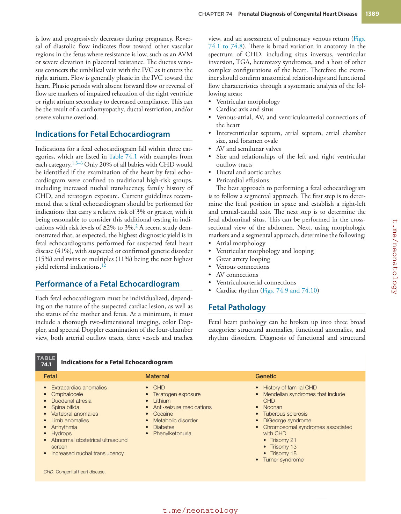

### Original source page 1390

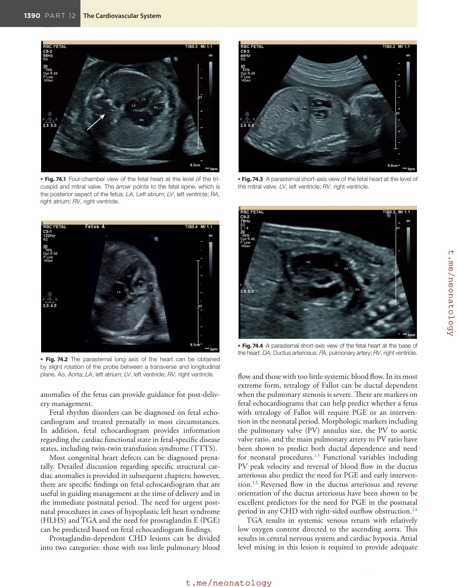

### Original source page 1391

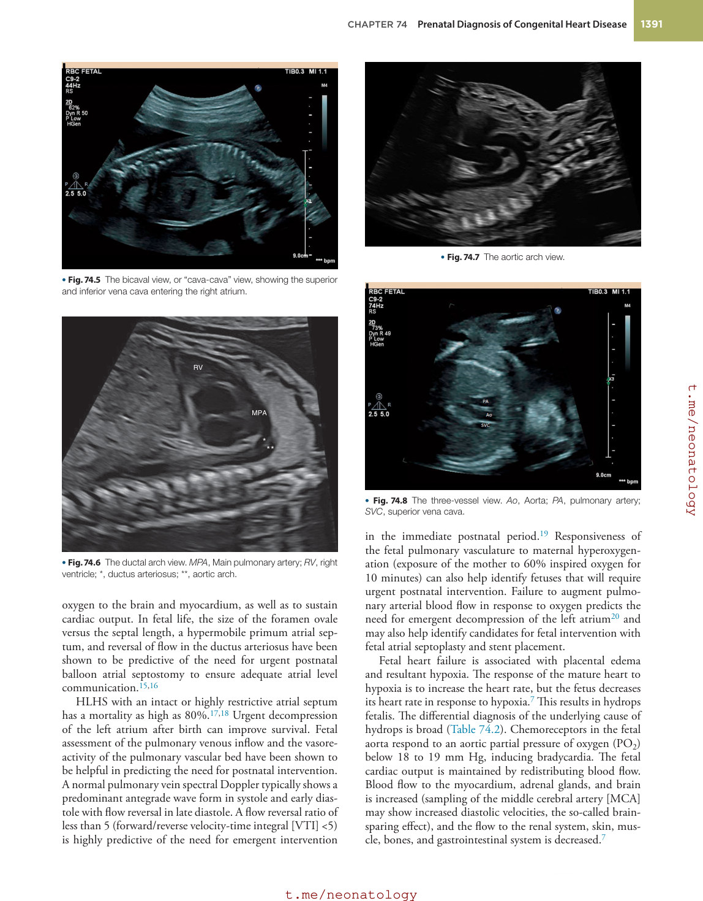

### Original source page 1392

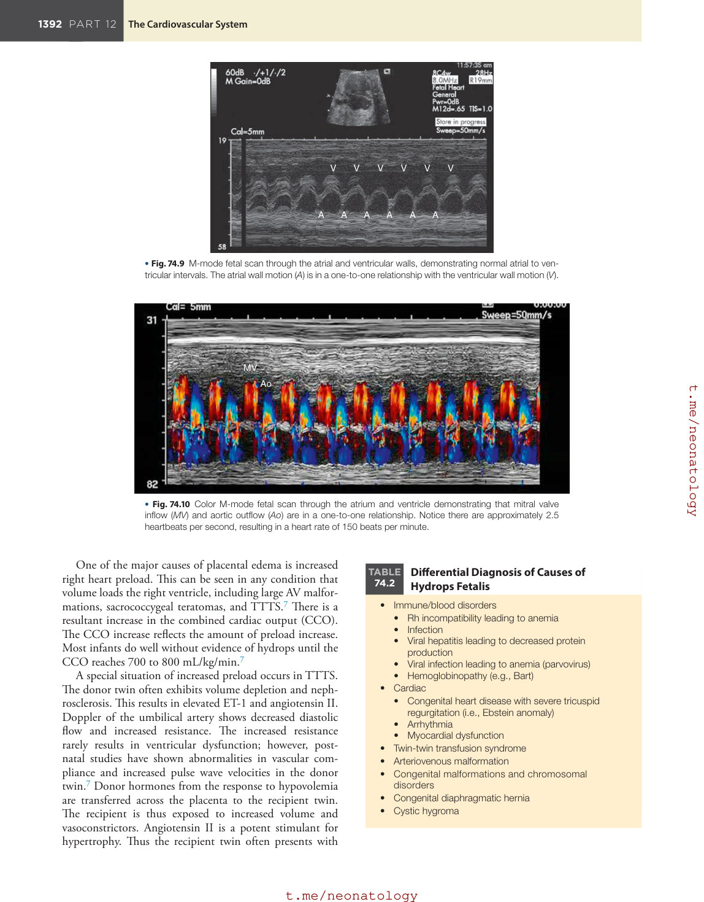

### Original source page 1393

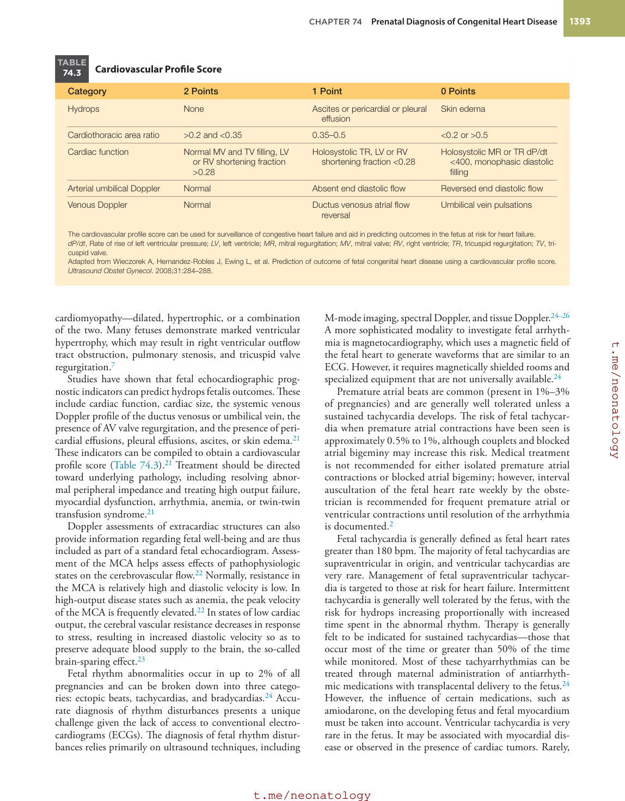

### Original source page 1394

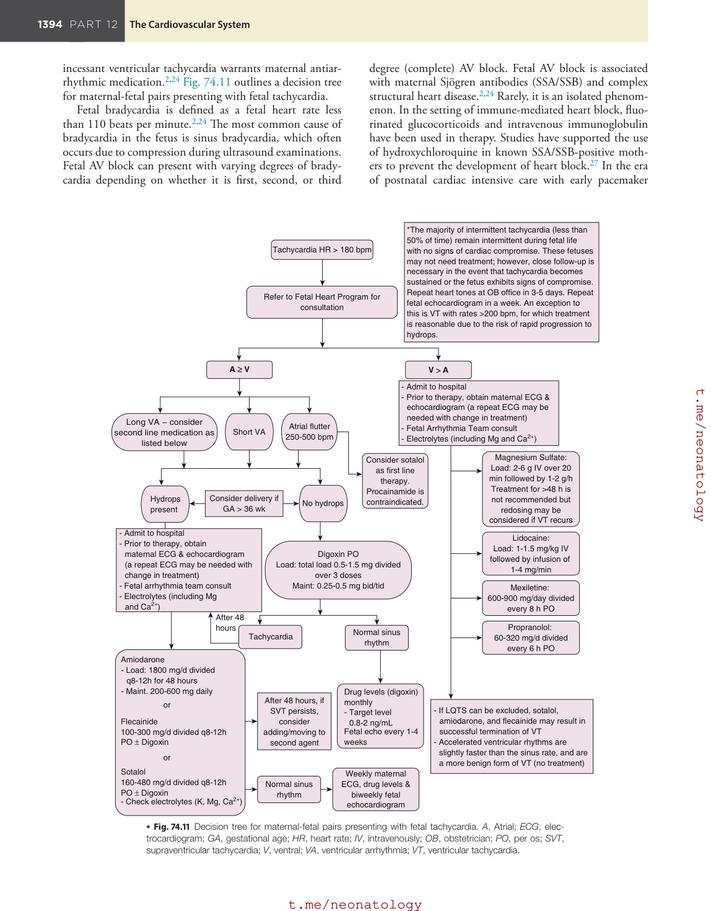

### Original source page 1395

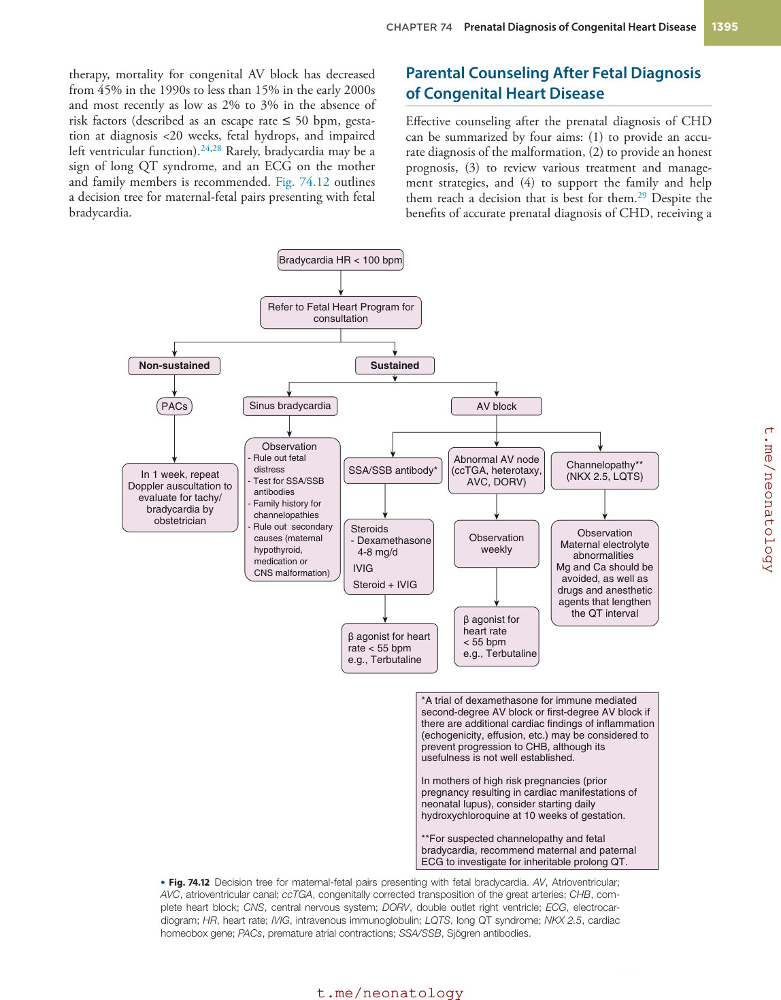

### Original source page 1396

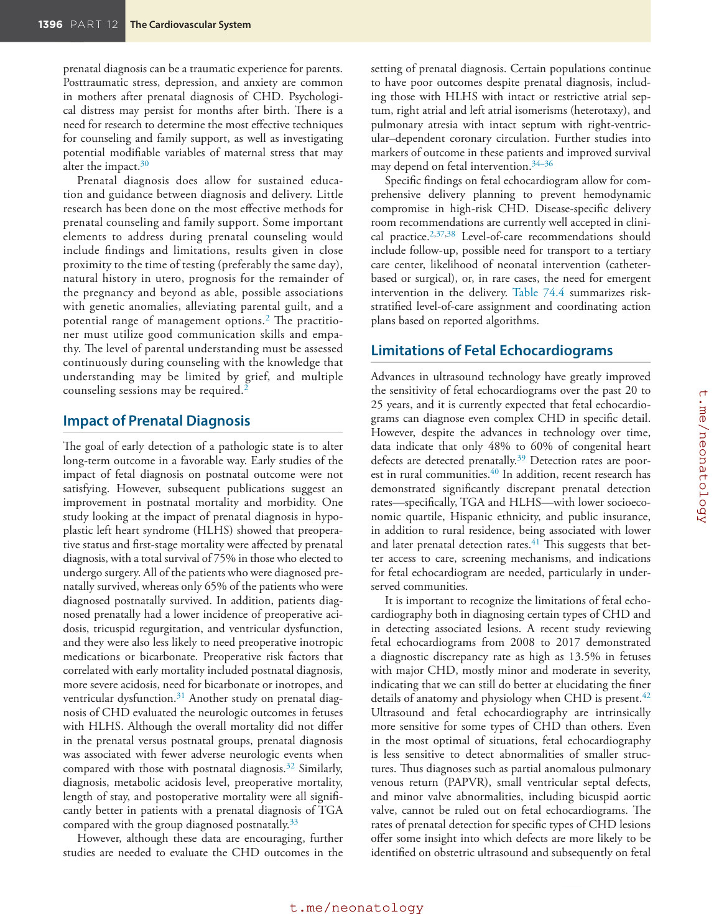

### Original source page 1397

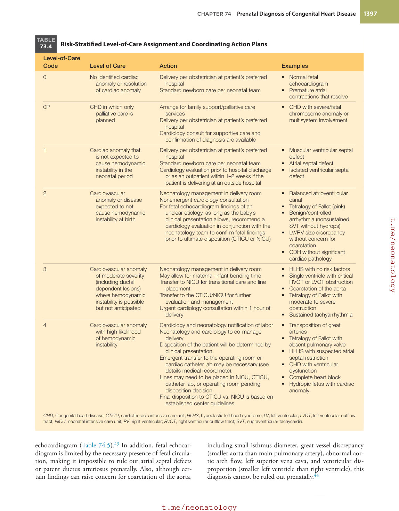

### Original source page 1398

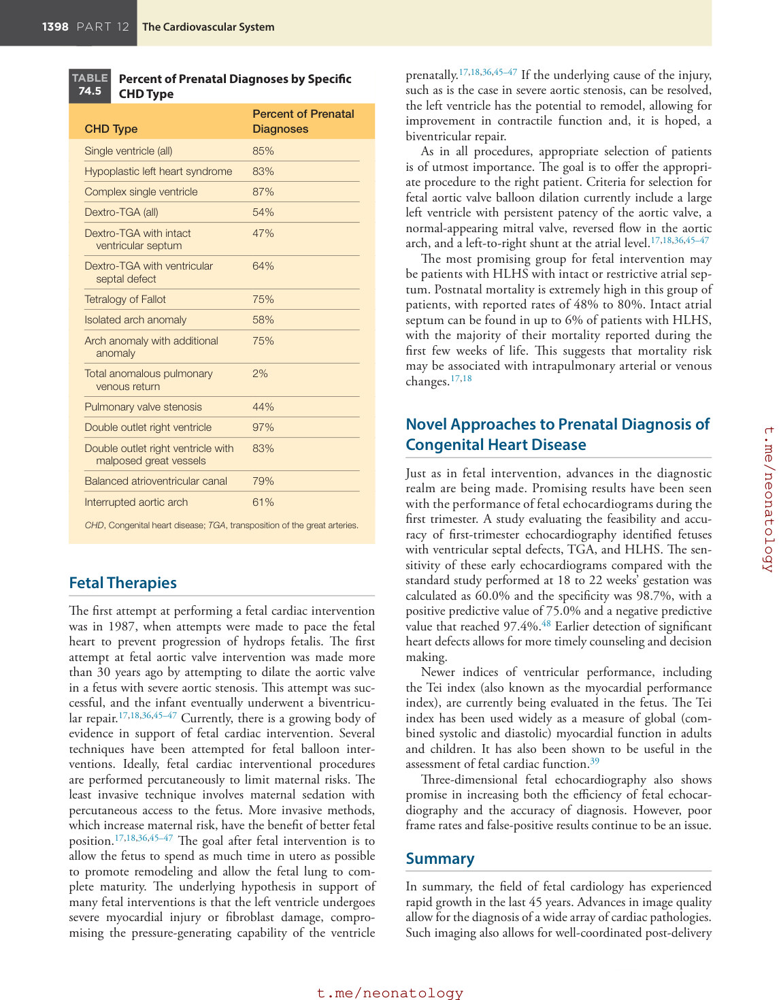

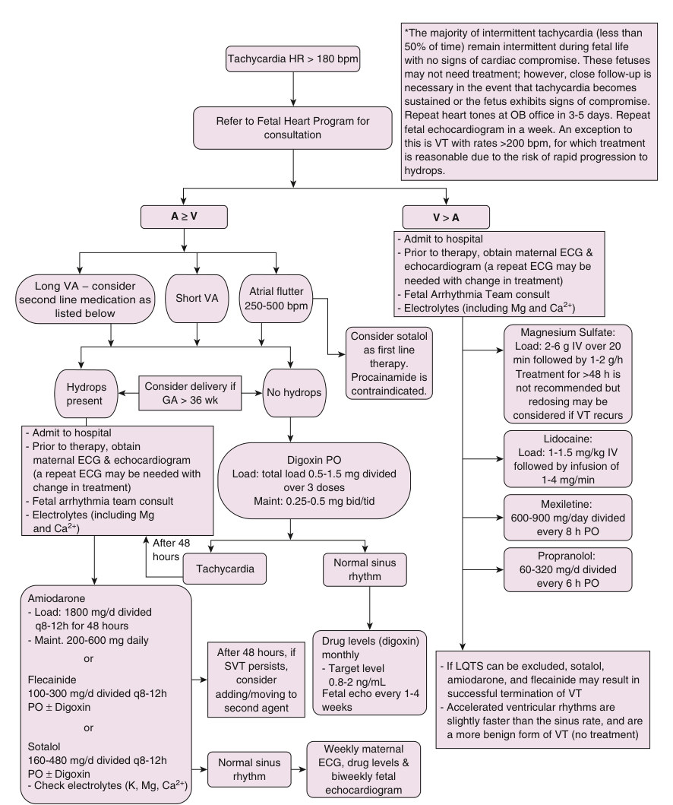

• Fig. 74.11 Decision tree for maternal-fetal pairs presenting with fetal tachycardia. A, Atrial; ECG, electrocardiogram; GA, gestational age; HR, heart rate; IV, intravenously; OB, obstetrician; PO, per os; SVT, supraventricular tachycardia; V, ventral; VA, ventricular arrhythmia; VT, ventricular tachycardia.

PDF p. 1394

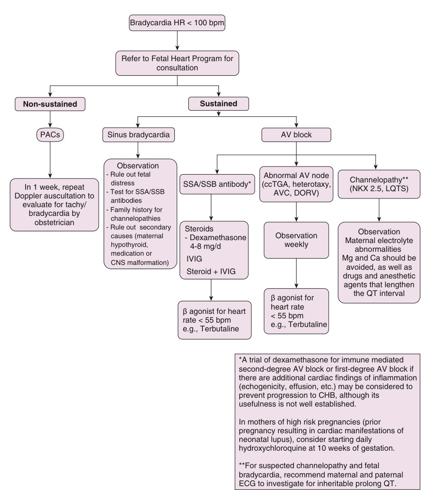

• Fig. 74.12 Decision tree for maternal-fetal pairs presenting with fetal bradycardia. AV, Atrioventricular; AVC, atrioventricular canal; ccTGA, congenitally corrected transposition of the great arteries; CHB, complete heart block; CNS, central nervous system; DORV, double outlet right ventricle; ECG, electrocardiogram; HR, heart rate; IVIG, intravenous immunoglobulin; LQTS, long QT syndrome; NKX 2.5, cardiac homeobox gene; PACs, premature atrial contractions; SSA/SSB, Sjögren antibodies.

PDF p. 1395
