# 75. Patent Ductus Arteriosus
> [Source credits](../../SOURCE_CREDITS.md).

## Study pillars

### Closure biology

Ductal smooth-muscle constriction. Oxygen promotes ductal contraction and falling PGE2 removes a relaxing influence; anatomic obliteration follows functional closure.

PDF p. 1401

### Shunt burden

Increasing pulmonary flow and left-heart volume load with possible systemic hypoperfusion. A persistent ductus permits increasing left-to-right shunting, pulmonary overflow and increased left-heart work as pulmonary resistance falls.

PDF p. 1402

### Echocardiographic assessment

Color Doppler echocardiography. Echocardiography demonstrates patency, direction and velocity and evaluates pulmonary overflow and systemic hypoperfusion.

PDF p. 1403

### Systemic steal

Evidence supporting systemic hypoperfusion from a large shunt. Absent or reversed systemic diastolic flow is one marker of systemic hypoperfusion, interpreted with the broader clinical and echocardiographic picture.

PDF p. 1403

### Outcome reasoning

Trials demonstrating those patient-centered outcomes. The chapter emphasizes that randomized interventions often achieved closure without demonstrating the anticipated broader benefits.

PDF p. 1401

## Full source extraction

# 75. Patent Ductus Arteriosus
> Source attribution: [Source credits](../../SOURCE_CREDITS.md).

## PDF page 1401 | printed page 1401

75 Patent Ductus Arteriosus

### WILLIAM E. BENITZ AND SHAZIA BHOMBAL

In utero, the ductus arteriosus provides a connection between the pulmonary artery and descending aorta, which carries deoxygenated blood returning to the right heart toward the placenta for reoxygenation. Although essential to normal fetal physiology, it typically constricts, closes, and becomes a fibrous remnant after birth. Failure of those processes, resulting in persistent ductal patency into childhood or adulthood, has been recognized as pathologic for many years. More than 60 years ago, Burnard reported that the murmur of a patent ductus arteriosus (PDA) was heard more frequently and for longer after birth in preterm infants and typically was associated with respiratory distress.1 Subsequently, prolonged ductal patency in preterm infants was linked to more severe respiratory distress syndrome (RDS), prolonged assisted ventilation, pulmonary hemorrhage, bronchopulmonary dysplasia (BPD), necrotizing enterocolitis (NEC), renal impairment, intraventricular hemorrhage (IVH), periventricular leukomalacia (PVL), cerebral palsy, and death.2 The plausible hypothesis that these morbidities might be caused by excessive pulmonary blood flow or systemic ischemia resulting from a large leftto-right shunt through the ductus led many practitioners to adopt strategies for closing the ductus, either in anticipation of or after confirmation of prolonged patency. In randomized trials, however, those interventions consistently failed to produce benefits other than ductal closure, and concerns arose regarding potential adverse effects. Although consensus on many aspects of management is lacking, the current approach consists of identifying pathologic persistent ductal patency, evaluating hemodynamic consequences, and minimizing deleterious effects.

### Pathogenesis

The ductus arteriosus is derived from the distal portion of the embryonic sixth brachial arch and is approximately the diameter of the descending aorta in utero. In a normal term infant, the ductus arteriosus constricts soon after birth, stimulated by the rapid postnatal increase in arterial oxygen tension. The muscularis of the ductus is uniquely responsive to oxygen, reacting to an increase in ambient oxygen with sustained contraction. The mechanisms of this response

are not fully understood, but the cytochrome P450 system (CYP450), endothelin-1 (ET-1), and intracellular oxidation-reduction (redox) balance appear to be important.3 Glucocorticoids may be essential in maturation of the ductal oxygen-sensing apparatus, because antenatal glucocorticoid treatment increases expression of genes for calcium and potassium channels implicated in the oxygen response and with decreased risk of persistent ductal patency. This direct response is augmented by a rapid decline in circulating levels of prostaglandin E2 (PGE2), a potent, very rapidly metabolized smooth muscle relaxant that has a major role in keeping the ductus arteriosus open in the fetus. The placenta is the primary source of fetal PGE2, so circulating levels fall precipitously upon umbilical cord clamping. Maximal effects of PGE2 withdrawal seem to require antenatal priming of ductal muscle by rising levels of PGE2 late in gestation. Dynamic functional closure initiates at the pulmonary end of the ductus arteriosus and usually is complete within the first 4 days after birth, but anatomic obliteration is not achieved until after 1 week of age.

In otherwise normal infants born at or near term, it is unusual for the ductus arteriosus to fail to close within the first 4 days. With decreasing gestational age at birth, both the age at spontaneous closure and the proportion of infants with a PDA at any postnatal age progressively increase.4,5 Before interventions to close the PDA in preterm infants were widely adopted, ductal closure nearly always occurred spontaneously if given sufficient time, sometimes as late as 4 to 6 months of age. However, those observations date from an era before adoption of antenatal steroid treatment and availability of exogenous surfactant, when very low birth weight (VLBW) infants rarely survived and extremely low birth weight (ELBW) infants essentially never survived. In many randomized trials, numerous control subjects were treated to achieve ductal closure, typically late in or after the first week after birth, obscuring the natural course of spontaneous ductal closure as well as risk factors that might predict failure of that process. High rates of spontaneous closure have been observed in control subjects in trials in which open treatment was used rarely or not at all, however. Observational data from centers that avoid interventions to close the ductus, where only 6% were treated to close

1401

## PDF page 1402

PDA, show that 90% of nearly 1200 otherwise unselected VLBW infants achieved ductal closure without treatment (80% before discharge).4–9 Spontaneous ductal closure is particularly likely in babies born at greater than 28 weeks’ gestation, weighing greater than 1000 g at birth, or without RDS. In addition to birth at an earlier gestational age, prolongation of ductal patency is associated with exposure to chorioamnionitis10 or gestational hypertension,11 or to higher fluid intake during the first 2 days after birth (but not on subsequent days),12 but whether these factors have a causal role in maintenance of a PDA remains uncertain.

The mechanisms underlying delay or failure of ductal closure in preterm infants have not been fully elucidated.13 Birth before term may simply come before the ductus is prepared, functionally or structurally, to respond to signals that normally induce closure. For example, lamb studies have demonstrated that the intensity of ductal constriction in response to oxygen is gestational-age dependent. Genes essential to ductal responses, including K+ and Ca2+ channels involved in muscle contraction and phosphodiesterases that degrade cyclic guanosine monophosphate (cGMP) and cyclic adenosine monophosphate (cAMP), mediators of the vasodilator responses to nitric oxide (NO) and PGE2, are developmentally upregulated in the ductus arteriosus of the fetus approaching term. Lack of preconditioning by PGE2 in late gestation may make the ductus less sensitive to withdrawal of that vasorelaxant. Inadequate glucocorticoid production, common in extremely preterm infants, may compromise oxygen-sensing pathways, particularly in infants not exposed to maternal antenatal steroids. Cytokines produced by a fetal inflammatory response, a frequent correlate of preterm birth, may directly impede ductal responses.14 These potential mechanisms correspond to the clinical observations that presence of a PDA is strongly associated with extreme immaturity, lack of exposure to antenatal steroids, and signs of fetal inflammation or infection.

### Pathophysiology

Before birth, the pulmonary vascular resistance (PVR) is high, so approximately 75% of the right ventricular output flows right-to-left through the ductus arteriosus. With the first breath, lung inflation and oxygenation produce a rapid decline in PVR, a decrease in pulmonary arterial pressures, and a large increase in pulmonary blood flow. Removal of the low-resistance placenta from the systemic circulation leads to increased systemic vascular resistance, and ductal flow quickly reverses direction to left-to-right. If ductal closure occurs in the first few days, the imbalance in distribution of the total cardiac output, with increased pulmonary blood flow relative to systemic blood flow, is well tolerated. If the ductus arteriosus remains open, however, the continued decline in PVR over the first several days and weeks results in progressively increasing left-to-right shunting through the PDA, with excessive pulmonary blood flow, increased volume work for the left heart, and the potential for systemic ischemia.

Term infants can often tolerate large left-to-right shunts with high pulmonary-to-systemic blood flow ratios (Q̇ P/ Q̇ S) without developing pulmonary edema. In preterm infants, surfactant deficiency, low serum oncotic pressures, and compromised capillary integrity (e.g., that which accompanies bacteremia) lower the threshold for development of pulmonary edema. Accumulation of alveolar and interstitial fluid increases the alveolar-arterial oxygen gradient and reduces lung compliance. A large left-to-right shunt increases volume work for the left heart, leading to atrial and ventricular enlargement and myocardial dysfunction. The combination of left heart dysfunction and diversion of aortic flow into the lungs (a “ductal steal”) may compromise systemic cardiac output, with consequent risk of end-organ ischemia. Low diastolic pressures may impair coronary artery perfusion, producing signs of myocardial ischemia, including ST segment depression and elevated serum troponin levels. Increasing ductal left-to-right shunting may be associated with Doppler ultrasound evidence of decreased, absent, or reversal of diastolic flow in the middle cerebral, superior mesenteric, and renal arteries, as well as the descending aorta. Impaired cerebral blood flow has been associated with PDA in several studies, implicating but not proving a causal role for PDA in development of IVH and, possibly, PVL. Similarly, bowel or kidney ischemia resulting from compromised mesenteric or renal arterial flow may be associated with NEC or impaired renal function. Reversal of aortic diastolic flow in term infants with surgical congenital heart disease has been associated with NEC, but empiric data have not demonstrated a direct correlation between estimates of severity of the ductal steal and the risk of ischemic complications in preterm infants with PDA.

### Clinical Presentation

Recognition of a persistent PDA in a preterm infant typically begins with auscultation of the characteristic coarse systolic murmur, heard best along the left sternal border. The continuous “machinery murmur” typical of PDA in an older child is rarely present. Infants with a very large PDA and high Q̇ P/Q̇ S ratio may have no audible murmur. Increasing murmur intensity may reflect increasing flow velocity through a narrowing ductus rather than increasing shunt volume. Hemodynamic effects of the large leftto-right shunt may be evident in an increased precordial impulse (owing to the increased left ventricular stroke volume) and in arterial pulses that are prominent, bounding, or palpable where they are not normally, such as in the palms (resulting from diastolic runoff into the low-pressure pulmonary circulation). In preterm infants greater than 1000 g, systemic arterial diastolic blood pressures are reduced and pulse pressures may be increased. Among babies less than 1000 g, reduction in both systolic and diastolic pressures without widened pulse pressures are more typical. These findings are nonspecific, insensitive, and correlate poorly with echocardiographic findings. Similar physical findings may be present in infants with an aortopulmonary window,

## PDF page 1403 | printed page 1403

large arteriovenous malformation, hemitruncus, or certain other cardiac defects, or they may simply reflect a relatively hyperdynamic state of another cause. Often, a hemodynamically significant PDA (hsPDA) is suspected only because of signs of excessive pulmonary perfusion, such as an increasing Paco2 and/or alveolar-arterial oxygen gradient, decreasing lung compliance, or inability to wean the infant from supplemental oxygen, distending airway pressure, or positive pressure ventilation. Pulmonary hemorrhage is an infrequent complication often attributed to increased pulmonary flow from a PDA.

### Diagnostic Evaluation

Patent ductus arteriosus is most readily confirmed by color Doppler echocardiography, which documents anatomic patency and the direction and velocity of ductal blood flow throughout the cardiac cycle (Fig. 75.1). Ductal shunt patterns and systemic to diastolic flow ratios also may aid in identifying an hsPDA, with early demonstration of a pulsatile pattern with a high systolic-to-diastolic ratio predicting a large PDA at 1 month, compared with a restrictive pattern with a low systolic-to-diastolic ratio (Fig. 75.2).15 Echocardiography also allows characterization of the hemodynamic consequences of the ductal shunt, including assessment of degree of pulmonary overflow and systemic hypoperfusion (Table 75.1).16 Findings that correlate with a large shunt include a large ductal diameter, evidence for increased pulmonary flow, such as an increased left atrial to aortic root diameter (LA:Ao) ratio, left heart distention, ratio of early passive to late atrial contractile transmitral filling (E wave to A wave ratio), left ventricular isovolumic relaxation time (IVRT), and signs of systemic hypoperfusion, such as absent or reversed diastolic flow in cerebral, renal, or mesenteric arteries or descending aorta (Fig. 75.3).17,18 The utility of individual markers is low, but composite scores appear to

B A

• Fig. 75.1 Echocardiographic imaging determining severity of ductal shunting. (A) Color flow Doppler study showing large patent ductus arteriosus with flow outlined by arrow from descending aorta (DAo) to main pulmonary artery (MPA) in parasternal short-axis view. (B) Increased LA:Ao ratio with dilated left atrium (LA) compared to aorta (Ao) on parasternal long axis view.

increase diagnostic utility. Preliminary results suggest that high composite scores may predict development of chronic lung disease.16,17,19 Schena et al. used a scoring system for shunt severity to report association of prolonged patent ductus with BPD.20 These results need to be confirmed and extended to other adverse outcomes potentially attributable to PDA, but they represent essential first steps toward establishing the role of such measures in identifying candidates for enrollment in management trials and ultimately for targeted interventions.

Measurement of regional tissue oxygen saturations (rSpo2) or fractional tissue oxygen extraction (FTOE) by near-infrared spectroscopy (NIRS) has been proposed for evaluation of the peripheral hemodynamic consequences of ductal patency. PDA, whether hemodynamically significant by echocardiographic criteria or not, correlates with lower renal rSpo2 and increased renal FTOE; cerebral rSpo2 is reduced only if arterial oxygen saturations are, and cerebral FTOE is not increased by PDA or hsPDA (Table 75.2).21 Paired comparisons show increases in cerebral rSpo2 and decreases in FTOE following medical or surgical closure of the ductus arteriosus,22 but similar effects on renal rSpo2 were not observed. Larger ductal diameters and other echocardiographic measures of hemodynamic significance are not consistently related to NIRS indicators of reduced tissue perfusion.22–24 Although these observations show promise, the utility of NIRS measurements for diagnosis or severity assessment of PDA, identification of infants with PDA for selective treatment, or prediction of long-term consequences has not been evaluated.

Serum biomarkers are potential tools for evaluation of hemodynamic significance of PDA, guiding treatment of PDA, or predicting adverse outcomes.25 Plasma levels of B-type natriuretic peptide (BNP) or NT-pro-BNP, an inactive byproduct of BNP production, are elevated in infants with significant PDA, correlate with echocardiographic

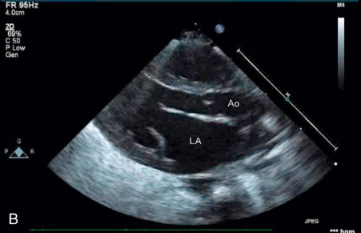

Unmatched source image; PDF page 1403. Consult the original caption.

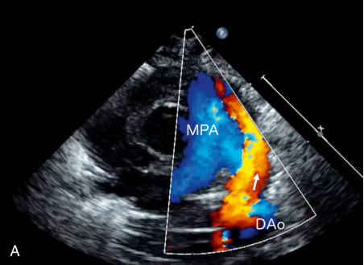

• Fig. 75.1 Echocardiographic imaging determining severity of ductal shunting. (A) Color flow Doppler study showing large patent ductus arteriosus with flow outlined by arrow from descending aorta (DAo) to main pulmonary artery (MPA) in parasternal short-axis view. (B) Increased LA:Ao ratio with dilated left atrium (LA) compared to aorta (Ao) on parasternal long axis view.

## PDF page 1404

### MPA

### PDA

A C

B D

### • Fig. 75.2 Echocardiographic imaging of ductal flow patterns. (A) Color Doppler through patent ductus

arteriosus (PDA) demonstrating right to left flow (blue denotes flow away from the probe from the main pulmonary artery [MPA] toward the aorta). (B) Right to left flow pattern. (C) Pulsatile flow pattern with high systolic to diastolic ratio. (D) Restrictive flow pattern with lower systolic to diastolic ratio.

TABLE

### Echocardiographic Correlates of Hemodynamic Significance of PDA

### 75.1

Echo Assessment Small PDA

Ductus Arteriosus

Narrowest diameter (mm) <1.5

Maximum flow velocity (m/s) >2

Ductal Shunt Magnitude

Left ventricular output (mL/kg/min) ≤314

Left atrial: aortic valve ratio <1.4:1

E wave to A wave ratio <1

Isovolumic relaxation time (ms) >45

Systemic Hypoperfusion

Descending aorta end diastolic flow Normal

Celiac artery end diastolic flow Normal

Middle cerebral artery end diastolic flow Normal

PDA, Patent ductus arteriosus. Adapted from Sehgal A, McNamara PJ. Does echocardiography facilitate determination of hemodynamic significance attributable to the ductus arteriosus? Eur J Pediatr. 2009;168:907–914; and Sehgal A, Paul E, Menahem S. Functional echocardiography in staging for ductal disease severity: role in predicting outcomes. Eur J Pediatr. 2013;172:179–184.

### systolic diastolic

Moderate PDA Large PDA

1.5–3 >3

1.5–2 <1.5

≤314 >314

1.4–1.6:1 >1.6:1

1–1.5 >1.5

36–45 <35

Decreased or absent Reversed

Decreased or absent Reversed

Decreased or absent Reversed

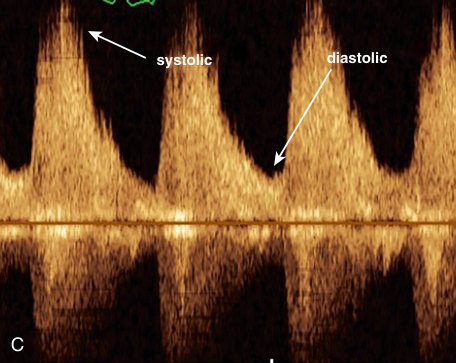

Unmatched source image; PDF page 1404. Consult the original caption.

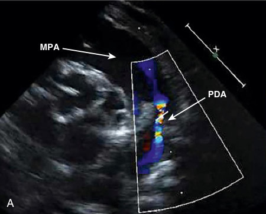

• Fig. 75.2 Echocardiographic imaging of ductal flow patterns. (A) Color Doppler through patent ductus arteriosus (PDA) demonstrating right to left flow (blue denotes flow away from the probe from the main pulmonary artery [MPA] toward the aorta). (B) Right to left flow pattern. (C) Pulsatile flow pattern with high systolic to diastolic ratio. (D) Restrictive flow pattern with lower systolic to diastolic ratio.

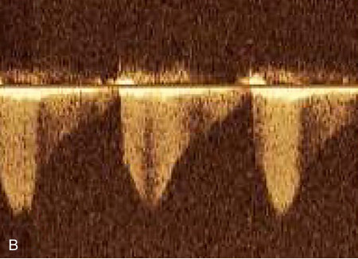

• Fig. 75.2 Echocardiographic imaging of ductal flow patterns. (A) Color Doppler through patent ductus arteriosus (PDA) demonstrating right to left flow (blue denotes flow away from the probe from the main pulmonary artery [MPA] toward the aorta). (B) Right to left flow pattern. (C) Pulsatile flow pattern with high systolic to diastolic ratio. (D) Restrictive flow pattern with lower systolic to diastolic ratio.

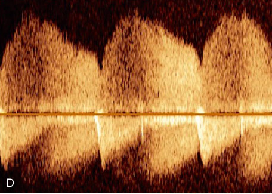

Unmatched source image; PDF page 1404. Consult the original caption.

## PDF page 1405 | printed page 1405

markers of ductal shunting, and decrease after the ductus arteriosus closes.26 Among infants less than 32 weeks’ gestation with PDA, NT-pro-BNP levels at 48 hours of age were higher in those who died or had grade III or IV IVH than in those who survived without IVH, and survivors with higher NT-pro-BNP levels had worse neurodevelopmental outcomes.27 Elevated levels of troponin T at 48 hours of age are associated with the presence of PDA, correlate with echocardiographic indicators of ductal shunting, predict death or grade III/IV IVH, and may help identify infants at greatest risk for impaired neurodevelopment at age 2 years.27 There is substantial heterogeneity in laboratory methodologies and reported serum levels across these studies, however, so their utility remains limited to screening candidates for

A

B

• Fig. 75.3 Doppler findings with hemodynamically significant patent ductus arteriosus. (A) Pulse wave Doppler demonstration of holodiastolic flow reversal in the descending aorta. (B) Pulse wave Doppler demonstration of antegrade flow throughout diastole in the descending aorta following indomethacin treatment of the same infant.

TABLE

Relationship Between Ductal Patency and Systemic and Regional Oxygen Measurements

75.2

No PDA PDA

n 64 41

Spo2 93.8 ± 1.88 93.7 ± 1.62

Cerebral rSpo2 79.3 ± 2.45 79.7 ± 2.27

Renal rSpo2 76.7 ± 7.64 71.1 ± 9.02a

Cerebral FTOE 0.15 ± 0.033 0.15 ± 0.026

Renal FTOE 0.18 ± 0.079 0.23 ± 0.092a

aSignificant difference from No PDA group. bSignificant difference from PDA group. All values expressed as mean ± SD. FTOE, Fractional tissue oxygen extraction by NIRS; hsPDA, echocardiographic demonstration of ductal left-to-right shunt, LA/Ao ratio ≥1.4 and ductus diameter >2 mm; No PDA, ductus arteriosus closure demonstrated by echocardiography; PDA, patent ductus arteriosus, not hemodynamically significant; rSpO2, regional tissue oxygenation by near infrared spectroscopy (NIRS); SpO2, arterial oxygen saturation by pulse oximetry. Adapted with permission from Navikiene J, Virsilas E, Vankeviciene R, et al. Brain and renal oxygenation measured by NIRS related to patent ductus arteriosus in preterm infants: a prospective observational study. BMC Pediatr. 2021;21:559.

echocardiography. There have been no studies evaluating these markers as criteria for intervention to close the ductus arteriosus.

Chest radiographs may demonstrate an enlarged cardiac silhouette, prominent pulmonary vascular markings, or evidence of pulmonary edema. Although these signs may suggest the diagnosis, they are nonspecific and insensitive.

### Management

Because PDA in preterm infants is strongly associated with adverse outcomes, surgical and medical strategies for closing the ductus arteriosus were widely adopted soon after they became available. Surgical ligation in preterm infants with RDS was first reported in 1968, and the first case series appeared in 1972. Medical induction of ductal closure with indomethacin was described in 1976. The conviction that ductal closure was beneficial became so pervasive that the landmark National Collaborative Study of indomethacin in preterm infants with PDA had no nontreatment arm: all three regimens mandated ductal closure by either indomethacin or ligation. These reports were followed by numerous descriptions of successful surgical or medical closure of the ductus, which heavily influenced practice for many years, but the utility of routine intervention to achieve ductal closure late in the first or during the second week of life has come into question.

The seminal reports that nonsteroidal anti-inflammatory drugs (NSAIDs, now called cyclo-oxygenase inhibitors) induce constriction and closure of the ductus arteriosus have been followed by more than 60 randomized, placebocontrolled trials of cyclo-oxygenase inhibitors in preterm infants.28–33 Indomethacin and ibuprofen are equally effective in reducing rates of persistent PDA, resulting in lower rates of ductal ligation. These agents may be less effective in achievement of ductal closure in the most immature

hsPDA P

18 —

91.7 ± 2.70a,b 0.001

77.0 ± 5.16a,b 0.004

67.4 ± 13.48a <0.001

0.16 ± 0.047 0.57

0.24 ± 0.117a 0.002

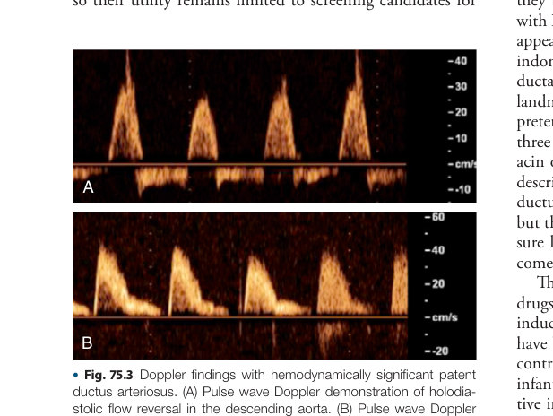

Unmatched source image; PDF page 1405. Consult the original caption.

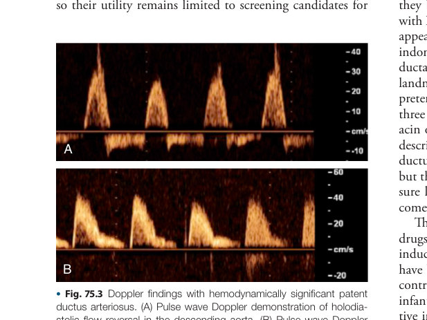

Unmatched source image; PDF page 1405. Consult the original caption.

## PDF page 1406

preterm infants; however, in a randomized trial in infants less than 27 weeks’ gestation, timing of ductal closure did not differ between the oral ibuprofen and placebo groups.34 Observational data from the 1970s suggested that indomethacin might be less likely to induce ductal closure in infants greater than 10 to 14 days of age, but contemporary experiences indicate that efficacy is not lost with increasing age, at least over the first 3 to 4 weeks35,36 and perhaps much longer.37 Repeated courses of indomethacin or ibuprofen may be effective in infants who do not respond to the first or second course.38 Acetaminophen is gaining favor as an equally effective alternative for PDA closure with fewer adverse effects,39 but its role in optimal management of preterm infants with PDA remains to be established.

Neither individual trials nor meta-analyses have identified improvements in long-term outcomes with these treatments.28 In early randomized trials, indomethacin prophylaxis started before 12 hours of age decreased rates of any IVH and of grade III/IV IVH. These effects are not achieved with later treatment2 nor with ibuprofen,40 do not appear to be mediated by PDA closure, and may not obtain in the current era, because baseline rates of IVH are now much lower.41 Reduction in IVH did not correlate with improved long-term neurodevelopmental outcomes. Compared with placebo-treated controls, infants given low-dose indomethacin prophylaxis had better vocabulary skills and a lower probability of an IQ less than 70 at age 4.5 years, but their mothers were more likely to describe them as having significant problems on the daily living domain of the Vineland scale at age 8. No effects on many other neurodevelopmental outcome measures were evident. Although indomethacin reduces cerebral, mesenteric, and renal arterial blood flow and is associated with diminished cerebral oxygen levels, reduced creatinine clearance, and oliguria, meta-analyses of randomized trials indicate that these hemodynamic changes do not increase mortality or potential complications, including BPD, NEC, bowel perforation, retinopathy of prematurity (ROP), or neurodevelopmental impairment.28 A randomized trial in preterm infants aged less than 28 weeks with moderate to large PDAs who were receiving respiratory support after the first week found that early routine treatment did not reduce PDA ligations or the presence of a PDA at discharge and did not improve any prespecified secondary outcomes. However, early treatment delayed full feeding and was associated with higher rates of late-onset sepsis and death in infants born at ≥26 weeks of gestation.42 The effect of prophylactic indomethacin on BPD risk remains unclear, with recent data from contemporary cohorts indicating either a decrease or no increase in BPD incidence.43,44 Co-administration of indomethacin with a glucocorticosteroid increases the risk of bowel perforation, however. Ibuprofen has less impact on cerebral and renal blood flow and minimal if any effect on mesenteric perfusion, so it is less likely than indomethacin to cause significant oliguria and may be less likely to be associated with NEC.45 In vitro studies suggest that ibuprofen may displace bilirubin from its binding site on albumin. Medical PDA

prophylaxis reduces severe pulmonary hemorrhage during the first week but not over the entire hospital course.46

Although many case series of surgical ligation have appeared, the three randomized trials that assessed the impact of this intervention demonstrated no consistent improvements in mortality or long-term morbidities.2 Ligation is a reliable method for closing the ductus arteriosus, but it is not without hazard. In up to one-third of infants, ligation precipitates severe left ventricular dysfunction and cardiorespiratory decompensation, requiring major increases in intensive care support in the immediate postoperative period. The risk of this complication decreases with postnatal age, so later ligations (at >4 weeks of age) are better tolerated than earlier surgeries. Infants who develop postoperative hypotension refractory to catecholamine infusion have lower postoperative serum cortisol levels than those who do not become hypotensive or respond to catecholamine treatment.47 Some have reported that milrinone infusion reduces postoperative hemodynamic instability,48 but others have not found this treatment to be beneficial.49 Other surgical complications include chylothorax, pneumothorax, phrenic or recurrent laryngeal nerve injury, and scoliosis.50 Paralysis of the left vocal cord, which occurs in up to 67% of ELBW infants following ductal ligation,51 is associated with prolongation of assisted ventilation and oxygen supplementation, a higher probability of BPD, feeding difficulties, tube feeding, longer neonatal hospitalization, and vocal and respiratory impairments in adulthood.52 Infants who undergo early ductal ligation are at increased risk for BPD and have higher rates of neurodevelopmental impairment; these adverse outcomes may result from the indication for surgery rather than the surgery itself.

Transcatheter ductus closure (TCC), the newest treatment option, has been demonstrated to be safe and effective.53 Devices have been FDA-approved for use in infants as small as 700 g. Adverse effects appear to be limited to rare device displacement or embolization, which have mostly been manageable by another catheter-based intervention. Although a few early reports described ischemic limb injury following arterial access, such events have been very rare since adoption of the femoral vein as the preferred access site. Post-procedure circulatory decompensation is much less common than with surgical ligation. It is not yet known if a more favorable adverse effect profile will lead to favorable effects on longterm outcomes, because there have been no controlled trials of this treatment. Consequently, the indications and optimal timing for this procedure are not yet clearly defined.

Current evidence indicates that routine, early treatment to achieve ductal closure does not improve long-term outcomes.2 Although some individual trials have found statistically significant effects on scattered outcomes, meta-analyses have found only reduction in IVH or IVH > grade II and increased ROP ≥ stage 3 to be significant in pooled data.28 Rates of untoward outcomes do not correlate with differences in rates of ductal closure among trials. Elimination of trials that frequently provided open treatment of infants in the “control” arm does not change these conclusions.28 Because

## PDF page 1407 | printed page 1407

most clinical trials addressed treatment early in the postnatal course, the effects of prolonged exposure to a moderate or large left-to-right shunt in ELBW infants remain unknown. Recent post hoc analyses from Clyman and colleagues have found that increased rates of BPD or of death or BPD are associated with prolonged PDA only for infants who require ongoing intubation for positive pressure ventilation, and that prolongation of PDA exposure beyond a threshold duration of 10 to 14 days does not further augment the incidence of those outcomes.54–56 Consequently, the indications (if any) for, potential benefits from, and optimal timing of later ductal closure remain indeterminate. Similarly, these global observations do not imply that there cannot be some infants for whom ductal closure would be beneficial, particularly within groups that are not well represented in those older studies (e.g., those <26 weeks’ gestation).

Better strategies for assessment of the magnitude of ductal shunting, based on echocardiographic findings such as those listed in Table 75.1 or scores based on those measurements with or without additional clinical or biomarker variables,17,19 promise to help identify infants who may be candidates for ductal closure,16,17 but benefits of treatment for infants selected using such criteria remain to be demonstrated. Until such information is available, practice will be guided by consensus, belief, and individualized clinical judgment. The perceived balance between benefits (reduced IVH and early pulmonary hemorrhage) and disadvantages (more severe respiratory disease, intestinal perforation with concomitant glucocorticoid use) will guide the choice between the use and avoidance of indomethacin prophylaxis. High rates of spontaneous closure in infants greater than 1000 g, and their demonstrated ability to tolerate longer periods of ductal shunting, support a permissive approach to PDA management. Infants weighing less than 1000 g who develop hypotension or overt congestive heart failure may be deemed to require ductal closure, but the criteria for that decision remain uncertain.

Experience with less aggressive strategies for management of PDA continues to accumulate. Although earlier studies mostly described effects of moderate reductions in the proportion of infants with PDA who received treatment, there are now several reports of cohorts and randomized trials in which treatment was rarely used. Although some cohort studies suggest an increase in adverse outcomes with adoption of conservative PDA management practices, randomized trials consistently fail to demonstrate differences in outcomes between groups managed with or without active PDA closure. Elimination of cyclo-oxygenase inhibitor treatment in 139 infants less than 30 weeks’ gestation who required ventilation and surfactant replacement was associated with lower rates of chronic lung disease (8% vs. 18%– 28%) and NEC (0% vs. 4%–6%) and comparable rates of IVH (7% vs. 6%–7%) and mortality (13% vs. 12%), versus network benchmarks, and ligation was used in fewer than 5%.57 Adoption of a conservative treatment approach in 72 VLBW infants (<1500 g) was followed by a significant reduction in the rate of oxygen use or ventilation at

36 weeks’ postmenstrual age (from 49% in prior treatment eras to 18%) among those diagnosed with PDA, despite treatment of PDA with ibuprofen in only 7% of cases and no use of ligation, without any increase in rates of NEC, IVH/PVL, or death.7 Among 132 infants 23 to 26 weeks’ gestation who required ventilation and had an hsPDA at least 2 mm in diameter, transition from mandatory PDA closure to nonintervention eliminated indomethacin use and ligation (compared to baseline rates of 58% and 82%, respectively). BPD declined from 58% to 38% (P = .006), without changes in other morbidities or mortality.58 In 321 infants weighing less than 1500 g monitored by serial echocardiography, fewer than 5% were treated for PDA, and rates of chronic lung disease, severe IVH, PVL, NEC, and severe ROP compared favorably to contemporaneous Vermont Oxford Network benchmarks.4 After adoption of a noninterventional strategy at one center, mortality among infants less than 26 weeks, BPD in those 26 to 29 weeks’ gestation, and BPD or death in both groups significantly declined.9 These experiences do not prove that permissive management strategies for preterm infants with PDA result in improved outcomes, because better outcomes may result from contemporaneous changes in other practices, but they do indicate that permissive approaches to PDA management do not substantially worsen outcomes. Available data do not exclude possible effects of nontreatment that have not been studied, such as late development of pulmonary hypertension or pulmonary veno-occlusive disease, so vigilance for unexpected sequelae of practice changes is necessary.

Growing awareness that aggressive intervention to achieve ductal closure may not be beneficial should not lead to an assumption that a persistently patent ductus arteriosus can simply be ignored. As with other large shunts, the hemodynamic and secondary pulmonary, cerebral, or visceral effects may require active management.50 Factors that may delay ductal closure, such as late-onset bacterial infection or excessive fluid administration (>150 mL/kg/day), should be avoided. Furosemide apparently does not compromise ductal closure in response to indomethacin59 but may prolong ductal patency in untreated infants. Circulatory imbalance, while the ductus arteriosus remains patent, may be managed by measures that increase PVR (permissive hypercapnia, increased distending airway pressure, or maintenance of a higher hematocrit) or that avoid or correct circumstances that may lower PVR (metabolic alkalosis, excessive supplemental oxygen, NO). Reduced systemic blood flow may be improved by agents that decrease systemic afterload (captopril, milrinone) or exacerbated by those that increase systemic vascular resistance (systemic vasopressor agents), which may increase diversion of cardiac output to the pulmonary circulation. Compromised systemic cardiac output may also be helped by measures that increase PVR, reducing ductal steal (Q̇ P/Q̇ S), and by increasing total cardiac output if Q̇ P/Q̇ S remains constant. Ensuring adequacy of preload may require invasive monitoring of central venous pressures or frequent assessment with functional echocardiography. Hydrocortisone and/or cardiotonic agents may be useful in

## PDF page 1408

hypotensive infants. Congestive heart failure can be managed with the usual strategies of preload reduction (fluid restriction, diuretics), inotropic support, and afterload reduction. It may be useful to prevent or correct ancillary factors that may predispose to pulmonary edema (hypoproteinemia, bacteremia) or augment the risk of injury to the

Key Points

### • Delayed closure of the ductus arteriosus is common in

extremely premature neonates and is associated with a variety of untoward outcomes, but there is a lack of evidence for improvement in outcomes with treatment for closure.

### • Observational studies of nonintervention strategies

provide evidence that permissive approaches to patent ductus arteriosus (PDA) management do not appear to worsen outcomes; however, some data suggest an association between patency of a large ductus arteriosus and bronchopulmonary dysplasia (BPD).

### References

1. Burnard ED. The cardiac murmur in relation to symptoms in the

newborn. BMJ. 1959;1:134–138. PMID: 13618575. 2. Benitz WE. Treatment of persistent patent ductus arteriosus in

preterm infants: time to accept the null hypothesis? J Perinatol. 2010;30:241–252. PMID: 20182439. 3. Ovali F. Molecular and mechanical mechanisms regulating ductus

arteriosus closure in preterm infants. Front Pediatr. 2020;8:516. PMID: 32984222. 4. Semberova J, Sirc J, Miletin J, et al. Spontaneous closure

of patent ductus arteriosus in infants ≤ 1500 g. Pediatrics. 2017;140:e20164258. PMID: 28701390. 5. Sung SI, Chang YS, Kim J, et al. Natural evolution of ductus

arteriosus with noninterventional conservative management in extremely preterm infants born at 23-28 weeks of gestation. PLoS One. 2019;14:e0212256. PMID: 30759169. 6. Sirc J, Kucera J, Semberova J, et al. Spontaneous closure of patent

ductus arteriosus is presumable in very low birth weight infants. Arch Dis Child. 2012;97:A331. 7. Letshwiti JB, Semberova J, Pichova K, et al. A conservative treat-

ment of patent ductus arteriosus in very low birth weight infants. Early Hum Dev. 2017;104:45–49. PMID: 28042972. 8. Karpuz D, Çelik Y, Bozlu G, et al. Outcomes of conservative

treatment in infants with patent ductus arteriosus. Cukurova Med J. 2018;43: 1–1. 9. de Carvalho Nunes G, Wutthigate P, Simoneau J, et al. Natu-

ral evolution of the patent ductus arteriosus in the extremely premature newborn and respiratory outcomes. J Perinatol. 2022;42:642–648. PMID: 34815521. 10. Liu C, Zhu X, Li D, et al. Related factors of patent ductus arte-

riosus in preterm infants: a systematic review and meta-analysis. Front Pediatr. 2020;8:605879. PMID: 33469523. 11. Lee JA, Sohn JA, Oh S, et al. Perinatal risk factors of symptomatic

preterm patent ductus arteriosus and secondary ligation. Pediatr Neonatol. 2020;61:439–446. PMID: 32362475. 12. Mirza H, Garcia J, Bell C, et al. Fluid intake in the first week

of life and the duration of hemodynamically significant patent ductus arteriosus in extremely preterm infants. Am J Perinatol. 2023;40:1345–1350. PMID: 34384119.

brain (infection, anemia, hypoglycemia), kidneys (hypovolemia, nephrotoxic drugs), or bowel. These measures must be chosen and balanced carefully to ensure optimal effect; excessive fluid restriction to avoid pulmonary edema may exacerbate renal ischemia, for example. None of these strategies has been evaluated in clinical trials.

### • Presence of a ductus arteriosus in premature neonates

may lead to hemodynamic and secondary pulmonary, cerebral, or visceral effects that may require active management, such as fluid restriction, ventilator adjustments, or circulatory support.

### • Evaluation with clinical tools such as biomarkers or

echocardiography may delineate a population of preterm infants who will benefit from medical or surgical closure of the ductus arteriosus.

13. Hundscheid T, van den Broek M, van der Lee R, et al. Under-

standing the pathobiology in patent ductus arteriosus in prematurity-beyond prostaglandins and oxygen. Pediatr Res. 2019;86:28–38. PMID: 30965358. 14. Kim ES, Kim EK, Choi CW, et al. Intrauterine inflammation as

a risk factor for persistent ductus arteriosus patency after cyclooxygenase inhibition in extremely low birth weight infants. J Pediatr. 2010;157:745–750. PMID: 20598319. 15. Smith A, Maguire M, Livingstone V, et al. Peak systolic to end

diastolic flow velocity ratio is associated with ductal patency in infants below 32 weeks of gestation. Arch Dis Child Fetal Neonatal Ed. 2015;100:F132–136. PMID: 25406463. 16. Sehgal A, Paul E, Menahem S. Functional echocardiography in

staging for ductal disease severity: role in predicting outcomes. Eur J Pediatr. 2013;172:179–184. PMID: 23052621. 17. El-Khuffash A, James AT, Corcoran JD, et al. A patent ductus arte-

riosus severity score predicts chronic lung disease or death before discharge. J Pediatr. 2015;167:1354–1361. PMID: 26474706. 18. Shepherd JL, Noori S. What is a hemodynamically significant

PDA in preterm infants? Congenit Heart Dis. 2019;14:21–26. PMID: 30548469. 19. Fink D, El-Khuffash A, McNamara PJ, et al. Tale of two patent

ductus arteriosus severity scores: similarities and differences. Am J Perinatol. 2018;35:55–58. PMID: 28787748. 20. Schena F, Francescato G, Cappelleri A, et al. Association between

hemodynamically significant patent ductus arteriosus and bronchopulmonary dysplasia. J Pediatr. 2015;166:1488–1492. PMID: 25882876. 21. Navikiene J, Virsilas E, Vankeviciene R, et al. Brain and renal

oxygenation measured by NIRS related to patent ductus arteriosus in preterm infants: a prospective observational study. BMC Pediatr. 2021;21:559. PMID: 34886825. 22. Poon WB, Tagamolila V. Cerebral perfusion and assessing hemo-

dynamic significance for patent ductus arteriosus using near infrared red spectroscopy in very low birth weight infants. J Matern Fetal Neonatal Med. 2021;34:1645–1650. PMID: 31303077. 23. Dix L, Molenschot M, Breur J, et al. Cerebral oxygenation and

echocardiographic parameters in preterm neonates with a patent ductus arteriosus: an observational study. Arch Dis Child Fetal Neonatal Ed. 2016;101:F250–F526. PMID: 27034323.

## PDF page 1409 | printed page 1409

24. van der Laan ME, Roofthooft MT, Fries MW, et al. A hemo-

dynamically significant patent ductus arteriosus does not affect cerebral or renal tissue oxygenation in preterm infants. Neonatology. 2016;110:141–147. PMID: 27088709. 25. Weisz DE, McNamara PJ, El-Khuffash A. Cardiac biomark-

ers and haemodynamically significant patent ductus arteriosus in preterm infants. Early Hum Dev. 2017;105:41–47. PMID: 27998626. 26. Sellmer A, Hjortdal VE, Bjerre JV, et al. Cardiovascular biomark-

ers in the evaluation of patent ductus arteriosus in very preterm neonates: a cohort study. Early Hum Dev. 2020;149:105142. PMID: 32861196. 27. El-Khuffash AF, Slevin M, McNamara PJ, Troponin T, et al.

N-terminal pro natriuretic peptide and a patent ductus arteriosus scoring system predict death before discharge or neurodevelopmental outcome at 2 years in preterm infants. Arch Dis Child Fetal Neonatal Ed. 2011;96:F133–F137. PMID: 21071684. 28. Sankar MN, Benitz WE. Does crossover treatment of control sub-

jects invalidate results of randomized trials of patent ductus arteriosus treatment? J Perinatol. 2020;40:1863–1870. PMID: 33024260. 29. Hirano S, Fujimura M, Kusuda S, et al. Randomized control

trial for the prevention of intraventricular hemorrhage and patent ductus arteriosus by indomethacin in Japanese extremely low birth weight infants. Jpn J Dev Pharmacol Ther. 2007;20:98–102. PMID:. 30. Lin XZ, Chen HQ, Zheng Z, et al. [Therapeutic effect of early

administration of oral ibuprofen in very low birth weight infants with patent ductus arteriosus]. Zhongguo Dang Dai Er Ke Za Zhi. 2012;14:502–505. PMID: 22809601. 31. El-Khuffash A, Bussmann N, Breatnach CR, et al. A pilot ran-

domized controlled trial of early targeted patent ductus arteriosus treatment using a risk based severity score (The PDA RCT). J Pediatr. 2021;229:127–133. PMID: 33069668. 32. Roze JC, Cambonie G, Le Thuaut A, et al. Effect of early targeted

treatment of ductus arteriosus with ibuprofen on survival without cerebral palsy at 2 years in infants with extreme prematurity: a randomized clinical trial. J Pediatr. 2021;233:33–42. PMID: 33307111. 33. Potsiurko S, DO Dobryanskyy, Sekretar L, et al. Randomized

Non-inferiority Trial of Expectant Management versus Early Treatment of Patent Ductus Arteriosus in Preterm Infants. Am J Perinatol. 2022. (online ahead of print) PMID: 35213904. 34. Sung SI, Lee MH, Ahn SY, et al. Effect of nonintervention vs

oral ibuprofen in patent ductus arteriosus in preterm infants: a randomized clinical trial. JAMA Pediatr. 2020;174:755–763. PMID: 32539121. 35. Gudmundsdottir A, Johansson S, Hakansson S, et al. Timing

of pharmacological treatment for patent ductus arteriosus and risk of secondary surgery, death or bronchopulmonary dysplasia: a population-based cohort study of extremely preterm infants. Neonatology. 2015;107:87–92. PMID: 25412681. 36. Liebowitz M, Kaempf J, Erdeve O, et al. Comparative effective-

ness of drugs used to constrict the patent ductus arteriosus: a secondary analysis of the PDA-TOLERATE trial (NCT01958320). J Perinatol. 2019;39:599–607. PMID: 30850756. 37. Frauenfelder O, vanBeynum IM, Reiss IK, et al. Ibuprofen for

ductus arteriosus months after birth. Case Rep Pediatr. 2016; 2016:1–3. PMID: 27403365. 38. van der Lugt NM, Lopriore E, Bokenkamp R, et al. Repeated

courses of ibuprofen are effective in closure of a patent ductus arteriosus. Eur J Pediatr. 2012;171:1673–1677. PMID: 22864766.

39. Manalastas M, Zaheer F, Nicoski P, et al. Acetaminophen

therapy for persistent patent ductus arteriosus. NeoReviews. 2021;22:e320–e331. PMID: 33931477. 40. Dani C, Bertini G, Pezzati M, et al. Prophylactic ibupro-

fen for the prevention of intraventricular hemorrhage among preterm infants: a multicenter, randomized study. Pediatrics. 2005;115:1529–1535. PMID: 15930213. 41. Foglia EE, Roberts RS, Stoller JZ, et al. Effect of prophylactic

indomethacin in extremely low birth weight infants based on the predicted risk of severe intraventricular hemorrhage. Neonatology. 2018;113:183–186. PMID: 29258076. 42. Clyman RI, Liebowitz M, Kaempf J, et al. PDA-TOLERATE

Trial: an exploratory randomized controlled trial of treatment of moderate-to-large patent ductus arteriosus at 1 week of age. J Pediatr. 2019;205:41–48. PMID: 30340932. 43. Jensen EA, Dysart KC, Gantz MG, et al. Association between

use of prophylactic indomethacin and the risk for bronchopulmonary dysplasia in extremely preterm infants. J Pediatr. 2017;186:34–40. PMID: 28258737. 44. Liebowitz M, Clyman RI. Prophylactic indomethacin compared

with delayed conservative management of the patent ductus arteriosus in extremely preterm infants: effects on neonatal outcomes. J Pediatr. 2017;187:119–126. PMID: 28396025. 45. Ohlsson A, Walia R, Shah SS. Ibuprofen for the treatment of

patent ductus arteriosus in preterm or low birth weight (or both) infants. Cochrane Database Syst Rev. 2020;2:CD003481. PMID: 32045960. 46. Kluckow M, Jeffery M, Gill A, et al. A randomised placebo-con-

trolled trial of early treatment of the patent ductus arteriosus. Arch Dis Child Fetal Neonatal Ed. 2014;99:F99–F104. PMID: 24317704. 47. Clyman RI, Wickremasinghe A, Merritt TA, et al. Hypotension

following patent ductus arteriosus ligation: the role of adrenal hormones. J Pediatr. 2014;164:1449–1455.e1441. PMID: 24636853. 48. Jain A, Sahni M, El-Khuffash A, et al. Use of targeted neona-

tal echocardiography to prevent postoperative cardiorespiratory instability after patent ductus arteriosus ligation. J Pediatr. 2012;160:584–589.e581. PMID: 22050874. 49. Halliday M, Kavarana M, Ebeling M, et al. Milrinone use for

hemodynamic instability in patent ductus arteriosus ligation. J Matern Fetal Neonatal Med. 2017;30:529–533. PMID: 27072674. 50. Benitz WE. Learning to live with patency of the ductus arterio-

sus in preterm infants. J Perinatol. 2011;31(suppl 1):S42–S48. PMID: 21448203. 51. Benjamin JR, Smith PB, Cotten CM, et al. Long-term morbidi-

ties associated with vocal cord paralysis after surgical closure of a patent ductus arteriosus in extremely low birth weight infants. J Perinatol. 2010;30:408–413. PMID: 19759545. 52. Roksund OD, Clemm H, Heimdal JH, et al. Left vocal cord

paralysis after extreme preterm birth, a new clinical scenario in adults. Pediatrics. 2010;126:e1569–e1577. PMID: 21098147. 53. Kuntz MT, Staffa SJ, Graham D, et al. Trend and outcomes for

surgical versus transcatheter patent ductus arteriosus closure in neonates and infants at US Children’s Hospitals. J Am Heart Assoc. 2021:e022776. PMID: 34970919. 54. Clyman RI, Hills NK, Liebowitz M, et al. Relationship between

duration of infant exposure to a moderate-to-large patent ductus arteriosus shunt and the risk of developing bronchopulmonary dysplasia or death before 36 weeks. Am J Perinatol. 2020;37:216– 223. PMID: 31600791. 55. Clyman RI, Kaempf J, Liebowitz M, et al. Prolonged tracheal

intubation and the association between patent ductus arteriosus

## PDF page 1410

and bronchopulmonary dysplasia: a secondary analysis of the PDA-TOLERATE trial. J Pediatr. 2021;229:283–288. PMID: 32979387. 56. Clyman RI, Hills NK, Cambonie G, et al. Patent ductus arte-

riosus, tracheal ventilation, and the risk of bronchopulmonary dysplasia. Pediatr Res. 2022;91:652–658. PMID: 33790415. 57. Vanhaesebrouck S, Zonnenberg I, Vandervoort P, et al. Con-

servative treatment for patent ductus arteriosus in the preterm. Arch Dis Child Fetal Neonatal Ed. 2007;92:F244–F247. PMID: 17213270.

58. Sung SI, Chang YS, Chun JY, et al. Mandatory closure versus

nonintervention for patent ductus arteriosus in very preterm infants. J Pediatr. 2016;177:66–71. PMID: 27453374. 59. Lee BS, Byun SY, Chung ML, et al. Effect of furosemide on

ductal closure and renal function in indomethacin-treated preterm infants during the early neonatal period. Neonatology. 2010;98:191–199. PMID: 20234144.

<!-- SOURCE_LAYOUT_VIEWS -->

## Original layout views and recovered diagrams

Automatic extraction can flatten tables and superscripts. Check the original layout for numeric data, footnotes and image credits. [Source review notes](../../SOURCE_REVIEW_NOTES.md).

### Original source page 1403

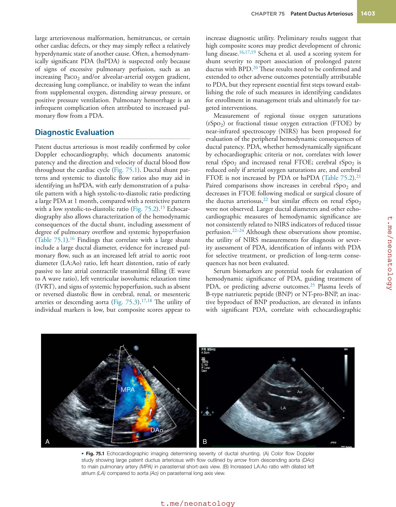

### Original source page 1404

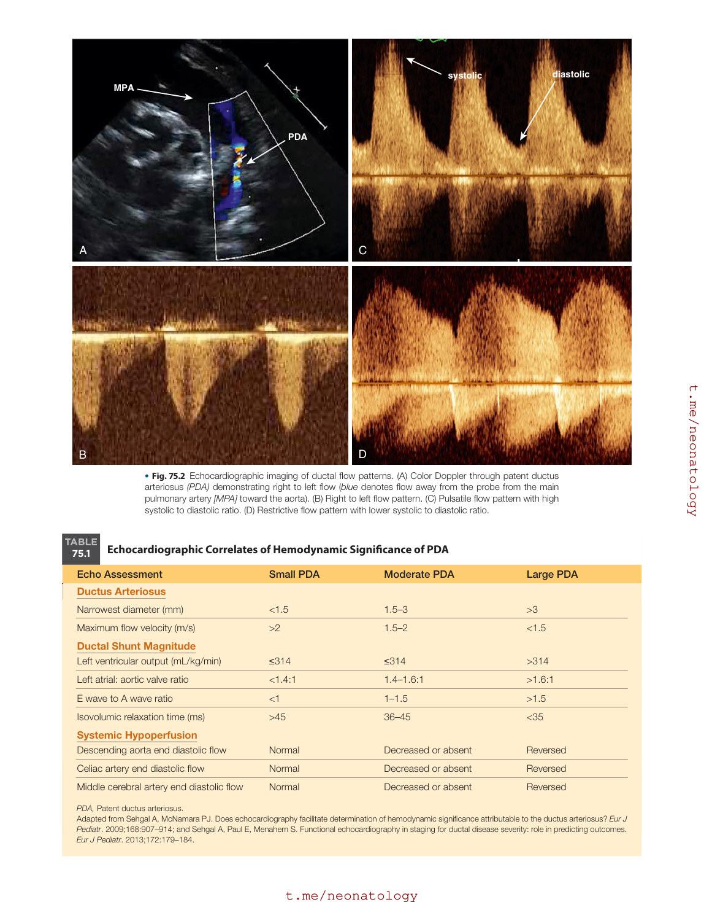

### Original source page 1405

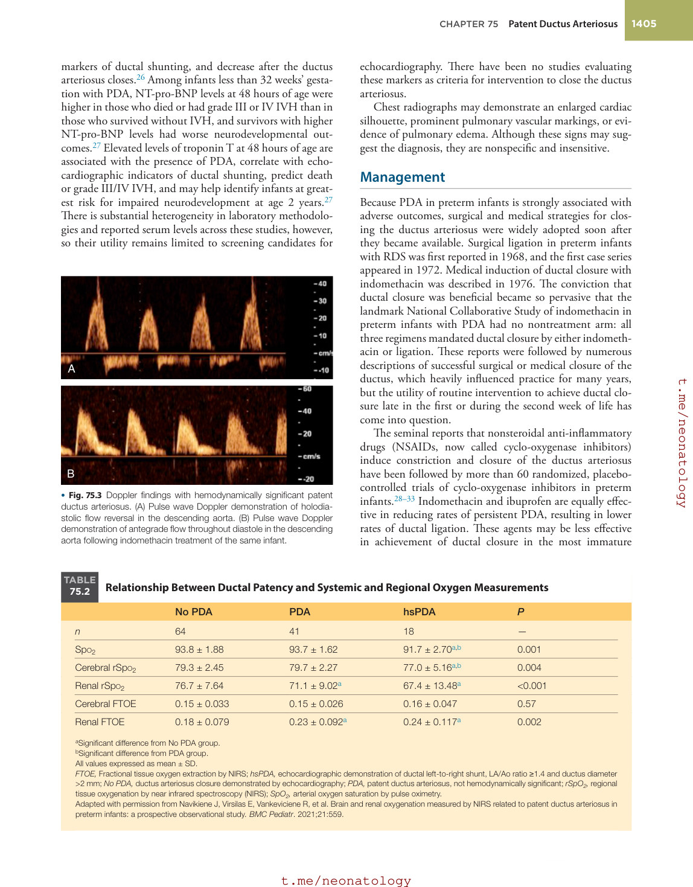

### Original source page 1407

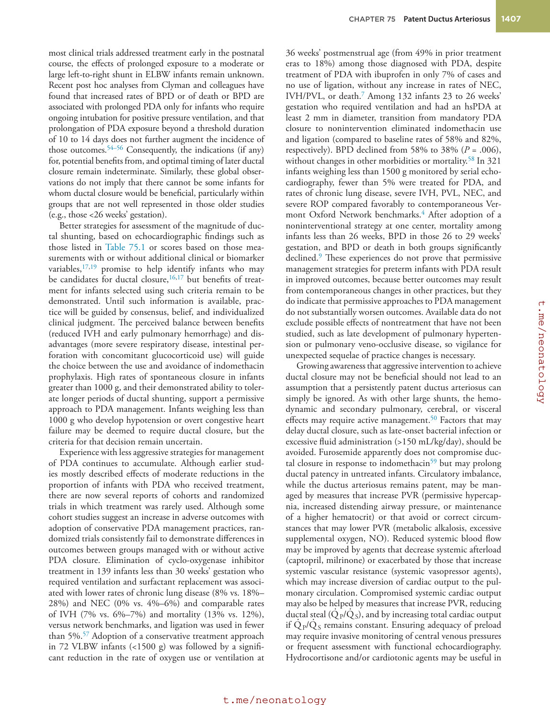
