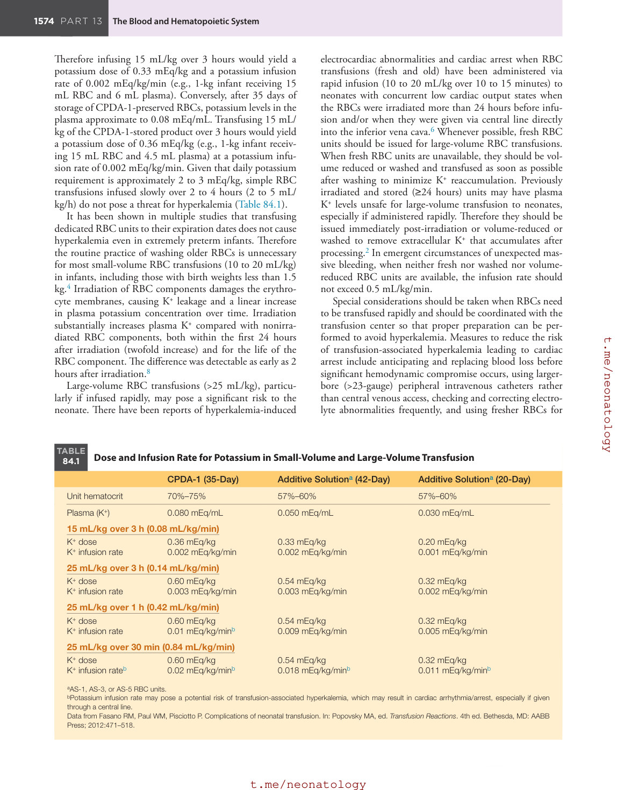
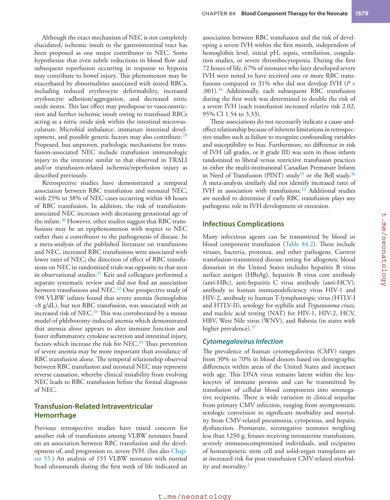
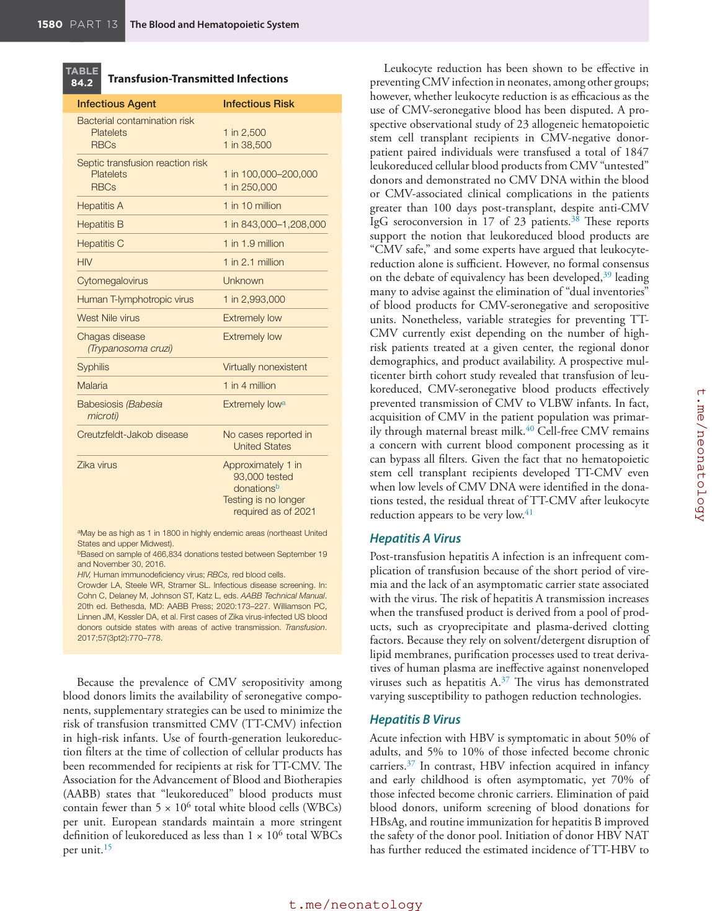
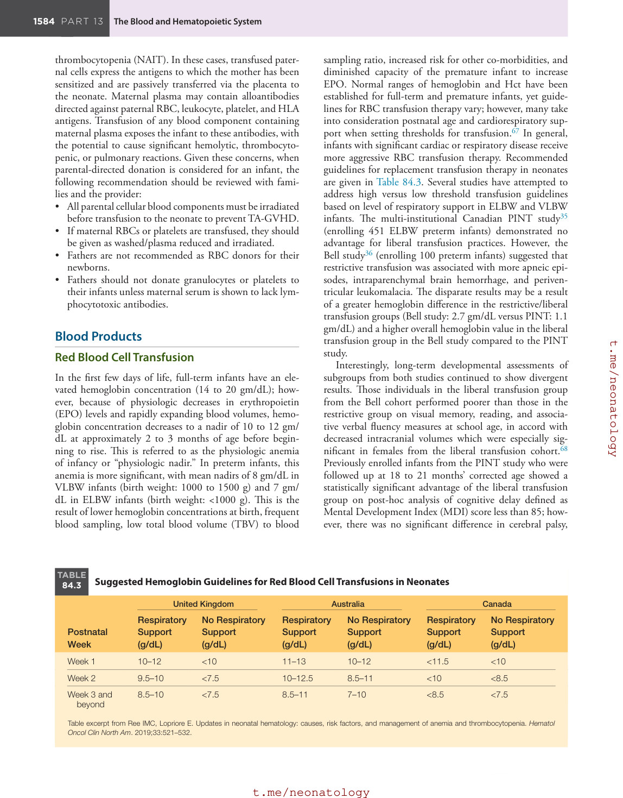
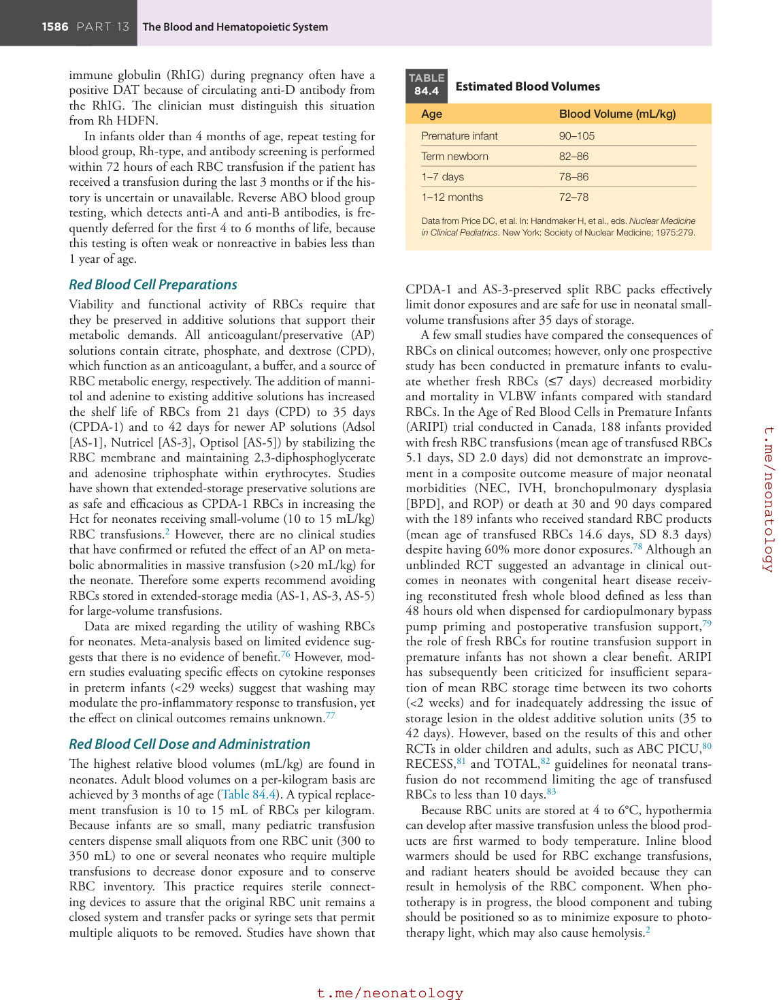

# 84. Blood Component Therapy for the Neonate
> [Source credits](../../SOURCE_CREDITS.md).

## Study pillars

### Neonatal susceptibility

Immature handling of product solutes with a small circulating blood volume. Immature organ function and limited blood volume increase susceptibility to glucose, potassium and calcium disturbances.

PDF p. 1572

### Citrate and calcium

Citrate-associated calcium binding with limited neonatal citrate handling. Large citrate loads may cause symptomatic hypocalcemia, especially with immature metabolism; exchange differs from a small-volume transfusion.

PDF p. 1574

### CMV transmission

Leukocytes. CMV remains latent in donor leukocytes and may be transmitted in cellular components; vulnerability is greatest in selected high-risk recipients.

PDF p. 1578

### Platelet trial interpretation

The higher-threshold group had more new major bleeding or death. In the cited premature-infant trial, the more liberal threshold was associated with more major bleeding or death; the result must be interpreted in its studied context.

PDF p. 1586

### Plasma purpose

Plasma. Plasma supplies factors and is used for selected acquired deficiencies, including DIC or liver-related coagulopathy.

PDF p. 1588

## Full source extraction

# 84. Blood Component Therapy for the Neonate
> Source attribution: [Source credits](../../SOURCE_CREDITS.md).

## PDF page 1571 | printed page 1572

84 Blood Component Therapy for the Neonate

### CYRIL JACQUOT, YUNCHUAN DELORES MO, AND JENNIFER WEBB

### ABBREVIATIONS

AABB: Association for the Advancement of Blood and

Biotherapies AIDS: acquired immunodeficiency syndrome Anti-HBc: hepatitis B virus core antibody AP: anticoagulant/preservative aPTT: activated partial thromboplastin time ARDS: acute respiratory distress syndrome ARIPI: Age of Red Blood Cells in Premature Infants AS-1: additive solution (Adsol)—other examples are AS-3

and AS-5 ATR: allergic transfusion reaction BPD: bronchopulmonary dysplasia CMV: cytomegalovirus CPD: citrate, phosphate, and dextrose CPDA-1: citrate-phosphate-dextrose-adenine DAA: direct-acting antivirals DAT: direct antiglobulin test DEHP: di-(2-diethylhexyl) phthalate DHTR: delayed hemolytic transfusion reaction DIC: disseminated intravascular coagulation ECMO: extracorporeal membrane oxygenation ELBW: extremely low birth weight EPO: erythropoietin ESA: erythropoiesis-stimulating agent ETTNO: Effects of Transfusion Thresholds on Neurocognitive

Outcome of Extremely Low-Birth-Weight Infants EU: platelet equivalent unit FDA: Food and Drug Administration FFP: fresh frozen plasma FNHTR: febrile nonhemolytic transfusion reaction FP24: plasma frozen within 24 hours of phlebotomy GCSF: granulocyte colony stimulating factor HBsAg: hepatitis B virus surface antigen HCV: hepatitis C virus Hct: hematocrit HDFN: hemolytic disease of the fetus and newborn HIV: human immunodeficiency virus

1572

HLA: human leukocyte antigen HPA: human platelet antigen HTLV: human T-lymphotropic virus HUS: hemolytic uremic syndrome IVH: intraventricular hemorrhage IVIG: intravenous immunoglobulin MDI: Mental Development Index score NAIT: neonatal alloimmune thrombocytopenia NAT: nucleic acid testing NEC: neonatal enterocolitis PAS: platelets in additive solution PCC: prothrombin complex concentrates PDA: patent ductus arteriosus PR: pathogen reduction PT: prothrombin time RBC: red blood cells RCT: randomized controlled trial RhIG: Rh immune globulin RING: Resolving Infection in Neutropenia with Granulocytes ROP: retinopathy of prematurity SARS-CoV-2: severe acute respiratory syndrome

coronavirus-2 SCID: severe combined immunodeficiency S/D: solvent/detergent TACO: transfusion-associated circulatory overload TAD: transfusion-associated dyspnea TA-GVHD: transfusion-associated graft versus host disease TBV: total blood volume TOP: Transfusion of Prematures trial TRALI: transfusion-related acute lung injury TT-CMV: transfusion-transmitted cytomegalovirus UVB: ultraviolet B VLBW: very low birth weight vWF: von Willebrand factor WNV: West Nile virus ZIKV: Zika virus

## PDF page 1572 | printed page 1573

### Special Considerations for Transfusion Therapy in the Neonate

Neonates constitute one of the most heavily transfused patient groups in the hospital. In a Canadian study, over 40% of very low birth weight (VLBW) infants and greater than 90% of extremely low birth weight infants (ELBW; birth weight of less than 1000 g) received at least one red blood cell (RBC) transfusion during their initial hospitalization.1 Neonatal transfusion practices differ substantially from adult and pediatric transfusion practices because of unique differences in neonatal physiology. Neonates have small blood volumes when compared with older children and adults but high blood volume per body weight. Their immature organ system function predisposes them to metabolic derangements from blood products and additive solutions and to the infectious and immunomodulatory hazards of transfusion such as transfusion-transmitted cytomegalovirus (TT-CMV) infection and transfusion-associated graftversus-host disease (TA-GVHD). Neonates undergo rapid growth but have a limited capacity to expand their blood volume. In addition, passive transfer of maternal antibodies to the immunologically naïve newborn creates unique compatibility scenarios not commonly encountered in children or adults. Their responses to stresses, including hypothermia, hypovolemia, hypoxia, and acidosis, are dependent on gestational age, birth weight, and co-morbidities. These considerations necessitate special approaches to transfusion therapy in the neonate.2

### Risks of Transfusion Therapy

Advances in donor recruitment, blood screening, and processing have decreased the risks associated with blood transfusion. As part of patient blood management, current transfusion considerations and guidelines focus on reducing both transfusion number and donor exposures while striving to minimize iatrogenic blood losses. Nevertheless, hematologic, immunologic, infectious, cardiovascular, and metabolic complications can occur. Many of these risks exist for transfusion recipients of any age, whereas others pose a greater threat to the neonatal recipient. These potential risks affect the choice and processing of blood products. Parents must be advised of the risks, benefits, and alternatives to transfusion, and informed consent should be documented in the medical record along with the indications for, and results of, the prescribed transfusion.

### Metabolic Complications

Neonates, especially extremely premature infants, are more susceptible to metabolic alterations caused by the immaturity of many of their organ systems. Glucose imbalances, hyperkalemia, and hypocalcemia are the most common metabolic derangements related to transfusion, owing to the inability of the infant to efficiently metabolize and/or excrete elements intrinsic to blood and blood components,

including anticoagulants, preservative solutions, and other solutes that accumulate during refrigerated storage.

### Hypoglycemia

Hypoglycemia (see Chapter 90) can result from the combination of decreased glucose infusion rates during transfusion and impaired glycogenolysis and gluconeogenesis within the liver of the preterm neonate. Continuous glucose infusion rates of greater than 3 to 4 mg/kg/min are often required in preterm infants; if maintenance fluids are suspended during transfusion, glucose infusion rates can decrease to approximately 0.2 mg/kg/min for citrate-phosphate-dextrose-adenine (CPDA-1) preserved RBCs and 0.5 mg/kg/min for the RBC additive Adsol (AS-1) preserved RBCs. In neonatal intensive care units, holding feeds during blood transfusions, particularly for premature infants, has become a common practice to decrease the risk of neonatal enterocolitis (NEC) and generally does not result in adverse nutritional outcomes.3 Reported incidences of hypoglycemia in neonates either during or after exchange transfusions range from 1.4% to 3.6%. Hypoglycemia occurring after exchange transfusion is believed to be caused by intraprocedural hyperglycemia (from the dextrose in blood additive solutions), which causes rebound hypoglycemia from insulin secretion.4 Preventive measures for transfusion-associated hypoglycemia include recognizing those infants at risk for developing glucose homeostatic imbalances, continuing the infusion of maintenance fluids rich in dextrose (albeit at a slower rate) to maintain an adequate glucose infusion rate during simple transfusions, and close monitoring of blood glucose during both small and large volume transfusions. To minimize the risk of RBC hemolysis and/or agglutination, dextrose-rich fluids should be infused in a separate intravenous line from the blood transfusion.5

### Hyperkalemia

The risk of transfusion-induced hyperkalemia is directly related to the magnitude of the K+ load delivered with RBC transfusion, which depends on the age, plasma volume, and plasma concentration of K+ of the unit, and the rate at which K+ is delivered (potassium infusion rate). Potassium infusion rates greater than 0.01 mEq/kg/min may pose a potential risk of transfusion-associated hyperkalemia and have been shown to result in cardiac arrhythmia/arrest in neonates.6 As stored RBCs age, intracellular potassium leaks out into the plasma and raises the extracellular potassium level within the component. Units of RBCs in extendedstorage media (AS-1, AS-3, AS-5) have a hematocrit (Hct) of approximately 60%, and RBCs stored in CPDA-1 have an Hct of approximately 70%. Furthermore, some pediatric transfusion centers centrifuge RBC aliquots before transfusions for neonates to further reduce the plasma component to 20% (e.g., RBC unit: Hct >80%). Such an approach helps reduce the content of potassium, mannitol, and RBC microvesicles in irradiated RBC aliquots stored up to 21 days.7 After 42 days of storage, K+ levels in the plasma of an AS-1-preserved RBC unit approximate to 0.05 mEq/mL.

## PDF page 1573

Therefore infusing 15 mL/kg over 3 hours would yield a potassium dose of 0.33 mEq/kg and a potassium infusion rate of 0.002 mEq/kg/min (e.g., 1-kg infant receiving 15 mL RBC and 6 mL plasma). Conversely, after 35 days of storage of CPDA-1-preserved RBCs, potassium levels in the plasma approximate to 0.08 mEq/mL. Transfusing 15 mL/ kg of the CPDA-1-stored product over 3 hours would yield a potassium dose of 0.36 mEq/kg (e.g., 1-kg infant receiving 15 mL RBC and 4.5 mL plasma) at a potassium infusion rate of 0.002 mEq/kg/min. Given that daily potassium requirement is approximately 2 to 3 mEq/kg, simple RBC transfusions infused slowly over 2 to 4 hours (2 to 5 mL/ kg/h) do not pose a threat for hyperkalemia (Table 84.1).

It has been shown in multiple studies that transfusing dedicated RBC units to their expiration dates does not cause hyperkalemia even in extremely preterm infants. Therefore the routine practice of washing older RBCs is unnecessary for most small-volume RBC transfusions (10 to 20 mL/kg) in infants, including those with birth weights less than 1.5 kg.4 Irradiation of RBC components damages the erythrocyte membranes, causing K+ leakage and a linear increase in plasma potassium concentration over time. Irradiation substantially increases plasma K+ compared with nonirradiated RBC components, both within the first 24 hours after irradiation (twofold increase) and for the life of the RBC component. The difference was detectable as early as 2 hours after irradiation.8

Large-volume RBC transfusions (>25 mL/kg), particularly if infused rapidly, may pose a significant risk to the neonate. There have been reports of hyperkalemia-induced

TABLE

Dose and Infusion Rate for Potassium in Small-Volume and Large-Volume Transfusion

84.1

CPDA-1 (35-Day) Additive Solutiona (42-Day)

Unit hematocrit 70%–75% 57%–60%

Plasma (K+) 0.080 mEq/mL 0.050 mEq/mL

15 mL/kg over 3 h (0.08 mL/kg/min)

K+ dose K+ infusion rate

0.36 mEq/kg 0.002 mEq/kg/min

0.33 mEq/kg 0.002 mEq/kg/min

25 mL/kg over 3 h (0.14 mL/kg/min)

K+ dose K+ infusion rate

0.60 mEq/kg 0.003 mEq/kg/min

0.54 mEq/kg 0.003 mEq/kg/min

25 mL/kg over 1 h (0.42 mL/kg/min)

K+ dose K+ infusion rate

0.60 mEq/kg 0.01 mEq/kg/minb

0.54 mEq/kg 0.009 mEq/kg/min

25 mL/kg over 30 min (0.84 mL/kg/min)

K+ dose K+ infusion rateb

0.60 mEq/kg 0.02 mEq/kg/minb

0.54 mEq/kg 0.018 mEq/kg/minb

aAS-1, AS-3, or AS-5 RBC units. bPotassium infusion rate may pose a potential risk of transfusion-associated hyperkalemia, which may result in cardiac arrhythmia/arrest, especially if given through a central line. Data from Fasano RM, Paul WM, Pisciotto P. Complications of neonatal transfusion. In: Popovsky MA, ed. Transfusion Reactions. 4th ed. Bethesda, MD: AABB Press; 2012:471–518.

electrocardiac abnormalities and cardiac arrest when RBC transfusions (fresh and old) have been administered via rapid infusion (10 to 20 mL/kg over 10 to 15 minutes) to neonates with concurrent low cardiac output states when the RBCs were irradiated more than 24 hours before infusion and/or when they were given via central line directly into the inferior vena cava.6 Whenever possible, fresh RBC units should be issued for large-volume RBC transfusions. When fresh RBC units are unavailable, they should be volume reduced or washed and transfused as soon as possible after washing to minimize K+ reaccumulation. Previously irradiated and stored (≥24 hours) units may have plasma K+ levels unsafe for large-volume transfusion to neonates, especially if administered rapidly. Therefore they should be issued immediately post-irradiation or volume-reduced or washed to remove extracellular K+ that accumulates after processing.2 In emergent circumstances of unexpected massive bleeding, when neither fresh nor washed nor volumereduced RBC units are available, the infusion rate should not exceed 0.5 mL/kg/min.

Special considerations should be taken when RBCs need to be transfused rapidly and should be coordinated with the transfusion center so that proper preparation can be performed to avoid hyperkalemia. Measures to reduce the risk of transfusion-associated hyperkalemia leading to cardiac arrest include anticipating and replacing blood loss before significant hemodynamic compromise occurs, using largerbore (>23-gauge) peripheral intravenous catheters rather than central venous access, checking and correcting electrolyte abnormalities frequently, and using fresher RBCs for

Additive Solutiona (20-Day)

57%–60%

0.030 mEq/mL

0.20 mEq/kg 0.001 mEq/kg/min

0.32 mEq/kg 0.002 mEq/kg/min

0.32 mEq/kg 0.005 mEq/kg/min

0.32 mEq/kg 0.011 mEq/kg/minb

## PDF page 1574 | printed page 1575

massive transfusion.6 For patients on extracorporeal membrane oxygenation (ECMO), pre-bypass ultrafiltration helps normalize the electrolyte balance of the circuit prime and may reduce the risk of hyperkalemia-related cardiac arrest.9 In Japan, where universal irradiation of cellular blood products is performed, a study used a potassium filter with high adsorption efficacy for neonatal RBC transfusions. The authors noted that potassium reduction is accompanied by an increase in sodium, which may occasionally be clinically significant.10

### Hypocalcemia

Infants, especially premature infants, are particularly susceptible to hypocalcemia (see Chapter 91) within the first week of life. Because of the immaturity in neonatal liver and kidney function, and small skeletal muscle mass, transfusion of citrate-enriched blood can result in hypocalcemia from citrate toxicity. The amount of citrate infused into a neonate during a small-volume transfusion (10 to 15 mL/kg) is very unlikely to cause hypocalcemia; however, the citrate load during an exchange transfusion can reach very high levels and lead to symptomatic hypocalcemia. In a retrospective review of neonatal exchange transfusions, symptomatic hypocalcemia was one of the most common side effects, along with bleeding associated with thrombocytopenia, catheter-related complications, apnea, bradycardia, and other metabolic disturbances. Adverse events were generally higher among ill neonates (i.e., presence of co-morbidities besides indication for exchange) when compared to healthy peers, and complication frequency increased with decreasing birth weights.11 Because clinical manifestations of hypocalcemia are often subtle and/or variable in premature infants, many recommend monitoring ionized calcium levels and/or QT intervals throughout exchange transfusion procedures, in addition to minimizing potentiating factors such as hypomagnesemia, hyperkalemia, alkalosis, and hypothermia in high-risk (ill) patients. Insufficient evidence is currently available in the literature to support or reject the continual use of prophylactic intravenous calcium infusions in neonates receiving exchange transfusions.12

### Effect of Plasticizers

The toxicity associated with the use of the plasticizer di- (2-ethylhexyl) phthalate (DEHP) in blood storage bags has been debated in the transfusion medicine community for over 50 years. (See also Chapter 13.) DEHP is added to polyvinylchloride plastic storage blood bags to increase bag flexibility, RBC survival, and oxygen permeability for platelet storage. DEHP also stabilizes RBC membranes, which prevents hemolysis and alteration during refrigerated storage. Because of its desirable structural properties, it is also widely used in medical plastics as well as in food storage and household products. Critically ill neonates exposed to endotracheal tubes, orogastric tubes, intravenous tubing, and blood products can have DEHP exposures that exceed safe levels by 3 to 5 orders of magnitude.13

However, there is evidence that DEHP exerts detrimental effects on the endocrine system by acting as an androgen antagonist and an estrogen agonist. While DEHP is broken down in the gastrointestinal tract to some extent, transfusions bypass this protection. At particular risk for toxicity are neonates receiving high-volume transfusions, such as neonatal RBC exchange, during ECMO, and during massive transfusion. Health concerns have prompted European authorities to start restricting its use according to European Regulation 2017/745, and efforts are underway to identify suitable alternatives.14

### Immunologic Complications Transfusion Reactions

Transfusion reactions are less common in neonates than in older children or adults. Nevertheless, neonates undergoing transfusions should be closely monitored for symptoms and signs of a reaction. Often, potential reactions are noted by a change in vital signs or a rash early in the course of a transfusion, but they may occur at any point. The Joint Commission recommends that vital signs be measured at baseline (pre-transfusion), within 15 minutes of initiation, and within 60 minutes after the end of the transfusion.15 Hospital policies are based on these guidelines but may differ with respect to each other. In addition to vital signs, it is important to also assess the patient for cutaneous changes (e.g., rash, hives), respiratory distress, discomfort, or pain.

When an acute transfusion reaction occurs, it is crucial to discontinue the transfusion immediately, maintain intravenous access, and verify that the correct unit was transfused while treating the patient’s symptoms. Notifying the transfusion service for further laboratory evaluation of the reaction is essential to properly categorize the reaction so that the patient can be managed appropriately.9 Because a single blood donation often results in several different blood products, untransfused co-components may need to be quarantined until the investigation is complete.

Hemolytic Transfusion Reactions

Acute hemolytic transfusion reactions occur when RBCs are transfused to a recipient with preformed antibodies to antigens expressed on the transfused RBCs. Almost all acute hemolytic transfusion reaction fatalities are the result of transfusion of ABO-incompatible blood because of clerical errors and misidentification; however, nonimmune causes of acute hemolysis may also occur. These include hemolysis from shear and/or heat stress imposed on erythrocytes by extracorporeal circuits, infusion devices, filters, blood warmers, or phototherapy light exposure. These reactions are characterized by fever, chills, diaphoresis, abdominal pain, hypotension, and hemoglobinuria with potential progression to disseminated intravascular coagulation (DIC) and acute renal failure. When a hemolytic transfusion reaction is suspected, the transfusion should be immediately stopped, blood cultures from both the patient and blood component(s) should be obtained, and the transfusion service should be notified. A clerical check of all labels,

## PDF page 1575

inspection of the blood component(s), post-transfusion hemolysis check, and direct antiglobulin test (DAT) should be completed by the transfusion service. The patient’s hemoglobin/Hct, serum bilirubin, lactate dehydrogenase, and urobilinogen should be monitored, and intravenous fluids should be administered to offset hypotension and ensure adequate urine output. Mannitol may be administered to force diuresis, but osmotic diuresis in neonates is controversial because of concerns about alterations in cerebral microcirculation and risk of intraventricular hemorrhage (IVH). Although infants less than 4 months old have an absence of native A and B hemagglutinins and other RBC alloantibodies, maternal IgG antibodies can cross the placenta, causing hemolysis of transfused RBCs and therefore should be considered when transfusing infants.

Delayed hemolytic transfusion reactions (DHTRs) occur 3 to 10 days following RBC transfusion and manifest as unexplained anemia, hyperbilirubinemia, and abdominal pain. As with acute hemolytic reactions, the diagnosis is confirmed by a positive DAT, identification of a new RBC antibody, hyperbilirubinemia, and a reduction in hemoglobin.9 DHTRs are extremely rare in neonates because of the immaturity of the immune system. Even though there have been case reports of anti-E and anti-Kell formation in infants as young as 18 days of life, the majority of reports have supported the infrequency of RBC alloimmunization and DHTRs in infants less than 4 months of age. A cohort study of 1641 neonates and children up to the age of 3 years found no alloimmunization cases within the first 6 months of life. The authors conclude that after initial testing, repeat antibody screening and cross-matching during the first 4 months of life can be safely omitted.16

Febrile Nonhemolytic Transfusion Reactions

Febrile nonhemolytic transfusion reactions (FNHTRs) are characterized by fever, chills, and diaphoresis. These reactions are believed to result from the release of pyrogenic cytokines by leukocytes within the plasma during storage. The incidence of FNHTRs has decreased dramatically since the implementation of pre-storage leukoreduction of RBCs and platelet products in 1999. Whereas FNHTRs occurred in approximately 10% of transfusions in the past, the incidence since the introduction of leukoreduction is now 0.1% to 3% (approximately 0.2% for prestorage leukoreduction) for all products.17 When FNHTR is suspected, the transfusion should be stopped and more serious reactions must be ruled out. A sample of blood from the patient may be sent for DAT, plasma hemoglobin quantification, serum lactate dehydrogenase, and bilirubin level to ensure that the patient is not experiencing a hemolytic transfusion reaction. The transfusion service may repeat the crossmatch between the RBC unit and a post-transfusion patient sample to ensure that there is no new unexpected incompatibility. Bacterial contamination should be assessed via cultures of the transfused product and the patient’s blood; empiric antibiotic therapy may be warranted. Most FNHTRs respond to antipyretics, and meperidine may be used for rigors.9

Allergic Transfusion Reactions

Allergic transfusion reactions (ATRs) are marked by urticaria and itching but can include flushing, bronchospasm, and anaphylaxis in severe cases. For mild or localized cases, transfusion can be continued once symptoms have subsided; however, severe allergic reactions (anaphylactoid or anaphylactic reactions) may require treatment with corticosteroids and/or epinephrine. The same blood unit should never be restarted in severe cases, even after symptoms have abated. Leukoreduction does not decrease the incidence of ATRs as it has for FNHTRs.9 Premedication with antihistamines with or without steroids is recommended for ATRs. Because these reactions are caused by an antibody response in a sensitized recipient to soluble plasma proteins within the blood product, washed RBCs and platelets may be used for severe or recurrent ATRs nonresponsive to medication. Severe ATRs leading to anaphylaxis can be caused by the development of anti-IgA antibodies in recipients who are IgA-deficient. In these instances, IgA-deficient plasma products may be obtained but require the use of rare donor registries. In patients of Asian descent, haptoglobin deficiency may also be associated with severe ATRs.17

The use of platelets in additive solution (PAS) resulted in decreased incidence of ATRs and FNHTRs in one adult study, presumably because of decrease in donor plasma content in the blood products.18 A retrospective study in Japan of two different PAS formulations showed prevention of ATRs in children without other adverse events. The ages ranged from 0 to 19 years but the proportion of neonates was not specified.19

Transfusion-Associated Graft Versus Host Disease

TA-GVHD occurs when an immunosuppressed or immunodeficient patient receives cellular blood products that contain immunologically competent lymphocytes. The transfused donor lymphocytes are able to proliferate and engraft within the immunologic incompetent recipient because the recipient is unable to detect and reject foreign cells.9 The degree of similarity between human leukocyte antigens (HLA) of donor and recipient also increases the likelihood of developing TA-GVHD. As an example, in the setting of directed donation from a first-degree relative, donor lymphocyte homozygosity for an HLA haplotype for which the recipient is haploidentical predisposes to recipient tolerance, donor lymphocyte engraftment, and alloreaction leading to TA-GVHD.17

The clinical signs and symptoms of TA-GVHD include fever; generalized, erythematous rash that may progress to desquamation; watery diarrhea; mild hepatitis to fulminant liver failure; respiratory distress; and pancytopenia, which is unusually severe because hematopoietic progenitor cells are preferentially affected. Onset is usually from 5 to 10 days following transfusion of lymphocyte-replete cellular blood components in older children and adults; however, there may be a longer latency period before the onset of clinical manifestations of TA-GVHD and a longer course of disease before death in neonates.9 Prolonged latency of clinical

## PDF page 1576 | printed page 1577

manifestations and death is believed to result from thymic and/or extrathymic semi-tolerance for allogeneic cytotoxic T lymphocytes.

Neonates at “high risk” for TA-GVHD include those with impaired cellular immunity, such as severe combined immunodeficiency (SCID) or Wiskott-Aldrich syndrome, those receiving intrauterine transfusions and/or neonatal exchange transfusion, and those receiving cellular blood components from family members or those who are genetically similar to the recipient. Extremely premature neonates are also considered by many to be at significant risk for TA-GVHD.17

No effective therapy is available to treat TA-GVHD except for hematopoietic stem cell transplantation, and owing to bone marrow hypoplasia, the mortality rate is 90% in the pediatric population. Fortunately, this complication can be prevented by pretransfusion gamma or X-ray irradiation of cellular blood components at a dose of 2.5 Gy, which effectively abolishes lymphocyte proliferation.20 The shelf life of irradiated RBCs is 28 days; however, no data currently exist on the safety in the neonatal population of gamma-irradiated or X-ray-treated RBCs that are stored for this amount of time. Because potassium and free hemoglobin increase after irradiation and storage of RBCs, it is preferable to irradiate cellular blood products immediately before issue for neonates, who may not be able to tolerate high potassium loads.8 There exists no “standard of care” regarding irradiation of blood products for otherwise nonhigh-risk infants. Many transfusion services irradiate all cellular blood products given to preterm infants born weighing 1.0 to 1.2 kg or less, whereas some irradiate all cellular blood products (i.e., RBCs, platelets, granulocytes) for infants less than 4 months of age, citing the lack of clinical studies on the incidence of TA-GVHD in the neonatal population and the concern for failure to recognize an infant with an undiagnosed congenital immunodeficiency. When an infant requires irradiated blood components, all cellular blood components for that infant should be irradiated; however, it is not necessary to irradiate acellular blood components, such as fresh frozen plasma (FFP) and cryoprecipitate. The known and presumed indications for irradiation of blood components for neonates are listed in Box 84.1. Although leukoreduction decreases the risk of TA-GVHD, it is not considered sufficient to prevent the complication.21

Transfusion-Related Acute Lung Injury

Transfusion-related acute lung injury (TRALI) is an uncommon, potentially fatal acute immune-related transfusion reaction that typically occurs within 4 to 6 hours of transfusion and presents with respiratory distress caused by noncardiogenic pulmonary edema (normal central venous pressure and pulmonary capillary wedge pressure), hypotension, fever, and severe hypoxemia.9 Differentiation from transfusion-associated circulatory overload (TACO), an acute, nonimmune transfusion reaction that presents with respiratory distress, cardiogenic pulmonary edema, and hypertension caused by volume overload, is important because

• BOX 84.1 Indications for Administering

Irradiated Blood Components to Neonates

• Transfusion to a premature infant with birth weight <1200 g • Intrauterine transfusion • Known or suspected congenital cellular immunodeficiency • Hematologic malignancies or solid tumors • Significant immunosuppression related to chemotherapy,

radiation, or immunosuppressive treatment • Transfusion of a cellular blood component obtained from a

blood relative • Transfusion of an HLA-matched or platelet-cross-matched

product • Granulocyte components

Modified from Wong EEC, Punzalan RC. Neonatal and pediatric transfusion practice. In: Cohn C, Delaney M, Johnson ST, eds. AABB Technical Manual. 20th edition. Bethesda, MD: AABB Press; 2020:673–704. Hod EA, Francis R. Noninfectious complications of blood transfusion. In: Cohn C, Delaney M, Johnson ST, eds. AABB Technical Manual. 20th edition. Bethesda, MD: AABB Press; 2020.

treatments differ. Furthermore, transient leukopenia, which is commonly seen with TRALI but is absent in TACO, can aid in differentiation of these reactions. Symptoms of TRALI usually improve within 48 to 96 hours; however, three-fourths of patients require aggressive respiratory support. Treatment is mainly supportive, including fluid and/ or vasopressor support in the face of hypotension. Whereas aggressive diuresis is often required in TACO, this should be avoided in TRALI.9

Although the exact mechanism of TRALI remains uncertain, it is generally believed to be caused by the passive transmission of HLA and/or neutrophil antibodies directed against recipient leukocyte antigens. These antibodies activate and sequester recipient neutrophils within the endothelium of the lungs, ultimately leading to the production of vasoactive mediators and capillary leak. Plasma products (such as FFP, plasma frozen within 24 hours of phlebotomy [FP24], and apheresis platelets) account for the majority of severe TRALI cases, and multiparous women are the most commonly implicated donors.22 Because of these findings, various preventative measures have been adopted in the United States and elsewhere. These include the use of maleonly, high-volume plasma products (FFP, FP24, platelets), or the selection of donor products from donors who have a low likelihood of being alloimmunized via pregnancy or prior transfusions or who are negative on HLA antibody screen.23 TRALI has been well-documented in the pediatric population, and a case report described possible TRALI in the setting of a designated blood transfusion between mother and infant.24

T-Antigen Activation

T-antigen activation is a phenomenon that can cause immune-mediated hemolysis in neonates, ranging from minor to fulminant and fatal. Removal of N-acetyl neuraminic (sialic) acid residues from the O-linked

## PDF page 1577

oligosaccharides on glycophorins (A, B, and C) on RBC membranes by neuraminidase-producing bacteria, particularly Clostridium bacteroides and Streptococcus pneumoniae, results in exposure of the normally masked Thomsen-Friedenreich (T) cryptantigen on the RBC surface of the neonate. Transfusion of adult blood products containing plasma with naturally occurring anti-T antibodies into neonates with T-antigen activation can produce intravascular hemolysis following transfusion or unexplained failure to achieve an expected post-transfusion hemoglobin increment.25 The incidence of T-antigen activation has been reported in 5% to 35% of infants with NEC.26 The rate of T-antigen activation is higher in infants with more severe disease (e.g., multiple cultures positive for Clostridia, presence of intestinal perforation, need for surgical intervention).

The picture is complicated by the fact that T-antigen activation may be detected in the laboratory without any evidence of clinical hemolysis, making broad-based screening impractical and arguing against a direct causal link. T-antigen activation may instead correlate with the amount of circulating bacterial toxin and serve as a surrogate marker for disease severity. In a retrospective report, laboratory evidence of T-antigen activation was detected by lectin agglutination testing in 9% of 43 Taiwanese infants with stage II/III NEC but did not result in hemolysis, regardless of whether washed or unwashed RBC units were administered or contribute to an increase in NEC-related mortality.27 A more recent publication reported that transfusion-associated hemolysis is often not seen in T-antigen activated infants when transfused with donor anti-T-containing plasma. The authors concluded that the use of plasma-containing blood products is not contraindicated in NEC patients with coagulopathy or requiring hemostatic factors, even if T-antigen activation is present.26

Routine cross-matching techniques may not detect the polyagglutination owing to T-antigen activation when monoclonal ABO antiserum is used. Minor cross-matching of neonatal T-antigen activated RBCs with donor anti-Tcontaining serum may show agglutination, but this is not performed routinely. Infants with discrepancies in forward and reverse blood typing and those with evidence of hemolysis on smear should be suspected of T-antigen activation. The diagnosis is confirmed by specific agglutination tests using peanut lectin Arachis hypogea and Glycine soja.

Reports of severe hemolysis in the setting of T-antigen have nevertheless led to cautious practice guidelines. For example, the American Society for Apheresis recommends avoiding plasma-containing blood components and instead suggests using albumin when plasma exchange is performed in S. pneumoniae-associated hemolytic uremic syndrome (HUS). The optimal strategy for transfusion support in T-antigen activation has not been established, and there is debate in the literature about the benefit of providing blood products with low levels of anti-T. RBCs stored in additive solutions already contain smaller amounts of plasma, which mitigates hemolysis risk. Washing these products is therefore unlikely to significantly benefit the patient but does

negatively impact the RBCs because of cell loss. Manipulations of platelets to decrease anti-T content (for example, by volume reducing or washing) reduce their potency, result in pre-transfusion activation, and may introduce contamination. Attempting to find low anti-T titer plasma from a blood center may be difficult and may possibly delay an important transfusion. Nevertheless, if a patient with T-antigen activation receives a transfusion, their hemoglobin should be closely monitored and the possible increased need for RBC support should be anticipated.25

### Transfusion-Associated Dyspnea

Transfusion-associated dyspnea (TAD) is defined as acute respiratory distress occurring within 24 hours of cessation of transfusion. Diagnosis requires ruling out other types of transfusion reactions associated with respiratory symptoms such as ATR, TACO, and TRALI.9 In some cases, TAD may represent allergic reactions without the full complement of cutaneous and hemodynamic manifestations.

### Transfusion-Related Sepsis

Septic transfusion reactions generally present with fever, hypotension, shock, and acute decompensation. Platelets are most frequently implicated because their storage at room temperature can foster growth of bacterial contaminants. Based on the inoculum of the pathogen, the onset of symptoms may occur earlier or later in the transfusion. However, the diagnosis can be challenging because similar manifestations may also present as part of other transfusion reactions or as a result of the patient’s underlying disease.28

If a septic transfusion reaction is suspected, the transfusion should be stopped immediately. It is important to maintain venous access by running normal saline through the intravenous line. The remaining blood bag should be sent to the transfusion service for visual inspection, clerical check, possible culture, and quarantine (along with any co-components from the same donation). If the clinical suspicion for sepsis is high, empiric antibiotic therapy should be started immediately. Cultures of the patient and/or blood product may not demonstrate immediate growth.

### Transfusion-Related Necrotizing Enterocolitis

NEC is a devastating gastrointestinal emergency that primarily afflicts premature infants but can occur in at-risk term gestation infants as well. Severity and treatment can range from full recovery with conservative medical management to intestinal perforation and bowel necrosis requiring surgical intervention. NEC-related morbidity and mortality remains quite high, with up to 30% of affected infants succumbing to the disease, many with an acute presentation followed by rapid deterioration and death. For a full description of clinical presentations, pathophysiology, diagnosis, and treatment of NEC, refer to Chapter 89.

## PDF page 1578 | printed page 1579

Although the exact mechanism of NEC is not completely elucidated, ischemic insult to the gastrointestinal tract has been proposed as one major contributor to NEC. Some hypothesize that even subtle reductions in blood flow and subsequent reperfusion occurring in response to hypoxia may contribute to bowel injury. This phenomenon may be exacerbated by abnormalities associated with stored RBCs, including reduced erythrocyte deformability, increased erythrocyte adhesion/aggregation, and decreased nitric oxide stores. This last effect may predispose to vasoconstriction and further ischemic insult owing to transfused RBCs acting as a nitric oxide sink within the intestinal microvasculature. Microbial imbalance, immature intestinal development, and possible genetic factors may also contribute.29 Proposed, but unproven, pathologic mechanisms for transfusion-associated NEC include transfusion immunologic injury to the intestine similar to that observed in TRALI and/or transfusion-related ischemia/reperfusion injury as described previously.

Retrospective studies have demonstrated a temporal association between RBC transfusion and neonatal NEC, with 25% to 38% of NEC cases occurring within 48 hours of RBC transfusion. In addition, the risk of transfusionassociated NEC increases with decreasing gestational age of the infant.30 However, other studies suggest that RBC transfusions may be an epiphenomenon with respect to NEC rather than a contributor to the pathogenesis of disease. In a meta-analysis of the published literature on transfusions and NEC, increased RBC transfusions were associated with lower rates of NEC; the direction of effect of RBC transfusions on NEC in randomized trials was opposite to that seen in observational studies.31 Keir and colleagues performed a separate systematic review and did not find an association between transfusions and NEC.32 One prospective study of 598 VLBW infants found that severe anemia (hemoglobin <8 g/dL), but not RBC transfusion, was associated with an increased risk of NEC.33 This was corroborated by a mouse model of phlebotomy-induced anemia which demonstrated that anemia alone appears to alter immune function and foster inflammatory cytokine secretion and intestinal injury, factors which increase the risk for NEC.29 Thus prevention of severe anemia may be more important than avoidance of RBC transfusion alone. The temporal relationship observed between RBC transfusion and neonatal NEC may represent reverse causation, whereby clinical instability from evolving NEC leads to RBC transfusion before the formal diagnosis of NEC.

### Transfusion-Related Intraventricular Hemorrhage

Previous retrospective studies have raised concern for another risk of transfusions among VLBW neonates based on an association between RBC transfusion and the development of, and progression to, severe IVH. (See also Chapter 55.) An analysis of 155 VLBW neonates with normal head ultrasounds during the first week of life indicated an

association between RBC transfusion and the risk of developing a severe IVH within the first month, independent of hemoglobin level, initial pH, sepsis, ventilation, coagulation studies, or severe thrombocytopenia. During the first 72 hours of life, 67% of neonates who later developed severe IVH were noted to have received one or more RBC transfusions compared to 31% who did not develop IVH (P < .001).34 Additionally, each subsequent RBC transfusion during the first week was determined to double the risk of a severe IVH (each transfusion increased relative risk 2.02; 95% CI 1.54 to 3.33).

These associations do not necessarily indicate a cause-andeffect relationship because of inherent limitations in retrospective studies such as failure to recognize confounding variables and susceptibility to bias. Furthermore, no difference in risk of IVH (all grades, or ≥ grade III) was seen in those infants randomized to liberal versus restrictive transfusion practices in either the multi-institutional Canadian Premature Infants in Need of Transfusion (PINT) study35 or the Bell study.36 A meta-analysis similarly did not identify increased rates of IVH in association with transfusions.32 Additional studies are needed to determine if early RBC transfusion plays any pathogenic role in IVH development or extension.

### Infectious Complications

Many infectious agents can be transmitted by blood or blood component transfusion (Table 84.2). These include viruses, bacteria, protozoa, and other pathogens. Current transfusion-transmitted disease testing for allogeneic blood donation in the United States includes hepatitis B virus surface antigen (HBsAg), hepatitis B virus core antibody (anti-HBc), anti-hepatitis C virus antibody (anti-HCV), antibody to human immunodeficiency virus HIV-1 and HIV-2, antibody to human T-lymphotropic virus (HTLV-I and HTLV-II), serology for syphilis and Trypanosoma cruzi, and nucleic acid testing (NAT) for HIV-1, HIV-2, HCV, HBV, West Nile virus (WNV), and Babesia (in states with higher prevalence).37

### Cytomegalovirus Infection

The prevalence of human cytomegalovirus (CMV) ranges from 30% to 70% in blood donors based on demographic differences within areas of the United States and increases with age. This DNA virus remains latent within the leukocytes of immune persons and can be transmitted by transfusion of cellular blood components into seronegative recipients. There is wide variation in clinical sequelae from primary CMV infection, ranging from asymptomatic serologic conversion to significant morbidity and mortality from CMV-related pneumonia, cytopenias, and hepatic dysfunction. Premature, seronegative neonates weighing less than 1250 g, fetuses receiving intrauterine transfusions, severely immunocompromised individuals, and recipients of hematopoietic stem cell and solid-organ transplants are at increased risk for post-transfusion CMV-related morbidity and mortality.2

## PDF page 1579

TABLE

Transfusion-Transmitted Infections

84.2

Infectious Agent Infectious Risk

Bacterial contamination risk

Platelets 1 in 2,500 RBCs 1 in 38,500

Septic transfusion reaction risk

Platelets 1 in 100,000–200,000 RBCs 1 in 250,000

Hepatitis A 1 in 10 million

Hepatitis B 1 in 843,000–1,208,000

Hepatitis C 1 in 1.9 million

HIV 1 in 2.1 million

Cytomegalovirus Unknown

Human T-lymphotropic virus 1 in 2,993,000

West Nile virus Extremely low

Chagas disease

Extremely low

(Trypanosoma cruzi)

Syphilis Virtually nonexistent

Malaria 1 in 4 million

Extremely lowa

Babesiosis (Babesia

microti)

Creutzfeldt-Jakob disease No cases reported in

United States

Zika virus Approximately 1 in

93,000 tested donationsb Testing is no longer

required as of 2021

aMay be as high as 1 in 1800 in highly endemic areas (northeast United States and upper Midwest). bBased on sample of 466,834 donations tested between September 19 and November 30, 2016. HIV, Human immunodeficiency virus; RBCs, red blood cells. Crowder LA, Steele WR, Stramer SL. Infectious disease screening. In: Cohn C, Delaney M, Johnson ST, Katz L, eds. AABB Technical Manual. 20th ed. Bethesda, MD: AABB Press; 2020:173–227. Williamson PC, Linnen JM, Kessler DA, et al. First cases of Zika virus-infected US blood donors outside states with areas of active transmission. Transfusion. 2017;57(3pt2):770–778.

Because the prevalence of CMV seropositivity among blood donors limits the availability of seronegative components, supplementary strategies can be used to minimize the risk of transfusion transmitted CMV (TT-CMV) infection in high-risk infants. Use of fourth-generation leukoreduction filters at the time of collection of cellular products has been recommended for recipients at risk for TT-CMV. The Association for the Advancement of Blood and Biotherapies (AABB) states that “leukoreduced” blood products must contain fewer than 5 × 106 total white blood cells (WBCs) per unit. European standards maintain a more stringent definition of leukoreduced as less than 1 × 106 total WBCs per unit.15

Leukocyte reduction has been shown to be effective in preventing CMV infection in neonates, among other groups; however, whether leukocyte reduction is as efficacious as the use of CMV-seronegative blood has been disputed. A prospective observational study of 23 allogeneic hematopoietic stem cell transplant recipients in CMV-negative donorpatient paired individuals were transfused a total of 1847 leukoreduced cellular blood products from CMV “untested” donors and demonstrated no CMV DNA within the blood or CMV-associated clinical complications in the patients greater than 100 days post-transplant, despite anti-CMV IgG seroconversion in 17 of 23 patients.38 These reports support the notion that leukoreduced blood products are “CMV safe,” and some experts have argued that leukocytereduction alone is sufficient. However, no formal consensus on the debate of equivalency has been developed,39 leading many to advise against the elimination of “dual inventories” of blood products for CMV-seronegative and seropositive units. Nonetheless, variable strategies for preventing TT- CMV currently exist depending on the number of highrisk patients treated at a given center, the regional donor demographics, and product availability. A prospective multicenter birth cohort study revealed that transfusion of leukoreduced, CMV-seronegative blood products effectively prevented transmission of CMV to VLBW infants. In fact, acquisition of CMV in the patient population was primarily through maternal breast milk.40 Cell-free CMV remains a concern with current blood component processing as it can bypass all filters. Given the fact that no hematopoietic stem cell transplant recipients developed TT-CMV even when low levels of CMV DNA were identified in the donations tested, the residual threat of TT-CMV after leukocyte reduction appears to be very low.41

### Hepatitis A Virus

Post-transfusion hepatitis A infection is an infrequent complication of transfusion because of the short period of viremia and the lack of an asymptomatic carrier state associated with the virus. The risk of hepatitis A transmission increases when the transfused product is derived from a pool of products, such as cryoprecipitate and plasma-derived clotting factors. Because they rely on solvent/detergent disruption of lipid membranes, purification processes used to treat derivatives of human plasma are ineffective against nonenveloped viruses such as hepatitis A.37 The virus has demonstrated varying susceptibility to pathogen reduction technologies.

### Hepatitis B Virus

Acute infection with HBV is symptomatic in about 50% of adults, and 5% to 10% of those infected become chronic carriers.37 In contrast, HBV infection acquired in infancy and early childhood is often asymptomatic, yet 70% of those infected become chronic carriers. Elimination of paid blood donors, uniform screening of blood donations for HBsAg, and routine immunization for hepatitis B improved the safety of the donor pool. Initiation of donor HBV NAT has further reduced the estimated incidence of TT-HBV to

## PDF page 1580 | printed page 1581

levels close to HIV and HCV (about 1 in 1,000,000 units transfused) by shortening the window period (time interval between infection and laboratory test positivity when viral markers are too low for detection).42

### Hepatitis C Virus

HCV is a well-known cause of transfusion-associated hepatitis. Since the advent of NAT for HCV in the late 1990s, the incidence of transfusion-transmitted HCV has decreased to 1 in 1.9 million within the United States. This is because of shorter window periods from time of acute infection to laboratory markers of infection (8 days) within the donor population.37

Acute HCV infection is often asymptomatic, but the likelihood of developing chronic hepatitis exceeds 60%. Approximately one-third of those with untreated chronic hepatitis will develop hepatic fibrosis and cirrhosis within two decades; those with cirrhosis have a 1% to 5% risk of hepatocellular carcinoma 20 years after cirrhosis is diagnosed. Long-term outcome is dependent upon the route of transmission, age when infected, gender, and coexisting morbidities. A retrospective study of 31 adults with transfusion-associated HCV acquired at birth (35 years earlier) described a milder disease with slower progression to hepatic fibrosis in perinatally acquired HCV than those who acquire HCV in early adulthood.43 In a look-back study involving previously transfused infants and children, 88% of those with silent infection (positive anti-HCV enzyme immunoassay) had persistent HCV viremia at 10 years post transfusion. This is in contrast to previously reported pediatric HCV clearance rates of 45% and 42% at 19.5 and 35 years post-transfusion, respectively, which indicated that pediatric patients, unlike adults, may clear HCV over time.43 The current standard treatment of chronic HCV infection in children ages 3 or older is pegylated-interferon-alpha and ribavirin. However, because of adverse effects (e.g., constitutional symptoms, bone marrow suppression, neuropsychiatric complications, hypothyroidism, and inhibited growth), therapy is often held until later in life. In adults, these medications have been largely supplanted by direct-acting antivirals (DAA) because of improved side effect profile and sustained virologic response. Practice guidelines for DAA use in children are available.44

### HIV-1 and HIV-2

The retroviruses HIV-1 and HIV-2 are the agents responsible for acquired immunodeficiency syndrome (AIDS). In the United States, the vast majority of AIDS cases are related to HIV-1. Virtually all transfusion-transmitted HIV infections occurred before 1985, when serologic screening for HIV was initiated, and numerous effective methods of viral inactivation for plasma-derived clotting factor concentrates subsequently became available. Today, the risk of HIV transmission from blood transfusion is less than 1 in 2.1 million because of improved donor history screening and the advent of NAT testing in the late 1990s, which decreased the estimated window period to about 9 days.37

### West Nile Virus

WNV, a mosquito-borne, single-stranded RNA virus of the Flaviviridae family, has become a major public health concern since its first detection in the United States in 1999. The first cases of transfusion-transmitted WNV occurred in 2002, with growing numbers of cases through 2004. Infection results in neuroinvasive disease (meningo-encephalitis, spastic paralysis) in roughly 20% of individuals, with more severe sequelae in the older adult and immunocompromised. Donors with WNV virus are commonly asymptomatic, meaning that the donor health questionnaire may fail to identify donors at risk. Despite implementation of pooled blood donor sample WNV NAT testing (which is converted to more sensitive individual donation testing when local disease activity exceeds preset thresholds) in 2003, sporadic cases of transfusion-transmitted WNV in immunosuppressed patients show that rare breakthrough transmissions may still occur in the United States.37

### Zika Virus

Zika virus (ZIKV) is a flavivirus first discovered in the Zika Forest in Uganda in 1947. For many years, the virus caused sporadic outbreaks in Africa before gradually moving east. Several Pacific Islands were affected in 2013 to 2014. In 2016 the virus appeared in South America and rapidly spread. The virus is transmitted by the Aedes mosquito and therefore shows more activity during the summer months.

Unlike other flaviviruses, ZIKV has been associated with microcephaly and other fetal abnormalities when placental transmission occurs in an acutely infected pregnant woman and is currently under intense study.45 Of concern for blood supply safety, about 80% of infected patients are asymptomatic, resulting in great risk of a viremic blood donation and transmission to a susceptible donor before the advent of a suitable method of laboratory detection. Blood collections were temporarily halted in areas with local virus transmission (e.g., Puerto Rico) at the onset of the outbreak. In the fall of 2016, NAT screening of all donations in the United States was implemented under an investigational new drug protocol. During a period of about 2 months, 5 of 466,834 donations tested for ZIKV RNA were found to be positive.46 The United States Food and Drug Administration (FDA) cleared the first approved ZIKV detection test based on viral RNA in the plasma of blood donors in October 2017. To date, there have been no confirmed transfusiontransmission cases of ZIKV in the United States. However, cases of ZIKV transmission through platelet transfusions have been documented in Brazil. In 2021 the FDA determined that ZIKV no longer had sufficient incidence or prevalence to affect the potential donor population in the United States and permitted blood collectors to discontinue testing.47

### COVID-19

The betacoronavirus (SARS-CoV-2) which causes the associated disease COVID-19 has undoubtedly had a negative

## PDF page 1581

impact on blood collection efforts because of social distancing measures and staffing shortages. Given its primary method of transmission via respiratory pathway, no cases of transfusion-transmitted infections have been documented. Asymptomatic individuals have at most very low viremia detectable in the blood. 48

### Emerging Pathogens

Transmission of babesiosis and malaria has been reported in neonates within endemic areas such as the northeast United States and Africa, respectively.49 Healthy patients transfused with Babesia microti–contaminated blood often do not get sick; however, transfusion-transmitted Babesia can be a significant cause of transfusion-related morbidity and mortality, especially for premature infants. Neonatologists in endemic areas should have a high index of suspicion for babesiosis in premature infants exposed to blood transfusions. At this time, blood products collected in United States regions with high prevalence of the disease (e.g., Minnesota, Wisconsin, Massachusetts, New York state, and Connecticut) are tested for Babesia by a NAT. However, implementation of nationwide testing has not been mandated because of cost-effectiveness considerations.37

Continuous attention is being paid to emerging infections such as chikungunya, dengue fever, Ebola, T. cruzi, variant Creutzfeldt-Jakob disease, and malaria, among others. Despite extensive donor screening and laboratory testing, these infections can still be transmitted through blood products. Pathogen reduction (PR)/inactivation offers the advantage of eliminating the risk of infection by any nucleic acid–containing agent, which includes viruses, bacteria, protozoa, and fungi (prions excluded). However, current pathogen reduction/techniques using nucleic acid–inactivating agents are still under investigation, because no single technique has proven to be effective for all blood components.

### Pathogen Reduction

Current screening approaches are reactive in nature and depend on pathogen identification, characterization of infectious markers, and development of detection assays. Although this iterative approach has greatly increased the safety of the blood supply, it requires significant resources and time to implement for each emerging pathogen.

PR is an all-encompassing term for a variety of methods (e.g., photochemical activation or solvent detergent treatment) that may be applied to blood products following collection to confer broad protection against multiple infectious agents by countering proliferation and contamination.42 Many of these technologies target DNA or cell membranes and are effective across different classes of pathogens (e.g., viruses, bacteria, and parasites), offering the ability to interdict agents that are known to be transfusion-transmissible as well as emerging pathogens that pose uncertain risks to the blood supply.

The appeal of pathogen reduction is that it is a proactive approach to blood safety that inactivates pathogens instead of only screening for their presence. Although developed to complement current testing, PR could ultimately prove to be an alternative to testing. If widely effective, PR could reduce the number of donor deferrals because of disease risk factors. Because PR inactivates white blood cells, it may provide additional benefits such as TA-GVHD prevention without the need for irradiation and alloimmunization reduction.50

Two different methodologies of photochemical activation that have been more extensively studied will be briefly described, but others are at various stages of development. Thus far, these technologies have been applied only to platelets and plasma. Platelets are of primary concern because their storage at 20 to 24°C heightens their risk of contamination. No photochemical activation process is currently in clinical use for RBCs because of the obstacles associated with light absorption by hemoglobin.

### INTERCEPT and Mirasol Systems

The only photochemical activation platform approved by the FDA at the time of this writing is the INTERCEPT system (Cerus, Concord, CA). This technique uses amotosalen, a compound which can intercalate between DNA bases. In the presence of activation by UVA light, this molecule irreversibly crosslinks with the DNA, thus preventing DNA transcription and cellular reproduction. After INTERCEPT treatment, an adsorption step removes excess amotosalen, resulting in minimal residual amounts in the transfused blood product.51

INTERCEPT is widely used for platelets and plasma and is approved in the United States and European Union for this purpose.52 The technology is effective against viruses, bacteria, and protozoans. However, breakthrough transmission has been reported with hepatitis A virus (HAV), hepatitis E virus (HEV), parvovirus B19, poliovirus, and certain spore-forming and/or fast-growing bacteria.53 There have also been cases of severe septic reactions with Acinetobacter baumannii complex and other bacteria because of processing or environmental contamination after INTERCEPT treatment.54

The Mirasol (Terumo BCT, Lakewood, CO) system uses riboflavin as a photosensitizer compound with ultraviolet B (UVB) light. Riboflavin readily traverses lipid membranes and then intercalates nonspecifically with nucleic acids. Upon exposure to UVB light, intercalated riboflavin-modified guanine residues promote the generation of oxygen radicals. Because riboflavin and its byproducts are naturally occurring, no additional steps for removal following treatment are believed to be necessary. Mirasol has shown efficacy against a wide variety of pathogens that pose a risk of transfusion transmission.55

A Cochrane review that evaluated 10 randomized controlled trials (RCT) (9 with INTERCEPT, 1 with Mirasol) showed no difference in clinically significant bleeding

## PDF page 1582 | printed page 1583

or severe bleeding between recipients of pathogen-reduced platelets compared to control platelets. When evaluated, allcause mortality, product utilization, and adverse events were also not increased.56 Clinical trials performed with INTER- CEPT-treated plasma have shown no difference in clinical efficacy when compared to standard FFP.57

There is relative paucity of neonatal and pediatric safety data. A European prospective hemovigilance study of INTERCEPT-treated platelets following 19,175 transfusions in 2441 patients demonstrated a low incidence of acute transfusion reactions and a safety profile in line with conventional platelet components. Forty-six of the patients were neonates (<28 days of age) who received a range of 1 to 9 platelet transfusions, and 242 were children (<18 years of age) who received a range of 1 to 66 transfusions. Similar rates of adverse events occurred in children compared to adults. No events were reported in the neonates.58 In another study, Mirasol platelets were transfused to 2458 patients, including 99 neonates (age range not specified) and 379 children (<15 years of age). A historic cohort of 132 neonates was used for comparison. Overall, adverse event rate was similar in all patient groups, but neonates did have higher transfusion requirements when receiving PR platelets.59

### Donor-Specific Units

### Autologous Red Blood Cell Transfusions

Collection of autologous umbilical cord blood was first reported in 1979. Depending on the gestational age of the infant, the umbilical cord contains 75 to 120 mL of fetal blood, which could serve as an alternative source of RBCs for transfusion. It has been shown that collection of placental blood in both vaginal and cesarean deliveries is possible and that the RBC component is able to be stored for short periods of time (21 to 28 days) in additive solutions (e.g., AS-3). However, problems with obtaining sufficient volumes, clotting or hemolysis within the stored unit, and bacterial contamination are frequently reported, particularly in those who are most likely to benefit from autologous RBC transfusions (e.g., ELBW neonates).60 In most of the reports to date, autologous RBC transfusions have been shown to replace only a minority of allogeneic RBC transfusions needed by the infants, and the cost of collecting and storing autologous umbilical cord blood for subsequent RBC transfusion did not justify the limited benefits. For example, Khodabux and colleagues reported that of the 176 attempted autologous umbilical cord blood collections performed in neonates with gestational age less than 32 weeks, 101 (57%) yielded 15 mL/kg or greater, and only 64 (36%) yielded satisfactory units for transfusion.61 Furthermore, only 17% of umbilical cord blood collections were available for autologous RBC transfusions in infants with birth weights less than 1000 g. Of those infants who received autologous RBCs, their allogeneic RBC transfusion requirements were reduced by only 15%.61 As better techniques

are developed for harvesting, storing, and administering autologous RBCs from the umbilical cord, the benefits of using autologous RBC transfusions may outweigh the cost and risks as a means to reducing the need of allogeneic RBC transfusion in VLBW infants. Reports have demonstrated improved techniques for the processes described above and the feasibility of using this autologous blood for thalassemia, autoimmune disease, cancer, renal failure, diabetes, infectious diseases, and other causes of anemia.60 However, additional large RCTs are needed to validate the safety and efficacy of this process before it can become routine neonatal intensive care unit practice.62

### Delayed Cord Clamping and Cord Stripping

Delayed clamping of the umbilical cord of premature infants has been reported as a successful variation of autologous transfusion. (See also Chapter 34.) A 2021 systematic review of 56 studies enrolling 6852 preterm infants found that delayed cord clamping was associated with lower odds of mortality, IVH and need for RBC transfusion compared to immediate cord clamping.63

One limitation with delayed cord clamping is the required delay of 30 seconds or more in neonatal resuscitation during a VLBW delivery. As an alternative, “milking” or “stripping” the cord has been proposed. This is done by holding the placental end of the umbilical cord and gently moving blood within the umbilical vessels toward the neonate. This “stripping” is performed one to four times before clamping and cutting the cord. A Cochrane review in 2012 showed that delayed cord clamping up to 180 seconds or umbilical cord milking versus immediate cord clamping resulted in 39% fewer transfusions for anemia, 41% fewer patients with IVH, and 38% fewer patients with NEC.64 The aforementioned 2021 systematic review found that umbilical cord clamping was beneficial compared to immediate cord clamping with respect to odds of IVH and need for RBC transfusion. There was no significant difference for any assessed outcome between umbilical cord milking and delayed cord clamping.63 The American College of Obstetricians and Gynecologists currently recommends a delay in umbilical cord clamping in vigorous term and preterm infants for at least 30 to 60 seconds after birth.65

### Parental Blood Donation

Concern over transfusion-associated infections has encouraged directed-donor blood programs, including those that allow biologic parents to serve as directed donors for their neonates. No data exist to support the contention that directed-donor programs increase safety. Indeed, a retrospective review at a pediatric institution found that parental donors had higher rates of infectious-disease-testing positivity than community donors.66 Furthermore, paternal blood products are a poor choice in neonates with immune-mediated hemolysis (such as hemolytic disease of the fetus and newborn, or HDFN) or neonatal alloimmune

## PDF page 1583

thrombocytopenia (NAIT). In these cases, transfused paternal cells express the antigens to which the mother has been sensitized and are passively transferred via the placenta to the neonate. Maternal plasma may contain alloantibodies directed against paternal RBC, leukocyte, platelet, and HLA antigens. Transfusion of any blood component containing maternal plasma exposes the infant to these antibodies, with the potential to cause significant hemolytic, thrombocytopenic, or pulmonary reactions. Given these concerns, when parental-directed donation is considered for an infant, the following recommendation should be reviewed with families and the provider: • All parental cellular blood components must be irradiated

before transfusion to the neonate to prevent TA-GVHD. • If maternal RBCs or platelets are transfused, they should

be given as washed/plasma reduced and irradiated. • Fathers are not recommended as RBC donors for their

newborns. • Fathers should not donate granulocytes or platelets to

their infants unless maternal serum is shown to lack lymphocytotoxic antibodies.

### Blood Products

### Red Blood Cell Transfusion

In the first few days of life, full-term infants have an elevated hemoglobin concentration (14 to 20 gm/dL); however, because of physiologic decreases in erythropoietin (EPO) levels and rapidly expanding blood volumes, hemoglobin concentration decreases to a nadir of 10 to 12 gm/ dL at approximately 2 to 3 months of age before beginning to rise. This is referred to as the physiologic anemia of infancy or “physiologic nadir.” In preterm infants, this anemia is more significant, with mean nadirs of 8 gm/dL in VLBW infants (birth weight: 1000 to 1500 g) and 7 gm/ dL in ELBW infants (birth weight: <1000 g). This is the result of lower hemoglobin concentrations at birth, frequent blood sampling, low total blood volume (TBV) to blood

TABLE

Suggested Hemoglobin Guidelines for Red Blood Cell Transfusions in Neonates

84.3

United Kingdom

Respiratory Support (g/dL)

No Respiratory Support (g/dL)

Respiratory Support (g/dL)

Postnatal Week

Week 1 10–12 <10 11–13

Week 2 9.5–10 <7.5 10–12.5

Week 3 and

8.5–10 <7.5 8.5–11

beyond

Table excerpt from Ree IMC, Lopriore E. Updates in neonatal hematology: causes, risk factors, and management of anemia and thrombocytopenia. Hematol Oncol Clin North Am. 2019;33:521–532.

sampling ratio, increased risk for other co-morbidities, and diminished capacity of the premature infant to increase EPO. Normal ranges of hemoglobin and Hct have been established for full-term and premature infants, yet guidelines for RBC transfusion therapy vary; however, many take into consideration postnatal age and cardiorespiratory support when setting thresholds for transfusion.67 In general, infants with significant cardiac or respiratory disease receive more aggressive RBC transfusion therapy. Recommended guidelines for replacement transfusion therapy in neonates are given in Table 84.3. Several studies have attempted to address high versus low threshold transfusion guidelines based on level of respiratory support in ELBW and VLBW infants. The multi-institutional Canadian PINT study35 (enrolling 451 ELBW preterm infants) demonstrated no advantage for liberal transfusion practices. However, the Bell study36 (enrolling 100 preterm infants) suggested that restrictive transfusion was associated with more apneic episodes, intraparenchymal brain hemorrhage, and periventricular leukomalacia. The disparate results may be a result of a greater hemoglobin difference in the restrictive/liberal transfusion groups (Bell study: 2.7 gm/dL versus PINT: 1.1 gm/dL) and a higher overall hemoglobin value in the liberal transfusion group in the Bell study compared to the PINT study.

Interestingly, long-term developmental assessments of subgroups from both studies continued to show divergent results. Those individuals in the liberal transfusion group from the Bell cohort performed poorer than those in the restrictive group on visual memory, reading, and associative verbal fluency measures at school age, in accord with decreased intracranial volumes which were especially significant in females from the liberal transfusion cohort.68 Previously enrolled infants from the PINT study who were followed up at 18 to 21 months’ corrected age showed a statistically significant advantage of the liberal transfusion group on post-hoc analysis of cognitive delay defined as Mental Development Index (MDI) score less than 85; however, there was no significant difference in cerebral palsy,

Australia Canada

No Respiratory Support (g/dL)

Respiratory Support (g/dL)

No Respiratory Support (g/dL)

10–12 <11.5 <10

8.5–11 <10 <8.5

7–10 <8.5 <7.5

## PDF page 1584 | printed page 1585

severe cognitive delay (MDI <70), severe hearing or visual impairment, or death.69

Two more recent studies have sought to clarify previously conflicting results. The Transfusion of Prematures (TOP) trial randomized 1824 ELBW infants to a restrictive (7 to 11 g/dL) versus liberal (10 to 13 g/dL) transfusion strategy and found no significant differences in death or neurodevelopmental outcomes at 22 to 26 months corrected age.70 Concordant results were found in the Effects of Transfusion Thresholds on Neurocognitive Outcome of Extremely Low- Birth-Weight Infants (ETTNO) trial which randomized 1013 ELBW infants to restrictive versus liberal Hct transfusion thresholds and found no difference in death or disability at 24 months corrected age. The thresholds depended on the postnatal age and whether the health state was critical or noncritical.71 Taken together, these studies suggest that a restrictive transfusion threshold does not appear to put VLBW and ELBW infants at greater risk of poor neurodevelopmental outcomes; however, absolute thresholds for transfusion need to be individualized with consideration given to postnatal age, clinical status, and level of respiratory support.

Most RBC transfusions in newborns are administered to either replace blood loss or treat anemia of prematurity. Blood loss can result from hemorrhage or phlebotomy. Iatrogenic losses from phlebotomy can be considerable but can be minimized by judicious testing strategies, sampling from indwelling catheters, using microtainers for laboratory assays, and implementing point-of-care testing.

The use of recombinant human EPO has been proposed to decrease neonatal transfusion burden, donor exposure, and anemia of prematurity, as well as other co-morbidities. A 2020 Cochrane review assessing the effectiveness and safety of early (<8 days of life) initiation of erythropoiesisstimulating agents (ESAs) showed minimal benefits with regard to donor blood exposure, number of RBC transfusions, and volume of transfusions (mL/kg) in 3643 premature infants.72 There was some protective effect of ESAs on NEC (RR 0.69, 95% CI 0.52 to 0.91) and IVH (RR 0.6, 95% CI 0.43 to 0.85). Although ESAs lowered the risk of neurodevelopmental impairment at 18 to 22 months’ corrected age (RR 0.62, 95% CI 0.48 to 0.8), the results were mixed and the quality of evidence was low. A multi-center, randomized, double-blind trial of early, high-dose EPO administered to infants delivered between 24 and 0/7 weeks to 27 and 6/7 weeks through 32 weeks’ postmenstrual age showed no mortality or protection from severe neurodevelopmental impairment at 2 years of age.73 However, the treatment group received fewer transfusions (3.5 vs. 5.2, RR 0.66, 95% CI 0.59 to 0.75), lesser transfusion volume (47.6 mL vs. 76.3 mL, mean difference −25.66, 95% CI −33.26 to −18.07) and fewer donor exposures (1.6 vs. 2.4, RR 0.67, 95% CI 0.58 to 0.77). There were also a significant number who remained transfusion free in the treatment arm (43 in placebo vs. 117 in the treatment arm, P < .001).74 The greatest differences in transfusions were generally seen in infants born at later gestational ages. Meta-analysis of late ESA use

(>8 days of life) involving 1651 preterm infants showed a significant decrease in the number of infants who required transfusion (RR 0.72, 95% CI 0.65 to 0.79) and in the total number of transfusions received (mean difference −0.22, 95% CI −0.38 to 0.06); however, there were no differences in the total volume/kg transfused or decrease in the number of donor exposures as many infants received transfusions before ESA administration.75 There was no effect on incidence of co-morbidities aside from a nonsignificant trend toward increased risk of retinopathy of prematurity (ROP) with ESA administration. When comparing early versus late initiation of ESAs, there were no significant reductions in the frequency of transfusion and the number of transfusions; however, there was a statistically significant increased risk of ROP in the early initiation group (RR 1.4, 95% CI 1.05 to 1.86).75 Therefore early ESA use may decrease donor exposures and transfusion volume; however, it is unclear how clinically meaningful those differences are, and there is currently no conclusive evidence that either early or late ESA use offers any clear morbidity and/or mortality benefit, though there may be a signal for increasing ROP.

### Pretransfusion Testing

Before RBC transfusion, a blood sample is obtained for ABO and Rh determination (blood group and type) and to screen for antibodies against blood group antigens. Because antibodies identified in the neonate’s blood are most often of maternal origin, maternal blood can often serve as the source of serum/plasma for the antibody screen. A newborn’s ABO group is assigned solely on the testing of the patient’s RBCs for the A and B antigens (forward typing), because the isohemagglutinins anti-A and anti-B are not present in the serum at birth. The use of cord blood specimens for infant blood type determination is discouraged because of possible contamination with Wharton jelly and concerns about proper identification of the specimen.

If the newborn’s antibody screen is negative, ABO- and Rh-specific RBCs may be transfused, and the antibody screen does not need to be repeated during the remainder of the infant’s hospitalization until the infant reaches 4 months of age. If the screening identifies passively acquired maternal blood group antibodies, as in Rh HDFN, then O-negative RBCs should be transfused until repeat testing is negative for antibodies reacting against the ABO- or Rh-specific units. When antibodies to other RBC antigens other than RhD are detected, RBCs selected for transfusion should also be negative for the identified antibody or compatible by crossmatch. In cases when reconstituted whole blood is needed for large-volume transfusion procedures (i.e., exchange transfusions, cardiopulmonary bypass, ECMO), the neonate may be given plasma that is ABO-compatible with the neonate’s RBCs but receive RBCs that are compatible with maternal serum. This may result in disparate ABO group of the RBC and plasma units. An alternative used by some transfusion centers entails the use of low isohemagglutinin titer, group-O whole blood, if available.2 Infants whose Rh-negative mothers were treated with Rh

## PDF page 1585

immune globulin (RhIG) during pregnancy often have a positive DAT because of circulating anti-D antibody from the RhIG. The clinician must distinguish this situation from Rh HDFN.

In infants older than 4 months of age, repeat testing for blood group, Rh-type, and antibody screening is performed within 72 hours of each RBC transfusion if the patient has received a transfusion during the last 3 months or if the history is uncertain or unavailable. Reverse ABO blood group testing, which detects anti-A and anti-B antibodies, is frequently deferred for the first 4 to 6 months of life, because this testing is often weak or nonreactive in babies less than 1 year of age.

### Red Blood Cell Preparations

Viability and functional activity of RBCs require that they be preserved in additive solutions that support their metabolic demands. All anticoagulant/preservative (AP) solutions contain citrate, phosphate, and dextrose (CPD), which function as an anticoagulant, a buffer, and a source of RBC metabolic energy, respectively. The addition of mannitol and adenine to existing additive solutions has increased the shelf life of RBCs from 21 days (CPD) to 35 days (CPDA-1) and to 42 days for newer AP solutions (Adsol [AS-1], Nutricel [AS-3], Optisol [AS-5]) by stabilizing the RBC membrane and maintaining 2,3-diphosphoglycerate and adenosine triphosphate within erythrocytes. Studies have shown that extended-storage preservative solutions are as safe and efficacious as CPDA-1 RBCs in increasing the Hct for neonates receiving small-volume (10 to 15 mL/kg) RBC transfusions.2 However, there are no clinical studies that have confirmed or refuted the effect of an AP on metabolic abnormalities in massive transfusion (>20 mL/kg) for the neonate. Therefore some experts recommend avoiding RBCs stored in extended-storage media (AS-1, AS-3, AS-5) for large-volume transfusions.

Data are mixed regarding the utility of washing RBCs for neonates. Meta-analysis based on limited evidence suggests that there is no evidence of benefit.76 However, modern studies evaluating specific effects on cytokine responses in preterm infants (<29 weeks) suggest that washing may modulate the pro-inflammatory response to transfusion, yet the effect on clinical outcomes remains unknown.77

### Red Blood Cell Dose and Administration

The highest relative blood volumes (mL/kg) are found in neonates. Adult blood volumes on a per-kilogram basis are achieved by 3 months of age (Table 84.4). A typical replacement transfusion is 10 to 15 mL of RBCs per kilogram. Because infants are so small, many pediatric transfusion centers dispense small aliquots from one RBC unit (300 to 350 mL) to one or several neonates who require multiple transfusions to decrease donor exposure and to conserve RBC inventory. This practice requires sterile connecting devices to assure that the original RBC unit remains a closed system and transfer packs or syringe sets that permit multiple aliquots to be removed. Studies have shown that

TABLE

Estimated Blood Volumes

84.4

Age Blood Volume (mL/kg)

Premature infant 90–105

Term newborn 82–86

1–7 days 78–86

1–12 months 72–78

Data from Price DC, et al. In: Handmaker H, et al., eds. Nuclear Medicine in Clinical Pediatrics. New York: Society of Nuclear Medicine; 1975:279.

CPDA-1 and AS-3-preserved split RBC packs effectively limit donor exposures and are safe for use in neonatal smallvolume transfusions after 35 days of storage.

A few small studies have compared the consequences of RBCs on clinical outcomes; however, only one prospective study has been conducted in premature infants to evaluate whether fresh RBCs (≤7 days) decreased morbidity and mortality in VLBW infants compared with standard RBCs. In the Age of Red Blood Cells in Premature Infants (ARIPI) trial conducted in Canada, 188 infants provided with fresh RBC transfusions (mean age of transfused RBCs 5.1 days, SD 2.0 days) did not demonstrate an improvement in a composite outcome measure of major neonatal morbidities (NEC, IVH, bronchopulmonary dysplasia [BPD], and ROP) or death at 30 and 90 days compared with the 189 infants who received standard RBC products (mean age of transfused RBCs 14.6 days, SD 8.3 days) despite having 60% more donor exposures.78 Although an unblinded RCT suggested an advantage in clinical outcomes in neonates with congenital heart disease receiving reconstituted fresh whole blood defined as less than 48 hours old when dispensed for cardiopulmonary bypass pump priming and postoperative transfusion support,79 the role of fresh RBCs for routine transfusion support in premature infants has not shown a clear benefit. ARIPI has subsequently been criticized for insufficient separation of mean RBC storage time between its two cohorts (<2 weeks) and for inadequately addressing the issue of storage lesion in the oldest additive solution units (35 to 42 days). However, based on the results of this and other RCTs in older children and adults, such as ABC PICU,80 RECESS,81 and TOTAL,82 guidelines for neonatal transfusion do not recommend limiting the age of transfused RBCs to less than 10 days.83

Because RBC units are stored at 4 to 6°C, hypothermia can develop after massive transfusion unless the blood products are first warmed to body temperature. Inline blood warmers should be used for RBC exchange transfusions, and radiant heaters should be avoided because they can result in hemolysis of the RBC component. When phototherapy is in progress, the blood component and tubing should be positioned so as to minimize exposure to phototherapy light, which may also cause hemolysis.2

## PDF page 1586 | printed page 1587

### Platelet Transfusion Indications

As with older children and adults, platelet transfusions are administered to neonates therapeutically or prophylactically to prevent the hemorrhagic complications of thrombocytopenia. Neonates have different risks of bleeding given the same degree of thrombocytopenia. For example, thrombocytopenic neonates with NAIT have a high risk of major bleeding, whereas those with sepsis, NEC, or intrauterine growth restriction have an intermediate and low risk of major hemorrhage, respectively. Differences in platelet function or concurrent coagulopathy are likely causes for these discrepancies. A historic RCT addressing whether platelet transfusions reduce major bleeding in neonates found no benefit of maintaining a normal platelet count (platelets >150,000/μL) in preterm neonates compared with those maintained at greater than 50,000/μL. However, this study did not address bleeding risk or transfusion benefit for neonates with platelet counts less than 50,000/μL.84 A more recent RCT, the Platelet Transfusion Thresholds in Premature Neonates (PlaNet-2) study, compared prophylactic platelet transfusion thresholds of 25,000/μL and 50,000/μL in terms of mortality and major bleeding complications in 660 premature infants (less than 34 weeks). Infants randomized to the higher transfusion threshold had higher occurrence of a new major bleeding episode or death than infants randomized to the lower threshold (26% vs. 19%, P = .02).85

Subsequent secondary analysis demonstrated that a threshold of 25,000/μL was safe for all preterm neonates regardless of their baseline risk of bleeding or death.86 Another recent RCT examined the effect of platelet transfusion on time to patent ductus arteriosus (PDA) closure in 44 thrombocytopenic preterm (<35 weeks’ gestation) neonates randomized to either a liberal transfusion group (platelet count >100,000/μL) or standard transfusion group (platelet count >20,000/μL). Not only was there no difference in PDA closure time, but the liberal transfusion group also had a significantly higher rate of IVH compared to the standard transfusion group (40.9% vs. 9.1%, P = .034).87

Historically, neonatal platelet transfusion threshold policies varied widely88 and were largely based on expert panel recommendations garnered from clinical experience because of the absence of high-quality evidence. Because of the concern for IVH in the sick neonate, many physicians traditionally adopted an aggressive platelet threshold for transfusion (e.g., platelet count >100,000/μL in high-risk patients). However, in a cross-sectional observational study of neonatal outcomes with severe thrombocytopenia, Stanworth and colleagues failed to show a clear relationship between nadir platelet count/degree of thrombocytopenia and major hemorrhage (intraventricular, pulmonary, intra-abdominal, hematuria). In the 169 neonates studied with severe thrombocytopenia (platelet count nadir <60,000/μL), 154 (91%) did not experience major hemorrhage. Of the 15 (9%) that experienced major

hemorrhage, 12 patients (80%) had a platelet count nadir before the hemorrhage of greater than 20,000/μL,89 and follow-up analysis revealed that thrombocytopenia alone was not a strong indicator of bleeding risk, whereas gestational age (<34 weeks), early onset of postnatal thrombocytopenia (<10 days after birth), and coexistence of NEC were strong clinical risk factors for bleeding in this population.90 Retrospective studies have also failed to establish a link between the severity of thrombocytopenia and risk of IVH91 across both liberal and restrictive transfusion practices.92 A retrospective study of VLBW infants demonstrated that a restrictive platelet transfusion protocol using platelet count thresholds of 25,000/μL in clinically stable neonates and 50,000/μL in clinically unstable neonates, extremely premature neonates within the first week of life, or neonates at high risk of major bleeding was not associated with an increased risk for IVH compared with a more aggressive transfusion protocol.92 Before publication of the two RCTs supporting a transfusion threshold of 20,000 to 25,000/μL, a 2016 retrospective review found that a majority of neonatal platelet transfusions in the United States were administered for pretransfusion platelet counts of ≥50,000/μL in VLBW infants despite evidence that platelet transfusion had little appreciable impact on the risk of IVH after adjustment for underlying clinical variables.93

In light of the recent RCT findings demonstrating increased harm associated with maintaining higher platelet counts, a platelet count of 25,000/μL appears to be a reasonable transfusion threshold for preterm infants who are not bleeding, over 7 days old, and not undergoing an invasive procedure in the following 24 hours.2,94 For neonates who do not meet the criteria above, transfusion decisions should be based on clinical judgment and individual patient characteristics and risk of bleeding. Current recommended thresholds for neonatal platelet transfusion are listed in Box 84.2. Platelet transfusions are also indicated to treat hemorrhage associated with acquired (i.e., ECMO,

• BOX 84.2 Recommended Thresholds for

Neonatal Platelet Transfusion

• Platelet count <25 × 109/L

No bleeding, including neonatal alloimmune

thrombocytopenia (NAIT) without bleeding or family history of ICH and age >7 days • Platelet count <30–50 × 109/L

Bleeding, current coagulopathy, surgical prophylaxis, or

NAIT with a family history of ICH in an affected sibling or age <7 days • Platelet count <100 × 109/L

Major bleeding or requiring major surgery (e.g.,

neurosurgery)

Modified from New HV, Berryman J, Bolton‐Maggs PH, et al. Guidelines on transfusion for fetuses, neonates, and older children. Brit J Haematol. 2016;175:784–828 and August 2020 addendum. Brit J Haematol. 2020;191(5):725–727.

## PDF page 1587

cardiopulmonary bypass, uremia) or congenital qualitative platelet abnormalities (i.e., Glanzmann thrombasthenia, Bernard-Soulier syndrome), even if the platelet count is within the normal range.

### Pretransfusion Testing

Platelets express intrinsic ABO antigens but not Rh antigens. In patients with limited blood volumes, they should be ABO-group specific whenever possible because of reports of intravascular hemolysis following transfusion of ABOincompatible platelets in infants and children. Platelets do not routinely require cross-matching unless they contain over 2 mL of contaminating RBCs.95 Although Rh matching does not affect post-transfusion platelet survival, RBCs are present in small amounts of whole blood–derived platelet concentrates (and even smaller amounts in apheresis platelets) and can potentially cause Rh sensitization in an Rh-negative recipient. However, actual alloimmunization rates in children and adults following exposure to Rh-positive platelet transfusion have been extremely low (<2%).96 Depending on clinical circumstances or institutional policy, administration of RhIG may be considered for Rh-negative neonates, especially females, within 72 hours of exposure to Rh-positive RBCs through a platelet transfusion. The recommended immune globulin dose is 120 IU per mL of RBCs transfused if administered intramuscularly or 90 IU per mL of RBCs if administered intravenously.28

### Component Definition and Dosing

A standard unit of platelets, prepared from a single donation of whole blood, contains at least 5.5 × 1010 platelets in 50 to 70 mL of plasma. Apheresis platelets, often called singledonor platelets, contain a minimum of 3 × 1011 platelets in approximately 250 mL (range: 200 to 400 mL) of plasma, the equivalent of an estimated 6 units of whole blood– derived platelets. There are two ways to calculate platelet doses in neonates, based on mL/kg or based on equivalent units/kg. An equivalent unit (EU) is the volume of a platelet aliquot that has a minimum platelet content of 5.5 × 1010. Because one apheresis unit contains at least 3 × 1011 platelets, the content of an apheresis platelet unit is equivalent to approximately 6 units of whole blood–derived platelets. The standard dose based on this method is 1 EU per 5 to 10 kg with a minimum dose of 1 EU. EU-based dosing offers the advantage of reducing platelet content variability in the transfused product because a minimum platelet content will be administered regardless of its volume. This may be clinically significant in sick neonates with thrombocytopenia.

Platelet components may be volume reduced to 15 to 20 mL for patients requiring significant volume restrictions, but this is associated with significant platelet loss of 15% to 35% and may affect platelet function adversely. Rapid decreases in pH have also been observed for aliquots stored in syringes after volume reduction; for this reason, infusion of these products is recommended within 4 to 6 hours of processing to avoid induction or exacerbation of acidosis in transfusion recipients.97 Platelets are stored at 20 to 24°C

under constant agitation and have a shelf life of up to 7 days after collection, depending on bacterial contamination mitigation strategy. Transfusion of 10 to 15 mL/kg of platelets for neonates, or 1 EU per 5 to 10 kg for children over 5 to 10 kg, should yield a platelet increment of 50,000 to 100,000/μL if no predisposing risk factors for refractoriness exist. It is important to account for device-related dead space (10 to 30 mL) when issuing the product, as this can be considerable in relation to the overall platelet dose. The expected rise in the platelet count after transfusion may not be met because of destructive thrombocytopenia occurring with splenomegaly, fever, sepsis, DIC, bleeding, or antibiotic therapy. Immune-mediated causes of platelet refractoriness, such as alloantibodies to platelet-specific antigens (e.g., HPA-1a, 5b) in NAIT and autoantibodies to common platelet antigens in idiopathic thrombocytopenic purpura, require consideration in this population so that appropriate management can be initiated.2

### Granulocyte Transfusion

Neonates, particularly those with VLBWs, are susceptible to overwhelming bacterial infection. Many factors contribute to this risk, including disruption of mucosal barriers, hypogammaglobulinemia, and qualitative neutrophil defects. Furthermore, preterm neonates may become neutropenic during sepsis because of a reduced capacity to increase myeloid progenitor cell proliferation with infections. Transfusion of granulocytes has been used in the treatment of neonatal sepsis; however, the efficacy of such transfusions is controversial. Meta-analysis of the safety and efficacy of granulocyte infusion adjunctive to antimicrobial therapy in the treatment of septic neutropenic neonates failed to show that granulocyte infusions reduce mortality or morbidity, although a reduction in the latter approached statistical significance.98 The Resolving Infection in Neutropenia with Granulocytes (RING) randomized clinical trial compared standard antimicrobial therapy alone against daily granulocyte transfusion from donors stimulated with granulocyte colony stimulating factor (GCSF) and dexamethasone in addition to standard therapy and found no difference in survival or microbial response in the granulocyte arm,99 although secondary analyses indicated that higher doses of granulocytes achieved through GCSF stimulation were associated with better outcomes than lower doses.100 Although children (defined as <18 years of age) were included in this study, they comprised only a minority of the total number of subjects (6/49 in control arm, 4/48 in granulocyte arm).99 In spite of the conflicting evidence, granulocyte transfusion may be considered in neonates with qualitative neutrophil defects with severe (or progressive) bacterial or fungal infection who have not responded to appropriate aggressive antimicrobial treatment.

Granulocyte concentrates for neonatal transfusion are prepared by automated leukapheresis of healthy stimulated (dexamethasone ± GCSF) donors and contain 1 to 2 × 109 neutrophils per kilogram in a volume of 10 to 15 mL/kg.

## PDF page 1588 | printed page 1589

Treatment should be continued daily until clinical improvement or neutrophil count recovery (absolute neutrophil count >3000/μL in first week of life; >1500/μL thereafter). All granulocytes should be gamma or x-ray irradiated to prevent TA-GVHD, and leukodepletion is obviously contraindicated. Although CMV-seronegative granulocytes may be preferred for naive recipients to prevent transfusion-transmitted infection, practical considerations must be taken into account because such products may not always be available on short notice. Because granulocyte concentrates have a significant amount of RBCs (Hct: 15% to 20%), the component must be ABO/Rh and cross-match compatible with the intended neonatal recipient. Because granulocytes must be transfused within 24 hours of collection, FDA-mandated testing for blood products will not be completed before the product is released for administration. Overall, the risks and benefits of transfusing an untested or CMV-positive blood product must be weighed by the medical team and the parents of the infant and documented accordingly in the medical record.2

There are unique risks to granulocyte transfusion. They include varying degrees of pulmonary reactions from mild transient respiratory distress to severe pulmonary edema, hypoxia, and acute respiratory distress syndrome (ARDS), as well as a high incidence of febrile transfusion reactions. Pulmonary complications have been reported in 4% of transfused infants, and severe pulmonary reactions resembling TRALI have been reported.98 Mild to moderate reactions occur in 25% to 50% and severe reactions in about 1% of all granulocyte transfusions.99 Administration of amphotericin B should not occur within 6 hours of granulocyte transfusion because of suspected increased risk of severe pulmonary reactions. Polycythemia secondary to granulocyte transfusion is an infrequently reported complication but may be especially relevant in neonates, owing to the large volume of RBCs within the granulocyte product relative to the patient’s blood volume. Given the relatively high RBC volume in granulocyte concentrates (Hct 15% to 20%), a significant increase in the patient’s Hct may be observed when granulocytes are given at doses of 15 to 20 mL/kg for several days in a row.101

Although granulocyte colony-stimulating factor and granulocyte-macrophage colony-stimulating factor have been used successfully to stimulate neutrophil numbers, and intravenous immunoglobulin (IVIG) has been attempted to augment traditional antimicrobial therapy to support septic neonates, data on efficacy are inconclusive.102,103 Because of the lack of clear consensus on their impact on improving host defense mechanisms and improving outcomes, these adjuncts to standard antimicrobial and antifungal therapy require further investigation.

### Fresh Frozen Plasma Transfusion

Plasma can be prepared by either whole blood separation or by apheresis. When the plasma product is frozen to −18°C or colder within 8 hours of collection, it is labeled as FFP

(approximately 250 to 300 mL) and can be stored at this temperature for up to 1 year.2 FP24 has a similar shelf life and is considered essentially bioequivalent to FFP with the exception of factor VIII activity, which is typically 15% to 30% lower.104 To conserve plasma inventory and limit donor exposures for infants who receive only fractions of an adult-sized unit, plasma can be separated into multiple satellite bags and frozen as aliquots. Once thawed, plasma components can be further subdivided into aliquots for multiple neonates via sterile connecting devices, stored at 1°C to 6°C for up to 5 days, and transfused as “thawed plasma.”2 Although thawed plasma has approximately 40% factor V and VIII (heat labile factors) activity, effective hemostasis is maintained at this level, making thawed plasma clinically similar to FFP and FP24.

Plasma is used primarily to treat acquired coagulation factor deficiencies as a result of DIC, liver failure, exposure to extracorporeal circuits,105 and vitamin K deficiency from malabsorption, biliary disease, warfarin therapy, or dilutional coagulopathy from massive transfusion. It can also be used for specific factor replacement in congenital factor deficiencies when specific factor concentrates or recombinant products are not manufactured or unavailable (e.g., factor V).2 Additionally, it may be combined with RBCs to form reconstituted whole blood for neonatal exchange or extracorporeal circuit (cardiopulmonary bypass or ECMO) priming.94 However, the optimal role of plasma in neonatal transfusion practice has not been established through evidence-based studies, and a majority of plasma transfusions in patients of all ages appear to be given for prophylactic purposes.106 Recent transfusion guidelines do not recommend routine use of plasma for correction of coagulopathy in neonates without clinically significant bleeds. In contrast, plasma may be of use in neonates with significant bleeding, including those requiring massive transfusion or at high risk for bleeding because of an invasive procedure or significant coagulopathy as evidenced by markedly prolonged prothrombin time (PT) or activated partial thromboplastin time (aPTT). Plasma is not indicated for volume expansion, enhancement of wound healing, or as first-line treatment for congenital factor deficiencies when either a virally inactivated, plasma-derived factor concentrate or recombinant factor is available.

Plasma transfusions should be ABO-compatible with the neonate’s RBCs to avoid passive transfer of isohemagglutinins from ABO-incompatible plasma, which may result in hemolysis.2 Because the freezing process renders the frozenthawed plasma component free of viable leukocytes, plasma products are not screened for CMV antibody, nor are leukoreduction and irradiation necessary for the prevention of CMV reactivation and TA-GVHD, respectively. However, passive administration of antibody to CMV in plasma may cause CMV IgG testing to become positive in the transfused neonate. This does not represent CMV infection, and the antibody disappears in a time course consistent with the 21-day half-life of gamma-globulin.38

## PDF page 1589

Plasma is typically dosed at 10 to 15 mL/kg. Assuming that 1 mL of plasma equates to 1 U of factor activity (definition of 100% activity), one can predict the amount of replacement of most factors following plasma transfusion. For example, for a preterm infant, the calculations are as follows: 1. 1 U of factor activity = 1 mL plasma 2. TBV (total blood volume) = weight × 100 mL/kg 3. TPV (total plasma volume) = TBV × (1 − Hct) 4. Unit of factor needed = TPV × (desired factor [%] −

initial factor [%]) Example: 1-kg preterm infant, with Hct 55%; desired factor activity increment of 30%:

TBV = 100 mL, and TPV = 45 mL Units of factor needed = 45 × (0.30) = 15 U Amount of plasma needed = 15 mL (or 15 mL/kg)

Using these calculations for a preterm infant, it is evident that 10 to 15 mL/kg of plasma will replace approximately 10% to 30% of most factors immediately following transfusion. It is important for the clinician to know the half-lives of the factor(s) because factor half-lives vary. Furthermore, vitamin K–dependent factors (factors II, VII, IX, and X, as well as anticoagulant proteins C and S) are lower in neonates, thereby prolonging both the PT and aPTT. Correlation of laboratory values with gestational age and clinical status is therefore important when devising a plasma-dosing schedule for a coagulopathic infant. It is critical that appropriately collected specimens for evaluation of coagulation factors be obtained in advance of plasma transfusion.

Solvent/detergent (S/D) treatment shows great effect against enveloped viruses because it disrupts their lipidcontaining membranes. Because the treatment also lyses cells, S/D can only be used for acellular products such as plasma (e.g., Octaplas) or coagulation factors. A limitation of the treatment is that nonenveloped viruses such as hepatitis A and parvovirus are relatively resistant. Octaplas received Health Canada approval in 2005 and FDA approval in January 2013. It has been available in Europe since 1992 and several countries (e.g., Norway, Ireland, and Finland) have entirely converted their plasma supply from FFP to Octaplas. Each lot is prepared from a pool of 630 to 1520 units of FFP, which provides a more consistent level of coagulation factors. The risk of allergic reactions and TRALI appears to be reduced because of the process of filtration to remove cellular debris as well as the dilution of individual donor plasma proteins. The product is available in 200-mL aliquots, but these cannot be divided into smaller portions, limiting their use in smaller patients. Octaplas preparation includes affinity ligand chromatography (to remove prions), several filtration steps, and S/D treatment with trinitrobutyl phosphate and Triton X-100. Through such preparation processes, Octaplas is associated with reduced risk of bacterial contamination.42 In the United States, the shelf life is 3 years when stored below −18°C (compared to 1 year for FFP or FP24). Pathogen

inactivated plasma also represents a safe alternative to conventional plasma, although only psoralen-treated products are FDA-approved at this time.

### Cryoprecipitate Transfusion

Cryoprecipitate is the cold-insoluble precipitate prepared from FFP that has been thawed slowly at 1°C to 6°C and refrozen at −18°C after removal of the supernatant. Each unit (bag) of cryoprecipitate is derived from a single whole-blood donation and has a shelf life of up to 1 year. Pathogen-reduced cryoprecipitated fibrinogen complex derived from psoralen-treated plasma is now approved for treatment of bleeding secondary to fibrinogen deficiency and features a longer post-thaw shelf life of 5 days compared to 4 or 6 hours for conventional products.107 A unit (5 to 20 mL) of cryoprecipitate contains a minimum of 80 units of factor VIII activity and 150 mg of fibrinogen. There are no standards for the quantity of the other factors; however, there is approximately the same amount of von Willebrand factor (vWF) and factor XIII in one unit as 10 to 15 mL/kg of FFP.2 Therefore it is a useful product in infants who require higher concentrations of factors VIII, XIII, vWF, or fibrinogen levels and those who are volume restricted. Cryoprecipitate is indicated in the treatment of bleeding episodes associated with fibrinogen deficiency or with von Willebrand disease and/or hemophilia A only when FDA-licensed recombinant and/or viral-inactivated preparations of vWF and factor VIII are not available. In general, an infant should receive 1 bag of cryoprecipitate per 5 to 10 kg, which increases the total fibrinogen by about 50 to 100 mg/dL.

### Factor Concentrates

A variety of human plasma-derived and recombinant factor medications have become more widely available in the last several decades, including short- and long-acting factor VIII and factor IX concentrates indicated in the treatment of hemophilia A and B, respectively, and vWF concentrates for von Willebrand disease. Activated factor VII (Novo Seven) is indicated for congenital factor VII deficiency and patients with hemophilia and high titer inhibitors, but it is more commonly used for off-label treatment of refractory bleeding in neonates on cardiopulmonary bypass where it may be overutilized.108 There is conflicting evidence as to whether the risk of thrombosis is significantly higher in neonates compared to older children.109 Prothrombin complex concentrates (PCC) containing three (factors II, IX, X) or four (factors II, VII, IX, X) factors are indicated for vitamin K deficiency, especially when plasma is contraindicated because of volume restriction; however, meta-analysis of the use of PCCs with vitamin K compared to vitamin K administration alone for hemorrhagic disease of the newborn have not shown clear mortality or bleeding benefit.110 Newer agents indicated for rare specific factor deficiencies include factor XIII (Corifact, Tretten), protein C (Ceprotin), factor

## PDF page 1590 | printed page 1591

X (Coagadex), and fibrinogen (RiaSTAP, Fibryga) concentrates. The use of antithrombin concentrates is discussed below in the ECMO section.

### Special Topics in Neonatal Transfusion

### Exchange Transfusion

Exchange transfusion is the replacement of most or all of the recipient’s RBC mass and plasma with appropriately compatible whole blood or reconstituted blood from RBCs and plasma from one or more donors. The amount of blood exchanged generally is expressed in relation to the recipient’s blood volume (e.g., as a partial, single, or double volume exchange).

### Indications

Neonatal exchange transfusions are most commonly used in infants with hemolytic disease of the newborn (HDFN). Double-volume exchange transfusions also are frequently used in newborns with severe jaundice from other causes to prevent kernicterus and other toxicities related to hyperbilirubinemia. Bilirubin levels warranting exchange transfusion are discussed in Chapter 95. Exchange transfusion can also be used, albeit infrequently, to remove exogenous (drugs) or endogenous (metabolic) toxins.

Although a Cochrane meta-analysis demonstrated that IVIG administration (0.5 to 1.5 g/kg) may prevent exchange transfusion in preterm and term infants with HDFN,111 two prospective, double-blind, randomized studies failed to show an effect.112,113 Despite this, IVIG is often considered when serum bilirubin levels continue to rise despite aggressive phototherapy or when the bilirubin level is approaching the exchange level and may be of benefit in select patients.

The efficiency of exchange transfusion diminishes exponentially as the procedure continues. The kinetics of exchange are very similar, regardless of whether a continuous technique (simultaneous withdrawal and replacement) or discontinuous technique (alternating withdrawal and replacement) is used. The effectiveness of exchange transfusion varies with the component being removed and its relative distribution within intravascular and extravascular compartments. The efficiency is highest for RBCs. A double-volume, whole blood exchange transfusion results in removal of approximately 85% of the neonate’s RBCs; however, the amount of bilirubin or maternal alloantibody removed is significantly less (25% to 45%) because of equilibrium between the intravascular pool and the extravascular tissues for bilirubin, antibodies, and similar substances.

The typical volume for an exchange transfusion is twice the infant’s blood volume. Little is gained by exceeding two blood volumes. When anticipating the volume needed for double-volume exchange, the total volume required depends on whether the infant is term or preterm. For example, using two times TBV:

   2 volume exchange volume preterm =100 mL/kg×2, or 200 mL/kg

   2 volume exchange volume term =85 mL/kg×2,

or170 mL/kg

To perform the exchange transfusion, aliquots of the reconstituted whole blood product are administered while equal amounts of the infant’s blood are withdrawn, with careful attention not to exceed 5 mL/kg or 5% of TBV at a time (over 2 to 10 minutes).

### Choice of Blood Components

Either stored whole blood, if available, or reconstituted whole blood (i.e., RBCs plus plasma) can be used for neonatal exchange transfusion. The RBC component should be group O-negative or ABO/Rh compatible to maternal serum for Rh HDFN. Fresh CPDA-1 units may be preferentially used depending on institutional practice and availability because the safety of extended storage media has not been amply studied for neonatal large-volume transfusions. If only older CPD(A) units or extended-storage additive units are available, the RBC units can be washed or the supernatant removed. The RBCs are reconstituted with compatible plasma to a final Hct of 40% to 50%. Furthermore, components should be CMV risk reduced (leukoreduced), irradiated, and sickle trait negative. Both whole blood and reconstituted whole blood are deficient in platelets. Platelets are not added to reconstituted blood during an exchange, because this could lead to increased microaggregate formation. Infants who are significantly thrombocytopenic (platelet count <30,000/μL) after an exchange transfusion or who are bleeding should receive a platelet transfusion. For infants with HDFN caused by other RBC antibodies, the RBC product should be specifically selected to be negative for the offending antibody(ies).

The majority of adverse events associated with exchange transfusions reported include hypocalcemia (3% to 42%), metabolic acidosis (approximately 24%), hypernatremia (8%), severe thrombocytopenia defined as platelet count less than 50,000/μL (6% to 44%; and up to 63% in neonates receiving exchange transfusion specifically for Rh HDFN), and leukopenia/neutropenia (70%).67 Other potential complications of exchange transfusion include: hyperglycemia (with subsequent rebound hypoglycemia), hypothermia (typically avoided with use of appropriate in-line blood warmers), umbilical vein/arterial thrombosis, NEC, intracranial pressure fluctuations resulting in IVH, air embolization, and infection. These adverse events may manifest as asymptomatic laboratory abnormalities or may be associated with significant exchange-transfusion–related morbidity. Adverse events are more frequent in exchanges performed on preterm infants less than 32 weeks, infants with other significant comorbidities, and with use of umbilical catheters (in particular, portal vein thrombosis). One unique risk factor associated with exchange transfusion in neonates is subsequent development of invasive bacterial infections, with reported incidence of exchange-transfusion-related sepsis ranging from 0% to 11%. It is postulated that the increased risk may be associated with umbilical vein catheter use, exchange-transfusion-related

## PDF page 1591

leukopenia, and potentially immunomodulatory effects of blood transfusion.112

### Partial Exchange Transfusion

Approximately 5% of all neonates are born with or develop polycythemia. Infants of diabetic mothers and small-forgestational-age neonates are at higher risk. Neonatal polycythemia is defined as a venous Hct greater than 65% within the first week of life. Partial exchange transfusion effectively lowers the Hct and reduces whole blood viscosity in polycythemic neonates who have hyperviscosity. Partial exchange transfusion is also useful for correcting severe anemia without the risk of fluid overload and heart failure.

The long-term benefit of early partial exchange transfusion in polycythemic neonates is controversial, at least partly because the prognosis for such infants depends greatly on the etiology. An Hct greater than 65% is generally used as the stimulus for partial exchange transfusion because blood viscosity significantly increases and oxygen transport diminishes as the Hct rises above this level.

A partial exchange is used to normalize the Hct to below 60% by removing infant whole blood and replacing it with an equal volume of isotonic crystalloid solution. Crystalloid solutions are preferable to plasma to decrease exposure to plasma and because NEC has been associated with the use of plasma as replacement solution.67 The volume of exchange required can be calculated with the following formula:

            

Volume of exchange mL

=TBV mL Observed Hct Desired Hct × Observed Hct

For example: 1-kg preterm infant with Hct 68%, desired post-partial exchange Hct 55%

                 

Volume of exchange mL

68 55 =100 mL× 68 = 20 mL of crystalloid

exchanged with whole blood

To correct severe anemia, RBCs are used as the replacement fluid for the whole blood withdrawn. The formula used to calculate the volume required for exchange is similar to the one above; however, the Hct of the RBC product used must be taken into account. RBCs in CPDA-1 usually have an Hct of approximately 70%, and those in additive solution have an Hct of approximately 60% (range 55% to 65%). If RBCs preserved in other solutions are used, the equation must be altered to take into account the average Hct of the product.

Thus the formula for CPDA-1 RBCs is:

 

Volume of exchange mL

         

Desired Hct Observed Hct =TBV mL × Hct of Unit Observed Hct

 

For example: 1-kg preterm infant with Hct 21%, desired post-partial exchange Hct 45%

     

Volume of exchange mL

        

45 21 =100 mL × 70 21 = 49 mL of CPDA RBCs exchanged with whole blood

The technique of partial exchange transfusion is similar to that used in larger volume exchange. A discontinuous methodology is most often used; aliquots of 5 mL/kg or less should be used for each withdrawal and infusion.

### Extracorporeal Membrane Oxygenation

Because of the large volume of transfused RBCs used for ECMO, RBCs used in the bypass circuit should be less than 7 to 14 days old to avoid high potassium levels in older blood.6 In the infant with presumed or suspected cellular immunodeficiency, the blood products should undergo CMV risk reduction (CMV seronegative or leukoreduced) and gamma or x-ray irradiation. There is mounting anecdotal evidence that RBCs preserved in extended storage media (AS-1, AS-3) are safe for ECMO. Some ECMO centers use RBC products stored in CPD/CPDA preservatives or reduce the additive before use.2 Hemolysis from mechanical damage and phlebotomy contributes to ongoing RBC transfusion requirements. Thrombocytopenia occurs in nearly all patients undergoing ECMO as a result of accelerated platelet destruction. This, coupled with the need for systemic anticoagulation with heparin to prevent clotting within the extracorporeal circuit, places infants on ECMO at significant risk for hemorrhage. Platelets should be maintained at greater than 50,000 to 100,000/μL or higher in infants undergoing major surgery such as diaphragmatic hernia repair while on ECMO. Activated clotting times and other coagulation tests such as thromboelastography/ rotation thromboelastometry, aPTT, and anti-factor Xa assays are used to measure coagulation parameters, and FFP and cryoprecipitate are often needed to correct laboratory abnormalities.

### Management of ECMO Patients Using Factor Concentrates (e.g., Antithrombin III)

Although on-demand dosing of antithrombin concentrates (Thrombate, ATryn) for pediatric patients on ECMO increases antithrombin levels and decreases heparin requirements for at least 12 hours after dosing, no statistical differences in the number of circuit changes, in vivo clots or hemorrhages, transfusion requirements, hospital or intensive care unit length of stay, or in-hospital mortality were identified compared to controls.114 Similarly, studies of antithrombin supplementation in children on cardiopulmonary bypass have demonstrated decreased heparin doses without significant impact on clinical outcomes.109 Current experts suggest the use of antithrombin supplementation in the

## PDF page 1592 | printed page 1593

context of standardized institutional protocols that include multiple measures of hemostasis, as well as individualized assessments of risk of relevant bleeding or thrombotic complications, until further evidence can guide best practices.115

### Therapeutic Hypothermia

Perinatal asphyxia, itself, has been associated with thrombocytopenia and DIC, thought to be because of ischemic injury to the liver. In addition, those infants presenting with ischemic injury may be offered neuroprotective therapy with whole body or selective head cooling, which may further exacerbate bleeding because of hypothermia-associated dysregulation of enzymatic function, reduced platelet activity, and/or altered fibrinolysis.116 Reassuringly, metaanalysis of studies comparing bleeding and thrombotic events in infants who received cooling therapy compared to infants who did not receive cooling therapy showed no significant increase in hemorrhage or thrombosis as a result of coagulopathy (RR 1.68, 95% CI 0.58 to 4.83), despite statistically significant higher rate of thrombocytopenia in treated patients (RR 1.21, 95% CI 1.05 to 1.4).117 Patients

Key Points

• Leukoreduction, donor selection criteria, and improved

infectious disease screening have contributed to a very safe blood supply. • Nevertheless, transfusions still carry infectious and non-

infectious risks and should therefore be administered carefully and judiciously. Rapid, large-volume transfusions, in particular, may lead to metabolic derangements. • During all transfusions, patients must be closely moni-

tored for signs and symptoms of transfusion reactions. • Current neonatal transfusion practices are guided by

the gestational age and clinical status of the patient but remain variable across institutions. Newer evidence

### References

1. Villeneuve A, Arsenault V, Lacroix J, Tucci M. Neonatal red

blood cell transfusion. Vox Sang. 2021;116(4):366–378. 2. Wong EEC, Punzalan RC. Neonatal and pediatric transfusion

practice. In: Cohn C, Delaney M, Johnson ST, Katz L, eds. AABB Technical Manual. 20th ed. Bethesda, MD: AABB Press; 2020:673–704. 3. Killion E. Feeding practices and effects on transfusion-associ-

ated necrotizing enterocolitis in premature neonates. Adv Neonatal Care. 2021;21(5):356–364. 4. Fasano RM, Paul WM, Pisciotto PT. Complications of neonatal

transfusion. In: Popovsky MA, ed. Transfusion Reactions. 4th ed. Bethesda, MD: AABB Press; 2012:471–518. 5. Keir A, Callum J, Jankov RP. Is it safe to co-infuse dextrose-

containing fluids with red blood cells? J Paediatr Child Health. 2013;49(8):687–691. 6. Yamada C, Edelson M, Lee A, et al. Transfusion-associated

hyperkalemia in pediatric population: prevalence, risk factors, survival, infusion rate, and RBC unit features. Transfusion. 2021;61(4):1093–1101.

undergoing hypothermia may have prolonged international normalized ratio and aPTT values and lower platelet and fibrinogen levels compared to normal controls; however, these effects may be transient, and these vulnerable patients may be supported with transfusions to achieve a hemostatic levels.118

### Future Directions

Neonatal transfusion practices remain highly variable across institutions because of a paucity of evidence-based guidelines. Cure and colleagues have identified several key areas requiring additional research, including ideal parameters for assessing the need for transfusion beyond cell counts as well as markers for assessing transfusion efficacy and long-term outcomes, methods of gathering and compiling epidemiologic data on neonatal transfusions, and blood management strategies for neonates, especially with regard to safety of pathogen-inactivated products.62 The authors propose that additional translational studies and clinical RCTs are needed to address these questions along with large, centralized repositories for collection and analysis of data.

suggests restrictive red blood cell transfusion thresholds may not lead to worse outcomes. • Recent clinical trials have contributed toward under-

standing of neonatal transfusion triggers and clinical outcomes, but ongoing and future trials are needed for further clarification of these parameters as well as identification of viable alternatives to blood products. • Increasing availability of both plasma-derived and

recombinant factor concentrates has led to replacement of plasma products in the treatment of certain clinical conditions and additional applications in the management of neonates on extracorporeal life support.

7. Serrano K, Pambrun C, Levin E, Devine DV. Supernatant

reduction of stored gamma-irradiated red blood cells minimizes potentially harmful substances present in transfusion aliquots for neonates. Transfusion. 2017;57(12):3009–3018. 8. Winter KM, Johnson L, Kwok M, et al. Understanding the

effects of gamma-irradiation on potassium levels in red cell concentrates stored in SAG-M for neonatal red cell transfusion. Vox Sang. 2015;108(2):141–150. 9. Delaney M, Wendel S, Bercovitz RS, et al. Transfusion

reactions: prevention, diagnosis, and treatment. Lancet. 2016;388(10061):2825–2836. 10. Ogasawara K, Ohto H, Takano N, et al. Assessment of a down-

sized potassium adsorption filter designed to transfuse neonates. Transfusion. 2020;60(11):2494–2499. 11. Wolf MF, Childers J, Gray KD, et al. Exchange transfusion

safety and outcomes in neonatal hyperbilirubinemia. J Perinatol. 2020;40(10):1506–1512. 12. Ogunlesi TA, Lesi FE, Oduwole O. Prophylactic intravenous

calcium therapy for exchange blood transfusion in the newborn. Cochrane Database Syst Rev. 2017;10:CD011048.

## PDF page 1593

13. Mallow EB, Fox MA. Phthalates and critically ill neonates:

device-related exposures and non-endocrine toxic risks. J Perinatol. 2014;34(12):892–897. 14. Larsson L, Ohlsson S, Derving J, et al. DEHT is a suitable plas-

ticizer option for phthalate-free storage of irradiated red blood cells. Vox Sang. 2022;117(2):193–200. 15. Jorgenson M. Administration of blood components. In: Cohn

C, Delaney M, Johnson ST, Katz L, eds. AABB Technical Manual. 20th ed. Bethesda, MD: AABB Press; 2020:537–554. 16. Turkmen T, Qiu D, Cooper N, et al. Red blood cell alloimmu-

nization in neonates and children up to 3 years of age. Transfusion. 2017;57(11):2720–2726. 17. Hod EA, Francis R. Noninfectious complications of blood

transfusion. In: Cohn C, Delaney M, Johnson ST, Katz L, eds. AABB Technical Manual. 20th ed. Bethesda, MD: AABB Press; 2020. 18. Cohn CS, Stubbs J, Schwartz J, et al. A comparison of adverse

reaction rates for PAS C versus plasma platelet units. Transfusion. 2014;54(8):1927–1934. 19. Kojima S, Yanagisawa R, Tanaka M, et al. Comparison of

administration of platelet concentrates suspended in M-sol or BRS-A for pediatric patients. Transfusion. 2018;58(12):2952– 2958. 20. Kopolovic I, Ostro J, Tsubota H, et al. A systematic review

of transfusion-associated graft-versus-host disease. Blood. 2015;126(3):406–414. 21. Rodriguez JV, Tormey CA. Can transfusion-associated graft-

versus-host disease (TA-GvHD) be prevented with leukoreduction alone? Transfus Apher Sci. 2022:103402. 22. Semple JW, Rebetz J, Kapur R. Transfusion-associated circula-

tory overload and transfusion-related acute lung injury. Blood. 2019;133(17):1840–1853. 23. Otrock ZK, Liu C, Grossman BJ. Transfusion-related acute lung

injury risk mitigation: an update. Vox Sang. 2017;112(8):694– 703. 24. Yang X, Ahmed S, Chandrasekaran V. Transfusion-related

acute lung injury resulting from designated blood transfusion between mother and child: a report of two cases. Am J Clin Pathol. 2004;121(4):590–592. 25. Jacquot C, Pary PP, Babu V, et al. Erythrocyte T-antigen activa-

tion in children: patient characteristics and the hemolytic risk of transfusion. Pediatr Blood Cancer. 2021;68(8):e29082. 26. Moh-Klaren J, Bodivit G, Jugie M, et al. Severe hemolysis after

plasma transfusion in a neonate with necrotizing enterocolitis, Clostridium perfringens infection, and red blood cell T-polyagglutination. Transfusion. 2017;57(11):2571–2577. 27. Wang LY, Chan YS, Chang FC, et al. Thomsen-Friedenreich

activation in infants with necrotizing enterocolitis in Taiwan. Transfusion. 2011;51(9):1972–1976. 28. Lieberman L, Clarke G, Svensson AM. Perinatal issues in trans-

fusion practice. In: Cohn C, Delaney M, Johnson ST, Katz L, eds. AABB Technical Manual. 20th ed. Bethesda, MD: AABB Press; 2020:659–672. 29. Arthur CM, Nalbant D, Feldman HA, et al. Anemia induces

gut inflammation and injury in an animal model of preterm infants. Transfusion. 2019;59(4):1233–1245. 30. Baxi AC, Josephson CD, Iannucci GJ, Mahle WT. Necrotizing

enterocolitis in infants with congenital heart disease: the role of red blood cell transfusions. Pediatr Cardiol. 2014;35(6):1024– 1029. 31. Kirpalani H, Zupancic JA. Do transfusions cause necrotizing

enterocolitis? The complementary role of randomized trials and observational studies. Semin Perinatol. 2012;36(4):269–276.

32. Keir A, Pal S, Trivella M, et al. Adverse effects of red blood cell

transfusions in neonates: a systematic review and meta-analysis. Transfusion. 2016;56(11):2773–2780. 33. Patel RM, Knezevic A, Shenvi N, et al. Association of red blood

cell transfusion, anemia, and necrotizing enterocolitis in very low-birth-weight infants. JAMA. 2016;315(9):889–897. 34. Baer VL, Lambert DK, Henry E, et al. Among very-low-birth-

weight neonates is red blood cell transfusion an independent risk factor for subsequently developing a severe intraventricular hemorrhage? Transfusion. 2011;51(6):1170–1178. 35. Kirpalani H, Whyte RK, Andersen C, et al. The Premature

Infants in Need of Transfusion (PINT) study: a randomized, controlled trial of a restrictive (low) versus liberal (high) transfusion threshold for extremely low birth weight infants. J Pediatr. 2006;149(3):301–307. 36. Bell EF, Strauss RG, Widness JA, et al. Randomized trial of

liberal versus restrictive guidelines for red blood cell transfusion in preterm infants. Pediatrics. 2005;115(6):1685–1691. 37. Crowder LA, Steele WR, Stramer SL. Infectious disease screen-

ing. In: Cohn C, Delaney M, Johnson ST, Katz L, eds. AABB Technical Manual. 20th ed. Bethesda, MD: AABB Press; 2020:173–227. 38. Thiele T, Kruger W, Zimmermann K, et al. Transmission of

cytomegalovirus (CMV) infection by leukoreduced blood products not tested for CMV antibodies: a single-center prospective study in high-risk patients undergoing allogeneic hematopoietic stem cell transplantation (CME). Transfusion. 2011;51(12):2620–2626. 39. AABB, Heddle NM, Boeckh M, et al. AABB Committee

Report: reducing transfusion-transmitted cytomegalovirus infections. Transfusion. 2016;56(6 Pt 2):1581–1587. 40. Josephson CD, Caliendo AM, Easley KA, et al. Blood transfu-

sion and breast milk transmission of cytomegalovirus in very low-birth-weight infants: a prospective cohort study. JAMA Pediatr. 2014;168(11):1054–1062. 41. Voruz S, Gowland P, Eyer C, et al. Transfusion-transmitted

cytomegalovirus: behaviour of cell-free virus during blood component processing. A study on the safety of labile blood components in Switzerland. Blood Transfus. 2020;18(6):446–453. 42. Jacquot C, Delaney M. Efforts toward elimination of infec-

tious agents in blood products. J Intensive Care Med. 2018;33(10):543–550. 43. Luban NL, Colvin CA, Mohan P, Alter HJ. The epidemiology

of transfusion-associated hepatitis C in a children’s hospital. Transfusion. 2007;47(4):615–620. 44. Indolfi G, Hierro L, Dezsofi A, et al. Treatment of chronic

hepatitis C virus infection in children: a position paper by the Hepatology Committee of European Society of Paediatric Gastroenterology, Hepatology and Nutrition. J Pediatr Gastroenterol Nutr. 2018;66(3):505–515. 45. Mulkey SB, Ansusinha E, Cristante C, et al. Complexities of

Zika diagnosis and evaluation in a U.S. Congenital Zika Program. Am J Trop Med Hyg. 2021;104(6):2210–2219. 46. Williamson PC, Linnen JM, Kessler DA, et al. First cases of

Zika virus-infected US blood donors outside states with areas of active transmission. Transfusion. 2017;57(3pt.2):770–778. 47. US Food and Drug Administration. Information for Blood

Establishments Regarding FDA’s Determination That Zika Virus Is No Longer a Relevant Transfusion-Transmitted Infection, and Withdrawal of Guidance Titled “Revised Recommendations for Reducing the Risk of Zika Virus Transmission by Blood and Blood Components.” Published 2021. Accessed August 17, 2023. https://www.fda.gov/media/148549/download

## PDF page 1594 | printed page 1595

48. Bakkour S, Saa P, Groves JA, et al. Minipool testing for SARS-

CoV-2 RNA in United States blood donors. Transfusion. 2021;61(8):2384–2391. 49. Glanternik JR, Baine IL, Rychalsky MR, et al. A cluster of cases

of Babesia microti among neonates traced to a single unit of donor blood. Pediatr Infect Dis J. 2018;37(3):269–271. 50. Kleinman S, Stassinopoulos A. Risks associated with red blood

cell transfusions: potential benefits from application of pathogen inactivation. Transfusion. 2015;55(12):2983–3000. 51. Kaiser-Guignard J, Canellini G, Lion N, et al. The clinical and

biological impact of new pathogen inactivation technologies on platelet concentrates. Blood Rev. 2014;28(6):235–241. 52. Irsch J, Seghatchian J. Update on pathogen inactivation treat-

ment of plasma, with the INTERCEPT Blood System: current position on methodological, clinical and regulatory aspects. Transfus Apher Sci. 2015;52(2):240–244. 53. Schmidt M, Hourfar MK, Sireis W, et al. Evaluation of the

effectiveness of a pathogen inactivation technology against clinically relevant transfusion-transmitted bacterial strains. Transfusion. 2015;55(9):2104–2112. 54. Fadeyi EA, Wagner SJ, Goldberg C, et al. Fatal sepsis associated

with a storage container leak permitting platelet contamination with environmental bacteria after pathogen reduction. Transfusion. 2021;61(2):641–648. 55. Kasirye R, Hume H, Bloch EM, et al. The Mirasol Evaluation

of Reduction in Infections Trial (MERIT): study protocol for a randomized controlled clinical trial. Trials. 2022;23(1):257. 56. Butler C, Doree C, Estcourt LJ, et al. Pathogen-reduced plate-

lets for the prevention of bleeding. Cochrane Database Syst Rev. 2013;(3):CD009072. 57. Hubbard T, Backholer L, Wiltshire M, et al. Effects of riboflavin

and amotosalen photoactivation systems for pathogen inactivation of fresh-frozen plasma on fibrin clot structure. Transfusion. 2016;56(1):41–48. 58. Knutson F, Osselaer J, Pierelli L, et al. A prospective, active

haemovigilance study with combined cohort analysis of 19,175 transfusions of platelet components prepared with amotosalen- UVA photochemical treatment. Vox Sang. 2015;109(4):343– 352. 59. Jimenez-Marco T, Garcia-Recio M, Girona-Llobera E. Use and

safety of riboflavin and UV light-treated platelet transfusions in children over a five-year period: focusing on neonates. Transfusion. 2019;59(12):3580–3588. 60. Bianchi M, Papacci P, Valentini CG, et al. Umbilical cord blood

as a source for red-blood-cell transfusion in neonatology: a systematic review. Vox Sang. 2018;113(8):713–725. 61. Khodabux CM, von Lindern JS, van Hilten JA, et al. A clinical

study on the feasibility of autologous cord blood transfusion for anemia of prematurity. Transfusion. 2008;48(8):1634–1643. 62. Cure P, Bembea M, Chou S, et al. 2016 proceedings of the

National Heart, Lung, and Blood Institute’s scientific priorities in pediatric transfusion medicine. Transfusion. 2017;57(6):1568– 1581. 63. Jasani B, Torgalkar R, Ye XY, et al. Association of umbilical

cord management strategies with outcomes of preterm infants: a systematic review and network meta-analysis. JAMA Pediatr. 2021;175(4):e210102. 64. Rabe H, Diaz-Rossello JL, Duley L, Dowswell T. Effect of tim-

ing of umbilical cord clamping and other strategies to influence placental transfusion at preterm birth on maternal and infant outcomes. Cochrane Database Syst Rev. 2012;(8):CD003248. 65. American College of Obstetricians and Gynecologists’ Com-

mittee on Obstetric Practice. Delayed umbilical cord clamping

after birth: ACOG Committee Opinion, Number 814. Obstet Gynecol. 2020;136(6):e100–e106. 66. Jacquot C, Seo A, Miller PM, et al. Parental versus non-parental-

directed donation: an 11-year experience of infectious disease testing at a pediatric tertiary care blood donor center. Transfusion. 2017;57(11):2799–2803. 67. New HV, Berryman J, Bolton-Maggs PH, et al. Guidelines on

transfusion for fetuses, neonates and older children. Br J Haematol. 2016;175(5):784–828. 68. Benavides A, Conrad AL, Brumbaugh JE, et al. Long-term out-

come of brain structure in female preterm infants: possible associations of liberal versus restrictive red blood cell transfusions. J Matern Fetal Neonatal Med. 2021;34(20):3292–3299. 69. Whyte RK, Kirpalani H, Asztalos EV, et al. Neurodevelopmen-

tal outcome of extremely low birth weight infants randomly assigned to restrictive or liberal hemoglobin thresholds for blood transfusion. Pediatrics. 2009;123(1):207–213. 70. Kirpalani H, Bell EF, Hintz SR, et al. Higher or lower hemo-

globin transfusion thresholds for preterm infants. N Engl J Med. 2020;383(27):2639–2651. 71. Franz AR, Engel C, Bassler D, et al. Effects of liberal vs restric-

tive transfusion thresholds on survival and neurocognitive outcomes in extremely low-birth-weight infants: the ETTNO Randomized Clinical Trial. JAMA. 2020;324(6):560–570. 72. Ohlsson A, Aher SM. Early erythropoiesis-stimulating agents in

preterm or low birth weight infants. Cochrane Database Syst Rev. 2020;2:CD004863. 73. Juul SE, Comstock BA, Wadhawan R, et al. A randomized trial

of erythropoietin for neuroprotection in preterm infants. N Engl J Med. 2020;382(3):233–243. 74. Juul SE, Vu PT, Comstock BA, et al. Effect of high-dose eryth-

ropoietin on blood transfusions in extremely low gestational age neonates: post hoc analysis of a randomized clinical trial. JAMA Pediatr. 2020;174(10):933–943. 75. Aher SM, Ohlsson A. Late erythropoiesis-stimulating agents to

prevent red blood cell transfusion in preterm or low birth weight infants. Cochrane Database Syst Rev. 2020;1:CD004868. 76. Keir AK, Wilkinson D, Andersen C, Stark MJ. Washed versus

unwashed red blood cells for transfusion for the prevention of morbidity and mortality in preterm infants. Cochrane Database Syst Rev. 2016;(1):CD011484. 77. Crawford TM, Andersen CC, Hodyl NA, et al. Effect of washed

versus unwashed red blood cells on transfusion-related immune responses in preterm newborns. Clin Transl Immunology. 2022;11(3):e1377. 78. Fergusson DA, Hebert P, Hogan DL, et al. Effect of fresh red

blood cell transfusions on clinical outcomes in premature, very low-birth-weight infants: the ARIPI randomized trial. JAMA. 2012;308(14):1443–1451. 79. Gruenwald CE, McCrindle BW, Crawford-Lean L, et al. Recon-

stituted fresh whole blood improves clinical outcomes compared with stored component blood therapy for neonates undergoing cardiopulmonary bypass for cardiac surgery: a randomized controlled trial. J Thorac Cardiovasc Surg. 2008;136(6):1442–1449. 80. Spinella PC, Tucci M, Fergusson DA, et al. Effect of fresh vs

standard-issue red blood cell transfusions on multiple organ dysfunction syndrome in critically ill pediatric patients: a randomized clinical trial. JAMA. 2019;322(22):2179–2190. 81. Steiner ME, Ness PM, Assmann SF, et al. Effects of red-cell

storage duration on patients undergoing cardiac surgery. N Engl J Med. 2015;372(15):1419–1429. 82. Dhabangi A, Ainomugisha B, Cserti-Gazdewich C, et al.

Effect of transfusion of red blood cells with longer vs shorter

## PDF page 1595

storage duration on elevated blood lactate levels in children with severe anemia: the TOTAL Randomized Clinical Trial. JAMA. 2015;314(23):2514–2523. 83. Tobian AA, Heddle NM, Wiegmann TL, Carson JL. Red blood

cell transfusion: 2016 clinical practice guidelines from AABB. Transfusion. 2016;56(10):2627–2630. 84. Andrew M, Vegh P, Caco C, et al. A randomized, controlled

trial of platelet transfusions in thrombocytopenic premature infants. J Pediatr. 1993;123(2):285–291. 85. Curley A, Stanworth SJ, Willoughby K, et al. Randomized trial

of platelet-transfusion thresholds in neonates. N Engl J Med. 2019;380(3):242–251. 86. Fustolo-Gunnink SF, Fijnvandraat K, van Klaveren D, et al.

Preterm neonates benefit from low prophylactic platelet transfusion threshold despite varying risk of bleeding or death. Blood. 2019;134(26):2354–2360. 87. Kumar J, Dutta S, Sundaram V, et al. Platelet transfusion for

PDA closure in preterm infants: a randomized controlled trial. Pediatrics. 2019;143(5):e20182565. 88. Cremer M, Sola-Visner M, Roll S, et al. Platelet transfusions

in neonates: practices in the United States vary significantly from those in Austria, Germany, and Switzerland. Transfusion. 2011;51(12):2634–2641. 89. Stanworth SJ, Clarke P, Watts T, et al. Prospective, observa-

tional study of outcomes in neonates with severe thrombocytopenia. Pediatrics. 2009;124(5):e826–e834. 90. Muthukumar P, Venkatesh V, Curley A, et al. Severe throm-

bocytopenia and patterns of bleeding in neonates: results from a prospective observational study and implications for use of platelet transfusions. Transfus Med. 2012;22(5):338– 343. 91. von Lindern JS, Khodabux CM, Hack KE, et al. Long-term

outcome in relationship to neonatal transfusion volume in extremely premature infants: a comparative cohort study. BMC Pediatr. 2011;11:48. 92. Borges JP, dos Santos AM, da Cunha DH, et al. Restric-

tive guideline reduces platelet count thresholds for transfusions in very low birth weight preterm infants. Vox Sang. 2013;104(3):207–213. 93. Sparger KA, Assmann SF, Granger S, et al. Platelet transfusion

practices among very-low-birth-weight infants. JAMA Pediatr. 2016;170(7):687–694. 94. Zerra PE, Josephson CD. Transfusion in neonatal patients:

review of evidence-based guidelines. Clin Lab Med. 2021;41(1):15–34. 95. AABB. Standard 5.15.5. Standards for Blood Banks and Transfu-

sion Services. 33rd ed. Bethesda, MD: AABB Press; 2022. 96. Cid J, Lozano M, Ziman A, et al. Low frequency of anti-D allo-

immunization following D+ platelet transfusion: the Anti-D Alloimmunization after D-incompatible Platelet Transfusions (ADAPT) study. Br J Haematol. 2015;168(4):598–603. 97. Diab Y, Wong E, Criss VR, et al. Storage of aliquots of apheresis

platelets for neonatal use in syringes with and without agitation. Transfusion. 2011;51(12):2642–2646. 98. Pammi M, Brocklehurst P. Granulocyte transfusions for neo-

nates with confirmed or suspected sepsis and neutropenia. Cochrane Database Syst Rev. 2011;(10):CD003956. 99. Price TH, Boeckh M, Harrison RW, et al. Efficacy of trans-

fusion with granulocytes from G-CSF/dexamethasonetreated donors in neutropenic patients with infection. Blood. 2015;126(18):2153–2161. 100. Marfin AA, Price TH. Granulocyte transfusion therapy. J Inten-

sive Care Med. 2015;30(2):79–88.

101. Adisa O, Hendrickson JE, Hopkins CK, et al. Polycythemia in

an infant secondary to granulocyte transfusions. Pediatr Blood Cancer. 2011;57(7):1236–1238. 102. Alejandria MM, Lansang MA, Dans LF, Mantaring 3rd JB.

Intravenous immunoglobulin for treating sepsis, severe sepsis and septic shock. Cochrane Database Syst Rev. 2013;9: CD001090. 103. Shane AL, Sanchez PJ, Stoll BJ. Neonatal sepsis. Lancet.

2017;390(10104):1770–1780. 104. Dumont LJ, Cancelas JA, Maes LA, et al. The bioequivalence

of frozen plasma prepared from whole blood held overnight at room temperature compared to fresh-frozen plasma prepared within eight hours of collection. Transfusion. 2015;55(3):476– 484. 105. McMichael ABV, Zimmerman KO, Kumar KR, Ozment CP.

Evaluation of effect of scheduled fresh frozen plasma on ECMO circuit life: a randomized pilot trial. Transfusion. 2021;61(1):42– 51. 106. Stanworth SJ, Grant-Casey J, Lowe D, et al. The use of fresh-

frozen plasma in England: high levels of inappropriate use in adults and children. Transfusion. 2011;51(1):62–70. 107. Kamyszek RW, Foster MW, Evans BA, et al. The effect of patho-

gen inactivation on cryoprecipitate: a functional and quantitative evaluation. Blood Transfus. 2020;18(6):454–464. 108. Lieberman L, Lin Y, Cserti-Gazdewich C, et al. Utilization of

frozen plasma, cryoprecipitate, and recombinant factor VIIa for children with hemostatic impairments: an audit of transfusion appropriateness. Pediatr Blood Cancer. 2018;65(4). 109. Punzalan RC, Gottschall JL. Use and future investigations of

recombinant and plasma-derived coagulation and anticoagulant products in the neonate. Transfus Med Rev. 2016;30(4):189– 196. 110. Zeng L, Choonara I, Zhang L, et al. Effectiveness of prothrom-

bin complex concentrate (PCC) in neonates and infants with bleeding or risk of bleeding: a systematic review and meta-analysis. Eur J Pediatr. 2017;176(5):581-589. 111. Zwiers C, Scheffer-Rath ME, Lopriore E, et al. Immunoglobu-

lin for alloimmune hemolytic disease in neonates. Cochrane Database Syst Rev. 2018;3:CD003313. 112. Smits-Wintjens VE, Rath ME, van Zwet EW, et al. Neonatal

morbidity after exchange transfusion for red cell alloimmune hemolytic disease. Neonatology. 2013;103(2):141–147. 113. Santos MC, Sa C, Gomes Jr SC, et al. The efficacy of the use

of intravenous human immunoglobulin in Brazilian newborns with rhesus hemolytic disease: a randomized double-blind trial. Transfusion. 2013;53(4):777–782. 114. Wong TE, Delaney M, Gernsheimer T, et al. Antithrombin

concentrates use in children on extracorporeal membrane oxygenation: a retrospective cohort study. Pediatr Crit Care Med. 2015;16(3):264–269. 115. Chlebowski MM, Baltagi S, Carlson M, et al. Clinical contro-

versies in anticoagulation monitoring and antithrombin supplementation for ECMO. Crit Care. 2020;24(1):19. 116. Chun-Lin H, Jie W, Xiao-Xing L, et al. Effects of therapeu-

tic hypothermia on coagulopathy and microcirculation after cardiopulmonary resuscitation in rabbits. Am J Emerg Med. 2011;29(9):1103–1110. 117. Jacobs SE, Berg M, Hunt R, et al. Cooling for newborns with

hypoxic ischaemic encephalopathy. Cochrane Database Syst Rev. 2013;(1):CD003311. 118. Oncel MY, Erdeve O, Calisici E, et al. The effect of whole-body

cooling on hematological and coagulation parameters in asphyxic newborns. Pediatr Hematol Oncol. 2013;30(3):246–252.

<!-- SOURCE_LAYOUT_VIEWS -->

## Original layout views and recovered diagrams

Automatic extraction can flatten tables and superscripts. Check the original layout for numeric data, footnotes and image credits. [Source review notes](../../SOURCE_REVIEW_NOTES.md).

### Original source page 1573

### Original source page 1578

### Original source page 1579

### Original source page 1583

### Original source page 1585

