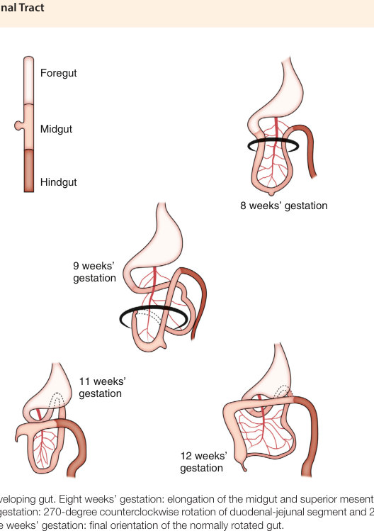
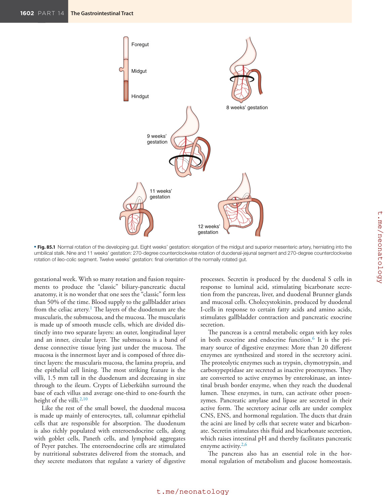

# 85. Development of the Neonatal Gastrointestinal Tract
> [Source credits](../../SOURCE_CREDITS.md).

## Study pillars

### Gut origins

Endoderm and splanchnic mesoderm. Folding of endoderm and splanchnic mesoderm produces the early gut tube.

PDF p. 1596

### Segmental circulation

Different esophageal regions receive distinct arterial branches. Segmental arterial inputs matter when preserving perfusion during mobilization.

PDF p. 1596

### Mesenteric fixation

It creates a broad mesenteric base that resists twisting. Widely separated fixation points broaden the mesenteric base and reduce twisting risk.

PDF p. 1599

### Absorptive intestine

Small intestine. The small intestine is the major digestive and absorptive region; villi and microvilli greatly increase surface area.

PDF p. 1601

### Colonic function

Water-electrolyte absorption and storage/elimination of feces. The colon absorbs water and electrolytes and stores and eliminates feces.

PDF p. 1601

## Full source extraction

# 85. Development of the Neonatal Gastrointestinal Tract
> Source attribution: [Source credits](../../SOURCE_CREDITS.md).

## PDF page 1596 | printed page 1598

85 Development of the Neonatal Gastrointestinal Tract

### MICHAEL DINGELDEIN

### Summary

This chapter reviews the embryology of the gastrointestinal (GI) tract with a focus toward clinically relevant information. The GI system is a complex collection of organs working in concert to fulfill a critically important mission, the breakdown and absorption of nutrients, while serving as a barrier to the potential insults of the outside world. The embryology of the GI system is also a complex and fascinating topic, starting as a primordial tube and evolving into highly segmented system with separate and independent tissue types.

The human GI tract is a complex combination of organs whose primary function is to digest and absorb nutrients while protecting from environmental insults. Many important secondary functions are also performed, such as the endocrine function of the pancreas. In fact, what was once considered a simple system of digestion and absorption is now recognized as something much more complex and dynamic. Furthermore, as with the respiratory system, to perform its duties, the GI tract must be in continuity with the environment. This places the additional demand of having mechanisms in place to protect the host from toxins and pathogens. It is remarkable that this tube, open to the outside world at both ends and colonized by bacteria for a significant portion of its length, is tolerated so well and has relatively few complications associated with it. But troubles do occur, and in the neonate, most can be traced to developmental anomalies.

### The Beginning

During gestation, the alimentary canal can be considered as the folding of endoderm and splanchnic mesoderm into a tube at the end of week 3 and the beginning of week 4.1 As the head fold forms, the cranial part of the yolk sac becomes enclosed within the embryo and becomes the foregut. Shortly thereafter, the caudal portion of the yolk

1598

sac becomes enclosed and forms the hindgut. The midgut resides between the foregut and the hindgut, near the yolk sac, which remains outside the embryo. The midgut remains in communication with the yolk sac until the yolk stalk closes during the 10th week of gestation. Initially the digestive tube ends blindly—cranially at the oropharyngeal membrane and caudally at the cloacal membrane. These membranes, made up of endoderm and ectoderm, break down, with the oropharyngeal going first at the start of week 4 followed by the cloacal at the start of week 6. After the process of folding is complete, there remains a thin layer of splanchnic mesoderm known as the dorsal mesentery. This connects the gut tube along its entire axial length to the dorsal portion of the abdominal body wall and provides a basis for the development of a blood supply.2

### Esophagus

The esophagus serves as a complex conduit between mouth and stomach and, at the gastroesophageal (GE) junction, functions to avoid reflux of stomach contents back up the esophagus. Although this task sounds simple, the esophagus performs its roles so well that no esophageal replacement has been found that does anywhere near as good a job. All efforts are made to keep a native esophagus, even a severely compromised one, rather than go with any replacement.

The fully developed esophagus extends from the pharynx and cricopharyngeal sphincter in the neck to the lower esophageal sphincter and GE junction in the abdomen. The blood supply to the esophagus is segmental, which is a key concept to understand for surgical planning. The upper esophagus is supplied by branches descending from the inferior thyroid artery. The middle and lower thirds of the esophagus are supplied by branches arising directly from the bronchial vessels or the descending thoracic aorta. The abdominal and lower esophagus also receive blood supply from the left gastric and inferior phrenic arteries.

## PDF page 1597 | printed page 1599

The full-term newborn esophagus is 10 cm in length and up to 40 cm in adulthood. There are four areas of natural anatomic constriction of the esophagus: (1) at the level of the cricopharyngeal sphincter, (2) as the aortic arch crosses anteriorly, (3) as the left main stem bronchus crosses anteriorly, and (4) at the level of the lower esophageal sphincter. Foreign bodies in the esophagus tend to lodge at one of these areas of constriction, and burns from caustic ingestion tend to be more severe in these regions.2

The esophagus is differentiated from the primitive foregut during the fourth week of gestation.2 A tracheoesophageal septum is evident at this time, initiating the division of the trachea anteriorly from the foregut posteriorly. The septum remains at about the same level in the fetus while the body grows cranially. This leads to elongation of the esophagus, primarily from “ascent” of the pharynx rather than “descent” of the stomach. It reaches its full length, relative to the size of the developing fetus, during the seventh week of gestation. Aberrations during this phase of development result in esophageal atresia and tracheoesophageal fistulas.3

The muscular wall of the esophagus is similar to that of the rest of the GI tract, with an outer longitudinal layer and a circular inner layer. The more highly developed longitudinal layer forms during the ninth week of gestation, whereas the circular layer forms during the sixth week. There is no serosa on the esophagus except in the short abdominal portion. This is clinically important when considering the resection or repair of the esophagus.4

The epithelial lining of the esophagus is derived from the primitive endoderm. At the 10th week of gestation, this is ciliated, but a stratified, nonkeratinizing, squamous epithelium begins replacing the ciliated epithelium at about the fourth month of gestation. Some ciliated epithelium along the length of the esophagus may persist until birth. The striated muscle of the upper third arises from mesoderm of the branchial arches, whereas the smooth muscle of the distal two-thirds is derived from splanchnic mesenchyme. Therefore diseases of smooth muscle tend to affect the lower esophagus only.2

By 8 weeks’ gestation, immature neurons are identifiable within the wall of the esophagus. These nerves are derived from both parasympathetic and sympathetic fibers. The cervical sympathetic trunks send fibers along the inferior thyroid artery to the upper third of the esophagus, whereas the middle and lower thirds are supplied by branches from the greater splanchnic nerves. The thoracic esophagus is supplied by branches of the esophageal vagal plexus, arising directly from the vagus trunks in the chest.4,5

The act of swallowing is initiated by impulses from the swallowing center, an area in the reticular formation of the rostral medulla where the nuclei of cranial nerves IX and X are located. The initial event in esophageal peristalsis is stimulation of the longitudinal muscle layer, which is followed by the segmental activation of the circular muscle and relaxation of the lower esophageal sphincter. The peristaltic wave begins in the pharynx and continues through to the GE junction without interruption. Whereas primary waves

are initiated from the swallowing center, secondary peristalsis is mediated by local intramural pathways to return refluxed material in the lower esophagus to the stomach.3–5

The upper esophageal sphincter corresponds to the cricopharyngeal muscle. There is no morphologic distinction in the muscular wall of the lower esophagus that would identify this sphincter, although clearly one functionally exists. This sphincter mechanism is a function not just of specific muscle’s actions in the lower esophagus, but also of specific physical arrangement of the GE junction near the diaphragm. The primary role of this sphincter is to prevent the reflux of gastric contents back into the lower esophagus. The lower esophageal sphincter relaxes as the primary peristaltic wave traverses the esophageal body, and it remains open until the peristaltic wave enters the sphincter and closes it. Disordered lower esophageal sphincter function is thought to be one of the mechanisms for pathologic GE reflux.3,4

### Stomach

The stomach first appears as a fusiform dilation of the caudal part of the foregut at the end of the fourth week of gestation.6 At this time, the stomach is suspended between the posterior and anterior body walls by a ventral and dorsal mesentery. During weeks 6 through 10, the stomach undergoes rotation in two planes, as well as growth differentials that lead to the appropriate size and orientation of the organ as seen at birth. One rotation is 90 degrees counterclockwise (viewed from below upward) along the longitudinal axis of the stomach. This brings the dorsal aspect of the stomach toward the fetus’s left side, and the ventral aspect now points to the right. The two mesenteries follow this rotation, with the ventral mesentery finally extending horizontally from the stomach to the liver as the lesser omentum. The cranial portion of the dorsal mesentery runs horizontally to the spleen laterally as the gastrosplenic ligament, and it contains the short gastric vessels. A second, lesser rotation, in conjunction with a growth differential favoring greater growth on the dorsal (now left lateral) side of the stomach, leads to the organ’s final position. This rotation is clockwise around the body’s anterior–posterior axis when viewed from the front and brings part of the now left lateral (formerly dorsal) side of the stomach to point caudally. This part of the stomach still has the caudal portion of the stomach’s dorsal mesentery attached, which now grows quite quickly caudally, forming a two-layer fat pad that covers the bowel and extends to the pelvis. The two fat layers fuse to each other and to the colon and become the greater omentum. The space now created behind the stomach is called the lesser sac. It has one entrance, the epiploic foramen (foramen of Winslow), which is located beneath the free edge of the ventral mesentery that now extends from the area of the gastroduodenal junction to the liver.6,7

The final shape of the stomach along with the various epithelial cell types that constitute its mucosal lining create distinct areas: the cardia around the GE junction; the fundus, which projects cephalad from the GE junction; the

## PDF page 1598

body, which is the vast majority of the gastric reservoir; and the antrum, the portion of the stomach immediately before the pylorus. There are three muscle layers of the stomach: the outer longitudinal, the intermediate circular, and the inner oblique. The three layers permit complex mixing and churning movements that help begin the process of digestion.

The blood supply to the stomach is extremely rich and is derived principally from the celiac axis and superior mesenteric artery. Four major vessels are felt to provide the stomach with blood: the right and left gastric, and the right and left gastroepiploic. Also important are the short gastric arteries off the splenic artery. Venous drainage is via the portal system, with the exception of the GE junction, which can drain to the systemic system via esophageal veins (critical to the development of esophageal varices). The blood supply to the stomach is so redundant that the organ can survive if three of the four major arteries are divided, which is key in operative planning.7

The gastric epithelium is made up of a diverse cell population distributed in a regionally specific manner. The early gastric mucosa is initially a stratified or pseudostratified columnar epithelium that later becomes cuboidal. This mucus-secreting cuboidal epithelium then becomes peppered with gastric pits that are first observed between gestational weeks 6 and 9. By 20 weeks, the mucosa of the stomach is mature in appearance. At the base of the gastric pits are the gastric glands which contain the effector and regulator cells of gastric secretion.6

The different cell populations of the gastric glands in various regions of the stomach allow the stomach to be histologically and functionally compartmentalized. Parietal cells are found predominantly in the gastric fundus and body and less often in the proximal antrum and can be identified in gastric glands as early as week 10. They produce both hydrochloric acid and intrinsic factor (IF) under complicated regulatory control. Chief cells are found principally in the gastric fundus and body, first appearing in gestational week 12. They are located exclusively at the base of the gastric glands, where they synthesize, store, and secrete pepsinogen. Pepsinogen is hydrolyzed to the active proteolytic enzyme pepsin in the acid environment of the stomach.

Enteroendocrine cells are present throughout the stomach, duodenum, and distal intestine. Because of their ability to produce biologically active amines and peptides and to internalize certain precursor molecules, they are referred to as amine precursor uptake and decarboxylation (APUD) cells. There are many distinct types of enteroendocrine and neuroendocrine cells found in the gastric mucosa. These cells are among the first to populate the gastric glands, appearing at 8 to 9 weeks. The most common and well characterized are the G cells, which produce gastrin, and the D cells, which produce somatostatin and amylin. These cells predominate in the gastric antrum. Other enteroendocrine cells are ubiquitous both within the gastric glands and within the duodenal wall. They are responsible for producing such diverse amines and peptides as histamine (from the enterochromaffin-like cells), serotonin, dopamine, vasoactive intestinal

peptide (VIP), glucagon, gastric-releasing peptide (GRP), motilin, and ghrelin. Interestingly, the A cells, which produce glucagon, are present only in fetal and neonatal glands. Considered along with the trophic effect of many GI hormones, this suggests a growth and differentiation role for these substances, along with the digestive and regulatory roles they are currently known to have.2,7

All three components of the autonomic nervous system— sympathetic, parasympathetic, and enteric—innervate the stomach. The parasympathetic and enteric predominate. Sympathetic innervation is predominantly inhibitory to GI function and primarily uses the postganglionic neurotransmitter norepinephrine.8 The parasympathetic pathways mediated by acetylcholine are generally stimulatory. The enteric nervous system (ENS), on the other hand, uses a variety of neurotransmitters, including dopamine, somatostatin, VIP, GRP, ghrelin, and cholecystokinin. The ENS is the largest and most complex compartment of the autonomic nervous system and comprises more than 109 resident neurons within the wall of the GI tract. The ENS is anatomically separate from the CNS (i.e., the sympathetic and parasympathetic systems).2

Sympathetic innervation originates from cell bodies within the thoracic spinal cord and extends through presynaptic fibers in the greater splanchnic nerve to postsynaptic neurons in the celiac ganglion, whose axonal fibers follow blood vessels into the gastroduodenal wall. Parasympathetic presynaptic nerves originate in the brainstem and follow the vagus nerves to the stomach. ENS precursors differentiate from neuroblasts located in the vagal area of the neural crest and migrate with the vagus nerves to the developing GI tract. These ENS neurons then further differentiate, proliferate, and establish connections to each other, to other autonomic pathways, and to developing gastric secretory and muscle cells. There is significantly more ENS than CNS activity within the GI tract, suggesting a more powerful role for intrinsic (ENS) control than for extrinsic (CNS) control.

The stomach has two distinct functional zones based on motor activity differences. The proximal zone, which includes the fundus and the proximal third of the body of the stomach, serves as a reservoir in which an ingested meal is stored. Its ability to distend without increasing intraluminal pressure is important during bolus feeding. The proximal stomach generates slow, sustained tonic contractions under CNS control via the vagus. This action creates a constant pressure gradient that controls the passage of material through the stomach. Vagotomy significantly impairs this function, causing rapid emptying of fluids.7

Motor activity in the stomach distal to the proximal third of the body of the stomach is characterized by spontaneous depolarizations that result in phasic, directional contractions. This gives this portion of the stomach the ability to mix and grind solid food and to empty mixed food particles into the duodenum in a controlled fashion. During the fasting state, gastric activity follows a 90- to 120-minute repetitive pattern called the interdigestive migrating motor complex. This four-phase complex runs from mechanically silent to

## PDF page 1599 | printed page 1601

coordinated contractions that empty the gastric lumen of all indigestible materials. The fed state occurs when the migrating motor complex is interrupted by the arrival of ingested food. Now the stomach begins forceful, nonpropagated contractions in the distal stomach coupled with coordinated contractions of the pyloric sphincter that churn food into small particles. A gastric pacemaker located along the greater curvature at the proximal boundary of the distal zone triggers these contractions at a rate of three to four cycles per minute. When the average particle size reaches 1 mm, chyme is allowed to empty into the duodenum. Complex CNS and ENS coordination permits adequate breakdown of the food and ensures that the rate of gastric emptying is adjusted to provide an isocaloric flow of nutrients into the duodenum over time.2,6,7

Gastric secretory function evolves early in development. By 10 weeks’ gestation, parietal and enteroendocrine cells have begun to differentiate, and by 12 to 13 weeks, gastrin, hydrochloric acid, pepsin, and IF can all be detected. Mucus and bicarbonate secretion commences later, at about the 16th week. The gastric luminal pH of full-term newborns is neutral, but it is as low as 3.5 within a few hours. By 48 hours, the pH is between 1.0 and 3.0. Premature infants have a prolonged period of alkalinity—often many days— that is related to the degree of prematurity.

The production and secretion of hydrochloric acid by gastric parietal cells is governed by complex neurocrine, endocrine, and paracrine pathways, with little evidence for a final common pathway. The parietal cell can receive input and respond to a large variety of inputs, making its regulation by medical and surgical treatments difficult. Gastric acid has many functions. One is to facilitate protein digestion, but the lack of malabsorption problems in patients with achlorhydria indicates that this role may not be critical. Normal acid secretion does, however, play an integral role in initiating the digestive process. Gastric acid also creates a barrier to the entrance of bacteria into the GI tract. This not only protects the upper aerodigestive tract but also insulates the bacteria downstream from constant challenges from above. This is consistent with data that acid suppression therapy for GE reflux may be associated with a higher incidence of lower respiratory tract infections.7

### Duodenum, Pancreas, and Biliary System

The duodenum is the short retroperitoneal portion of the GI tract that connects the foregut to the midgut. At its proximal end, it connects to the outlet of the stomach, the pylorus, and it ends a short distance later at the ligament of Treitz, where the GI tract becomes an intraperitoneal organ once again and becomes the jejunum. Like the stomach, the duodenum undergoes a rotational process that brings it to its final C-loop configuration (Fig. 85.1). This 270-degree counterclockwise rotation swings the duodenum under the superior mesenteric artery. During this rotation, the duodenum’s dorsal mesentery shortens, which allows the duodenum to become fixed in the retroperitoneal position across

the upper abdomen from the pylorus (to the right of midline) to the ligament of Treitz (to the left of midline). This fixation is absolutely critical, because from the ligament of Treitz to the cecum (the next retroperitoneal portion of the GI tract located in the right lower quadrant), the bowel is on a mesentery and free to float about the peritoneal cavity. The bowel thus becomes fixed within the peritoneal cavity at the two most widely separated points available—the ligament of Treitz in the left upper quadrant and the cecum in the right lower quadrant. Because the mesenteric base is therefore so broad, it is impossible for the floating, intraperitoneal bowel to twist on its mesentery, thus compromising its own blood supply. However, any failure of proper rotation and fixation of the bowel can lead to the twisting of the bowel on its mesentery (i.e., volvulus) and the subsequent catastrophe of interruption of the flow of blood to the bowel.9

The rotation of the bowel occurs during the 6th to 10th weeks of gestation. Concurrently, there is a rapid epithelial proliferation (along with the rectum and esophagus) that obliterates the hollow lumen and converts the duodenum to a solid, cordlike structure. Vacuoles then appear and gradual recanalization occurs. The distal duodenum does not appear to pass through a solid phase. Defects in this proliferation and recanalization process are believed to lead to the problems of duodenal atresia, web, and stenosis.2,9

The duodenum is divided into four portions corresponding to the curvatures of the C loop. The blood supply is derived from the celiac axis through the superior pancreaticoduodenal branches of the gastroduodenal artery and the superior mesenteric artery through the inferior pancreaticoduodenal branches. Consistent with the location of the original liver bud, this transition from celiac to superior mesenteric blood supply defines the transition from foregut to midgut. A consistent landmark in the medial portion of the duodenum, near the end of the foregut, is the ampulla of Vater, which represents the confluence of common bile duct and pancreatic ducts and their entry into the duodenum.

The liver and biliary system develops within a bud along the free edge of the ventral mesentery, with stomach and bowel rotation bringing them to their final location in the right upper quadrant.2 Also within this bud is the primordial ventral pancreas. Opposite this ventral pancreatic bud (including liver and biliary primordium) is the dorsal pancreatic bud. During rotation, the ventral pancreatic bud fuses to the dorsal bud and becomes one organ. Failure of this rotation leads to the problem of annular pancreas. The biliary and pancreatic drainage systems also fuse during rotation so that the common bile duct descends in the remnant-free edge of ventral mesentery, along with the portal vein and hepatic artery, then passes behind the duodenum to join with the main pancreatic duct at the ampulla of Vater. This main pancreatic duct is formed from the confluence of the original ventral pancreatic duct with the distal dorsal pancreatic duct. The proximal dorsal pancreatic duct remains as the accessory pancreatic duct. The biliary and pancreatic ductal systems are complete by the 10th to 12th

## PDF page 1600

Foregut

Midgut

Hindgut

9 weeks’ gestation

11 weeks’ gestation

12 weeks’ gestation

• Fig. 85.1 Normal rotation of the developing gut. Eight weeks’ gestation: elongation of the midgut and superior mesenteric artery, herniating into the umbilical stalk. Nine and 11 weeks’ gestation: 270-degree counterclockwise rotation of duodenal-jejunal segment and 270-degree counterclockwise rotation of ileo-colic segment. Twelve weeks’ gestation: final orientation of the normally rotated gut.

gestational week. With so many rotation and fusion requirements to produce the “classic” biliary-pancreatic ductal anatomy, it is no wonder that one sees the “classic” form less than 50% of the time. Blood supply to the gallbladder arises from the celiac artery.1 The layers of the duodenum are the muscularis, the submucosa, and the mucosa. The muscularis is made up of smooth muscle cells, which are divided distinctly into two separate layers: an outer, longitudinal layer and an inner, circular layer. The submucosa is a band of dense connective tissue lying just under the mucosa. The mucosa is the innermost layer and is composed of three distinct layers: the muscularis mucosa, the lamina propria, and the epithelial cell lining. The most striking feature is the villi, 1.5 mm tall in the duodenum and decreasing in size through to the ileum. Crypts of Lieberkühn surround the base of each villus and average one-third to one-fourth the height of the villi.2,10

Like the rest of the small bowel, the duodenal mucosa is made up mainly of enterocytes, tall, columnar epithelial cells that are responsible for absorption. The duodenum is also richly populated with enteroendocrine cells, along with goblet cells, Paneth cells, and lymphoid aggregates of Peyer patches. The enteroendocrine cells are stimulated by nutritional substrates delivered from the stomach, and they secrete mediators that regulate a variety of digestive

8 weeks’ gestation

processes. Secretin is produced by the duodenal S cells in response to luminal acid, stimulating bicarbonate secretion from the pancreas, liver, and duodenal Brunner glands and mucosal cells. Cholecystokinin, produced by duodenal I-cells in response to certain fatty acids and amino acids, stimulates gallbladder contraction and pancreatic exocrine secretion.

The pancreas is a central metabolic organ with key roles in both exocrine and endocrine function.6 It is the primary source of digestive enzymes: More than 20 different enzymes are synthesized and stored in the secretory acini. The proteolytic enzymes such as trypsin, chymotrypsin, and carboxypeptidase are secreted as inactive proenzymes. They are converted to active enzymes by enterokinase, an intestinal brush border enzyme, when they reach the duodenal lumen. These enzymes, in turn, can activate other proenzymes. Pancreatic amylase and lipase are secreted in their active form. The secretory acinar cells are under complex CNS, ENS, and hormonal regulation. The ducts that drain the acini are lined by cells that secrete water and bicarbonate. Secretin stimulates this fluid and bicarbonate secretion, which raises intestinal pH and thereby facilitates pancreatic enzyme activity.2,6

The pancreas also has an essential role in the hormonal regulation of metabolism and glucose homeostasis.

Unmatched source image; PDF page 1600. Consult the original caption.

## PDF page 1601 | printed page 1603

These endocrine functions are provided by the islets of Langerhans, which make up about 1% to 2% of the pancreatic mass. These 1 to 2 million islets are more plentiful on the pancreatic tail and are also under complex CNS, ENS, and hormonal control. There are four distinct cell types within the islets: alpha cells for glucagon production, beta cells for insulin, gamma cells for somatostatin, and PP cells for pancreatic polypeptide.

### Small Intestine

The small intestine is the major digestive and absorptive portion of the GI tract. The gut initially herniates out of the fetus’s abdominal domain and lengthens rapidly during the 6th to 12th weeks of gestation.11 As described earlier, on reentry into the abdominal cavity, the small bowel undergoes a 270-degree twist around the superior mesenteric artery axis to bring it into its final anatomic position. This positioning is complete by the 20th week. The “small” of small intestine clearly relates only to the circumference of the structure, because its length is anything but small. The small intestine typically measures between 200 and 300 cm at birth in the full-term neonate after doubling its length between 26 and 38 weeks of gestation. After birth, the small intestine continues to grow, finally reaching its maximum length of 600 to 800 cm after 4 years of age.2,10 During this time, and continuing through puberty, there are also increases in intestinal diameter, along with development of the plicae circulares, villi, and microvilli that enlarge the absorptive surface area of the small intestine from about 950 cm3 at birth to 7500 cm3 in the adult. The blood supply of the small intestine is provided solely by branches of the superior mesenteric artery running in the mesentery of the small intestine.

The circular muscles of the small intestine appear at 6 weeks of gestation and the longitudinal muscles at 8 weeks. Neuroblasts appear at 7 weeks of gestation, and the myenteric and submucosal plexuses are noted to appear between the 9th and 13th weeks. Although there is some peristalsis noted as soon as the plexuses appear, it is poorly coordinated. The appearance of myenteric muscle contractions at 32 to 34 weeks leads to more coordinated contractions, but intestinal transit time at this gestation time is as long as 9 hours—nearly twice as long as in the term infant. It is not until about 38 weeks’ gestation that the myenteric muscle contractions are fully present and fasting motor activity is mature. Even so, limited feedings can be accomplished in infants as young as 25 weeks because they appear to stimulate contractions, albeit immature.2,9

Villi appear during weeks 8 to 11 and acquire their final, fingerlike shape by week 14. However, the villi remain shorter in the ileum than in the jejunum, leading to a fourfold greater absorptive area in the jejunum. Microvilli appear and the enterocytes are morphologically mature and display a well-organized brush border by 14 weeks of gestation. Endocrine cells appear at 9 weeks and continue to proliferate, with all the various gut peptide hormones and neurotransmitters present by 20 weeks’ gestation. These

include enteroglucagon, neurotensin, gastrin, pancreatic polypeptide, motilin, and VIP. Although all are present at birth, many of them show remarkable increases in basal levels during the first 2 weeks of life in the fed infant.6 Interestingly, when feedings are withheld in infants, intestinal growth and functional maturation are delayed and basal levels of the intestinal peptides remain low, suggesting some form of cause-and-effect relationship.

It is generally held that the enteric ganglion cells are derived from vagal neural crest cells. As mentioned, neural crest–derived neuroblasts first appear in the developing esophagus at 5 weeks. They then begin a migration down to the anal canal in a craniocaudal direction during the 5th to 12th weeks of gestation. The neural crest cells first form the myenteric plexuses just outside the circular muscle layer. The mesenchymally derived longitudinal muscle layer then forms, sandwiching the myenteric plexus after it has been formed in the 12th week of gestation. Finally, the submucous plexus is formed by neuroblasts, which migrate from the myenteric plexus across the circular muscle layer and into the submucosa and the mucosa. This also progresses in a craniocaudal direction, but it occurs during the 12th to 16th weeks of gestation.2

### Colon, Rectum, and Anus

The colon is a continuation of the intestine with two basic functions: (1) the absorption of water and electrolytes and (2) the storage and elimination of feces. Its absorptive function is significant in that the colon absorbs more than 80% of the water left after passage through the small intestine. The rectum and anus are critical in the complex act of controlled defecation.

The colon is divided into six areas: the cecum, the appendix, and the ascending, transverse, descending, and sigmoid colon. Like the duodenum, the colon also undergoes a 270-degree counterclockwise rotation during the 10th to 12th weeks of gestation to bring it into the proper position.2,6 Although this is nearly concurrent with the duodenal rotation, the two are not completely codependent. Either one, or both, can go astray, so it is possible to have a nonrotated colon with a properly rotated duodenum and vice versa. If properly rotated, the cecum lies in the right lower quadrant, the ascending colon along the right gutter, the transverse colon from the hepatic flexure to the splenic flexure, and the descending colon along the left gutter; the sigmoid colon connects the descending colon to the rectum approximately at the level of the third sacral vertebra. The ascending colon and the descending colon are retroperitoneal structures with peritoneum covering only their anterior and lateral surfaces. The cecum is variably fixed—sometimes completely retroperitoneal (along with the appendix) and sometimes on a short mesentery. The transverse and sigmoid colon are on a mesentery. The posterior border of the greater omentum is also attached to the transverse colon.6

The blood supply of the colon is supplied by both the superior and inferior mesenteric arteries. The watershed

## PDF page 1602

area between the distribution of the two vessels is typically located around the mid transverse colon to the splenic flexure. This also marks the boundary of the midgut and hindgut. This boundary area is critical to operative and often an area of injury during low cardiac output states. The rectum is supplied by the inferior mesenteric artery as well as branches off the iliac arteries.

Although it is developmentally similar to the small intestine in general structure, the colon has unique elements. Most obvious is the concentration of the longitudinal muscle coat into three bands—the teniae coli. The teniae create sacculations, called haustra, that permit radiographic differentiation of the small from the large intestine after infancy. The mucosa of the colon is characterized by crypts of Lieberkühn, which are lined with absorptive, goblet, and endocrine cells.2

The development of the anorectum requires unique attention, because problems result in a wide variety of anorectal malformations. As mentioned previously, during the third week of gestation, the bilaminar germ disc transforms into a trilaminar disc of ectoderm, mesoderm, and endoderm. At either end of the embryo, the endoderm and ectoderm fuse, excluding the mesoderm from these areas and giving rise to the oropharyngeal and cloacal membranes. The former breaks down in the fourth week to give rise to the mouth, whereas the cloacal membrane does not open until the eighth week. Between weeks 4 and 6, it is widely held that the primitive gut tube at the level of the cloacal membrane gets canalized and partitioned into an anterior urogenital sinus and a posterior anorectum by the cranialcaudal growth of a mesodermally derived partition called

Key Points

• Gastrointestinal development requires maturation of

various digestive, absorptive, and endocrine functions. • Sympathetic, parasympathetic, and intrinsic enteric neu-

rons all contribute to the maturation of gastrointestinal motility. • Abnormal separation of the developing respiratory and

digestive systems can lead to severe life-threating or at least life-altering anomalies such as tracheoesophageal clefts and tracheoesophageal fistula.

### References

1. Edwards NA, Shacham-Silverberg V, Weitz L, et al. Devel-

opmental basis of trachea-esophageal birth defects. Dev Biol. 2021;477:85–97. 2. Scheonwolf GC, et al. Development of the gastrointestinal tract.

In: Schoenwolf GC, et al, eds. Larsen’s Human Embryology. 6th ed. Elsevier; 2021:335–367. 3. Khan S, Orenstein S. Embryology, anatomy, and function of the

esophagus. In: Nelson Textbook of Pediatrics. 20th ed. Elsevier; 2016. 4. Chandler N, et al. The esophagus. In: Holcomb GW, Murphy

JP, eds. Holcomb and Ashcraft’s Pediatric Surgery. 7th ed. Elsevier; 2020:422–436.

the urorectal septum. Eventually, the urorectal septum fuses with the cloacal membrane, and the fusion site is called the perineal body. The newly formed anorectal canal remains closed by the posterior aspect of the cloacal membrane, which is now called the anal membrane. The ectoderm in this region then goes on to form the anal pit or proctodeum, so the distal third of the anal canal is eventually made up of ectoderm, the proximal two-thirds is made up of mesoderm, and the two cell types are divided by the anal membrane. The membrane breaks down during week 8, and the two cell populations fuse at what is called the pectinate or dentate line.

Aside from the previously described migration of neural crest cells to form enteric ganglion cells, the anorectum has an important neurologic milestone during the fourth week of gestation. At this time, spinal nerves from sacral levels 2, 3, and 4, which contribute to the peripheral parasympathetic nervous system, form. In contrast to the motility problems noted with failure of migration and thus the absence of ganglion cells, problems related to the proper development of these spinal nerves during week 4 may lead to the proprioceptive and motility problems associated with anorectal malformations, most classically represented by Hirschsprung disease.

### Acknowledgments

The author and editors acknowledge the important contributions of David K. Magnuson, Walter J. Chwals, and Robert L. Parry to the previous editions of this chapter, portions of which remain unchanged.

• The fore- and midgut undergo unique rotations during

6th to 10th weeks of gestation, which ensure fixation in the peritoneal cavity and prevent twisting and remittent bowel obstruction. • The colon acquires key absorptive and motility func-

tions. Aberrant anorectal maturation may lead to a variety of anorectal malformations.

5. Tovar JA. Disorders of esophageal function. In: Coran A, et al,

eds. Pediatric Surgery. 7th ed. Elsevier; 2012. 6. Carlson BM. Digestive and respiratory systems and body cavities. In:

Carlson BM, ed. Human Embryology & Developmental Biology. 6th ed. Elsevier; 2019. 7. Teitelbaum EN, et al. Stomach. In: Sabiston Textbook of Surgery.

20th ed. Elsevier; 2017. 8. Moore KL. The alimentary tract. In: The Developing Human.

10th ed. Elsevier; 2016. 9. Bonasso PC, et al. Malrotation. In: Holcomb GW, Murphy JP,

eds. Holcomb and Ashcraft’s Pediatric Surgery. 7th ed. Elsevier; 2020:507–516. 10. Dassinger MS, et al. Disorders of intestinal rotation and fixation.

In: Coran A, et al, eds. Pediatric Surgery. 7th ed. Elsevier; 2012.

<!-- SOURCE_LAYOUT_VIEWS -->

## Original layout views and recovered diagrams

Automatic extraction can flatten tables and superscripts. Check the original layout for numeric data, footnotes and image credits. [Source review notes](../../SOURCE_REVIEW_NOTES.md).

### Original source page 1600

