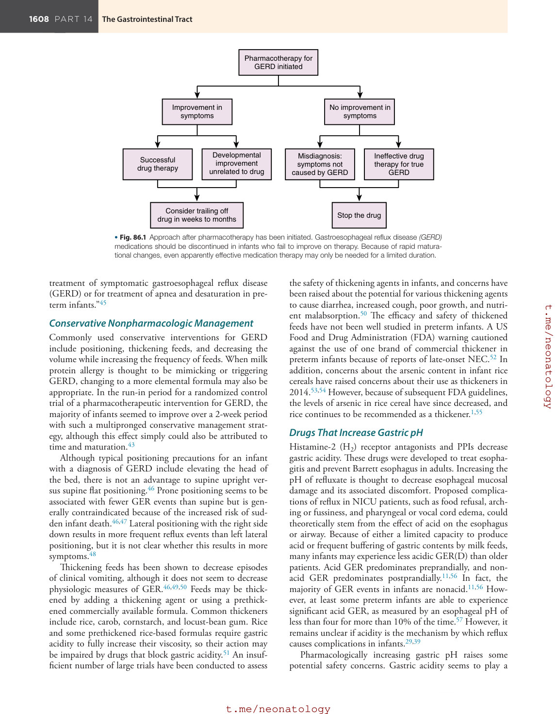
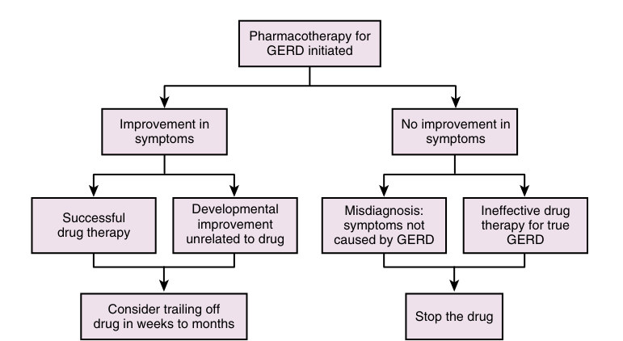

# 86. Gastrointestinal Reflux and Motility in the Neonate
> [Source credits](../../SOURCE_CREDITS.md).

## Study pillars

### Reflux versus disease

GERD requires medical complications attributable to reflux. GER is retrograde flow; GERD denotes a pathologic condition causing complications. Regurgitation alone is insufficient.

PDF p. 1603

### Sphincter physiology

Transient lower esophageal sphincter relaxations. Transient relaxations unrelated to swallowing permit retrograde passage; even very small infants can have good basal sphincter tone.

PDF p. 1603

### pH and impedance

Multichannel intraluminal impedance. Impedance detects fluid presence regardless of pH; combined sensors can characterize acid and nonacid events.

PDF p. 1605

### Causality

Temporal association alone does not prove causality. The chapter explicitly cautions that sequence does not establish a causal link.

PDF p. 1605

### Management evidence

Conservative expectant management with clinical reassessment. The source favors conservative management because symptoms often improve and drug or surgical safety and efficacy are limited.

PDF p. 1608

## Full source extraction

# 86. Gastrointestinal Reflux and Motility in the Neonate
> Source attribution: [Source credits](../../SOURCE_CREDITS.md).

## PDF page 1603 | printed page 1605

86 Gastrointestinal Reflux and Motility in the Neonate

### ANNA MARIA HIBBS

### Definitions

Gastroesophageal reflux (GER) is the physiologic retrograde passage of fluid from the stomach to the esophagus. Gastroesophageal reflux events occur in healthy infants multiple times per day. Gastroesophageal reflux disease (GERD) is the pathologic condition wherein such retrograde flow into the esophagus causes medical complications.1 Regurgitation and vomiting are common and often nonpathologic complications of GER.2 A definitive determination of GERD in infants is often elusive. Esophageal complications of GERD are often indirectly suggested because of difficulty in directly visualizing the esophagus in very small patients; for instance, infants who have arching, discomfort, or fussiness may be suspected of having esophagitis. Putative extraesophageal GERD-defining complications in infants, such as apnea or worsening of respiratory disease, are controversial, in large part, owing to lack of strong evidence in the literature.3 In most cases, no single test can diagnose or exclude GERD, and a comprehensive approach including testing and clinical assessments over time is needed to make the diagnosis.

### Physiology of Gastroesophageal Reflux

### Upper Gastrointestinal Motility and Physiologic Gastroesophageal Reflux

By as early as 26 weeks’ gestational age, esophageal motor function is well developed in infants.4,5 In both term and preterm infants, swallowing triggers coordinated esophageal peristalsis and lower esophageal sphincter (LES) relaxation.5 However, the velocity of propagation is significantly slower in preterm compared with term infants.6 Esophageal activity unrelated to swallowing often takes the form of incomplete or asynchronous waves; this type of nonperistaltic motor activity occurs more frequently in preterm infants than in adults.5 Infants with functional or anatomic esophageal abnormalities, such as those with repaired esophageal atresia or neuropathy affecting smooth muscle, are at risk for impaired esophageal clearance of fluid.

Gastroesophageal reflux events are part of the normal functioning of the upper gastrointestinal tract. The LES, which limits the retrograde passage of air and fluids from the stomach to the esophagus, is made up of intrinsic esophageal smooth muscle and diaphragmatic skeletal muscle.7 Several manometry studies have documented good LES tone, even in extremely low birth weight infants.5,8,9 In both preterm and term infants, just as in more mature patients, transient lower esophageal sphincter relaxations (TLESRs) unrelated to swallowing are the major mechanism allowing GER by dropping lower esophageal pressure below gastric pressure, thereby promoting the retrograde passage of fluid.5,9,10 Transient lower esophageal sphincter relaxations are frequent in preterm infants, occurring several times per hour, although the majority of TLESR events are not associated with GER.10 A similar frequency of TLESRs is seen in infants with and without GERD, but a higher percentage of acid GER events during TLESRs occurs in infants with GERD.10 It has been hypothesized that increased intra-abdominal pressure during a TLESR, for instance because of straining, may increase the likelihood of a GER event. Although LES relaxations also occur during normal swallowing, these are less often associated with GER events than isolated TLESR events,10 presumably owing to the coordinated waves of esophageal muscular activity propelling fluid antegrade during a swallow. The number of GER events and the height the fluid bolus reaches in the esophagus are increased after feeding; refluxate after feeding is less acidic than fluid refluxed before feeding.11 Other factors also promote GER in infants, particularly patients in a neonatal intensive care unit (NICU). For instance, infants ingest a much higher volume per kilogram of body weight, approximately 180 mL/kg/day, than older children and adults.12 In the NICU population, preterm and term patients with nasogastric or orogastric feeding tubes may experience more reflux episodes because of mechanical impairment of the competence of the LES.13,14 Infants with anatomic abnormalities of the structures that comprise the LES, such as infants with

1605

## PDF page 1604

congenital diaphragmatic hernia, are at risk for experiencing a higher-than-normal frequency of GER events.

Gastric emptying also plays a strategic role in upper gastrointestinal tract function. Between 25 and 30 weeks’ gestational age, gastric emptying time seems to be inversely and linearly correlated with gestational age at birth. Simultaneously decreasing the osmolality and increasing the volume of feeds may accelerate gastric emptying, although changes in osmolality or volume alone did not seem to have a significant effect.15 Human milk also promotes gastric emptying, but fortification may increase emptying time.16,17 Unfortunately, although breastfeeding is protective against GERD, mothers whose infants were diagnosed with reflux are more likely to wean.16 In formula-fed infants, several small studies suggest that prebiotics and probiotics may speed gastric emptying time.18,19 However, although it seems logical that slower gastric emptying would promote GER because of increased fluid and possibly pressure in the stomach, a study of the relationship between gastric emptying and GER in preterm infants found no association.20

The literature on the impact of hydrolyzed formulas is mixed.21–23 Joint guidelines from the North American Society for Pediatric Gastroenterology, Hepatology, and Nutrition and the European Society for Pediatric Gastroenterology, Hepatology, and Nutrition cite a lack of evidence for therapeutic effect of hydrolyzed formula for GERD, but they recommend a trial of hydrolyzed formula if there is no improvement with thickened feeding and other nonpharmacologic interventions, because it can be difficult to differentiate GERD from cow milk protein allergy.1 Gastroesophageal reflux events are frequent in healthy preterm and term infants. Among 509 healthy asymptomatic infants age 3 to 365 days, the mean number of acid reflux episodes in 24 hours was 31.28, with a standard deviation of 20.68.24 The reflux index, the percent of time the esophageal pH was less than 4, ranged from less than 1% to 23%, with the median and 95th percentile being 4% and 10%, respectively. Among the neonates in this study, the 95th percentile for the reflux index was as high as 13%. In a smaller study of 21 asymptomatic preterm infants, continuous combined esophageal pH and impedance monitoring detected refluxed fluid in the esophagus by impedance for a median of 0.73% (range, 0.3%–1.22%) of the recording time, and acid exposure detected by pH monitoring for a median of 5.59% (range, 0.04%–20.69%) of the recording time. These studies make it clear that GER events occur frequently in asymptomatic infants, and a wide range of reflux measurements may be seen in healthy preterm infants without GERD.

In a study of infants in general pediatric practice, half of all parents reported at least daily regurgitation at 0 to 3 months of age.25 The peak prevalence occurred at 4 months, with 67% reporting regurgitation. Thus benign regurgitation was the norm in the first few months of life. Parents reported regurgitation to be a problem when it was associated with increased crying or fussiness, perceived pain, or back arching. The prevalence of regurgitation perceived as a

problem peaked at 23% at 6 months and was down to 14% by 7 months. The majority of these children did not receive treatment for GERD from their pediatrician. Infants who did and did not experience frequent regurgitation between 6 and 12 months of age were followed up a year later.26 At this time, none of the parents described regurgitation as a current problem. Infants with frequent spitting at 6 to 12 months of age did not experience more infections of the ear, sinuses, or upper respiratory tract, nor did they experience more wheezing.

It is also important to remember that regurgitation and vomiting are not necessarily caused by GER or GERD. Clinical correlation is needed to determine whether other pathologic processes are present. The differential diagnosis includes gastrointestinal obstruction, motility abnormalities, infection, inborn errors of metabolism, adrenal insufficiency and other hormonal abnormalities, and neurologic abnormalities, including increased intracerebral pressure. Commonly, milk protein allergy may mimic GERD.2

The distinction between GER and GERD is important when communicating with families. One study showed that in infants with a label of GERD, families were more likely than those with a GER label to be interested in medications, even when they were told that those medications were likely ineffective.27

### Gastroesophageal Reflux Disease

### Symptoms and Complications

Identifying whether troublesome symptoms are in fact caused by reflux can be challenging in infants.28,29 Symptoms frequently attributed to GERD in infants include regurgitation, Sandifer posturing, worsening of lung disease, food refusal or intolerance, apnea, bradycardia, crying or fussiness, and stridor. Regurgitation may be a symptom of GERD in infants but in itself is neither necessary nor sufficient to make a diagnosis.29 Clustering regurgitation with other symptoms may increase the accuracy of diagnosis, as demonstrated by the I-GERQ-R infant reflux questionnaire.29,30 However, the validity of such questionnaires has not been established in the NICU population, which includes preterm infants and sick term neonates who have multiple other potential reasons for the symptoms frequently attributed to GERD.

Although GERD and bronchopulmonary dysplasia (BPD) seem to be associated, causality has not been determined.29,31–34 Patients with increased work of breathing may generate more negative intrathoracic pressures, thereby promoting the passage of gastric contents into the esophagus. Conversely, aspirated refluxate could injure the lungs, thereby promoting chronic lung disease. Finally, immaturity and severity of illness predispose to both conditions, and there may be no causal link in the majority of patients. In addition, part of the apparent association between BPD and GERD may be the result of an increased index of suspicion

## PDF page 1605 | printed page 1607

for GERD in patients with BPD, leading to increased rates of diagnosis.33

A similar issue exists for apnea in premature infants. Although in animal models, esophageal stimulation may trigger airway protective reflexes,35 there is insufficient evidence in human infant patients to confirm that reflux causes apnea.29,36, In fact, apnea may itself trigger reflux.37,38 Finally, immature infants are simply prone to both apnea and reflux, and there may be no causal association.39 In a cohort of infants referred for overnight esophageal and respiratory monitoring for suspicion of GERD-induced apnea, desaturation, or bradycardia, fewer than 3% of all cardiorespiratory events were preceded by a reflux event.40 Conversely, 9.1% of reflux events were preceded by a cardiorespiratory event. Thus it was more common for a cardiorespiratory event to precede reflux than for reflux to precede a cardiorespiratory event. Even in this population referred for suspicion of GER-triggering cardiorespiratory events, only a small minority of cardiorespiratory events were in fact preceded by reflux. However, data from small or moderately sized research cohorts cannot rule out the possibility that reflux can trigger the majority of cardiorespiratory events in a small subset of patients. Because bedside recording of apnea events is known to be inaccurate, correlation of apnea with feeding or reflux events in a specific patient requires simultaneous respiratory and esophageal monitoring.

It is unclear what component of the refluxate triggers complications. Acidity is often implicated, but it is not clear which, if any, complications are triggered by acidity.29,39 The other characteristics of the refluxate that have been postulated to be associated with symptoms include the height of the bolus in the esophagus, the volume of the bolus, or the pressure exerted on the esophagus. One study found an association with acid GER into the middle or proximal esophagus and cough in dysphagic preterm neonates.41

### Diagnostic Tools

Numerous tests exist to measure acid and nonacid GER in infants. Because the definition of GERD is based on clinical complications and not physiologic measurements, most available tests for GERD cannot definitively confirm or exclude the diagnosis. Numerous GER events are not sufficiently diagnostic of GERD without evidence of clinical complications. Because the diagnosis of GERD relies on the presence of clinical complications, no physiologic test that only characterizes the frequency or characteristics of GER events in a patient can by itself confirm the diagnosis of GERD. Esophageal monitoring for 12 to 24 hours gathers the best data on the timing and frequency of GER events. Esophageal pH probes measure acid reflux, and esophageal multichannel intraluminal impedance (MII) measures the presence of fluid in the esophagus regardless of pH. MII and pH sensors can be combined in one probe. Esophageal monitoring may be correlated with respiratory monitoring or with the timing of a clinical symptom to attempt to temporally correlate symptoms and GER events. However,

showing that a GER event preceded a clinical event is not proof of causality.

An upper gastrointestinal radiographic series is a poor measure of the frequency or severity of GER, because it captures only a brief window in time. Capturing a GER event on an upper gastrointestinal series is not informative with regard to either the frequency of GER or the diagnosis of GERD. However, this study may be useful in ruling out anatomic abnormalities that may mimic GERD.

A nuclear medicine scintigraphy study can identify postprandial reflux and aspiration and quantify gastric emptying time. Because of a lack of age-specific norms and the limited focus on postprandial GER, it is not recommended as a routine test for infants suspected of having GERD.1,2 However, in an infant suspected of chronically micro-aspirating refluxed fluid, it can document this complication and confirm the diagnosis of GERD. In addition, scintigraphy allows for the calculation of gastric emptying time, which may be useful in infants in whom delayed gastric emptying is part of the differential diagnosis.

Endoscopy with visualization and biopsy of the esophagus can document esophagitis caused by acid or conditions mimicking GERD, such as eosinophilic esophagitis. Unfortunately, many preterm and young term infants are too small for endoscopy to directly assess esophagitis, and so esophageal symptoms can only be inferred from vague symptoms such as food refusal or fussiness. Although some clinicians may turn to a trial of pharmacologic therapy in the setting of these diagnostic constraints, the North American Society for Pediatric Gastroenterology, Hepatology, and Nutrition and the European Society for Pediatric Gastroenterology, Hepatology, and Nutrition do not recommend a diagnostic trial of proton pump inhibitors (PPIs), because of limited efficacy of these medications.1

### Treatment

The general categories of interventions available to treat GERD are conservative nonpharmacologic, pharmacologic, and surgical. The natural history of GERD, often with improvement within a few weeks,42–44 must be remembered when interpreting the impact of an intervention. Treatment failures may result from either a failure of the medication to achieve its intended action or from the erroneous application of drugs to symptoms not caused by GERD. Apparent successes may result from either a true drug effect or from the natural resolution of symptoms with maturation (Fig. 86.1). Because the goal of therapy is to treat GERD, not physiologic GER, the gold standard for gauging therapeutic success must be improvement in symptoms or complications, not simply improvement in physiologic measures. The most effective treatment for GERD is time and maturation, and so expectant conservative management is the mainstay of therapy in most cases. With regard to pharmacologic therapy, the American Academy of Pediatrics Section on Perinatal Pediatrics Choosing Wisely campaign advised, “Avoid routine use of anti-reflux medications for

## PDF page 1606

Pharmacotherapy for GERD initiated

Improvement in symptoms

Developmental improvement unrelated to drug

Successful drug therapy

Consider trailing off drug in weeks to months

• Fig. 86.1 Approach after pharmacotherapy has been initiated. Gastroesophageal reflux disease (GERD) medications should be discontinued in infants who fail to improve on therapy. Because of rapid maturational changes, even apparently effective medication therapy may only be needed for a limited duration.

treatment of symptomatic gastroesophageal reflux disease (GERD) or for treatment of apnea and desaturation in preterm infants.”45

### Conservative Nonpharmacologic Management

Commonly used conservative interventions for GERD include positioning, thickening feeds, and decreasing the volume while increasing the frequency of feeds. When milk protein allergy is thought to be mimicking or triggering GERD, changing to a more elemental formula may also be appropriate. In the run-in period for a randomized control trial of a pharmacotherapeutic intervention for GERD, the majority of infants seemed to improve over a 2-week period with such a multipronged conservative management strategy, although this effect simply could also be attributed to time and maturation.43

Although typical positioning precautions for an infant with a diagnosis of GERD include elevating the head of the bed, there is not an advantage to supine upright versus supine flat positioning.46 Prone positioning seems to be associated with fewer GER events than supine but is generally contraindicated because of the increased risk of sudden infant death.46,47 Lateral positioning with the right side down results in more frequent reflux events than left lateral positioning, but it is not clear whether this results in more symptoms.48

Thickening feeds has been shown to decrease episodes of clinical vomiting, although it does not seem to decrease physiologic measures of GER.46,49,50 Feeds may be thickened by adding a thickening agent or using a prethickened commercially available formula. Common thickeners include rice, carob, cornstarch, and locust-bean gum. Rice and some prethickened rice-based formulas require gastric acidity to fully increase their viscosity, so their action may be impaired by drugs that block gastric acidity.51 An insufficient number of large trials have been conducted to assess

No improvement in symptoms

Ineffective drug therapy for true GERD

Misdiagnosis: symptoms not caused by GERD

Stop the drug

the safety of thickening agents in infants, and concerns have been raised about the potential for various thickening agents to cause diarrhea, increased cough, poor growth, and nutrient malabsorption.50 The efficacy and safety of thickened feeds have not been well studied in preterm infants. A US Food and Drug Administration (FDA) warning cautioned against the use of one brand of commercial thickener in preterm infants because of reports of late-onset NEC.52 In addition, concerns about the arsenic content in infant rice cereals have raised concerns about their use as thickeners in 2014.53,54 However, because of subsequent FDA guidelines, the levels of arsenic in rice cereal have since decreased, and rice continues to be recommended as a thickener.1,55

### Drugs That Increase Gastric pH

Histamine-2 (H2) receptor antagonists and PPIs decrease gastric acidity. These drugs were developed to treat esophagitis and prevent Barrett esophagus in adults. Increasing the pH of refluxate is thought to decrease esophageal mucosal damage and its associated discomfort. Proposed complications of reflux in NICU patients, such as food refusal, arching or fussiness, and pharyngeal or vocal cord edema, could theoretically stem from the effect of acid on the esophagus or airway. Because of either a limited capacity to produce acid or frequent buffering of gastric contents by milk feeds, many infants may experience less acidic GER(D) than older patients. Acid GER predominates preprandially, and nonacid GER predominates postprandially.11,56 In fact, the majority of GER events in infants are nonacid.11,56 However, at least some preterm infants are able to experience significant acid GER, as measured by an esophageal pH of less than four for more than 10% of the time.57 However, it remains unclear if acidity is the mechanism by which reflux causes complications in infants.29,39

Pharmacologically increasing gastric pH raises some potential safety concerns. Gastric acidity seems to play a

## PDF page 1607 | printed page 1609

role in defense against infection. The use of H2 receptor antagonists in preterm infants has been associated with an increased risk of necrotizing enterocolitis (NEC),58 although it is not clear if this is a causal relationship. However, one small study did show that gastric acidification decreases NEC.59 Infants treated with ranitidine have been demonstrated to have higher rates of gastric colonization with bacteria or yeast, although an increase in infection was not seen in this study.60 Ranitidine was associated with increased late-onset sepsis in NICU patients in a cohort study; however, confounding by indication or severity of illness cannot completely be excluded as the cause of this association.61 In older patients, an association between acid suppression and lower respiratory tract infections, including ventilator-associated pneumonia, has been proposed but remains controversial.62–70

Histamine-2 Receptor Antagonists

Examples of H2 receptor antagonists include ranitidine, cimetidine, and famotidine. They block the H2 receptor in acid-producing gastric parietal cells. Parietal cells continuously produce a baseline amount of HCl, even when they are not stimulated by histamine. H2 receptor antagonists suppress HCl production below physiologic basal secretion rates and also decrease meal-triggered acid production. In addition, this class of drugs impairs the ability of other substances that stimulate acid production, such as acetylcholine and gastrin to trigger acid production.

There are few randomized clinical trials of H2 receptor antagonists assessing their impact on the symptoms of GERD in term or preterm infants. In one small doubleblind study, infants age 1.3 to 10.5 months were randomized to a higher or lower dose of famotidine and then a placebo-controlled withdrawal.71 Infants receiving both doses experienced less emesis than those receiving placebo. Infants on the higher dose also demonstrated decreased crying time and volume of emesis. However, famotidine was also noted to be associated with agitation and a head-rubbing behavior that was attributed to headache.

In another randomized trial of H2 receptor antagonists, very low birth weight (VLBW) infants were randomized to cimetidine or placebo, with the hypothesis that cimetidine could decrease CYP-mediated oxidative injury in the lung.72 The goal of this study was not treatment of GERD, but it is one of the few studies in which VLBW infants were randomized to an H2 receptor antagonist early in life. The trial was stopped by the data safety monitoring committee for increased death and intraventricular hemorrhage in the treatment group. The mechanism of these apparent adverse effects is unknown.

Finally, in a small crossover trial of combined ranitidine and metoclopramide therapy in preterm infants with bradycardia attributed to GERD, infants on therapy experienced significantly more bradycardic events than those receiving placebo.44 This is biologically plausible, because histamine receptors are present in the heart, and ranitidine has been associated with bradyarrhythmias.73–79 Of

course, the lack of effect found in this study could also have been the result of misidentification of bradycardia as a symptom of GERD, an association that is not well supported by the literature. Even if reflux causes cardiorespiratory events in some infants periodically, the majority of cardiorespiratory events in preterm infants are not temporally related to GER, so bradycardia is likely to have poor specificity for the identification of GERD, and treatment of GERD is unlikely to impact the majority of cardiorespiratory events.40

Proton Pump Inhibitors

Proton pump inhibitors irreversibly block the gastric hydrogen/potassium adenosine triphosphatase that secretes hydrogen ions into the gastric lumen. Examples of PPIs include omeprazole, lansoprazole, dexlansoprazole, esomeprazole, pantoprazole, and rabeprazole. PPIs continue to be frequently prescribed for infants, despite a poor safety and efficacy profile.80–82

Proton pump inhibitors have not been shown to be effective in infants.83 For instance, in a trial of outpatient infants who had failed a run-in period of nonpharmacologic management to lansoprazole or placebo, there was no difference in efficacy between the groups, with slightly more than half of the infants in each group experiencing improvement in symptoms.42 However, there was a significant increase in serious adverse events in the lansoprazole group; among these adverse events, a nonsignificant increase in lower respiratory tract infections was seen.

The FDA released a class labeling change for PPIs based on findings that adults on high doses or prolonged courses of PPIs may experience more fractures.84,85 The impact of acid suppression by PPIs or H2 receptor antagonists on bone health in healthy neonates or preterm infants with osteopenia of prematurity is unknown. Exposure to acid suppression in infancy may also be associated with childhood fracture, although data are stronger for PPIs than H2 receptor antagonists.86,87 Acid suppression has also been associated with Clostridioides difficile infection in some adults, with PPIs seeming to have a higher risk than H2 receptor antagonists.88,89 The relationship between PPI use and pathogenic or colonizing C. difficile in infants has not been reported. Acid suppression in infancy has been linked to allergy in early childhood.90

### Drugs to Improve Motility

Drugs to promote gastrointestinal motility are thought to decrease GER by increasing gastric emptying or by improving esophageal motility and LES tone. The primary motility agents currently available in the United States are metoclopramide and erythromycin. Cisapride was removed from the market owing to the risk of serious cardiac arrhythmias and QT prolongation.91 Domperidone is used in some countries but is not approved in the United States owing to concerns about arrhythmia, and studies have shown that oral domperidone can increase the QT interval in neonates.92

## PDF page 1608

Metoclopramide

Metoclopramide is an antagonist of the dopamine D2 receptor subtype. A systematic review of metoclopramide therapy for GERD in infants found insufficient evidence for either efficacy or safety in this population.93 Published after this, the previously described placebo-controlled crossover study of combined therapy with ranitidine and metoclopramide found an increase in bradycardia in the treatment group, although this finding is not necessarily attributable to metoclopramide.44

Metoclopramide acts on central dopamine receptors. Its ability to cross the blood–brain barrier also allows for neurologic side effects. Reported complications of metoclopramide in infants include irritability, drowsiness, oculogyric crisis, dystonic reaction, apnea, and emesis.93 In 2009, the FDA issued a black-box warning about the risk of tardive dyskinesia with prolonged or high-dose metoclopramide exposure.94 Tardive dyskinesia may persist after the drug is stopped and has no known treatment. Whether neonates or preterm infants are at greater or lesser risk of tardive dyskinesia than older patients has not been established. Metoclopramide has also been reported to cause lactation and gynecomastia in neonates.95,96

Erythromycin

Erythromycin is a high-affinity analog of the hormone motilin, which is normally produced by duodenal and jejunal enterochromaffin cells.97–99 Stimulation of the motilin receptor promotes gastrointestinal migrating motor complexes. Infants with a gestational age greater than 32 weeks may be better able to respond to stimulation of the motilin receptor.100,101 Prokinetic doses are typically lower than antimicrobial doses.

The majority of studies of erythromycin as a prokinetic in preterm infants have focused on improving feeding intolerance and not specifically on treating GERD.100,101 In a masked randomized trial of erythromycin to promote feeding intolerance in 24 preterm infants, measuring GER as a secondary end point, erythromycin did not decrease the time to attain full enteral feeds, and there were no changes in GER as measured by esophageal pH probe.102 Gastroesophageal reflux disease symptoms were not addressed in this study. In a review of 10 studies using erythromycin as a prokinetic to promote feeding tolerance, erythromycin seemed to promote the establishment of enteral feeding and was not associated with any adverse events, including pyloric stenosis or arrhythmia. However, rare or long-term adverse events had not been fully studied.103

Like cimetidine, erythromycin is an inhibitor of CYP3A.104 It has been implicated in arrhythmias and QT

Key Points

• Gastroesophageal reflux (GER) is a frequent normal

physiologic process. • Gastroesophageal reflux disease (GERD) is defined as

GER that triggers complications or morbidities.

prolongation when co-administered with cisapride, but also has a direct proarrhythmic effect by itself. Erythromycin blocks the rapidly activating component of the cardiac delayed rectifier potassium current, thereby prolonging repolarization in a manner similar to some antiarrhythmic drugs.105 This action may prolong the QT interval and predispose the patient to torsades de pointes. Although cardiac adverse events have not been reported in the trials of erythromycin for feeding intolerance in preterm infants,100 caution should be used in infants at risk for arrhythmia or in infants on other CYP3A inhibitors, such as cimetidine, methadone, and some protease inhibitors.105

### Fundoplication

Several open and laparoscopic gastric fundoplication techniques may also be considered for infants with severe or life-threatening GERD when other attempts at management have failed and symptoms have not improved over time.2,1 Fundoplication acts by artificially augmenting LES pressure. Very high rates of complications and recurrence of GERD symptoms have been reported.106–111 In addition, infants with medical comorbidities, such as neurologic, cardiac, or pulmonary disease, are also those at highest risk for morbidity and mortality associated with the procedure. A great deal of regional variability exists in the use of fundoplication to treat GERD.112 Although some centers routinely evaluate children referred for gastric tube placement for fundoplication, this practice is not supported by the literature, as concomitant fundoplication increased morbidity and does not seem to decrease the use of reflux medications or reflux-related complications.113–115 In addition, in neurologically impaired children, fundoplication has not been shown to decrease reflux-related rehospitalization rates compared to gastrojejunal feeding.116 If fundoplication is undertaken, laparoscopic fundoplication is preferred to open because of fewer complications and shorter length of stay.1

### Summary

Because of limitations in the safety and efficacy of pharmacologic and surgical interventions for GERD, and a natural history of improvement over time, conservative expectant management is the mainstay of GERD management in infants. None of the medications commonly used to treat GERD in the NICU has been demonstrated to be safe and effective, and many have the potential to cause harm. Fundoplication also has a high rate of failure and complications and should be considered judiciously.

• Pharmacologic therapy for GERD is common, but the

literature does not support its safety or efficacy in infants. • Conservative nonpharmacologic management is the

mainstay of therapy.

## PDF page 1609 | printed page 1611

### References

1. Rosen R, Vandenplas Y, Singendonk M, et al. Pediatric gas-

troesophageal reflux clinical practice guidelines: joint recommendations of the North American Society for Pediatric Gastroenterology, Hepatology, and Nutrition, and the European Society for Pediatric Gastroenterology, Hepatology, and Nutrition. J Pediatr Gastroenterol Nutr. 2018:516–554. 2. Lightdale JR, Gremse DA. Gastroesophageal reflux: manage

ment guidance for the pediatrician. Pediatrics. 2013;131: e1684–e1695. 3. Golski CA, Rome ES, Martin RJ, et al. Pediatric special-

ists’ beliefs about gastroesophageal reflux disease in premature infants. Pediatrics. 2010;125:96–104. 4. Omari TI, Barnett C, Snel A, et al. Mechanisms of gastro-

esophageal reflux in healthy premature infants. J Pediatr. 1998;133:650–654. 5. Omari TI, Benninga MA, Barnett CP, et al. Characteriza-

tion of esophageal body and lower esophageal sphincter motor function in the very premature neonate. J Pediatr. 1999;135:517–521. 6. Jadcherla SR, Duong HQ, Hofmann C, et al. Characteristics

of upper oesophageal sphincter and oesophageal body during maturation in healthy human neonates compared with adults. Neuro Gastroenterol Motil. 2005;17:663–670. 7. Mittal RK, Balaban DH. The esophagogastric junction. N Engl

J Med. 1997;336:924–932. 8. Omari TI, Miki K, Davidson G, et al. Characterisation of relax-

ation of the lower oesophageal sphincter in healthy premature infants. Gut. 1997;40:370–375. 9. Omari TI, Miki K, Fraser R, et al. Esophageal body and lower

esophageal sphincter function in healthy premature infants. Gastroenterology. 1995;109:1757–1764. 10. Davidson G. The role of lower esophageal sphincter func-

tion and dysmotility in gastroesophageal reflux in premature infants and in the first year of life. J Pediatr Gastroenterol Nutr. 2003;37(suppl 1):S17–S22. 11. Slocum C, Arko M, Di Fiore J, et al. Apnea, bradycardia and

desaturation in preterm infants before and after feeding. J Perinatol. 2009;29:209–212. 12. Poets CF. Gastroesophageal reflux: a critical review of its role in

preterm infants. Pediatrics. 2004;113:e128–e132. 13. Mendes TB, Mezzacappa MA, Toro AA, et al. Risk factors

for gastroesophageal reflux disease in very low birth weight infants with bronchopulmonary dysplasia. J Pediatr (Rio J). 2008;84:154–159. 14. Peter CS, Wiechers C, Bohnhorst B, et al. Influence of naso-

gastric tubes on gastroesophageal reflux in preterm infants: a multiple intraluminal impedance study. J Pediatr. 2002;141: 277–279. 15. Ramirez A, Wong WW, Shulman RJ. Factors regulating gastric

emptying in preterm infants. J Pediatr. 2006;149:475–479. 16. Chen PL, Soto-Ramirez N, Zhang H, Karmaus W. Association

between infant feeding modes and gastroesophageal reflux: a repeated measurement analysis of the Infant Feeding Practices Study II. J Hum Lact. 2017;33:267–277. 17. Ewer AK, Yu VY. Gastric emptying in pre-term infants: the

effect of breast milk fortifier. Acta Paediatr. 1996;85:1112– 1115. 18. Indrio F, Riezzo G, Raimondi F, et al. The effects of probiotics

on feeding tolerance, bowel habits, and gastrointestinal motility in preterm newborns. J Pediatr. 2008;152:801–806.

19. Indrio F, Riezzo G, Raimondi F, et al. Prebiotics improve gastric

motility and gastric electrical activity in preterm newborns. J Pediatr Gastroenterol Nutr. 2009;49:258–261. 20. Ewer AK, Durbin GM, Morgan ME, et al. Gastric emptying

and gastro-oesophageal reflux in preterm infants. Arch Dis Child Fetal Neonatal Ed. 1996;75:F117–F121. 21. Corvaglia L, Mariani E, Aceti A, et al. Extensively hydrolyzed

protein formula reduces gastro-esophageal reflux in symptomatic preterm infants. Early Hum Dev. 2013;89:453–455. 22. Meyer R, Foong RX, Thapar N, et al. Systematic review of the

impact of feed protein type and degree of hydrolysis on gastric emptying in children. BMC Gastroenterol. 2015;15:137. 23. Staelens S, Van den Driessche M, Barclay D, et al. Gastric

emptying in healthy newborns fed an intact protein formula, a partially and an extensively hydrolysed formula. Clin Nutr. 2008;27:264–268. 24. Vandenplas Y, Goyvaerts H, Helven R, et al. Gastroesophageal

reflux, as measured by 24-hour pH monitoring, in 509 healthy infants screened for risk of sudden infant death syndrome. Pediatrics. 1991;88:834–840. 25. Nelson SP, Chen EH, Syniar GM, et al. Prevalence of symp-

toms of gastroesophageal reflux during infancy. A pediatric practice-based survey. Pediatric Practice Research Group. Arch Pediatr Adolesc Med. 1997;151:569–572. 26. Nelson SP, Chen EH, Syniar GM, et al. One-year follow-up of

symptoms of gastroesophageal reflux during infancy. Pediatric Practice Research Group. Pediatrics. 1998;102:E67. 27. Scherer LD, Zikmund-Fisher BJ, Fagerlin A, et al. Influence of

“GERD” label on parents’ decision to medicate infants. Pediatrics. 2013;131:839–845. 28. Rudolph CD, Mazur LJ, Liptak GS, et al. Guidelines for evalu-

ation and treatment of gastroesophageal reflux in infants and children: recommendations of the North American Society for Pediatric Gastroenterology and Nutrition. J Pediatr Gastroenterol Nutr. 2001;32(suppl 2):S1–S31. 29. Sherman PM, Hassall E, Fagundes-Neto U, et al. A global,

evidence-based consensus on the definition of gastroesophageal reflux disease in the pediatric population. Am J Gastroenterol. 2009;104:1278–1295. quiz 96. 30. Kleinman L, Rothman M, Strauss R, et al. The infant gastro-

esophageal reflux questionnaire revised: development and validation as an evaluative instrument. Clin Gastroenterol Hepatol. 2006;4:588–596. 31. Akinola E, Rosenkrantz TS, Pappagallo M, et al. Gastro-

esophageal reflux in infants <32 weeks gestational age at birth: lack of relationship to chronic lung disease. Am J Perinatol. 2004;21:57–62. 32. Farhath S, He Z, Nakhla T, et al. Pepsin, a marker of gas-

tric contents, is increased in tracheal aspirates from preterm infants who develop bronchopulmonary dysplasia. Pediatrics. 2008;121:e253–e259. 33. Fuloria M, Hiatt D, Dillard RG, et al. Gastroesophageal reflux

in very low birth weight infants: association with chronic lung disease and outcomes through 1 year of age. J Perinatol. 2000;20:235–239. 34. Khalaf MN, Porat R, Brodsky NL, et al. Clinical correlations

in infants in the neonatal intensive care unit with varying severity of gastroesophageal reflux. J Pediatr Gastroenterol Nutr. 2001;32:45–49. 35. St-Hilaire M, Nsegbe E, Gagnon-Gervais K, et al. Laryngeal che-

moreflexes induced by acid, water, and saline in nonsedated newborn lambs during quiet sleep. J Appl Physiol. 2005;98:2197–2203.

## PDF page 1610

36. Finer NN, Higgins R, Kattwinkel J, et al. Summary pro-

ceedings from the apnea-of-prematurity group. Pediatrics. 2006;117:S47–S51. 37. Kiatchoosakun P, Dreshaj IA, Abu-Shaweesh JM, et al. Effects

of hypoxia on respiratory neural output and lower esophageal sphincter pressure in piglets. Pediatr Res. 2002;52:50–55. 38. Omari TI. Apnea-associated reduction in lower esopha-

geal sphincter tone in premature infants. J Pediatr. 2009;154:374–378. 39. Slocum C, Hibbs AM, Martin RJ, et al. Infant apnea and gas-

troesophageal reflux: a critical review and framework for further investigation. Curr Gastroenterol Rep. 2007;9:219–224. 40. Di Fiore J, Arko M, Herynk B, et al. Characterization of cardio-

respiratory events following gastroesophageal reflux in preterm infants. J Perinatol. 2010;30:683–687. 41. Sivalingam M, Sitaram S, Hasenstab KA, et al. Effects of esoph-

ageal acidification on troublesome symptoms; an approach to characterize true acid GERD in dysphagic neonates. Dysphagia. 2017;32:509–519. 42. Orenstein SR, Hassall E, Furmaga-Jablonska W, et al. Mul-

ticenter, double-blind, randomized, placebo-controlled trial assessing the efficacy and safety of proton pump inhibitor lansoprazole in infants with symptoms of gastroesophageal reflux disease. J Pediatr. 2009;154:514–520.e4. 43. Orenstein SR, McGowan JD. Efficacy of conservative

therapy as taught in the primary care setting for symptoms suggesting infant gastroesophageal reflux. J Pediatr. 2008;152:310–314. 44. Wheatley E, Kennedy KA. Cross-over trial of treatment for

bradycardia attributed to gastroesophageal reflux in preterm infants. J Pediatr. 2009;155:516–521. 45. Ho T, Dukhovny D, Zupancic JA, et al. Choosing wisely in

newborn medicine; five opportunities to increase value. Pediatrics. 2015;136:e482–e489. 46. Carroll AE, Garrison MM, Christakis DA. A systematic

review of nonpharmacological and nonsurgical therapies for gastroesophageal reflux in infants. Arch Pediatr Adolesc Med. 2002;156:109–113. 47. American Academy of Pediatrics AAP Task Force on Infant

Positioning and SIDS. Positioning and SIDS. Pediatrics. 1992;89:1120–1126. 48. Omari TI, Rommel N, Staunton E, et al. Paradoxical impact of

body positioning on gastroesophageal reflux and gastric emptying in the premature neonate. J Pediatr. 2004;145:194–200. 49. Dupont C, Vandenplas Y, SONAR Study Group. Efficacy and

tolerance of a new anti-regurgitation formula. Pediatr Gastroenterol Hepatol Nutr. 2016;19:104–109. 50. Horvath A, Dziechciarz P, Szajewska H. The effect of thick-

ened-feed interventions on gastroesophageal reflux in infants: systematic review and meta-analysis of randomized, controlled trials. Pediatrics. 2008;122:e1268–e1277. 51. Vanderhoof JA, Moran JR, Harris CL, et al. Efficacy of a pre-

thickened infant formula: a multicenter, double-blind, randomized, placebo-controlled parallel group trial in 104 infants with symptomatic gastroesophageal reflux. Clin Pediatr (Phila). 2003;42:483–495. 52. US Food and Drug Administration. Do Not Feed SimplyThick

to Premature Infants. Accessed August 10, 2023. http://www. simplythick.com/Safety 53. Carignan CC, Punshon T, Karagas MR, Cottingham KL.

Potential exposure to arsenic from infant rice cereal. Ann Glob Health. 2016;82:221–224.

54. Karagas MR, Punshon T, Sayarath V, et al. Association of rice

and rice-product consumption with arsenic exposure early in life. JAMA Pediatr. 2016;170:609–616. 55. US Food and Drug Administration. Supporting Documentation

for Level of Arsenic in Rice Cereals for Infants. Accessed August 10, 2023. https://www.fda.gov/food/chemical-metals-natural-toxinspesticides-guidance-documents-regulations/supporting-document-action-level-inorganic-arsenic-rice-cereals-infants 56. Condino AA, Sondheimer J, Pan Z, et al. Evaluation of infantile

acid and nonacid gastroesophageal reflux using combined pH monitoring and impedance measurement. J Pediatr Gastroenterol Nutr. 2006;42:16–21. 57. Di Fiore JM, Arko M, Whitehouse M, et al. Apnea is not pro-

longed by acid gastroesophageal reflux in preterm infants. Pediatrics. 2005;116:1059–1063. 58. Guillet R, Stoll BJ, Cotten CM, et al. Association of H2-blocker

therapy and higher incidence of necrotizing enterocolitis in very low birth weight infants. Pediatrics. 2006;117:e137–e142. 59. Carrion V, Egan EA. Prevention of neonatal necrotizing entero-

colitis. J Pediatr Gastroenterol Nutr. 1990;11:317–323. 60. Cothran DS, Borowitz SM, Sutphen JL, et al. Alteration of

normal gastric flora in neonates receiving ranitidine. J Perinatol. 1997;17:383–388. 61. Bianconi S, Gudavalli M, Sutija VG, et al. Ranitidine and late-

onset sepsis in the neonatal intensive care unit. J Perinat Med. 2007;35:147–150. 62. Apte NM, Karnad DR, Medhekar TP, et al. Gastric coloniza-

tion and pneumonia in intubated critically ill patients receiving stress ulcer prophylaxis: a randomized, controlled trial. Crit Care Med. 1992;20:590–593. 63. Beaulieu M, Williamson D, Sirois C, et al. Do proton-pump

inhibitors increase the risk for nosocomial pneumonia in a medical intensive care unit? J Crit Care. 2008;23:513–518. 64. Canani RB, Cirillo P, Roggero P, et al. Therapy with gastric

acidity inhibitors increases the risk of acute gastroenteritis and community-acquired pneumonia in children. Pediatrics. 2006;117:e817–e820. 65. Cook D, Guyatt G, Marshall J, et al. A comparison of sucral-

fate and ranitidine for the prevention of upper gastrointestinal bleeding in patients requiring mechanical ventilation. Canadian Critical Care Trials Group. N Engl J Med. 1998;338:791–797. 66. Kobashi Y, Matsushima T. Clinical analysis of patients requir-

ing long-term mechanical ventilation of over three months: ventilator-associated pneumonia as a primary complication. Intern Med. 2003;42:25–32. 67. Miano TA, Reichert MG, Houle TT, et al. Nosocomial pneu-

monia risk and stress ulcer prophylaxis: a comparison of pantoprazole vs ranitidine in cardiothoracic surgery patients. Chest. 2009;136:440–447. 68. Sharma H, Singh D, Pooni P, et al. A study of profile of ventila-

tor-associated pneumonia in children in Punjab. J Trop Pediatr. 2009;55:393–395. 69. Tablan OC, Anderson LJ, Besser R, et al. Guidelines for pre-

venting health-care-associated pneumonia, 2003: recommendations of CDC and the Healthcare Infection Control Practices Advisory Committee. MMWR Recomm Rep (Morb Mortal Wkly Rep). 2004;53:1–36. 70. Yildizdas D, Yapicioglu H, Yilmaz HL. Occurrence of ven-

tilator-associated pneumonia in mechanically ventilated pediatric intensive care patients during stress ulcer prophylaxis with sucralfate, ranitidine, and omeprazole. J Crit Care. 2002;17:240–245.

## PDF page 1611 | printed page 1613

71. Orenstein SR, Shalaby TM, Devandry SN, et al. Famotidine for

infant gastro-oesophageal reflux: a multi-centre, randomized, placebo-controlled, withdrawal trial. Aliment Pharmacol Ther. 2003;17:1097–1107. 72. Cotton RB, Hazinski TA, Morrow JD, et al. Cimetidine does

not prevent lung injury in newborn premature infants. Pediatr Res. 2006;59:795–800. 73. Alliet P, Devos E. Ranitidine-induced bradycardia in a neo-

nate—secondary to congenital long QT interval syndrome? Eur J Pediatr. 1994;153:781. 74. Hinrichsen H, Halabi A, Kirch W. Clinical aspects of cardio-

vascular effects of H2-receptor antagonists. J Clin Pharmacol. 1995;35:107–116. 75. Hu WH, Wang KY, Hwang DS, et al. Histamine 2 receptor

blocker—ranitidine and sinus node dysfunction. Zhonghua Yi Xue Za Zhi (Taipei). 1997;60:1–5. 76. Nahum E, Reish O, Naor N, et al. Ranitidine-induced

bradycardia in a neonate—a first report. Eur J Pediatr. 1993;152:933–934. 77. Ooie T, Saikawa T, Hara M, et al. H2-blocker modulates heart

rate variability. Heart Ves. 1999;14:137–142. 78. Tanner LA, Arrowsmith JB. Bradycardia and H2 antagonists.

Ann Intern Med. 1988;109:434–435. 79. Yang J, Russell DA, Bourdeau JE. Case report: ranitidine-

induced bradycardia in a patient with dextrocardia. Am J Med Sci. 1996;312:133–135. 80. Barron JJ, Tan H, Spalding J, et al. Proton pump inhibitor

utilization patterns in infants. J Pediatr Gastroenterol Nutr. 2007;45:421–427. 81. Blank ML, Parkin L. National study of off-label proton

pump inhibitor use among New Zealand infants in the first year of life (2005-2012). J Pediatr Gastroenterol Nutr. 2017;65:179–184. 82. Slaughter JL, Stenger MR, Reagan PB, Jadcherla SR. Neona-

tal histamine-2 receptor antagonist and proton pump inhibitor treatment at United States children’s hospitals. J Pediatr. 2016;174:63–70. 83. van der Pol RJ, Smits MJ, van Wijk MP, et al. Efficacy of

proton-pump inhibitors in children with gastroesophageal reflux disease: a systematic review. Pediatrics. 2011;127:925– 935. 84. US Food and Drug Administration. Proton Pump Inhibitors

(PPI): Class Labeling Change. 2010. Accessed August 10, 2023. https://www.fda.gov/drugs/drugsafety/postmarketdrugsafetyinformationforpatientsandproviders/ucm213206.htm 85. US Food and Drug Administration. Possible Increased Risk of

Bone Fractures With Certain Antacid Drugs. 2010. Accessed August 10, 2023. https://www.fda.gov/drugs/drugsafety/postmarketdrugsafetyinformationforpatientsandproviders/ucm213206. htm 86. Malchodi L, Wagner K, Susi A, et al. Early acid suppression

therapy exposure and fracture in young children. Pediatrics. 2019;144(1):e20182625. 87. Fleishman NR, Richardson T, Attard TM. A multicenter cohort

analysis of fractures in histamine-2-receptor antagonist treated pediatric patients. Curr Med Res Opin. 2022;38(4):565–570. 88. Howell MD, Novack V, Grgurich P, et al. Iatrogenic gastric

acid suppression and the risk of nosocomial Clostridium difficile infection. Arch Intern Med. 2010;170:784–790. 89. Linsky A, Gupta K, Lawler EV, et al. Proton pump inhibitors

and risk for recurrent Clostridium difficile infection. Arch Intern Med. 2010;170:772–778.

90. Mitre E, Susi A, Kropp LE, et al. Association between use of

acid-suppressive medications and antibiotics during infancy and allergic diseases in early childhood. JAMA Pediatr. 2018;172(6):e180315. 91. Wysowski DK, Bacsanyi J. Cisapride and fatal arrhythmia. N

Engl J Med. 1996;335:290–291. 92. Djeddi D, Kongolo G, Lefaix C, et al. Effect of domperidone on

QT interval in neonates. J Pediatr. 2008;153:663–666. 93. Hibbs AM, Lorch SA. Metoclopramide for the treatment of

gastroesophageal reflux disease in infants: a systematic review. Pediatrics. 2006;118:746–752. 94. US Food and Drug Administration. Metoclopramide-Containing

Drugs. 2009. Accessed August 10, 2023. https://www.jwatch. org/pa200903180000001/2009/03/18/fda-warning-aboutmetoclopramide 95. Madani S, Tolia V. Gynecomastia with metoclopramide use in

pediatric patients. J Clin Gastroenterol. 1997;24:79–81. 96. Paturi B, Ryan RM, Michienzi KA, et al. Galactorrhea

with metoclopramide use in the neonatal unit. J Perinatol. 2009;29:391–392. 97. Feighner SD, Tan CP, McKee KK, et al. Receptor for moti-

lin identified in the human gastrointestinal system. Science. 1999;284:2184–2188. 98. Itoh Z, Nakaya M, Suzuki T, et al. Erythromycin mimics exog-

enous motilin in gastrointestinal contractile activity in the dog. Am J Physiol. 1984;247:G688–G694. 99. Itoh Z, Suzuki T, Nakaya M, et al. Gastrointestinal motor-

stimulating activity of macrolide antibiotics and analysis of their side effects on the canine gut. Antimicrob Agents Chemother. 1984;26:863–869. 100. Ng E, Shah VS. Erythromycin for the prevention and treatment

of feeding intolerance in preterm infants. Cochrane Database Syst Rev. 2008;3:CD001815. 101. Patole S, Rao S, Doherty D. Erythromycin as a prokinetic agent

in preterm neonates: a systematic review. Arch Dis Child Fetal Neonatal Ed. 2005;90:F301–F306. 102. Ng SC, Gomez JM, Rajadurai VS, et al. Establishing enteral

feeding in preterm infants with feeding intolerance: a randomized controlled study of low-dose erythromycin. J Pediatr Gastroenterol Nutr. 2003;37:554–558. 103. Ng PC. Use of oral erythromycin for the treatment of gas-

trointestinal dysmotility in preterm infants. Neonatology. 2009;95:97–104. 104. Rubinstein E. Comparative safety of the different macrolides.

Int J Antimicrob Agents. 2001;18(suppl 1):S71–S76. 105. Simko J, Csilek A, Karaszi J, et al. Proarrhythmic potential of

antimicrobial agents. Infection. 2008;36:194–206. 106. Gilger MA, Yeh C, Chiang J, et al. Outcomes of surgi-

cal fundoplication in children. Clin Gastroenterol Hepatol. 2004;2:978–984. 107. Macharia EW, Eaton S, de Coppi P, et al. Fundoplication in

ventilator-dependent infants with gastro-oesophageal reflux. Eur J Pediatr Surg. 2012;22:91–96. 108. Maier S, Zahn K, Wessel LM, et al. Preventive antireflux sur-

gery in neonates with congenital diaphragmatic hernia: a singleblinded prospective study. J Pediatr Surg. 2011;46:1510–1515. 109. Pascoe E, Falvey T, Jiwane A, et al. Outcomes of fundoplication

for paediatric gastroesophageal reflux disease. Pediatr Surg Int. 2016;32:353–361. 110. Schneider A, Gottrand F, Sfeir R, et al. Postoperative lower

esophageal dilation in children following the performance of Nissen fundoplication. Eur J Pediatr Surg. 2012;22:399–403.

## PDF page 1612

111. Short H, Travers C, McCracken C, et al. Increased morbidity

and mortality in cardiac patients undergoing fundoplication. Pediatr Surg Int. 2017;33:559–567. 112. Short HL, Zhu W, McCracken C, et al. Exploring regional vari-

ability in utilization of antireflux surgery in children. J Surg Res. 2017;214:49–56. 113. Berman L, Sharif I, Rothstein D, et al. Concomitant fundo-

plication increases morbidity of gastrostomy tube placement. J Pediatr Surg. 2015;50:1104–1108. 114. Fox D, Campagna EJ, Finnell SM, et al. Concomitant fundo-

plication with gastrostomy: a two-state comparison showing

continued use of reflux medications. J Pediatr Gastroenterol Nutr. 2016;63:e163–e168. 115. Yap BK, Nah SA, Chan Y, Low Y. Fundoplication with gas-

trostomy vs gastrostomy alone; a systematic review and metaanalysis of outcomes and complications. Pediatr Surg Int. 2017;33:217–228. 116. Stone B, Hester G, Jackson D, et al. Effectiveness of fundoplica-

tion or gastrojejunal feeding in children with neurologic impairment. Hosp Pediatr. 2017;7:140–148.

<!-- SOURCE_LAYOUT_VIEWS -->

## Original layout views and recovered diagrams

Automatic extraction can flatten tables and superscripts. Check the original layout for numeric data, footnotes and image credits. [Source review notes](../../SOURCE_REVIEW_NOTES.md).

### Original source page 1606

• Fig. 86.1 Approach after pharmacotherapy has been initiated. Gastroesophageal reflux disease (GERD) medications should be discontinued in infants who fail to improve on therapy. Because of rapid maturational changes, even apparently effective medication therapy may only be needed for a limited duration.

PDF p. 1606
