# 100. Retinopathy of Prematurity
> [Source credits](../../SOURCE_CREDITS.md).

## Study pillars

### Two-phase model

Early relative hyperoxia suppresses VEGF; later avascular retinal hypoxia raises VEGF. Early growth suppression leaves avascular retina; later hypoxia stimulates excessive VEGF and abnormal vessels.

PDF p. 2055

### Oxygen balance

Retinal risk must be balanced with survival and other morbidity. The chapter discusses lower ROP treatment rates alongside higher death and NEC, illustrating competing risks.

PDF p. 2056

### Stage and plus

Stage 3 with plus disease. Stage 3 is extraretinal neovascularization; plus disease describes pronounced venous dilation and arterial tortuosity.

PDF p. 2057

### Screening

Continue scheduled retinal surveillance according to regional criteria and findings. ROP evolves with retinal maturation; repeated examinations detect progression while treatment can preserve vision.

PDF p. 2057

### Laser rationale

Avascular peripheral retina overproducing angiogenic signals. Laser reduces the angiogenic drive from avascular retina to prevent progression and detachment, at the cost of peripheral retinal tissue.

PDF p. 2059

## Full source extraction

# 100. Retinopathy of Prematurity
> Source attribution: [Source credits](../../SOURCE_CREDITS.md).

## PDF page 2055 | printed page 2064

100 Retinopathy of Prematurity

### YE SUN, ANN HELLSTRÖM, AND LOIS E.H. SMITH

### Introduction

Retinopathy of prematurity (ROP) was first described ∼70 years ago as retrolental fibroplasia. The introduction of closed incubators with high levels of unmonitored supplemental oxygen enabled the survival of more premature infants. Still, doing so caused inhibition of retinal blood vessel growth followed by pathologic vasoproliferation, traction, and eventually retinal detachment. At examination, a fibrous membrane behind the crystalline lens was seen representing the end stage of the disease.1 Supplemental oxygen increased the risk of blindness but also improved survival. When oxygen use was curtailed in the 1950s, the incidence of ROP decreased, but mortality and morbidity increased.1 In modern times, the improved quality of neonatal care has reduced mortality in immature babies worldwide. However, when resources to control oxygen and to screen for and treat sight-threatening ROP are lacking, more surviving infants will become blind from ROP. It was estimated that in 2010 approximately 32,300 preterm infants became blind or visually impaired from ROP, with the highest numbers in the East, Southeast Asia, and Pacific region.2

### Incidence

In countries with advanced neonatal care, most cases of ROP now occur among infants who are born extremely preterm with a gestational age (GA) <28 weeks. Determining the current incidence of ROP in population-based studies, even among more developed countries, is challenging because there is considerable variability in study design, in GA of the included premature infants, and in survival rates.3 Improved neonatal care increases survival of very immature infants at high risk for ROP and lowers ROP risk in more mature infants. Worldwide, the incidence of ROP is also influenced by the fact that even more mature infants at very low risk for ROP with more advanced neonatal intensive care unit (NICU) care are at much higher risk in regions with uncontrolled oxygen delivery and less intensive neonatal care.4

In a national cohort of infants born at GA <31 weeks in Sweden from 2008 to 2017, 32% had some degree of ROP; 6% had severe ROP and were treated. The overall

2064

incidence of ROP was similar over the years, but the frequency of treatment increased with time, concomitant with increased survival of infants of GA <24 weeks and increased oxygen saturation target levels.5 In a large US cohort, the ROP rate as well as ROP treatment declined from 2008 to 2018.6 Unchanged ROP rates but increased frequency of treatment between 2010 and 2019 were reported in a large Chinese cohort.7

### Pathogenesis

The lower the GA at birth, the less complete is the retinal development at birth. In a very simplified model, a first phase of ROP is characterized by cessation of normal retinal blood vessel growth due to retinal hyperoxia from supplemental oxygen which inhibits the production of the angiogenic protein vascular endothelial growth factor (VEGF). The first visible sign of ROP on an ocular fundus examination is a sharp demarcation line separating the central vascularized and the peripheral avascular retina. In most cases, vascular growth resumes, and the second neovascular phase does not occur; however, even in cases with mild, spontaneously regressing ROP, impaired photoreceptor function may remain.

In severe cases, a second phase with pathologic neovascularization at the ridge and into the vitreous is triggered by markedly elevated levels of VEGF secreted when the increasingly metabolically active yet poorly vascularized retina becomes hypoxic. Without timely treatment, the most severe cases lead to fibrous scar formation, retinal detachment, and blindness.8

In reality, the pathogenesis of ROP is much more complex and poorly understood. Many factors are involved, some of which will be presented in the following discussion on risk factors.

### Risk Factors Low Gestational Age and Birth Weight

Low GA and low birth weight, reflecting the degree of immaturity and vulnerability to insult of the neurovascular tissues of the retina at birth, are the main risk factors for ROP.9 In a Swedish study of 7249 infants, treatment of severe ROP had been performed in 49.4% of those with

## PDF page 2056 | printed page 2065

GA 21 to 22 weeks, 7.5% with GA 26 weeks, and 0.3% of infants with GA 29 weeks.5

### Supplemental Oxygen

In normal intrauterine retinal vascularization, the blood vessels begin to grow from the optic nerve head toward the periphery at about 13 weeks of gestation. Development proceeds toward the physiologically hypoxic periphery stimulated by hypoxia-regulated angiogenic growth factors such as VEGF, following a template being laid by retinal astrocytes. After birth, energy needs are increased, and higher oxygenation is needed to sustain life. This relative hyperoxia, even from room air and exacerbated by supplemental oxygen given to sustain life, suppresses VEGF and is an important driver for the arrest of vascular growth in phase 1 in both animal models and human studies. In 1952, Patz first demonstrated the clinical association between oxygen and ROP.10 In 1954, Ashton established the concepts of oxygen toxicity (phase 1) followed by hypoxia-mediated vasoproliferation (phase 2) in ROP in a kitten model.11

It is clear that unmonitored high oxygen supplementation contributes to the first phase of ROP, even in more mature infants, but the best level that balances the risk of ROP with high oxygen saturation versus the morbidity and mortality that occur with insufficient oxygenation is not known. This is partly due to the fact that oxygen saturation target levels and not infant oxygen saturation have been evaluated in the studies on which current recommendations are based.12 In a meta-analysis of five clinical trials of infants born at GA <28 weeks, a lower oxygen saturation target range of 85% to 89% compared to 91% to 95% was associated with a lower risk of needing ROP treatment but a higher risk of death and necrotizing enterocolitis.12 Not only hyperoxia but also desaturations are common in very preterm infants. They contribute to oxygen saturation fluctuations that appear to be detrimental to the developing retinal vasculature and associated with increased ROP risk.13 In fact, infants with severe ROP have been reported to have lower mean achieved oxygen saturation than those with no or mild ROP.14

Phase 2 of ROP is characterized by retinal hypoxia. Theoretically, oxygen treatment in phase 2 could suppress high levels of hypoxia-stimulated growth factors such as VEGF that cause proliferative disease. This premise has been examined in several studies. Individually, these studies did not show a benefit from higher oxygen in phase 2. Chen et al.15 performed a meta-analysis of 10 publications to assess, at the two phases of ROP, the association between severe ROP and high or low target oxygen saturation. They found that low oxygen saturation targets (70%–96%) in the first several postnatal weeks were associated with reduced risk. High oxygen saturation targets (94%–99%) at or after 32 weeks’ postmenstrual age were associated with decreased risk for progression to severe ROP, and control of oxygen in the first phase was more important than the higher oxygen saturation in the second phase.15

The optimal oxygen saturation levels after extremely preterm birth are still undefined.16 Studies have suggested

that oxygen saturation (SpO2) target ranges of 85% to 89% versus 91% to 95% decrease the incidence of severe ROP but increase mortality.17 However, a systematic review and meta-analysis of those results found that the quality of evidence was moderate or low for the mortality rate outcomes.18 Other target ranges, such as 88% to 92%, have not been investigated. Increased rates of severe ROP have been reported after implementation of higher oxygen saturation targets after these trials.19

### Blood Transfusions and Low Levels of Fetal Hemoglobin

Oxygenation is dependent on the type of hemoglobin (Hb) present in erythrocytes. During gestation, fetal Hb with high affinity to oxygen dominates, but a switch to adult Hb with lower oxygen affinity occurs after birth at term. Most extremely preterm infants receive multiple transfusions with adult erythrocytes. An association between ROP and lower levels of fetal Hb during the first postnatal week, as well as at postmenstrual age 31 and 34 weeks, corresponding to the time period of phase 2 ROP, has been reported.20,21

### Low Insulin-Like Growth Factor 1 and Poor Weight Gain

After very preterm birth, the nutrient supply from the mother and factors essential for growth, immune defense, and other functions are lost. They are replaced by parenteral nutrition with solutions developed for adults, together with increasing enteral feedings with the mother’s own milk, donor milk, or preterm formula, or combinations of these. The inability to assimilate enough nutrients after birth contributes to subnormal levels of factors essential for growth and development, resulting in a high rate of growth restriction.22

Circulating insulin-like growth factor 1 (IGF-1) is an indicator of the nutritional status of an individual and becomes reduced with starvation, infection, and stress.23 IGF-1 acts as a permissive factor for VEGF-dependent vascular endothelial cell growth and survival24 and is critical for normal growth and development of many tissues including brain and blood vessels. There is a strong association between early postnatal low serum IGF-1 concentrations and later ROP, as well as other prematurity-related morbidities.25

### Hyperglycemia and Insulin Use

Neonatal hyperglycemia is common after extremely preterm birth and is an independent risk factor for ROP.26 High neonatal plasma glucose levels have been associated with both lower IGF-1 levels and increased ROP severity. In a model of ROP in mice with additional streptozotocin-induced low insulin and hyperglycemia, supplementation with IGF-1 resulted in improved retinal revascularization and decreased pathologic neovascularization, indicating a possible role for IGF-1 in ROP prevention.27

Increasing nutrition alone also does not influence weight gain (normalized for GA) or IGF-1 levels in extremely low birth weight infants who appear to be unable to assimilate enough nutrients to increase circulating IGF-1.28 Exogenous

## PDF page 2057

IGF-1 can improve growth in experimental states of undernutrition. In rats fed half of their needed calories, exogenous IGF-1 improved weight gain.29 As postnatal weight gain predicts ROP risk,30 this suggests that both increased nutrition and adequate IGF-1 levels are required for postnatal growth and for a reduction in ROP risk.

### Inadequate Nutrition

Parenteral Nutrition

After birth, more energy is needed to sustain life than in utero. The immaturity of oral and gastrointestinal functions makes the extremely preterm infant dependent on parenteral nutrition for varying periods of time after birth. The duration of parenteral nutrition has been identified as one risk factor for ROP.31

Lack of Breast Milk

Fresh maternal milk contains not only macro- and micronutrients but also bioactive components involved in immune defense, antioxidant and anti-inflammatory defense, and gut microbiome establishment, as well as food tolerability and metabolism. These factors are lacking in preterm formula, and many of them are lacking in processed donor milk.32 Provision of any amount of maternal milk, but not pasteurized donor milk, is associated with a lower incidence of both any ROP and severe ROP.33,34

Lack of Long-Chain Polyunsaturated Fatty Acids

The omega-3 long-chain polyunsaturated fatty acid (LCP- UFA), docosahexaenoic acid (DHA), and the omega-6 LCPUFA arachidonic acid (AA) are structural and functional components of membranes in neurovascular and other tissues and are selectively transferred from the mother during gestation.35 Animal studies have shown that a lack of omega-3 polyunsaturated fatty acids increases susceptibility for retinopathy.36 Most studies on LCPUFA and ROP and other prematurity-related disorders have focused on omega-3 LCPUFA and not omega-6 LCPUFA. A few studies providing omega-3 LCPUFA-rich fish oil instead of soybean-based oil in parenteral nutrition have reported decreased rates of proliferative ROP with fish oil.37,38 However, fish oil reduces AA levels,39 and low levels of AA have been associated with an increased risk of any ROP and severe ROP.40 Enteral supplementation with both AA and DHA lowered the risk of severe ROP by 50%.41 Higher mean daily serum levels of DHA during the first 28 postnatal days were associated with a reduced risk of severe ROP but only in infants with sufficiently high AA levels, indicating the importance of a proper balance between these fatty acids.42

### Classification

The International Classification of Retinopathy of Prematurity was developed in the 1980s and was revisited in 2005.43 A third edition was published in 2021.44 Disease severity at the vascular/avascular junction is expressed as stages 1

Zone III

Zone II

Zone I

• Fig. 100.1 Artist’s rendering of half of the eye with zone II, stage 3, retinopathy of prematurity with plus disease. The view is from the top of the head, with the temporal side of the retina to the reader’s left and the nasal side to the right. Zones I, II, and III are identified on the retina to assist in visualizing their positions within the eye.

through 5. A demarcation line in stage 1 and a ridge in stage 2 separate the vascular and avascular parts of the retina. Stage 3 is characterized by abnormal blood vessel growth on the ridge into the vitreous. This extraretinal neovascularization may regress spontaneously or progress to cause partial (stage 4) or total (stage 5) retinal detachment. With stage 5 ROP, blindness is irreversible. The retina is divided into three zones (Fig. 100.1). The extent of the disease is described by the number of 30° sectors (“clock hours”) affected. Increased venous dilation and arterial tortuosity reflect severe disease and are classified as “plus disease” (or “preplus disease” if it is not normal but is not pronounced enough to meet the criteria for plus disease). Aggressive posterior ROP, a central form of ROP with plus disease and rapid progression through ill-defined stages, was defined in the 2005 classification. In the latest classification, the name has changed to aggressive ROP, as similar progression has been seen with more peripheral ROP.44 The Early Treatment for Retinopathy of Prematurity (ETROP) study reclassified ROP into type 1 (requiring treatment) and type 2 (to be followed).45

### Clinical Course and Screening

Infants at risk for severe ROP undergo repeated retinal examinations with indirect ophthalmoscopy or widefield photography through dilated pupils. Because ROP risk is dependent on the quality of neonatal care, screening guidelines have to be adjusted to regional conditions. National guidelines differ in inclusion criteria regarding GA and birth weight. Starting at about 31 weeks’ postmenstrual age, at the

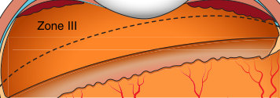

• Fig. 100.1 Artist’s rendering of half of the eye with zone II, stage 3, retinopathy of prematurity with plus disease. The view is from the top of the head, with the temporal side of the retina to the reader’s left and the nasal side to the right. Zones I, II, and III are identified on the retina to assist in visualizing their positions within the eye.

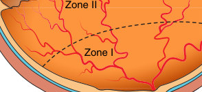

• Fig. 100.1 Artist’s rendering of half of the eye with zone II, stage 3, retinopathy of prematurity with plus disease. The view is from the top of the head, with the temporal side of the retina to the reader’s left and the nasal side to the right. Zones I, II, and III are identified on the retina to assist in visualizing their positions within the eye.

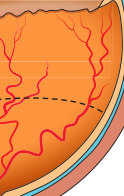

Unmatched source image; PDF page 2057. Consult the original caption.

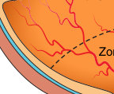

• Fig. 100.1 Artist’s rendering of half of the eye with zone II, stage 3, retinopathy of prematurity with plus disease. The view is from the top of the head, with the temporal side of the retina to the reader’s left and the nasal side to the right. Zones I, II, and III are identified on the retina to assist in visualizing their positions within the eye.

• Fig. 100.1 Artist’s rendering of half of the eye with zone II, stage 3, retinopathy of prematurity with plus disease. The view is from the top of the head, with the temporal side of the retina to the reader’s left and the nasal side to the right. Zones I, II, and III are identified on the retina to assist in visualizing their positions within the eye.

Unmatched source image; PDF page 2057. Consult the original caption.

Unmatched source image; PDF page 2057. Consult the original caption.

Unmatched source image; PDF page 2057. Consult the original caption.

## PDF page 2058 | printed page 2067

N=107 (1.5%)

N=604 (9%)

N=1025 (15%) N=541 (53%)

Examined N=6915 ROP 1 N=1025

N=455 (44%) N=633 (55%)

N=5179 (75%)

No ROP/ regression N=6592

• Fig. 100.2 Flow chart showing the sequential course of retinopathy of prematurity (ROP), including regression and progression to treatment, in the worst eyes (or right eye, if the stages were similar in the right and left eyes) of the infants in a Swedish National ROP Register (SWEDROP) study group. Infants with ROP in the worst eye at first examination or with missing data were excluded from the analysis. (From Holmstrom G, Hellstrom A, Granse L, et al. New modifications of Swedish ROP guidelines based on 10-year data from the SWEDROP register. Br J Ophthalmol. 2020;104(7):943–949.)

earliest, eye examinations are performed every 2 weeks to twice a week, depending on findings, to detect those needing treatment. The sequential development of the stages of ROP is monitored until ROP has regressed or progressed to type 1 disease, a certain combination of stages, zones, and/or plus disease for which treatment was found to be efficient in reducing blindness in the ETROP study.45 Rates of progression are variable, and the worst prognosis is associated with onset of severe disease in zone I (most central) that can rapidly progress to type 1 disease with high risk of retinal detachment. Onset in zone II, or a slower evolution of the disorder, leads more often to resolution. ROP with an onset in zone III has a good prognosis for recovery.46 Fig. 100.2 presents a flow chart showing the sequential course of ROP, including regression and progression to treatment in the worse eye of infants screened for ROP during a 10-year period in Sweden.5 After the neonatal period, extremely preterm infants have increased risk of reduced visual acuity, refractive errors, strabismus, and amblyopia which are strongly associated with ROP treatment.47 In addition, after treatment for type 1 ROP, retinal abnormalities such as persistent avascular retina with lattice-like changes and retinal tears may cause later retinal detachment at any age.48 Even eyes not meeting the treatment criteria in infancy may have similar changes and develop retinal detachment later in life.49 Therefore ROP should be considered a life-long disease, and treated children should be followed. Retinal fluorescein angiography can be used to visualize the pathology better because sometimes it could be difficult to see the

N=29 (2.8%)

N=508 (44%)

ROP 2 N=1145 ROP 3 N=644

N=325 (50%)

N=319 (50%)

N=4 (0.3%)

Treated N=323

extent and the severity of the pathology with simple direct visualization (Fig. 100.3).

### Prediction

The eye examinations are often painful and stressful, and the dilating eye drops may have adverse effects. Less than 10% of screened infants need ROP treatment,5 and algorithms to predict the risk of needing treatment for ROP have been developed to identify infants with high risk and those for whom examinations are unnecessary. Because poor postnatal weight gain was identified as a risk factor for severe ROP, a number of prediction models based on weight gain have been developed and validated.50,51 However, after implementation of higher oxygen saturation targets, the predictive ability of weight gain was lost in one study.52 In addition, information on body weight is not always available to ophthalmologists, and prediction tools based on birth characteristics alone or together with information on status and age when ROP was first diagnosed have been developed and validated.53,54 Prediction tools have hitherto been used mainly to judge when to safely end screening and not to exclude infants from eye examinations.

### Therapy

### Prevention

Oxygen control is a main factor in ROP prevention. Introduction of an educational program for care providers and

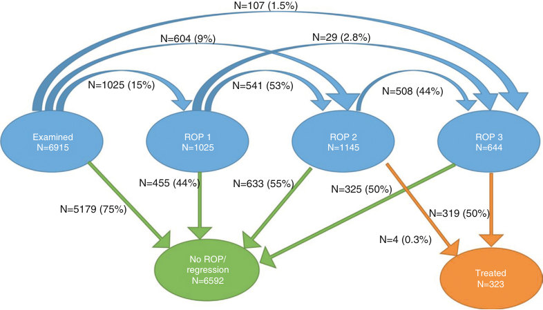

• Fig. 100.2 Flow chart showing the sequential course of retinopathy of prematurity (ROP), including regression and progression to treatment, in the worst eyes (or right eye, if the stages were similar in the right and left eyes) of the infants in a Swedish National ROP Register (SWEDROP) study group. Infants with ROP in the worst eye at first examination or with missing data were excluded from the analysis. (From Holmstrom G, Hellstrom A, Granse L, et al. New modifications of Swedish ROP guidelines based on 10-year data from the SWEDROP register. Br J Ophthalmol. 2020;104(7):943–949.)

## PDF page 2059

Optic nerve: The retinal vessels grow from the nerve head into the retina

New and abnormal vascularization formed at the border of the ROP. The new but small vessels have taken up the fluorescein dye as they light up as white under dark background

Fovea:

Central vision corresponds to this anatomical structure

A

Black arrow showing the previous location of ROP border at the time of treatment

Red arrow indicating the new advanced border with normal immature vasculature. No NV seen

C

• Fig. 100.3 A single patient with zone I, stage 3, retinopathy of prematurity (ROP) with plus disease. (A) Small arrows indicate the border where the vascular zone ends and the avascular (part of retina that does not have any vessels to bring oxygen and nutrition) zone begins. Along that border, the thick red line indicates significant neovascularization (NV) at that border. Also note the dilation of the veins and tortuosity of the arteries. It is still somewhat difficult to see the detail because of the underlying pinkish hue that masks the contrast. (B) Fluorescein angiography documents retinal vascular anatomy in much better detail, as the fluorescein dye lights up only the retinal vasculature and every other structure is dark. Bright white structures at the border are all significant neovascularization. (C) Fluorescein angiography shows the inferior retina. The border is visible again with less but present neovascularization seen as light bulbs on a tree. (D) Fluorescein angiography performed 1 month after treatment with anti-VEGF therapy. Note that the normal retinal vasculature has grown, and neovascularization has completely disappeared. Plus disease has also regressed with no tortuosity seen in the arteries.

a detailed policy for O2 monitoring and administration to minimize repeated episodes of hyperoxia after desaturations was shown to reduce ROP and the need for ROP treatment.55 Automation of oxygen titration appears promising so far, with a reduction in severe blood oxygen saturation (SpO2) deviations and the need for manual fraction of inspired oxygen (FiO2) adjustments compared with manual control.56

The mother’s own breast milk compensates for some of the losses of nutrients and bioactive factors after preterm birth, although it requires fortification.32 Programs to promote early provision of maternal milk instead of pasteurized donor milk or preterm formula are a cheap and safe intervention for ROP prevention.33 Maternal milk also contains the LCPUFAs DHA and AA, but not enough for the extremely preterm infant’s needs. In 2021, a randomized controlled study reported a 50% reduction in severe ROP after enteral supplementation with AA (100 mg/kg/d) and DHA (50 mg/kg/d) from the first days of life to 40 weeks’ postmenstrual age.41 Further studies are needed.

Loss of fetal Hb due to excessive blood sampling in extremely preterm infants is a risk factor for ROP.20 Development of methods to analyze small volumes of blood may decrease anemia and the need for transfusions of adult red blood cells. Studies on the feasibility of allogenic transfusion of red blood cells from umbilical cord with high levels of fetal Hb are ongoing.57,58 Because persistently low serum

B

D

IGF-I concentrations in preterm infants are associated with ROP and other morbidities59 and because supplemental IGF-I seems to improve food utilization in undernutrition,29 supplementation with exogenous IGF-I has been suggested as therapy to improve growth and reduce ROP and other morbidities. A phase II trial of supplementation of IGF-1 and the IGF binding protein IGFBP3 (NCT010100784) performed in 120 preterm infants showed no effects on ROP outcome but a reduced incidence of bronchopulmonary dysplasia.60 A phase III study is now under way, with ROP as the secondary endpoint.

### Treatment of Type 1 Retinopathy of Prematurity

The standard treatment of sight-threatening ROP is laser therapy to ablate the entire peripheral avascular retina, which is overproducing angiogenic factors such as VEGF, resulting in pathologic neovascularization on the ridge (Fig. 100.4). The criteria for laser treatment established by the ETROP multicenter trial first published in 2003 are shown in Box 100.1.45 Ablative treatment of nonvascularized retina helps prevent blindness but does not address the underlying cause of ROP or other co-morbidities—the failure of normal neural and vascular growth. Furthermore, the peripheral retina is destroyed to save central vision (see Fig. 100.3). Intravitreal injections of agents that block VEGF—mainly

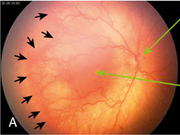

• Fig. 100.3 A single patient with zone I, stage 3, retinopathy of prematurity (ROP) with plus disease. (A) Small arrows indicate the border where the vascular zone ends and the avascular (part of retina that does not have any vessels to bring oxygen and nutrition) zone begins. Along that border, the thick red line indicates significant neovascularization (NV) at that border. Also note the dilation of the veins and tortuosity of the arteries. It is still somewhat difficult to see the detail because of the underlying pinkish hue that masks the contrast. (B) Fluorescein angiography documents retinal vascular anatomy in much better detail, as the fluorescein dye lights up only the retinal vasculature and every other structure is dark. Bright white structures at the border are all significant neovascularization. (C) Fluorescein angiography shows the inferior retina. The border is visible again with less but present neovascularization seen as light bulbs on a tree. (D) Fluorescein angiography performed 1 month after treatment with anti-VEGF therapy. Note that the normal retinal vasculature has grown, and neovascularization has completely disappeared. Plus disease has also regressed with no tortuosity seen in the arteries.

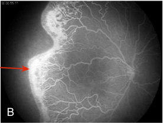

Unmatched source image; PDF page 2059. Consult the original caption.

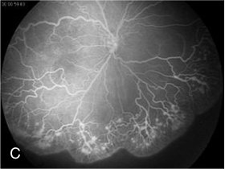

• Fig. 100.3 A single patient with zone I, stage 3, retinopathy of prematurity (ROP) with plus disease. (A) Small arrows indicate the border where the vascular zone ends and the avascular (part of retina that does not have any vessels to bring oxygen and nutrition) zone begins. Along that border, the thick red line indicates significant neovascularization (NV) at that border. Also note the dilation of the veins and tortuosity of the arteries. It is still somewhat difficult to see the detail because of the underlying pinkish hue that masks the contrast. (B) Fluorescein angiography documents retinal vascular anatomy in much better detail, as the fluorescein dye lights up only the retinal vasculature and every other structure is dark. Bright white structures at the border are all significant neovascularization. (C) Fluorescein angiography shows the inferior retina. The border is visible again with less but present neovascularization seen as light bulbs on a tree. (D) Fluorescein angiography performed 1 month after treatment with anti-VEGF therapy. Note that the normal retinal vasculature has grown, and neovascularization has completely disappeared. Plus disease has also regressed with no tortuosity seen in the arteries.

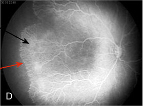

Unmatched source image; PDF page 2059. Consult the original caption.

## PDF page 2060 | printed page 2069

Old laser scars

ROP border

• Fig. 100.4 Fundus photography taken 4 weeks after laser treatment. The laser spots/scars are seen as white and black areas beyond the border of retinopathy of prematurity (ROP).

• BOX 100.1 Criteria for Peripheral Ablative

Therapy for Retinopathy of Prematurity

Zone II: Plus disease with stage 2 or 3 retinopathy of

prematurity Zone I: Plus disease with stage 1 or 2 retinopathy of

prematurity Zone I: Stage 3 retinopathy of prematurity

Adapted from Early Treatment for Retinopathy of Prematurity Cooperative Group. Revised indications for the treatment of retinopathy of prematurity: results of the Early Treatment for Retinopathy of Prematurity Randomized Trial. Arch Ophthalmol. 2003;121:1684.

bevacizumab, which is a full humanized antibody against VEGF, or ranibizumab, a fragment of a full antibody—are increasingly being used instead of or as a complement to laser therapy.61 Laser therapy is time consuming and usually performed under general anesthesia by highly skilled retinal surgeons, whereas anti-VEGF injections are more easily administered using local anesthesia. A review published in 2022 compared several aspects of anti-VEGF and laser treatments.61 Superior effects of anti-VEGF compared to laser in preventing retinal detachment primarily in zone I have been reported in a few studies, whereas similar effects of the two treatment modalities have been seen in zone II disease. Recurrences and longer times from treatment to recurrence, as well as more retinal vascular abnormalities detected with fluorescein angiography, have been seen in eyes treated with anti-VEGF compared to laser-treated eyes. A matter of concern with anti-VEGF treatment is leakage of the drug into the systemic blood circulation, where circulating VEGF is suppressed for weeks to months with unknown effects on the development of immature organs such as gut and brain.62 More research is needed regarding the choice of drug, dosage, and long-term effects of these drugs. Results of a systematic review and meta-analysis from 2021 indicated an increased risk of cognitive impairment and lower cognitive and language composite scores after bevacizumab therapy compared to laser therapy for severe ROP.63 Surgery

• BOX 100.2 Schedule for First Indirect

Ophthalmoscopy in Premature Infants

Who

• All infants with a birth weight of 1500 g or less or a

gestational age of 30 weeks or less • Selected infants with birth weight 1500 to 2000 g or

gestational age over 30 weeks who are believed to be at risk for ROP

When

• By the later of 31 weeks’ postmenstrual age or 4 weeks

after birth • Recommend first examination before discharge from the

hospital

Adapted from Fierson WM. American Academy of Pediatrics, Section on Ophthalmology, American Academy of Ophthalmology, American Association for Pediatric Ophthalmology and Strabismus, American Association of Certified Orthoptists. Screening examination of premature infants for retinopathy of prematurity. Pediatrics 2018;142(6):e20183061.

for partial retinal detachment (stage 4) may yield some form of vision, but total retinal detachment (stage 5) surgery yields very poor results.64

### Recommendations for Examination Schedule

At-risk premature infants need to be examined by a trained clinician with indirect ophthalmoscopy or with widefield photography to detect ROP before it reaches the well-established clinical criteria for treatment to prevent progression of the disease. Ophthalmic and pediatric societies periodically publish recommendations for the screening guidelines, which may vary among countries (Box 100.2). In the United States, infants at risk are suggested to be those weighing ≤1500 g or born at ≤30 weeks’ gestation.65 In addition, screening is recommended for more mature preterm infants with birth weight between 1500 and 2000 g or a GA >30 weeks who have had an unstable medical course. The infants should be examined initially by 31 weeks’ postmenstrual age or 4 weeks’ chronologic age and then repeatedly until the retina is fully vascularized. Intervals between examinations are scheduled according to severity of disease, ranging from 2 to 3 weeks to less than 1 week as stated in the national guidelines.65

Neonatologists and ophthalmologists must work closely together to ensure an efficient tracking system for timely examination of these infants and to be certain that followup examinations occur at the best times both in the hospital and after discharge or transfer. The goal is to ensure that no infants who reach the criteria for ROP treatment are missed in an attempt to minimize life-long vision loss.

After the acute process has resolved, continued followup is dictated by the worst degree of ROP that occurred in

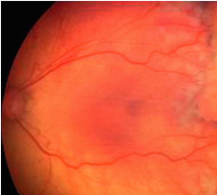

• Fig. 100.4 Fundus photography taken 4 weeks after laser treatment. The laser spots/scars are seen as white and black areas beyond the border of retinopathy of prematurity (ROP).

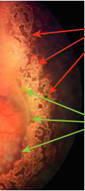

Unmatched source image; PDF page 2060. Consult the original caption.

## PDF page 2061

the acute course. For infants who have had laser or anti- VEGF for ROP, close observation of the retina and assessment for refractive errors, strabismus, amblyopia, or late retinal detachments through childhood are also important.66 One should also bear in mind that infants with severe ROP have increased risk of brain lesions and that their visual impairment may not be solely retinal in origin. Cerebral visual impairment is associated with reduced visual acuity and visual fields, strabismus, nystagmus, and optic atrophy. In addition, varying degrees of visual perceptual deficits may make visual problems more severe than indicated by visual acuity.67 Questionnaires regarding visual perceptual problems provide a simple method to identify children who might benefit from further neuropsychiatric investigation.68 Research must continue in order to learn more about the basic mechanisms involved in the control of neurovascular development. Such

Key Points

### • Retinopathy of prematurity (ROP) incidence is influ-

enced by the quality of neonatal care.

### • Oxygen regulation and other growth factors are key in

the pathogenesis of ROP.

### References

1. Silverman WA. Retrolental Fibroplasia: A Modern Parable. New

York: Grune & Stratton; 1980. 2. Blencowe H, Lawn JE, Vazquez T, et al. Preterm-associated

visual impairment and estimates of retinopathy of prematurity at regional and global levels for 2010. Pediatr Res. 2013;74(suppl 1):35–49. 3. Zin A, Gole GA. Retinopathy of prematurity-incidence today.

Clin Perinatol. 2013;40(2):185–200. 4. Zepeda-Romero LC, Lundgren P, Gutierrez-Padilla JA, et al. Oxy-

gen monitoring reduces the risk for retinopathy of prematurity in a Mexican population. Neonatology. 2016;110(2):135–140. 5. Holmstrom G, Hellstrom A, Granse L, et al. New modifications

of Swedish ROP guidelines based on 10-year data from the SWE- DROP register. Br J Ophthalmol. 2020;104(7):943–949. 6. Prakalapakorn SG, Greenberg L, Edwards EM, Ehret DEY.

Trends in retinopathy of prematurity screening and treatment: 2008-2018. Pediatrics. 2021;147(6):e2020039966. 7. Dai Y, Zhu L, Zhou Y, et al. Ten-year trend of retinopathy of

prematurity among extremely preterm infants in one neonatal intensive care unit in China. Front Pediatr. 2021;9:717090. 8. Hansen RM, Moskowitz A, Akula JD, Fulton AB. The neu-

ral retina in retinopathy of prematurity. Prog Retin Eye Res. 2017;56:32–57. 9. Lundgren P, Kistner A, Andersson EM, et al. Low birth weight is

a risk factor for severe retinopathy of prematurity depending on gestational age at birth. PLoS One. 2014;9(10):e109460. 10. Patz A, Hoeck E, De La Cruz E. Studies on the effect of high

oxygen administration in retrolental fibroplasia, I: nursery observations. Am J Ophthalmol. 1952;35:1248–1253. 11. Ashton N. Pathological basis of retrolental fibroplasia. Br J Oph-

thalmol. 1954;38(7):385–396.

knowledge may allow the prevention of ROP and other central nervous system sequelae of preterm birth. Education programs for care providers in oxygen titration and measures to stimulate the provision of the mother’s own unpasteurized milk have the potential to prevent ROP and should be instituted without delay.

### Acknowledgments

This work was supported in part by grants from the National Eye Institute, National Institutes of Health (EY022275, EY017017, EY030904, P01 HD18655 to LEHS) and the National Eye Institutes, National Institutes of Heath (R01EY030140, R01EY029238) (YS). The authors sincerely thank Dale L. Phelps, MD, for helping during the preparation of the manuscript and the copyright holders for permission to reproduce the illustrations used in this chapter.

### • Low gestational age and birth weight, oxygen supple-

mentation, low insulin-like growth factor 1 level, hyperglycemia, insulin use, and blood transfusions are risk factors for ROP.

12. Askie LM, Darlow BA, Finer N, et al. Association between oxy-

gen saturation targeting and death or disability in extremely preterm infants in the neonatal oxygenation prospective metaanalysis collaboration. JAMA. 2018;319(21):2190–2201. 13. Imanishi Y, Hirata K, Nozaki M, et al. Effect of fluctuation of

oxygenation on the development of severe retinopathy of prematurity in extremely preterm infants. J Perinatol. 2020;40(3):515– 521. 14. Di Fiore JM, Kaffashi F, Loparo K, et al. The relationship between

patterns of intermittent hypoxia and retinopathy of prematurity in preterm infants. Pediatr Res. 2012;72(6):606–612. 15. Chen ML, Guo L, Smith LE, et al. High or low oxygen saturation

and severe retinopathy of prematurity: a meta-analysis. Pediatrics. 2010;125(6):e1483–e1492. 16. Schmidt B, Whyte R. Oxygen saturation target ranges and alarm

settings in the NICU: what have we learnt from the neonatal oxygenation prospective meta-analysis (NeOProM)? Semin Fetal Neonatal Med. 2020;25(2):101080. 17. Stenson BJ. Oxygen saturation targets for extremely preterm infants

after the NeOProM trials. Neonatology. 2016;109(4):352–358. 18. Manja V, Lakshminrusimha S, Cook DJ. Oxygen saturation tar-

get range for extremely preterm infants: a systematic review and meta-analysis. JAMA Pediatr. 2015;169:332–340. 19. Liu T, Tomlinson LA, Yu Y, et al. Changes in institutional

oxygen saturation targets are associated with an increased rate of severe retinopathy of prematurity. J AAPOS. 2022;S1091- 8531(22):00002-7. 20. Hellstrom W, Martinsson T, Morsing E, et al. Low fraction of fetal

haemoglobin is associated with retinopathy of prematurity in the very preterm infant. Br J Ophthalmol. 2022;106(7):970–974. 21. Jiramongkolchai K, Repka MX, Tian J, et al. Effects of fetal hae-

moglobin on systemic oxygenation in preterm infants and the development of retinopathy of prematurity PacIFiHER Report No. 2. Br J Ophthalmol. 2023;107(3):380–383.

## PDF page 2062 | printed page 2071

22. Martin CR. Preventing bioenergetic failure in the preterm infant.

Arch Dis Child Fetal Neonatal Ed. 2015;101(2):F99–F101. 23. Larnkjaer A, Molgaard C, Michaelsen KF. Early nutrition

impact on the insulin-like growth factor axis and later health consequences. Curr Opin Clin Nutr Metab Care. 2012;15(3): 285–292. 24. Hellstrom A, Perruzzi C, Ju M, et al. Low IGF-I suppresses

VEGF-survival signaling in retinal endothelial cells: direct correlation with clinical retinopathy of prematurity. Proc Natl Acad Sci USA. 2001;98(10):5804–5808. 25. Hellström A, Ley D, Hansen-Pupp I, et al. Role of insulinlike

growth factor 1 in fetal development and in the early postnatal life of premature infants. Am J Perinatol. 2016;33(11):1067– 1071. 26. Rath CP, Shivamallappa M, Muthusamy S, et al. Outcomes of

very preterm infants with neonatal hyperglycaemia: a systematic review and meta-analysis. Arch Dis Child Fetal Neonatal Ed. 2022;107(3):269–280. 27. Cakir B, Hellstrom W, Tomita Y, et al. IGF1, serum glucose,

and retinopathy of prematurity in extremely preterm infants. JCI Insight. 2020;5(19):e140363. 28. Hansen-Pupp I, Löfqvist C, Polberger S, et al. Influence of

insulin-like growth factor I and nutrition during phases of postnatal growth in very preterm infants. Pediatr Res. 2011;69(5 Pt 1):448–453. 29. Fryklund L, Gluckman P, Skottner A. Treatment of Catabolic

States Using Authentic IGF-I and Hypocaloric Amount of Nutrients. United States: 2000. U.S. Patent #6034059. Accessed September 21, 2023. https://urldefense.com/v3/__https://patentimages.storage.googleapis.com/6b/1b/73/fa884c11ccf5c2/ US6034059A.pdf__;!!IuDQRY6mOWG9IIqcpA!XpBVXy0d- TTAJ2uVcCVWIrWZfpLOtrUHHV0GNWrkYgmwC97jH3si- Hr7wJQgb9HxaiQqvu2M41A4afAbHzquEnX4nEbTM$ 30. Athikarisamy S, Desai S, Patole S, et al. The use of postnatal

weight gain algorithms to predict severe or type 1 retinopathy of prematurity: a systematic review and meta-analysis. JAMA Netw Open. 2021;4(11):e2135879. 31. Vanhaesebrouck S, Vanhole C, de Zegher F, Allegaert K. Influ-

ence of duration of parenteral nutrition on retinopathy of prematurity. Arch Dis Child Fetal Neonatal Ed. 2008;93(2):F170. 32. Hard AL, Nilsson AK, Lund AM, et al. Review shows that donor

milk does not promote the growth and development of preterm infants as well as maternal milk. Acta Paediatr. 2019;108(6):998– 1007. 33. Bharwani SK, Green BF, Pezzullo JC, et al. Systematic review

and meta-analysis of human milk intake and retinopathy of prematurity: a significant update. J Perinatol. 2016;36(11):913–920. 34. Yu F, Cao B, Wen Z, et al. Is Donated breast milk better than

formula for feeding very low birth weight infants? A systematic review and meta-analysis. Worldviews Evid Based Nurs. 2019;16(6):485–894. 35. Gil-Sánchez A, Demmelmair H, Parrilla JJ, et al. Mechanisms

involved in the selective transfer of long chain polyunsaturated fatty acids to the fetus. Front Genet. 2011;2:57. 36. Connor KM, SanGiovanni JP, Löfqvist C, et al. Increased dietary

intake of omega-3-polyunsaturated fatty acids reduces pathological retinal angiogenesis. Nat Med. 2007;13(7):868–873. 37. Pawlik D, Lauterbach R, Walczak M, et al. Fish-oil fat emulsion

supplementation reduces the risk of retinopathy in very low birth weight infants: a prospective, randomized Study. JPEN (J Parenter Enteral Nutr). 2013;38(6):711–716.

38. Beken S, Dilli D, Fettah ND, et al. The influence of fish-oil

lipid emulsions on retinopathy of prematurity in very low birth weight infants: a randomized controlled trial. Early Hum Dev. 2014;90(1):27–31. 39. Najm S, Lofqvist C, Hellgren G, et al. Effects of a lipid emulsion

containing fish oil on polyunsaturated fatty acid profiles, growth and morbidities in extremely premature infants: a randomized controlled trial. Clin Nutr ESPEN. 2017;20:17–23. 40. Löfqvist C, Najm S, Hellgren G, et al. Association of retinopa-

thy of prematurity with low levels of arachidonic acid. A secondary analysis of a randomized clinical trial. JAMA Ophthalmol. 2018;136(3):271–277. 41. Hellström A, Nilsson AK, Wackernagel D, et al. Effect of enteral

lipid supplement on severe retinopathy of prematurity: a randomized clinical trial. JAMA Pediatr. 2021;175(4):359–367. 42. Hellström A, Pivodic A, Granse L, et al. Association of doco-

sahexaenoic acid and arachidonic acid serum levels with retinopathy of prematurity in preterm infants. JAMA Netw Open. 2021;4(10):e2128771. 43. International Committee for Classification of ROP. The interna-

tional classification of retinopathy of prematurity revisited. Arch Ophthalmol. 2005;123(7):991–999. 44. Chiang MF, Quinn GE, Fielder AR, et al. International classifi-

cation of retinopathy of prematurity, third edition. Ophthalmology. 2021;128(10):e51–e68. 45. Early Treatment for Retinopathy of Prematurity Cooperative Group.

Revised indications for the treatment of retinopathy of prematurity: results of the early treatment for retinopathy of prematurity randomized trial. Arch Ophthalmol. 2003;121(12):1684–1694. 46. Schaffer DB, Palmer EA, Plotsky DF, et al. Prognostic factors in

the natural course of retinopathy of prematurity. Cryotherapy for Retinopathy of Prematurity Cooperative Group. Ophthalmology. 1993;100:230–237. 47. Hellgren KM, Tornqvist K, Jakobsson PG. Ophthalmologic out-

come of extremely preterm infants at 6.5 years of age Extremely Preterm Infants in Sweden Study (EXPRESS). JAMA Ophthalmol. 2016;134(5):555–562. 48. Chang E, Rao P. Adult retinopathy of prematurity: treatment

implications, long term sequelae, and management. Curr Opin Ophthalmol. 2021;32(5):489–493. 49. Hamad AE, Moinuddin O, Blair MP, et al. Late-onset retinal

findings and complications in untreated retinopathy of prematurity. Ophthalmol Retina. 2020;4(6):602–612. 50. Hellstrom A, Hard AL, Engstrom E, et al. Early weight gain

predicts retinopathy in preterm infants: new, simple, efficient approach to screening. Pediatrics. 2009;123(4):e638–e645. 51. Athikarisamy S, Desai S, Patole S, et al. The use of postnatal

weight gain algorithms to predict severe or type 1 retinopathy of prematurity: a systematic review and meta-analysis. JAMA Netw Open. 2021;4(11):e2135879. 52. Lundgren P, Hard AL, Wilde A, et al. Implementing higher

oxygen saturation targets reduced the impact of poor weight gain as a predictor for retinopathy of prematurity. Acta Paediatr. 2018;107(5):767–773. 53. Pivodic A, Hard AL, Lofqvist C, et al. Individual risk prediction

for sight-threatening retinopathy of prematurity using birth characteristics. JAMA Ophthalmol. 2020;138(1):21–29. 54. Pivodic A, Johansson H, Smith LEH, et al. Development and

validation of a new clinical decision support tool to optimize screening for retinopathy of prematurity. Br J Ophthalmol. 2022;106(11):1573–1580.

## PDF page 2063

55. Chow LC, Wright KW, Sola A, CSMC Oxygen Administra-

tion Study Group. Can changes in clinical practice decrease the incidence of severe retinopathy of prematurity in very low birth weight infants? Pediatrics. 2003;111(2):339–345. 56. Dargaville PA, Marshall AP, McLeod L, et al. Automation of

oxygen titration in preterm infants: current evidence and future challenges. Early Hum Dev. 2021;162:105462. 57. Teofili L, Papacci P, Orlando N, et al. Allogeneic cord blood

transfusions prevent fetal haemoglobin depletion in preterm neonates. Results of the CB-TrIP study. Br J Haematol. 2020;191(2):263–268. 58. Barreto Henriksson H, Hellstrom A, Hesse C, et al. Morphol-

ogy and biological data in cord blood erythrocyte units resembles adult units after processing and storage - Meets current quality recommendations. Transfus Apher Sci. 2022;61(3):103356. 59. Hellstrom A, Ley D, Hansen-Pupp I, et al. IGF-I in the clin-

ics: use in retinopathy of prematurity. Growth Horm IGF Res. 2016;30–31:75–80. 60. Ley D, Hallberg B, Hansen-Pupp I, et al. rhIGF-1/rhIGFBP-3 in

preterm infants: a phase 2 randomized controlled trial. J Pediatr. 2019;206:56–65. 61. Chow SC, Lam PY, Lam WC, Fung NSK. The role of anti-vascu-

lar endothelial growth factor in treatment of retinopathy of prematurity—a current review. Eye (Lond). 2022;36(8):1532–1545. 62. Sato T, Wada K, Arahori H, et al. Serum concentrations of

bevacizumab (Avastin) and vascular endothelial growth factor

in infants with retinopathy of prematurity. Am J Ophthalmol. 2012;153(2):327–333. 63. Kaushal M, Razak A, Patel W, et al. Neurodevelopmental out-

comes following bevacizumab treatment for retinopathy of prematurity: a systematic review and meta-analysis. J Perinatol. 2021;41(6):1225–1235. 64. Patel CK, Carreras E, Henderson RH, et al. Evolving outcomes

of surgery for retinal detachment in retinopathy of prematurity: the need for a national service in the United Kingdom: an audit of surgery for acute tractional retinal detachment complicating OP in the UK. Eye (Lond). 2022;36(8):1590–1596. 65. Fierson WM, et al. Screening examination of premature

infants for retinopathy of prematurity. Pediatrics. 2018; 142(6):e20183061. 66. Hwang CK, Hubbard GB, Hutchinson AK, Lambert SR.

Outcomes after intravitreal bevacizumab versus laser photocoagulation for retinopathy of prematurity: a 5-year retrospective analysis. Ophthalmology. 2015;122(5):1008–1015. 67. Dutton GN. Cerebral visual impairment in children: the impor-

tance of classification. Dev Med Child Neurol. 2021;63(3):245. 68. Hellgren K, Jacobson L, Frumento P, et al. Cerebral visual impair-

ment captured with a structured history inventory in extremely preterm born children aged 6.5 years. J AAPOS. 2020;24(1):28. e1–28.e8.

<!-- SOURCE_LAYOUT_VIEWS -->

## Original layout views and recovered diagrams

Automatic extraction can flatten tables and superscripts. Check the original layout for numeric data, footnotes and image credits. [Source review notes](../../SOURCE_REVIEW_NOTES.md).

### Original source page 2057

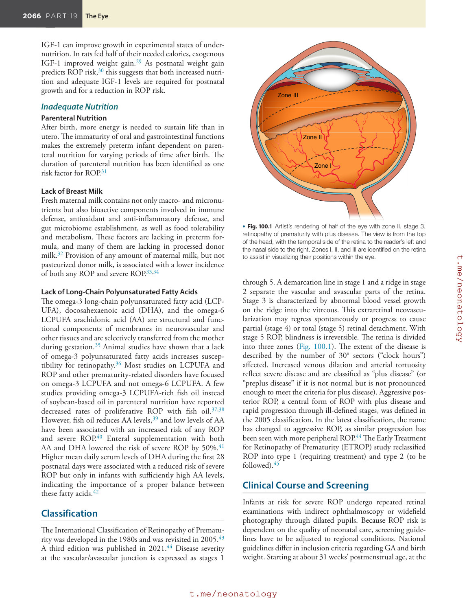

### Original source page 2058

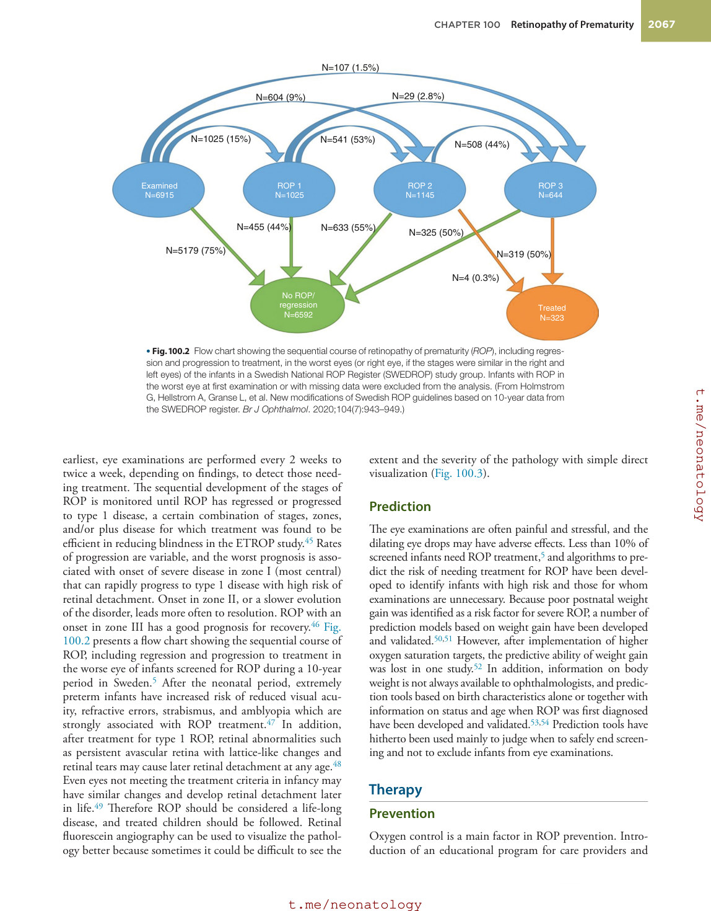

### Original source page 2059

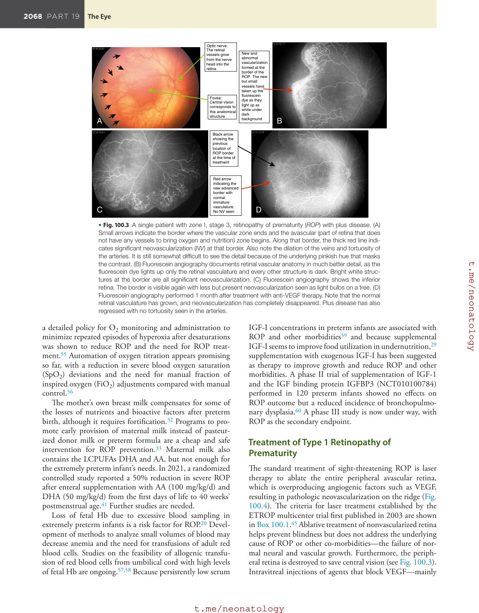

### Original source page 2060

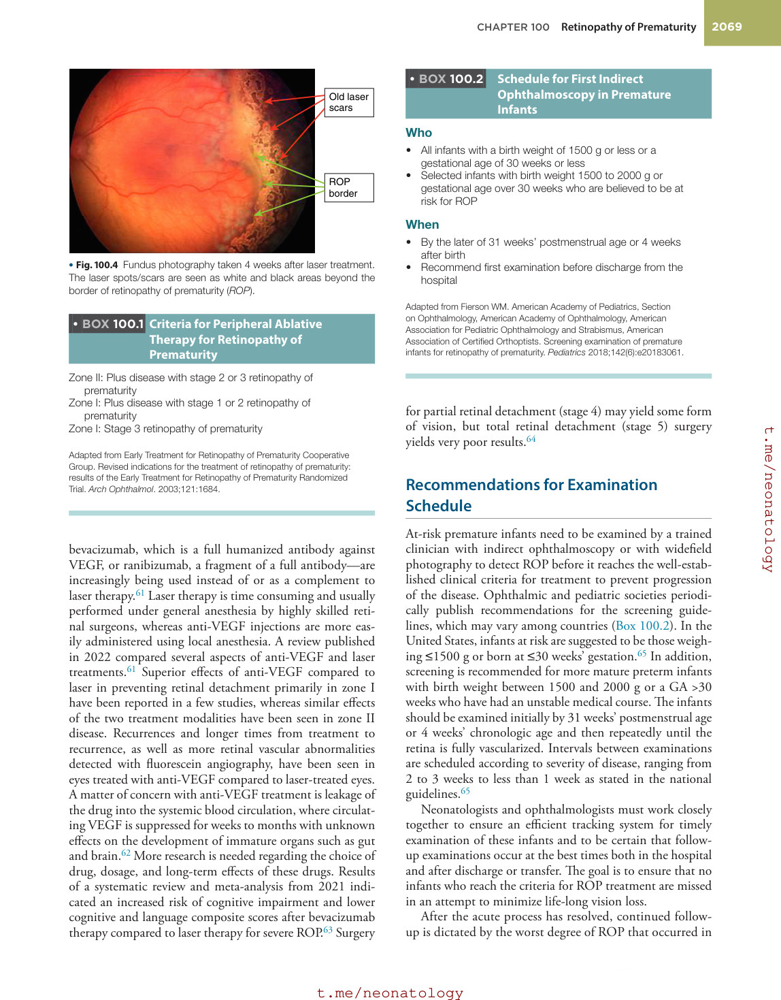
