# 101. Musculoskeletal Disorders in Neonates
> [Source credits](../../SOURCE_CREDITS.md).

## Study pillars

### Malformation versus deformation

Deformation of an essentially formed part. Early embryonic disturbances produce malformations; later fetal influences can alter the configuration of essentially normal structures.

PDF p. 2065

### Intrauterine constraint

Increased uterine compression affecting fetal position and motion. Oligohydramnios and other constraint factors may produce contractures and angular or torsional changes; some resolve, others require care.

PDF p. 2067

### Upper plexus pattern

Upper brachial plexus palsy. The described waiter’s-tip posture is characteristic of the common upper plexus injury pattern.

PDF p. 2068

### Painful pseudoparalysis

Pain-related pseudoparalysis from fracture. Clavicular fracture can cause painful reduced motion and mimic a neurologic palsy; examination and imaging distinguish causes.

PDF p. 2069

### Unossified epiphysis

The proximal humeral epiphysis is not yet ossified. An unossified epiphysis can conceal separation on plain radiography; ultrasound or other imaging and later callus may help.

PDF p. 2070

## Full source extraction

# 101. Musculoskeletal Disorders in Neonates
> Source attribution: [Source credits](../../SOURCE_CREDITS.md).

## PDF page 2064 | printed page 2074

101 Musculoskeletal Disorders in Neonates

### RAYMOND W. LIU AND MICHAEL P. GLOTZBECKER

### Overview of Musculoskeletal Chapters

Musculoskeletal abnormalities of the extremities, spine, and pelvis are common in the neonate. Some are pathologic and others physiologic in origin from normal in utero positioning. The congenital absence of all or part of a limb, deformities of the feet or hands, and abnormalities of the spine are rarely diagnostic problems, whereas others, such as developmental dysplasia of the hip (DDH), may escape diagnosis even after repeated screenings by experienced examiners. Bone and joint infections in the neonatal period produce few of the diagnostic signs and symptoms present in the older child and require a high index of suspicion and careful diagnostic evaluation. When an infection is diagnosed early and prompt treatment rendered, the growth potential of the neonate yields an excellent prognosis for normal development and function.

### Etiology of Congenital Disorders

### Teratogenic Abnormalities

It has been estimated in the past that 5% of all malformations are the result of the action of known teratogens on the developing embryo. Irradiation, industrial chemicals, therapeutic drugs, and certain maternal infections produce primary musculoskeletal malformations or secondarily affect the growth and development of the musculoskeletal system. Historically, thalidomide is the best-known cause of musculoskeletal malformation, causing limb reduction deficits in addition to a variety of other congenital abnormalities. Rubella, cytomegalic inclusion disease, and congenital herpes produce lesions of the central nervous system that may secondarily affect the musculoskeletal system.

### Genetic Disorders

Genetic disorders that affect the musculoskeletal system may be divided into three categories: Mendelian, chromosomal, and multifactorial.

2074

### Mendelian Disorders

Mendelian disorders are characterized by an abnormality in a single gene obeying the rules of Mendelian inheritance. Skeletal dysplasias such as achondroplasia and diastrophic dwarfism, neurofibromatosis, Marfan syndrome, and rickets resistant to vitamin D are examples of Mendelian disorders. Some skeletal dysplasias are diagnosed in the neonate, whereas others do not become clinically recognizable until later in childhood.

### Chromosomal Abnormalities

There are many varieties of chromosomal abnormalities. Aneuploidy is the presence of more or fewer chromosomes than normal and includes Down syndrome as well as Turner syndrome. Translocations are also changes that are detectable on ultrastructural analysis. Deletion and inversion can be more subtle and are discovered on specialized genetic testing. Although they are striking, the musculoskeletal manifestations of these conditions are frequently the least serious of the infant’s problems in other organ systems.

### Multifactorial Conditions

These conditions are determined by a combination of genetic predisposition and intrauterine environmental influences. Such conditions typically occur in families with a frequency that is greater than expected but do not follow the obvious rules of Mendelian inheritance. Talipes equinovarus (clubfoot) is such a disorder. The overall incidence of clubfoot is 1 case per 1000 live births, but the incidence of deformity among first-degree relatives is 20 to 30 times higher than that in the general population. Three percent of dizygous twins and 40% of monozygous twins share the deformity. An increased incidence of clubfoot occurs among breech and twin births.

### Development of Disorders

### Normal Embryology

Because many neonatal musculoskeletal disorders are congenital in origin, it is important to understand the basic aspects of musculoskeletal embryology. Prenatal development is

## PDF page 2065 | printed page 2075

divided into two major stages: the embryonic period, consisting of the first 8 to 9 weeks, and the fetal period, consisting of the remainder of pregnancy. The components of the musculoskeletal system differentiate during the first trimester; the second and third trimesters are periods of further growth and development.1,2 Abnormalities during the embryonic period produce congenital malformations, whereas the fetal period produces deformations and alterations in the configuration of essentially normal parts.

### Embryonic Development

The early embryonic development of the musculoskeletal system is oriented around the notochord, a tubular column of cells running cranially and caudally along the long axis of the embryo. During the third week of gestation, the neural crests develop dorsally and on either side of the notochord. These crests fold over and are joined dorsally to produce the neural tube, from which the spinal cord and associated spinal nerves develop. At the same time, paraxial collections of mesodermal tissue develop on either side of the notochord and segment in the cranial to caudal axis into 44 distinct condensations called somites. From the primitive mesodermal tissue comprising the somites, the skeletal tissues, muscle, and dermal elements of the body develop.

Teratogenic influences and genetic abnormalities occurring during the embryonic period can adversely affect the normal differentiation of the musculoskeletal system, resulting in malformations of the spine or extremities. Other organ systems differentiating at the same time are often concomitantly affected, such as the association of cardiac and genitourinary abnormalities with congenital spinal deformities (see Chapter 29).

Although spinal and limb anomalies occur very early in embryonic development, they are often not seen until later in fetal development or after birth when cartilaginous structures begin to ossify and are of sufficient size to detect differences.

### Spine

The differentiation of the spinal column begins during the fourth week of the embryonic period. The somites first appear in the occipital region of the embryo; further development occurs simultaneously in a cranial-to-caudal direction. Dorsal and anterolateral migrations of the mesodermal tissue derived from the somites give rise to the connective tissue elements of the trunk and limbs. Anteromedial extensions of the somatic mesoderm migrate to surround the notochord, separating it from the neural tube and forming the primitive anlage of the vertebral bodies. The differentiation of the neural and vascular elements of the spinal column occurs simultaneously to somite development.

Definitive formation of the spinal column occurs from the fourth through the sixth week of gestation. Abnormalities in normal spinal development are associated with abnormalities in other organ systems developing at the same time (cardiac, renal, limb, gastrointestinal).

During this critical period, the somatic mesodermal tissue surrounding the notochord differentiates into a less cellular and dense upper portion and a more cellular and dense lower portion. The somites cleave together, the lower portion of the superior somite joining with the upper portion of the inferior somite. The intervertebral disc develops at the site of the cleavage. The notochord, which is contained within the newly joined primitive vertebral bodies, degenerates, and those portions at the site of cleavage become the nucleus pulposus of the intervertebral disc. The neural arches and ribs develop from the dense portions of the somite, and the vertebral body develops from the less dense portions.

Chondrification begins in the primitive mesodermal vertebrae during the sixth week of pregnancy. It progresses rapidly to form cartilaginous models of the vertebral body by the end of the first trimester. Ossification of the cartilaginous models begins during the second trimester. The ossification of each side of the neural arch and of the body at each level proceeds separately. In the neonate, the ossified vertebral body and neural arches at each level are clearly visible radiographically, separated as they are by the nonossified synchondritic junctions. The ossification centers of the neural arches and body coalesce during the first 3 years of postnatal development.

### Extremities

The upper and lower extremities develop from the limb buds. They become recognizable during the fourth week of gestation. These buds grow and differentiate rapidly in a proximal to distal sequence during the next 4 weeks. The cells differentiate into three segments: the dermatomes, which become skin; the myotomes, which become muscle; and the sclerotomes, which become cartilage and bone. By the fifth week, the hand plate forms, and mesenchymal condensations occur in the limbs. By the sixth week, the digits become evident, and chondrification of the mesenchymal condensations occurs. Notches appear between the digit rays during the seventh week. The failure of the rays to separate at this time results in syndactyly. Also during the seventh week, the upper and lower limbs rotate in opposite directions. The lower limbs rotate internally to bring the toes to the midline, whereas the upper limbs rotate 90 degrees externally to the position of the thumb on the lateral side of the limb.

### Abnormal Fetal Development Spinal Defects

Errors in the embryologic derivation of the spine cause a number of congenital defects of the spine and spinal cord. These errors range in severity from isolated hemivertebrae to the complex errors of vertebral formation and segmentation associated with massive defects of the neural tube or spinal cord. When such errors result in asymmetric vertebral formation or produce asymmetric vertebral growth potential, structural spinal curves such as congenital scoliosis or kyphosis develop. Partial or complete failure of

## PDF page 2066

the formation of a vertebra (i.e., hemivertebra) or errors in the normal pattern of vertebral segmentation and recombination (i.e., unsegmented bars and trapezoidal, butterfly, and block vertebrae) may occur as single anomalies or be associated with other malformations of the osseous, neural, and organ systems. When vertebral defects are unbalanced and have growth potential, striking spinal deformities may occur, such as with a unilateral unsegmented bar with a contralateral hemivertebra. The nature of the deformity depends on the growth potential of the abnormal segments and their positions in the spinal column. For example, lateral abnormalities produce congenital scoliosis, and anterior or posterior midline defects result in congenital kyphotic or lordotic deformities.

Malformations of the head and neck, especially the internal and external auditory apparatuses, maxillae, and mandibles, occur frequently in patients with high thoracic and cervical curves. The association of a short neck, low posterior hairline, and restriction in neck motion caused by the congenital fusion of cervical vertebrae represents Klippel- Feil syndrome. Renal anomalies, the congenital elevation of the scapulae (i.e., Sprengel deformity), impaired hearing, and congenital heart disease are common associated anomalies in affected patients. The VACTERL syndrome (vertebral defects, imperforate anus, cardiac anomalies, tracheoesophageal fistula, renal dysplasia, and limb deficiencies, often in the radius) underscores the complex nature of the relationships between the rapidly evolving organ systems and the musculoskeletal system during the first trimester of pregnancy. Any child with congenital scoliosis should be specifically screened for cardiac and renal defects, while other VACTERL components are generally more diagnostically obvious.

McMaster reported a high incidence of occult intraspinal abnormality in patients with congenital scoliosis.3 Possible anomalies included intradural and extradural lipoma cysts, teratoma, spinal cord tethers, diplomyelia, diastematomyelia, and meningocele. The association of vertebral anomalies with neural tube or spinal cord defects is to be expected, given the intimate relationships of their embryonic development. The physical signs of underlying spinal dysraphism include hairy patches, midline dimpling, nevi, inequality in the length of the lower extremities or circumferential asymmetry, and asymmetry in foot size. Screening MRI of the spine is considered when there is a significant or draining defect, or if there are progressive changes in the neurologic exam (see Chapter 60).

### Congenital Limb Malformations

Congenital limb malformations are relatively common among neonates. Some are grossly obvious, such as a congenital amputation, whereas others are subtle and perhaps unrecognizable for years, such as a congenital proximal radioulnar synostosis (fusion). Swanson and colleagues developed the classic seven-group classification system4 (Box 101.1).

Lower extremity conditions can still be classified based on this system. However, because the Swanson system is based on morphology rather than etiology, it has issues because some conditions can fit in multiple categories and other conditions cannot be classified. A newer system developed by Oberg, Manske, and Tonkin (OMT) with a focus on etiology and with the ability to adapt to new developments in knowledge has been adopted by the International Federation of Societies for Surgery of the Hand Congenital Conditions Committee.5 The OMT classification has also been demonstrated reliable when tested among pediatric hand surgeons from multiple institutions using a multicenter registry.6

The foundation of the OMT system is based on developmental biology and split into malformations, deformations, and dysplasias7 (Box 101.2).

• BOX 101.1 Seven-Group Classification System of

Congenital Limb Malformations

1. Failure of formation of parts (e.g., arrested development) 2. Failure of differentiation (e.g., separation) of parts 3. Duplication 4. Overgrowth (e.g., hyperplasia, gigantism) 5. Undergrowth (e.g., hypoplasia) 6. Congenital constriction band syndrome 7. Generalized skeletal abnormalities

• BOX 101.2 Oberg, Manske, and Tonkin (OMT)

Classification

Malformations

• Failure of axis formations/differentiation—entire upper limb • Proximal-distal outgrowth (e.g., symbrachydactyly) • Radial-ulnar axis (e.g., radial longitudinal deficiency,

radioulnar synostosis) • Dorsal-ventral axis (e.g., nail-patella syndrome) • Failure of axis formation/differentiation—handplate • Radial-ulnar axis (e.g., polydactyly, triphalangeal thumb) • Dorsal-ventral axis (e.g., hypoplastic/aplastic nail) • Failure of handplate formation/differentiation—unspecified

axis • Soft tissue (e.g., syndactyly, camptodactyly) • Skeletal deficiency (e.g., clindactyly, brachydactyly) • Complex (e.g., cleft hand)

Deformations

• Constriction ring sequelae • Arthrogryposis • Trigger digits • Not otherwise specified

Dysplasias

• Hypertrophy • Macrodactyly • Upper limb • Upper limb and macrodactyly • Tumorous conditions

## PDF page 2067 | printed page 2077

Etiologies continue to be proposed for different congenital conditions. For example, it was recently postulated that proximal femur, fibula, and midline metatarsal long bone deficiencies have been misclassified as lateral deficiencies, when instead they should be classified as post-specification errors based on findings that all three may be caused by flawed embryonic arterial transitions.8

### In Utero Positioning

The imprint of in utero positioning is frequently seen in the neonate. It can produce joint and muscle contractures and torsional and angular variations in the long bones, especially those of the lower extremities. It can also produce craniofacial distortion and positional contracture of the neck. The upper extremities are usually less affected.

The expression of in utero positioning depends on fetal position and the amount of compressive force applied. Intrinsic and extrinsic factors contribute to these variables. The intrinsic factors include oligohydramnios, multiple fetuses, a large fetus, abnormal fetal positioning (e.g., breech and transverse), and abnormal fetal muscle tone. The extrinsic factors include a small maternal pelvis and uterine deformities (e.g., bicornuate). These factors can lead to increased uterine compression and secondary changes in the neonate. Some of the more common problems related to in utero positioning include DDH, metatarsus adductus, calcaneovalgus foot, tibial bowing, internal and external tibial torsion, and hyperextended knees. Many of these abnormalities are physiologic rather than pathologic in origin and resolve with normal growth and development. Others, such as DDH, may not resolve and may cause significant disability unless they are recognized and appropriately managed. The speed of resolution depends on the severity of the deformity and the rate of growth of the involved area.

It is a common misconception that the bowed appearance of the neonate’s lower extremities is an abnormality. All term neonates have 20- to 30-degree hip and knee flexion contractures that decrease to the neutral position by 4 to 6 months of age. The newborn hip is externally rotated in extension to 80 to 90 degrees and has a limitation of internal rotation of 0 to 10 degrees. Metatarsus adductus results from the tucked-under position, in which each foot is wrapped around the posterolateral aspect of the opposite thigh. The same position also produces lateral tibial bowing and inward (internal) rotation of the tibia. Tibial bowing and internal tibial torsion contribute to the bowed appearance of the lower extremity during the first year of life as well as a mild pigeontoed or in-toed gait during the second year. However, this condition must be recognized as a normal variation resulting from the in utero position; it typically resolves with normal growth and development.

Another diagnosis in the neonate that is believed to be related to fetal positioning is torticollis. It is most commonly associated with abnormalities of the sternocleidomastoid

muscle. Shortening of the sternocleidomastoid muscle results in tilting of the head toward the affected muscle and rotation of the chin toward the opposite side. Many of these patients will have flattening of the head and slight facial asymmetry or plagiocephaly which suggests that intrauterine positioning may be causative. Torticollis is occasionally associated with DDH severe enough to require treatment; this varies between 3.7% and 10% of patients, depending on the study.9,10 It is also seen in association with metatarsus adductus.11 All of these conditions are often the consequence of tight in utero positioning. However, the true cause is unknown and other postulated causes including birth trauma, intrauterine malposition, muscle fibrosis, bleeding, secondary compartment syndrome,12 and venous abnormality within the muscle have all been implicated, but no single cause has been identified. A small percentage (up to 5%) may be because of congenital cervicovertebral anomalies (Fig 101.1).13

A palpable mass is sometimes present within the affected muscle during the first few weeks of life. If no underlying skeletal abnormalities are identified, a program of stretching exercises is indicated to lengthen the contracted sternocleidomastoid muscle. The head is first tilted toward the opposite shoulder, and the chin is then rotated toward the affected side. Exercises should be performed gently, and the corrected position should be maintained for 5 to 10 seconds on each repetition. A program of 10 to 15 repetitions performed four times daily is sufficient in most cases. Stretching should begin early to prevent progressive plagiocephaly. Positioning the infant’s crib with the normal side of the neck toward the wall sometimes stimulates an infant who lies prone to turn his head and stretch the sternocleidomastoid muscle. However, this is not always reliable and should not replace manual exercises. The surgical release of sternocleidomastoid contracture is indicated if there is significant deformity after 6 months of vigorous therapy or for older children with untreated torticollis.14

### Trauma

See Chapter 28. Intrauterine fractures are rare but can be diagnosed via ultrasound in the third trimester with the most common causes being maternal trauma or osteogenesis imperfecta.15 Neonatal musculoskeletal injuries are frequently the result of a difficult or traumatic delivery. An abnormal intrauterine presentation and forcible extraction are associated with clavicular fractures, brachial plexus injuries, and occasionally long-bone fractures or epiphyseal separations (e.g., proximal humeral epiphysis) in otherwise healthy term infants. Prematurity, low birth weight, and underlying systemic disease may also predispose an infant to birth trauma and neonatal injury. These fractures are not usually associated with neurologic injury, and the prognosis for healing and subsequently normal function is excellent. Generally, these can be treated with minimal immobilization, such as pinning the arm sleeve to

## PDF page 2068

A B

• Fig. 101.1 Congenital scoliosis may be manifested as torticollis. (A) Clinical photograph of a 1-year-old child with congenital cervical scoliosis. The chin is tilted toward the right and the occiput toward the left. (B) Radiographic views of the cervical spine in this patient show multiple hemivertebrae formation and an unsegmented congenital bar on the left side of the lower cervical spine. By convention, scoliosis films are viewed as if the examiner is facing the patient’s back.

the body of the shirt. In contrast, fractures associated with neurologic injuries are more complex and have a more guarded prognosis.

Neonatal fractures resulting from abuse are uncommon but do unfortunately occur. Long-bone fractures in association with vague histories or suspicious causes must be investigated. In general, a babygram is deemed inappropriate to replace a formal skeletal survey.

### Brachial Plexus Injury

See Chapter 28. Injuries of the brachial plexus have long been recognized as a consequence of difficult labor and delivery.16 In 1877, Wilhelm Heinrich Erb described isolated upper plexus palsy and localized the site of damage to the junction of the C5 and C6 nerve roots, known thereafter as the Erb point. Erb’s description remains an accurate assessment of the most common variety of plexus injury, with traction damage to spinal nerves C5, C6, and C7. The arm is held in a characteristic waiter’s tip position, with the shoulder adducted and internal rotated, the elbow extended, the forearm pronated, and the wrist flexed.

Other patterns of brachial plexus injury are less common but well documented. Isolated injuries to the lower portion of the brachial plexus described by Klumpke are uncommon in infants. Wickstrom reported 11 such cases in his series of 87 patients.17 Hoffer and associates observed four cases of posterior plexus damage in their series of 39

patients.18 Total or mixed plexus involvement is reported to be the second most common pattern of injury after isolated upper plexus palsy.

A recent database study found that from 1997 to 2012, the incidence of brachial plexus injury dropped from 1.7 to 0.9 per 1000 live births, and during the same time period the rate of cesarean delivery increased by 63%.19 Risk factors include elevated birth weight, prolonged labor, shoulder dystocia, and breech presentation, as well as high maternal body mass index and fetal asphyxia. Additionally, a humerus fracture is a risk factor for brachial plexus injury, whereas a clavicle fracture is not. Cesarean delivery does not fully protect children from birth palsy20; 10% of the affected patients have a history of cesarean delivery.

Traction damage of the plexus may occur at any level from the origins of the cervical nerve roots at the spinal cord to the terminal branches of the plexus and may range in severity from stretch with intact neural tissues to avulsion of nerve roots. The physical findings at birth reflect the degree of involvement. With lesions of the upper plexus, active wrist flexion and finger flexion may be present. In complete injuries, these motions are absent. An avulsion of the nerve root, or preganglionic lesion, is generally associated with the presence of Horner syndrome (sympathetic chain), elevated hemidiaphragm (phrenis nerve), or winged scapula (long thoracic nerve). The injury must be differentiated from other causes of

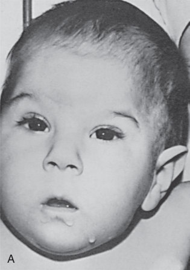

• Fig. 101.1 Congenital scoliosis may be manifested as torticollis. (A) Clinical photograph of a 1-year-old child with congenital cervical scoliosis. The chin is tilted toward the right and the occiput toward the left. (B) Radiographic views of the cervical spine in this patient show multiple hemivertebrae formation and an unsegmented congenital bar on the left side of the lower cervical spine. By convention, scoliosis films are viewed as if the examiner is facing the patient’s back.

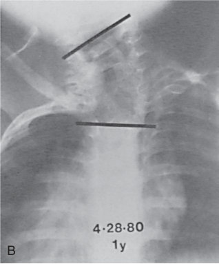

Unmatched source image; PDF page 2068. Consult the original caption.

## PDF page 2069 | printed page 2079

decreased active motion in the neonatal period, such as fracture of the clavicle or upper humerus and septic arthritis or osteomyelitis. The diagnosis can usually be established from a history of difficult delivery, physical examination, and radiographic evaluation of the upper limb and trunk.

The prognosis varies with the extent of damage to neural tissues. Up to 90% of patients with incomplete lesions involving the upper plexus can expect full recovery with no treatment. In general, these children recover biceps function within 1 month of life and quickly become normal. Patients with complete injuries or injuries of the lower plexus do not fare as well. Most recovery occurs within the first 3 months of life but continued slow improvement for up to 5 years after birth has been reported by Tada and colleagues for patients with complete injury.21 Partial recovery occurs in most cases. Surgical repair of the brachial plexus has been recommended by Waters for children who have no return of biceps function by 6 months of age.22 Compared with the natural history of the lesion, improved but not normal function is possible. Shoulder contracture and osseous deformity (nonspherical humeral heads and abnormal glenoids) are common in patients with birth palsies. They commonly occur in children who have incomplete recovery and are also seen in those who eventually have complete neurologic recovery if that recovery does not start within the first 3 weeks of life.23

Infants with nerve root avulsion have the worst prognosis; no motor recovery can be expected in such cases, although some sensory recovery may occur. Fortunately, avulsion injuries are uncommon. Surgical repair of infants without elbow flexion using ulnar and/or medial nerve fascicle transfers has demonstrated partial efficacy in infants with nerve root avulsion, late presentation, dissociative recovery, and failed nerve grafting.24

In most cases of neonatal brachial plexus palsy, no treatment is necessary. Abduction splinting of the limb in the first few months of life is unnecessary and may further complicate lower plexus injury. Gentle rangeof-motion exercises may be used to prevent adduction and internal rotation contracture. Infants with incomplete recovery may require later reconstructive surgery to minimize deformity and functional disability. In young children without fixed contractures and secondary bony deformities, tendon transfers may be used to balance asymmetric forces.18,25 In older children, humeral osteotomy is occasionally necessary to correct internal rotational deformity.26

### Fractures

Neonatal fractures usually involve the upper extremity, particularly the shoulder region, and are the result of a difficult delivery. Fractures of the lower extremity are less

common and may be indicative of an underlying neuromuscular disorder, especially those that limit joint mobility, such as arthrogryposis multiplex congenita. Fractures may also result from a bone disorder, such as osteogenesis imperfecta.

### Clavicle

Fractures of the clavicle are the most common type of fracture in neonates. The incidence of clavicular fractures ranges from 2 to 7 cases per 1000 live births. McBride and co-workers reported 9106 newborns prospectively screened for clavicular fracture.27 In this study, the risk factors included high birth weight, shoulder dystocia, and mechanically assisted delivery. Breech positioning was a factor in previous decades but not in this study. The liberal use of cesarean delivery appears protective. Of the 9106 babies reviewed, 1789 were delivered by cesarean section for various indications, including breech positioning. There were no clavicular fractures in these patients, although other authors have reported clavicular fractures after cesarean delivery.28

Fractures may be complete or incomplete (e.g., greenstick fracture). Complete fractures are more likely to be accompanied by classic symptoms and signs. Irritability and pseudoparalysis (e.g., decreased motion because of pain) of the involved limb are common. Discoloration, tenderness, and crepitation at the fracture site are common physical findings. Brachial plexus palsy, neonatal sepsis, traumatic separation of the proximal humeral epiphysis, humeral shaft fracture, and shoulder dislocation must be considered in the differential diagnosis.

The treatment of clavicular fracture is simple; asymptomatic patients with incomplete fractures need no immobilization. Symptomatic infants, usually those with complete fractures, should be treated. The treatment can include applying a figure-eight harness of gauze and tape or securing the affected arm to the chest with a bandage for 7 to 10 days. Pinning the sleeve of the infant’s shirt to the front is often sufficient. In larger infants an elastic bandage loosely applied around the chest and involved extremity after a cotton pad has been placed in the axilla can be useful.

Congenital pseudarthrosis of the clavicle is a rare condition that is distinguished from a neonatal clavicle fracture by the lack of birth trauma and the lack of healing callus on follow-up images. Isolated right-sided involvement is most common, with bilateral involvement less common and isolated left-sided involvement generally seen only in the context of dextrocardia. It is postulated that compression from the subclavian artery may explain the predilection for rightsided disease, and cervical ribs may account for bilateral disease. Congenital pseudarthrosis of the clavicle is generally asymptomatic in infants, with operative repair delayed until early childhood.

## PDF page 2070

### Long-Bone Fractures

Fractures of other long bones are occasionally seen after a difficult delivery. Fractures or separations of the proximal humeral epiphysis may occur with the same force that produces clavicular fracture and brachial plexus injury. Symptoms and signs may be similar; pseudoparalysis, swelling, pain on passive motion, and crepitation with shoulder joint motion are usually present. In contrast to the clavicle, the proximal humeral epiphysis is not ossified at birth, and routine radiography cannot demonstrate fracture or epiphyseal separation (Fig. 101.2). Ultrasonography can be used to establish the diagnosis in some cases, but most often the diagnosis is not confirmed until healing callus formation is seen radiographically 7 to 14 days later. Arthrography and magnetic resonance imaging can also be used to establish the diagnosis. When the diagnosis is confirmed soon after injury, the affected limb can be immobilized in a Velpeau bandage, although simply pinning the shirt to restrict motion is often adequate. Treatment is unnecessary if the diagnosis is delayed until callus formation has occurred. Scaglietti pointed out that late contractures of the shoulder in patients with fractures or separations resulting from a severely displaced proximal humerus may be difficult to distinguish from contractures caused by brachial plexus injury.16

Fractures of the humeral and femoral shafts occasionally occur during delivery or with the routine management of a premature infant or an infant with a severe metabolic or neurologic disorder. Such injuries are the result of an underlying weakness of the bone rather than traumatic handling, and accompanying soft tissue injury is rarely severe. Such fractures can usually be treated successfully with the application of a simple plaster splint until radiographic callus formation occurs. Spica casts can be used for fractures of the femur shaft, although in the infant, a Pavlik harness may simplify care without any delay in healing or additional deformity.29 The remodeling potential of the neonatal skeletal system is extraordinary, and long-term sequelae from long-bone fractures are not common.

Key Points

• Many neonatal musculoskeletal disorders are congenital

in origin. The 8 to 9 weeks is the embryonic period producing congenital malformations, whereas the remaining fetal period produces deformations and alterations of essentially normal parts. • Common embryonic period abnormalities include con-

genital spinal deformities, teratogenic limb and spinal malformations, and genetic disorders.

A

B

• Fig. 101.2 (A) Normal-appearing radiograph of the humerus in a female newborn who had pseudoparalysis and appeared to have pain with passive motion of the left shoulder. (B) Repeated radiograph 1 week later demonstrates subperiosteal new bone formation, indicating that there had been a traumatic separation of the proximal humeral epiphysis at delivery. The arm is now asymptomatic, and voluntary shoulder motion has returned.

• Common fetal period abnormalities include in utero

positioning problems (tibial torsion, metatarsus adductus, developmental dysplasia of the hip, torticollis), and trauma at birth producing brachial plexus injuries, and fractures, especially of the clavicle and proximal humeral metaphysis.

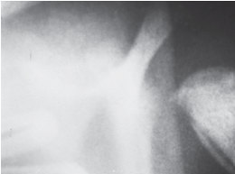

• Fig. 101.2 (A) Normal-appearing radiograph of the humerus in a female newborn who had pseudoparalysis and appeared to have pain with passive motion of the left shoulder. (B) Repeated radiograph 1 week later demonstrates subperiosteal new bone formation, indicating that there had been a traumatic separation of the proximal humeral epiphysis at delivery. The arm is now asymptomatic, and voluntary shoulder motion has returned.

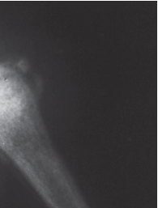

Unmatched source image; PDF page 2070. Consult the original caption.

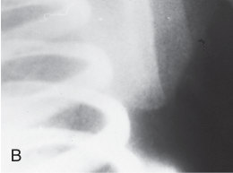

• Fig. 101.2 (A) Normal-appearing radiograph of the humerus in a female newborn who had pseudoparalysis and appeared to have pain with passive motion of the left shoulder. (B) Repeated radiograph 1 week later demonstrates subperiosteal new bone formation, indicating that there had been a traumatic separation of the proximal humeral epiphysis at delivery. The arm is now asymptomatic, and voluntary shoulder motion has returned.

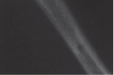

Unmatched source image; PDF page 2070. Consult the original caption.

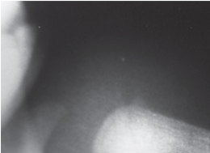

• Fig. 101.2 (A) Normal-appearing radiograph of the humerus in a female newborn who had pseudoparalysis and appeared to have pain with passive motion of the left shoulder. (B) Repeated radiograph 1 week later demonstrates subperiosteal new bone formation, indicating that there had been a traumatic separation of the proximal humeral epiphysis at delivery. The arm is now asymptomatic, and voluntary shoulder motion has returned.

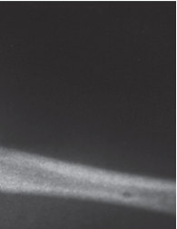

Unmatched source image; PDF page 2070. Consult the original caption.

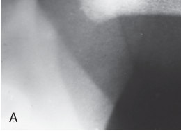

• Fig. 101.2 (A) Normal-appearing radiograph of the humerus in a female newborn who had pseudoparalysis and appeared to have pain with passive motion of the left shoulder. (B) Repeated radiograph 1 week later demonstrates subperiosteal new bone formation, indicating that there had been a traumatic separation of the proximal humeral epiphysis at delivery. The arm is now asymptomatic, and voluntary shoulder motion has returned.

Unmatched source image; PDF page 2070. Consult the original caption.

## PDF page 2071 | printed page 2081

### References

1. Fuller DJ, et al. The timed appearance of some congenital mal-

formations in orthopaedic abnormalities. Instr Course Lect. 1974;23:53. 2. Moore KL. The Developing Human: Clinically Oriented Embryol-

ogy. 4th ed. Philadelphia: Saunders; 1988. 3. McMaster MJ. Occult intraspinal anomalies and congenital sco-

liosis. J Bone Joint Surg Am. 1984;66:558. 4. Swanson AB, et al. Classification of limb malformations

on the basis of embryological failures. Surg Clin North Am. 1968;48:1169. 5. Ezaki M, Baek GH, Horii E, Hovius S. IFSSH Scientific

Committee on Congenital Conditions. J Hand Surg Eur. Vol. 2014;39(6):676–678. 6. Bae DS, Canizares MF, Miller PE, et al. Intraobserver and

interobserver reliability of the Oberg-Manske-Tonkin (OMT) classification: establishing a registry on congenital upper limb differences. J Pediatr Orthop. 2018;38(1):69–74. 7. Oberg KC, Feenstra JM, Manske PR, Tonkin MA. Developmen-

tal biology and classification of congenital anomalies of the hand and upper extremity. J Hand Surg Am. 2010;35(12):2066–2076. 8. Hootnick DR, Vargesson N. The syndrome of proximal femur,

fibula, and midline metatarsal long bone deficiencies. Birth Defects Res. 2018;110(15):1188–1193. 9. Minihane KP, et al. Developmental dysplasia of the hip in infants

with congenital muscular torticollis. Am J Orthop. 2008;37:E155. 10. Tien YC, et al. Ultrasonographic study of the coexistence of

muscular torticollis and dysplasia of the hip. J Pediatr Orthop. 2001;21:343. 11. Hummer CD, et al. The coexistence of torticollis and congenital

dislocation of the hip. J Bone Joint Surg Am. 1972;54:1255. 12. Davids JR, et al. Congenital muscular torticollis: sequela of intra-

uterine or perinatal compartment syndrome. J Pediatr Orthop. 1993;13:141. 13. Ballock RT, et al. The prevalence of nonmuscular causes of torti-

collis in children. J Pediatr Orthop. 1996;16:500. 14. Cheng JC, et al. Outcome of surgical treatment of congenital

muscular torticollis. Clin Orthop. 1999;362:190.

15. Morgan JA, Marcus PS. Prenatal diagnosis and management of

intrauterine fracture. Obstet Gynecol Surv. 2010;65(4):249–259. 16. Scaglietti O. The obstetrical shoulder trauma. Surg Gynecol

Obstet. 1938;66:868. 17. Wickstrom JL. Birth injuries of the brachial plexus: treatment of

defects in the shoulder. Clin Orthop. 1962;23:187. 18. Hoffer MM, et al. Brachial plexus birth palsies: results of tendon

transfers to the rotator cuff. J Bone Joint Surg Am. 1978;60:691. 19. DeFrancesco CJ, Shah DK, Rogers BH, Shah AS. The epide-

miology of brachial plexus birth palsy in the United States: declining incidence and evolving risk factors. J Pediatr Orthop. 2019;39(2):e134–e140. 20. Al-Qattan MM. Obstretric brachial plexus palsy associated with

breech delivery. Ann Plast Surg. 2003;51:257. 21. Tada K, et al. Birth palsy: natural recovery course and combined

root avulsion. J Pediatr Orthop. 1984;4:279. 22. Waters PM. Comparison of the natural history, the outcome

of microsurgical repair, and the outcome of operative reconstruction in brachial plexus birth palsy. J Bone Joint Surg Am. 1999;81:649. 23. Hoeksma AF, et al. Shoulder contracture and osseous defor-

mity in obstetrical brachial plexus injuries. J Bone Joint Surg. 2003;85A:316. 24. Little KJ, Zlotolow DA, Soldado F, et al. Early functional recov-

ery of elbow flexion and supination following median and/or ulnar nerve fascicle transfer in upper neonatal brachial plexus palsy. J Bone Joint Surg Am. 2014;96(3):215–221. 25. Van Egmond C, et al. Steindler flexorplasty of the elbow in obstet-

rical brachial plexus injuries. J Pediatr Orthop. 2001;21:169. 26. Kirkos JM, et al. Late treatment of brachial plexus palsy second-

ary to birth injuries: rotational osteotomy of the proximal part of the humerus. J Bone Joint Surg Am. 1998;80:1477. 27. McBride MT, et al. Newborn clavicle fractures. Orthopedics.

1998;17:317. 28. Hsu TY, et al. Neonatal clavicular fracture: clinical analysis of

incidence, predisposing factors, diagnosis, and outcome. Am J Perinatol. 2002;19:17. 29. Stannard JP, et al. Femur fractures in infants: a new therapeutic

approach. J Pediatr Orthop. 1995;15:461.

<!-- SOURCE_LAYOUT_VIEWS -->

## Original layout views and recovered diagrams

Automatic extraction can flatten tables and superscripts. Check the original layout for numeric data, footnotes and image credits. [Source review notes](../../SOURCE_REVIEW_NOTES.md).

### Original source page 2068

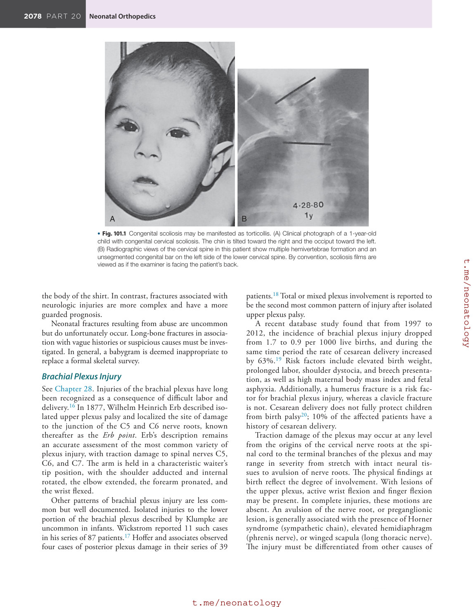

### Original source page 2070

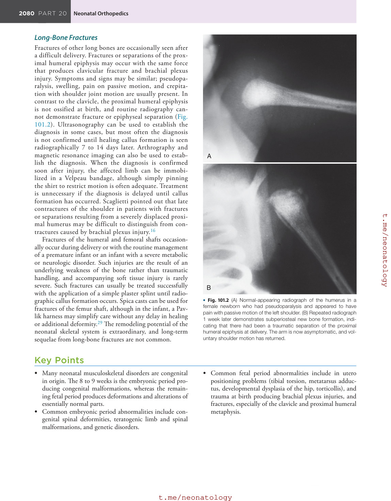
